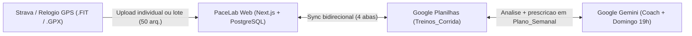

# PaceLab

Plataforma web full-stack para **corredores, praticantes de caminhada e candidatos a Testes de Aptidão Física (TAF)**, reunindo calculadoras de ritmo, planejador intervalado, diário de treinos com gasto calórico científico (**Compêndio 2024**), importação individual e em lote de telemetria **`.FIT` e `.GPX`** do Strava/Garmin, painel oficial de simulados (12 min + complementares), documentação interativa **OpenAPI/Swagger** e sincronização bidirecional com **Google Planilhas (`Treinos_Corrida`)** + fluxo fechado para **Google Gemini Coach**.

---

## Ecossistema e Principais Módulos



- **Painel Inicial (`/`), Calculadoras (`/calculadora`, `/taf`, `/metas`, `/intervalado`, `/historico`):** Quick Pace Widget, card de aderência semanal (`WeeklyAdherenceCard`), tática em pista de `400 m`, simulador intervalado com limitadores e Modo Pista, médias ponderadas e motores científicos (**Compêndio 2024** + **VO2 Máx de Cooper**).
- **Diário de Treinos & Analytics (`/treinos`):** cadastro manual com previsão calórica em tempo real, importação `.FIT`/`.GPX` individual e em massa (pareamento `.FIT + .GPX`, escolha única de destino e push consolidado), reconciliação em 2 passadas com `Plano_Semanal`, análise detalhada de parciais e dashboard com 6 KPIs, Heatmap de 12 semanas e 7 painéis (6 gráficos Recharts + Pirâmide RPE 80/20).
- **Meu TAF (`/meu-taf`) & Perfil Biométrico (`/perfil`):** régua visual de aprovação, exercícios complementares (Barra Fixa, Flexão e Abdominal com tempo opcional), comparador de períodos, backup/exportação JSON v3 & CSV seguro, cálculo de IMC (OMS), pesagem semanal automática (`WeeklyWeightModal`) e presets oficiais configuráveis **`PM-SP`, `PF`, `PRF` e `PMPR`**.
- **API Documentada (`/docs`):** interface Swagger UI em tema **Dark Performance Athletics** servida por OpenAPI 3.0.3 em `/api/docs/spec`, derivada automaticamente dos schemas Zod v4 (`z.toJSONSchema`).

---

## Stack Verificada (`package.json`)

- **Aplicação:** Next.js 14 (App Router), React 18, TypeScript 5
- **Dados & Persistência:** PostgreSQL (Supabase ou local) + Prisma ORM (`@prisma/client` / `prisma` v6), `localStorage` / `sessionStorage` para calculadoras e cache otimista SWR
- **Integrações & Telemetria:** `@googleapis/sheets` + `google-auth-library` (Service Account Base64 server-side), `@garmin/fitsdk` (`.FIT`), `fast-xml-parser` (`.GPX` anti-XXE)
- **Contratos, UI & Testes:** Zod 4, `swagger-ui-dist`, Tailwind CSS 3, Lucide Icons, Recharts, Vitest + React Testing Library + `@vitest/coverage-v8`

---

## Quickstart Local

1. **Instalar dependências** (também executa `prisma generate` via `postinstall`):
   ```bash
   npm install
   ```
2. **Configurar variáveis de ambiente:** copie [`.env.example`](.env.example) para `.env`, preenchendo `DATABASE_URL` e `DIRECT_URL` (e opcionalmente `GOOGLE_SHEETS_SPREADSHEET_ID` / `GOOGLE_CREDENTIALS_BASE64` conforme o [guia do Google Sheets e Gemini](docs/integrations/02_google_sheets_e_gemini_passo_a_passo.md)).
3. **Aplicar migrations e validar o banco:**
   ```bash
   npx prisma migrate deploy
   npm run db:check
   ```
4. **Subir o servidor de desenvolvimento:**
   ```bash
   npm run dev
   ```
   Acesse `http://localhost:3000` e a documentação OpenAPI em `http://localhost:3000/docs`.

---

## Principais Scripts (`package.json`)

| Comando | Finalidade |
|---|---|
| `npm run dev` / `npm run build` | Servidor de desenvolvimento e build de produção (`next build`) |
| `npm run lint` / `npx tsc --noEmit` | Análise estática ESLint e checagem estrita de tipos TypeScript |
| `npm test` / `npm run test:coverage` | Suíte Vitest e relatório V8 (metas `lines >= 90%`, `functions >= 90%` em `lib/**/*.ts`) |
| `npm run db:check` | Valida variáveis e conectividade SQL com `taf_goals`, `taf_attempts` e `training_sessions` |
| `npm run fit:inspect` / `npm run fit:test:synthetic` | CLI de inspeção `.FIT` e suíte das 10 fixtures sintéticas + mesclagem `.FIT + .GPX` |
| `npm run gpx:inspect` / `npm run gpx:test:synthetic` | CLI de inspeção `.GPX` e suíte das 20 fixtures XML sintéticas |

> Consulte todos os comandos, regras de migration na Vercel/Supabase e playbook de erros em [Testes, Deploy e Troubleshooting](docs/operations/01_testes_deploy_e_troubleshooting.md).

---

## Documentação Completa

O índice completo por perfil de leitor e o mapa de rotas estão em **[`docs/README.md`](docs/README.md)**:

- **Arquitetura & Contratos:** [Ecossistema dos 4 Pilares](docs/architecture/02_ecossistema_strava_pacelab_sheets_gemini.md) · [Modelo de Dados e APIs](docs/architecture/03_modelo_de_dados_e_apis.md) · [Padrões de Código e Design System](docs/architecture/04_padroes_de_codigo_e_design_system.md) · [Leitura `.FIT`/`.GPX` e Divergências Strava](docs/architecture/01_leitura_fit_gpx_e_divergencias_strava.md)
- **Integrações Externas:** [Exportação Strava e Classificação](docs/integrations/01_strava_exportacao_e_classificacao.md) · [Setup Google Cloud, Sheets (4 Abas) e Gemini Coach](docs/integrations/02_google_sheets_e_gemini_passo_a_passo.md)
- **Guias de Produto:** [Calculadoras e Motores Científicos](docs/features/01_calculadoras_e_motores_cientificos.md) · [Treinos, Aderência Semanal e Analytics](docs/features/02_treinos_e_dashboard_analitico.md) · [Meu TAF, Simulados e Perfil](docs/features/03_meu_taf_simulados_e_perfil.md)
- **Operações & Evolução:** [Testes, Deploy e Troubleshooting](docs/operations/01_testes_deploy_e_troubleshooting.md) · [Arquitetura e Padrões de Testes](docs/operations/02_arquitetura_e_padroes_de_testes.md) · [Roadmap de Melhorias](docs/roadmap/01_roadmap_melhorias_futuras.md)
