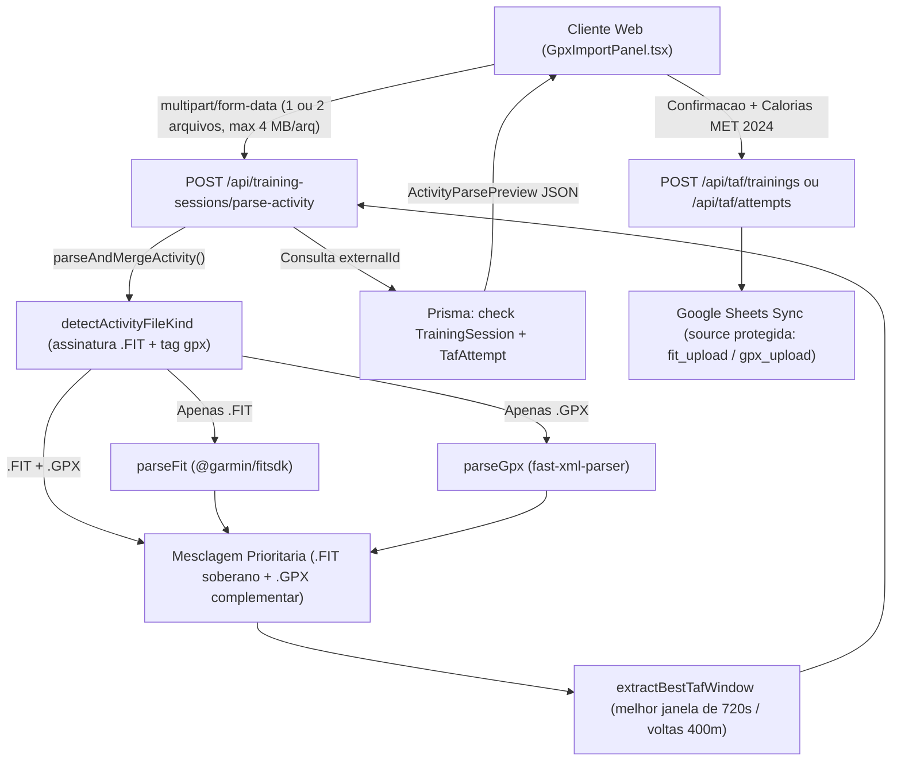

# Leitura de `.FIT` / `.GPX`, Mesclagem e Divergências com o Strava

> **Documentação Técnica de Arquitetura — PaceLab**
> Referência de código atualizada para o estado em produção pós-Planos 14 e 15 (parser prioritário `.FIT` + complemento `.GPX`, título por nome de arquivo, importação em lote de até 50 arquivos, proteção de telemetria no Google Sheets e conciliação com `Plano_Semanal`).

Este documento explica como o PaceLab ingere, valida, interpreta e mescla arquivos **`.FIT`** e **`.GPX`** para registrar treinos no Diário (`TrainingSession`) e Simulados de 12 minutos (`TafAttempt`), por que os números obtidos podem diferir dos exibidos na interface do Strava, qual abordagem é tecnicamente mais precisa e quais regras transversais governam o restante do sistema (calorias, Google Sheets, deduplicação e ferramentas de auditoria).

---

## 1. Visão Geral e Fluxo Ponta a Ponta

Todo o parsing de atividade é implementado em módulos **100% puros** (sem dependência de banco de dados, rede ou React), exposto por uma única rota de pré-visualização HTTP (`POST /api/training-sessions/parse-activity`) antes da persistência em `TrainingSession` ou `TafAttempt`.

### Contratos de Entrada na API de Parsing
- **Rota:** [`app/api/training-sessions/parse-activity/route.ts`](../../app/api/training-sessions/parse-activity/route.ts)
- **Limite por arquivo:** `MAX_ACTIVITY_FILE_BYTES = 4 * 1024 * 1024` (**4 MB**). Arquivos vazios retornam `422` (`EMPTY_FILE`); arquivos acima de 4 MB retornam `413` (`FILE_TOO_LARGE`).
- **Combinações aceitas:** `1 .FIT`, `1 .GPX`, ou `1 .FIT + 1 .GPX` da mesma atividade. Enviar mais de 2 arquivos na requisição HTTP retorna `422` (`TOO_MANY_FILES`); enviar dois `.FIT` ou dois `.GPX` simultaneamente é rejeitado pelo parser com `422` (`INVALID_FIT`).
- **Sugestão de modalidade (`resolveActivityTypeSuggestions`):**
  - `walk` → sugere `"caminhada"` (`allowedActivityTypes: ["caminhada"]`);
  - `run` → sugere `"corrida_continua"` (`allowedActivityTypes: ["rodagem_leve", "corrida_continua", "tempo_run", "corrida_intervalada", "longao"]`);
  - `unknown` → `suggestedActivityType: null`, liberando todas as opções de `ACTIVITY_TYPES`.
- **Origem do título sugerido (`titleSource`):**
  1. `"metadata"`: título extraído de dentro do arquivo (`session.workoutName` / `workoutMesgs[0].wktName` no `.FIT`, ou `<trk><name>` no `.GPX`);
  2. `"filename"`: fallback para o nome do arquivo enviado via `pickPreferredActivityTitleFromFileNames` ([`lib/activityParser/filenameTitle.ts`](../../lib/activityParser/filenameTitle.ts)), priorizando `.gpx` antes de `.fit`, convertendo `_` em espaço, removendo tags HTML/script e descartando nomes puramente numéricos (como IDs de exportação `1234567890.fit`);
  3. `null`: quando não há título aproveitável em metadados nem no nome do arquivo.

---

## 2. Pipeline de Leitura `.FIT` (`@garmin/fitsdk`)

Módulos principais: [`lib/fit/parseFit.ts`](../../lib/fit/parseFit.ts), [`lib/fit/movingMetrics.ts`](../../lib/fit/movingMetrics.ts) e [`lib/fit/types.ts`](../../lib/fit/types.ts).

### 2.1 Decodificação Binária e Sanitização de Registros
1. **Validação binária (`isFitBuffer`):** verifica a assinatura mágica `".FIT"` nos bytes `8..11` do cabeçalho e valida o stream via `Decoder.isFIT` do pacote `@garmin/fitsdk` (`^21.221.0`).
2. **Decodificação:** lê `sessionMesgs`, `lapMesgs`, `recordMesgs`, `workoutMesgs` e `eventMesgs` com `Stream.fromBuffer(buf)` e `new Decoder(stream).read()`.
3. **Normalização de `recordMesgs`:**
   - **Coordenadas GPS:** converte semicircles para graus decimais multiplicando por `SEMICIRCLES_TO_DEGREES = 180 / Math.pow(2, 31)`, rejeitando o valor sentinela `0x7fffffff` (`2147483647`).
   - **Altitude:** prioriza `enhancedAltitude` e usa `altitude` como fallback.
   - **Velocidade instantânea:** prioriza `enhancedSpeed` sobre `speed`, descartando amostras negativas ou acima de `FIT_MAX_VALID_SPEED_MS = 12.0` m/s (`43,2 km/h`).
   - **Frequência Cardíaca:** filtra pela faixa fisiológica `30` a `250` bpm (`MIN_VALID_HEART_RATE`..`MAX_VALID_HEART_RATE`).
   - **Cadência:** soma `cadence + fractionalCadence` quando positivo.
   - **Precisão GPS:** preserva `gpsAccuracy` (em metros) para descartar oscilações paradas com sinal degradado (`> FIT_MAX_GPS_ACCURACY_METERS = 50` m).
4. **Coalescência Temporal (`coalesceFitRecordsByTimestamp`):** aplicativos como o Strava Mobile frequentemente gravam mensagens alternadas no mesmo timestamp UTC (uma mensagem com `positionLat`/`positionLong`/`speed` e outra separada com `distance`/`heartRate`). O parser consolida mensagens de mesmo `timestampMs` antes de analisar passo, velocidade e pausa.

### 2.2 Modalidade, Indoor e Guarda de Plausibilidade
- `classifyFitSport` mapeia `sport` e `subSport`:
  - **Corrida (`run`):** `running`, `run`, `treadmill`, `indoor_running`, `street`, `trail`, `track`;
  - **Caminhada (`walk`):** `walking`, `walk`, `hiking`, `mountaineering`, `indoor_walking`, `casual_walking`, `speed_walking`;
  - **Desconhecida (`unknown`):** `generic`, `training` (emite aviso `UNKNOWN_ACTIVITY_TYPE`);
  - **Outras modalidades (`other`):** ciclismo, natação, remo etc. lançam erro `UNSUPPORTED_ACTIVITY` (`422`).
- **Detecção Indoor (`isIndoor`):** ativa quando `subSport` é `treadmill`, `indoor_running`, `indoor_walking`, `virtual_activity` ou `indoor_track`, ou quando não há coordenadas GPS válidas (`INDOOR_ACTIVITY_NO_GPS`).
- **Guarda de velocidade média:** o PaceLab exige velocidade média em movimento entre **`2,0 km/h`** e **`25,0 km/h`** (`MIN_AVG_MOVING_SPEED_KMH`..`MAX_AVG_MOVING_SPEED_KMH`), bloqueando registros de carro/bike mal categorizados como caminhada ou corrida.

### 2.3 Distância e Hierarquia de 3 Níveis para Tempo em Movimento
- **Distância total (`distanceKm`):** segue a ordem `session.totalDistance` → soma de `lapMesgs` → último `record.distance` válido, arredondando para **3 casas decimais** (`Number((totalDistanceM / 1000).toFixed(3))`), ou seja, precisão até o metro.
- **Tempo decorrido (`elapsedSeconds`):** `Math.max(durationSeconds, rawElapsedSec)` usando `session.totalElapsedTime` → soma de `lapMesgs` → intervalo do primeiro ao último `record` → `rawTimerSec`.
- **Tempo em movimento (`durationSeconds`) — Hierarquia de 3 níveis:**

| Nível | Condição no `.FIT` | Fonte usada para `durationSeconds` | Cenário típico |
| :--- | :--- | :--- | :--- |
| **1. Explícito** | `session.totalMovingTime` válido (ou soma de `lap.totalMovingTime`) | Valor oficial de movimento gravado no `.FIT` | Relógios GPS modernos (Garmin, Coros etc.) |
| **2. Auto-Pause de Relógio** | Ausência de `totalMovingTime`, porém `elapsed - timer >= 2s` **ou** eventos intermediários `timer stop/start` em `eventMesgs` (`hasExplicitTimerPauseEvents`) | `rawTimerSec` (`session.totalTimerTime` / `lapTotalTimerSec`) | Relógios com auto-pause ou pausa manual no botão |
| **3. Análise Física dos `recordMesgs`** | Ausência de `totalMovingTime`, `\|elapsed - timer\| < 2s`, série de alta frequência (`medianDtSec <= 5s` e `>= 9` passos), `movingTimeSec >= 10s` e (`validLaps <= 1` ou auto-laps uniformes de 1 km) | `rawTimerSec` descontado das pausas reais detectadas por velocidade + histerese | **App Strava Mobile** e gravadores contínuos sem auto-pause |

#### Como funciona a Histerese de Pausa no Nível 3 (`movingMetrics.ts`)
Para evitar penalizar paradas momentâneas ou ruído de 1–2 segundos de GPS:
1. Cada passo calcula a distância prioritariamente pelo odômetro nativo (`distanceM`) ou fallback Haversine (descartando saltos `> 12,0 m/s`).
2. A velocidade efetiva combina `speedMs`/`enhancedSpeed` com `deltaDistM / deltaTimeSec` (ignorando amostras de velocidade puramente GPS se `gpsAccuracyM > 50 m`).
3. Um passo é **candidato a parada** quando a velocidade fica abaixo do corte da modalidade:
   - **Corrida / desconhecida:** `< FIT_STOP_SPEED_THRESHOLD_RUN_MS` (**`0,85 m/s` ≈ `3,06 km/h`**);
   - **Caminhada:** `< FIT_STOP_SPEED_THRESHOLD_WALK_MS` (**`0,30 m/s` ≈ `1,08 km/h`**).
4. **Filtro anti-falso-positivo (`applyStopHysteresis`):** um intervalo parado só é confirmado como pausa real se a sequência contínua de candidatos a parada durar **`>= 3` segundos** (`FIT_PAUSE_HYSTERESIS_MIN_SECONDS = 3`) **e** não houver cadência ativa (`cadenceRaw > 0`). Quando o tempo parado descontado for `>= 5s`, o parser anexa o warning `PAUSES_DETECTED_FROM_RECORDS`.

### 2.4 Sensores, Elevação, Voltas e Parciais
- **Cadência (`avgCadence`):** lê `session.avgRunningCadence` ou `session.avgCadence` (+ `avgFractionalCadence`), com fallback pela média dos records. Se o valor bruto ficar abaixo de **`130`** (`CADENCE_SINGLE_FOOT_MAX`), é considerado cadência de um pé só (rpm) e multiplicado por 2 (`round(raw * 2)` spm totais), gerando o aviso `CADENCE_DOUBLED`.
- **Elevação (`elevationGainM`):** usa `session.totalAscent` se presente; caso contrário aplica `calculateElevationGain` (média móvel de 5 pontos + histerese de `2,0 m`) sobre `records`. Se continuar nulo, emite `NO_ELEVATION_DATA`.
- **Calorias do dispositivo (`activeCalories`):** lê `session.totalCalories` se `> 0`.
- **Voltas (`laps`) vs Parciais km a km (`splits`):**
  - `laps` preserva sempre as voltas reais gravadas no arquivo (`validLaps`).
  - Em treinos intervalados ou com múltiplas voltas heterogêneas, `splits` espelha `validLaps`.
  - Porém, quando há `< 2` voltas **ou** quando o arquivo traz apenas auto-laps uniformes de `1.000 ± 50 m` sem tempo parado descontado (`uniform1KmAutoLaps && detectedPausedSec > 0`), `shouldRebuildSplitsFromRecords` **reconstrói os splits de 1 km** via `motionStepsToSplitInputs` + `splitByDistance`. Passos marcados como pausa (`isMoving === false`) têm seu tempo excluído, mas sua distância eventual acumulada (`carriedPausedDistM`) é carregada para o próximo passo em movimento — garantindo que a soma das distâncias e durações das parciais feche exatamente com `distanceKm` e `durationSeconds`.
- **Deduplicação (`computeFitExternalId`):** gera `"fit_" + sha256("${normalizedIso}_${Math.round(distanceKm * 1000)}")`.

---

## 3. Pipeline de Leitura `.GPX` (`fast-xml-parser`)

Módulos principais: [`lib/gpx/parseGpx.ts`](../../lib/gpx/parseGpx.ts), [`lib/gpx/xml.ts`](../../lib/gpx/xml.ts), [`lib/gpx/geo.ts`](../../lib/gpx/geo.ts), [`lib/gpx/elevation.ts`](../../lib/gpx/elevation.ts), [`lib/gpx/metrics.ts`](../../lib/gpx/metrics.ts), [`lib/gpx/splits.ts`](../../lib/gpx/splits.ts), [`lib/gpx/externalId.ts`](../../lib/gpx/externalId.ts) e [`lib/gpx/types.ts`](../../lib/gpx/types.ts).

1. **Segurança e Parse XML (`parseGpxXml`):**
   - Remove BOM UTF-8, bloqueia explicitamente declarações `<!DOCTYPE|ENTITY|ATTLIST|ELEMENT|NOTATION>` contra vulnerabilidades **XXE / Billion Laughs**, valida sintaxe via `XMLValidator.validate` e parseia com `fast-xml-parser` (`processEntities: false`, `parseTagValue: false`).
   - Impõe teto de segurança `MAX_TRACKPOINTS_DEFAULT = 200.000` pontos e sanitiza textos livres (`<name>`, `<type>`) até 300 caracteres.
   - Lê extensões Garmin `TrackPointExtension` (`hr`, `cad` / `runcadence`, `atemp`, `power`).
2. **Classificação de Esporte (`classifyActivityType`):**
   - Reconhece texto ou código numérico Strava (ex.: `"9"` corrida, `"10"`/`"4"` caminhada/trilha) e bloqueia modalidades incompatíveis (`"1"`/`"17"`/`"18"` ciclismo, natação etc.) com `UNSUPPORTED_ACTIVITY`.
3. **Limpeza Geodésica e Filtro Anti-Jigging (`geo.ts`):**
   - Calcula distâncias pela fórmula de **Haversine** (`EARTH_RADIUS_METERS = 6.371.000 m`).
   - Ignora pontos com `deltaTimeSeconds <= 0` e descarta saltos de teletransporte (`rawSpeedMs > MAX_SPEED_SPIKE_MS = 12.0 m/s`), preservando o ponto âncora anterior para o próximo cálculo real.
   - **EMA Bidirecional Zero-Phase para caminhada lenta:** quando o trecho tem `>= 10` pontos (`GPS_SLOW_JITTER_MIN_POINTS`), `dt <= 3,0s` (`GPS_SLOW_JITTER_MAX_DT_SECONDS`) e velocidade instantânea `< 1,6 m/s` (`GPS_SLOW_JITTER_MAX_SPEED_MS`), aplica suavização Forward-Backward com `alpha = 0,62` (`GPS_SLOW_JITTER_EMA_ALPHA`). Isso atenua o "zigue-zague" lateral típico de GPS 1Hz em baixa velocidade sem introduzir atraso espacial.
   - **Detecção pontual de movimento:** classifica cada intervalo como em movimento quando `rawSpeedMs >=` **`0,894 m/s`** (~`3,22 km/h`) em corrida/`unknown`, ou **`0,32 m/s`** (~`1,15 km/h`) em caminhada. Diferente do `.FIT` mobile, não há janela de histerese multi-segundo porque o corte pontual somado à suavização EMA em caminhada já estabiliza os trechos parados.
4. **Elevação Suavizada (`elevation.ts`):** aplica média móvel centrada de janela **`5`** pontos (`ELEVATION_SMOOTHING_WINDOW`) e máquina de estados com histerese de **`2,0 m`** (`ELEVATION_HYSTERESIS_METERS`) para somar apenas subidas reais acima do ruído vertical do GPS.
5. **Métricas Ponderadas, Parciais e Sem Calorias XML (`metrics.ts`, `splits.ts`):**
   - `durationSeconds` é a soma arredondada dos segundos em movimento (`isMoving === true`); `distanceKm` prioriza `movingDistanceMeters` quando `> 0`.
   - Guarda de velocidade média idêntica (`2,0` a `25,0 km/h`).
   - `avgHeartRate` e `avgCadence` são calculados por **média ponderada pelo tempo em movimento** (`pair.movingTimeSeconds`). Valores de cadência `< 130` também recebem `×2` (`CADENCE_DOUBLED`).
   - **Exclusão intencional de calorias XML:** tags de calorias em `.GPX` são não-padronizadas e frequentemente inconsistentes; o parser de `.GPX` nunca importa calorias do arquivo.
   - **Parciais (`splitByDistance`):** interpola exatamente as fronteiras de `1.000 m` (tempo, elevação e FC ponderada), emitindo parcial final residual apenas se `>= 10 m` (`MIN_RESIDUAL_SPLIT_METERS`).
   - **Deduplicação (`computeGpxExternalId`):** gera `"gpx_" + sha256("${firstCanonical}|${lastCanonical}|${rawPointCount}")`.

---

## 4. Mesclagem Prioritária `.FIT + .GPX` e Extração Derivada

Quando o atleta envia `.FIT` e `.GPX` juntos na mesma importação, [`lib/activityParser/parseAndMergeActivity.ts`](../../lib/activityParser/parseAndMergeActivity.ts) une o rigor dos sensores/odômetro do `.FIT` com os metadados de rede/terreno do `.GPX`.

### 4.1 Matriz de Prioridade (`.FIT` Soberano + `.GPX` Complementar)

| Atributo | Fonte Soberana | Regra de Complemento / Fallback |
| :--- | :--- | :--- |
| **`source` & `externalId`** | `.FIT` (`"fit_upload"`, `fit_<sha256>`) | `.GPX` é ignorado para `externalId` evitando duplicação se reimportado depois só com `.FIT` |
| **Distância, Tempo em Movimento, Tempo Decorrido, Pace, Velocidade** | `.FIT` | Sem sobrescrita pelo `.GPX` |
| **FC (média/máx), Cadência, Temperatura, Calorias dispositivo, `laps`** | `.FIT` | Sem sobrescrita pelo `.GPX` |
| **Coerência do par** | `.FIT` + `.GPX` | Se `\|fit.startedAt - gpx.startedAt\| > 5 min` (`300.000 ms`), emite aviso `MISMATCHED_ACTIVITY_FILES` |
| **Título (`name`)** | `.FIT` (`workoutName`/`wktName`) | Se ausente/vazio no `.FIT`, adota `<trk><name>` do `.GPX` (`NAME_MERGED_FROM_GPX`) |
| **Ganho de Elevação (`elevationGainM`)** | `.FIT` (`totalAscent`) | Se `null` ou `0` no `.FIT` e `> 0` no `.GPX`, usa `gpx.elevationGainM` (`ELEVATION_MERGED_FROM_GPX`) |
| **Elevação por parcial (`splits[i].elevationDiffM`)** | `.FIT` | Se splits do `.FIT` estiverem sem elevação (ou zerados com elevação vinda do `.GPX`), e comprimentos/distâncias forem compatíveis (`<= max(0.25, fitDist * 15%)` total e `<= 0.25 km`/split), transfere os `elevationDiffM` do `.GPX` |
| **Modalidade (`sourceActivityKind`)** | `.FIT` | Se `.FIT` vier como `"unknown"` (`generic`/`training`), adota `"run"` ou `"walk"` do `.GPX` |
| **Janela TAF 12 min (`tafWindow`)** | `.FIT` | Fallback para `gpx.tafWindow` se ausente no `.FIT` |

### 4.2 Extração Automática de Simulado TAF (`extractBestTafWindow`)
Em [`lib/activityParser/window.ts`](../../lib/activityParser/window.ts), o parser executa uma janela deslizante (*two-pointer*) de até **`720` segundos (12 minutos)** (`DEFAULT_TAF_WINDOW_SECONDS = 720`) sobre a série cumulativa tempo × distância (`samplesFromFitRecords` ou amostras GPX):
- Identifica o trecho contínuo de 12 minutos com a **maior distância percorrida** (ideal quando o atleta fez aquecimento antes ou volta à calma depois do tiro de 12 min).
- Gera automaticamente sub-parciais a cada **`400 m`** (`DEFAULT_TAF_LAP_METERS = 400`) e calcula `bestDistanceMeters`, `paceFormatted`, `speedKmh`, `qualified` (comparando se a atividade durou pelo menos o tempo da janela) e `coverageWarning` caso haja lacunas grandes.

### 4.3 Cálculo de Calorias: Compêndio 2024 vs Dispositivo
Ao salvar no Diário pela interface ([`components/treinos/GpxImportPanel.tsx`](../../components/treinos/GpxImportPanel.tsx)), quando há **peso corporal válido (`bodyWeightKg`)**, o PaceLab prioriza o cálculo científico de calorias totais e calorias ativas pelo **Compêndio de Atividades Físicas de 2024** (Herrmann et al., [`lib/math/calories.ts`](../../lib/math/calories.ts)) em vez de aceitar automaticamente o valor bruto do dispositivo:
- Interpola linearmente o **MET** entre os nós oficiais de caminhada (`17151`..`17230`, `3,2` a `7,5 km/h`) ou corrida (`12020`..`12140`, `6,0` a `>= 19,3 km/h`).
- Fórmulas:
  - `Calorias Totais = (MET * 3.5 * pesoKg * duracaoMin) / 200`
  - `Calorias Ativas = ((MET - 1) * 3.5 * pesoKg * duracaoMin) / 200`
- Só utiliza `activeCalories` do `.FIT` (`session.totalCalories`) quando o peso do usuário não está disponível — pois relógios/celulares adotam algoritmos proprietários heterogêneos que frequentemente somam gasto basal como se fosse ativo ou divergem drasticamente entre fabricantes.

---

## 5. Por que `.FIT` e `.GPX` Divergem do Strava?

Muitos atletas comparam o arquivo importado no PaceLab com a tela do aplicativo/site do Strava e notam pequenas diferenças em distância, tempo em movimento e ganho de elevação. Essas diferenças têm causas técnicas exatas — observadas diretamente nos arquivos reais do projeto.

### 5.1 Estudo de Caso Real Auditado: `Caminhada_leve` (`2026-10-29T20:24:17.000Z`)

Comparação direta executada no repositório entre a tela oficial do Strava Web, o arquivo original `.FIT` baixado do Strava Mobile (`/export_original`) e o `.GPX` re-exportado pelo Strava:

| Métrica | Tela do Strava (UI) | `parseFit` (`.FIT` original) | `parseGpx` (`.GPX` Strava) | Causa Técnica da Diferença |
| :--- | :--- | :--- | :--- | :--- |
| **Distância** | `2,84 km` | **`2,849 km`** | `2,835 km` | Strava trunca na 2ª casa (`2,849` → `2,84`); `.FIT` usa odômetro nativo e `.GPX` recalcula Haversine após filtragem EMA |
| **Tempo em Movimento** | `35:26` (`2.126 s`) | **`34:12` (`2.052 s`)** | `34:03` (`2.043 s`) | `.FIT` mobile veio sem `totalMovingTime`/`auto-pause` (`2.140–2.141 s` em timer); Strava aplica algoritmo proprietário (`15 s` parado) vs corte físico transparente PaceLab (`0,30`/`0,32 m/s` + histerese `3s`, descontando `89 s` no `.FIT`) |
| **Tempo Decorrido** | `35:41` (`2.141 s`) | **`35:41` (`2.141 s`)** | **`35:41` (`2.141 s`)** | **100% idêntico** nas três fontes |
| **Ganho de Elevação (D+)** | `17 m` | `11 m` (`session.totalAscent`) | **`18 m`** | Strava substitui altitude GPS bruta (`11 m`) pelo **DEM** (*Digital Elevation Model*) no servidor e exporta esse terreno corrigido no `.GPX` |
| **Parciais (1 km)** | `~2,84 km` | `#1 09:38 (-2m)`, `#2 13:24 (+4m)`, `#3 0.849km 11:10 (+0m)` | Equivalentes (`578+804+670 = 2052s` no FIT) | Reconstrução por `recordMesgs` com desconto proporcional de pausas e conservação de distância (`carriedPausedDistM`) |

### 5.2 Os 6 Mecanismos Reais de Divergência

1. **O "`.FIT` Original" vem pré-processamento Strava; o `.GPX` vem pós-processamento:**
   Quando você baixa o `.FIT` original no Strava Web, recebe os bytes exatos enviados pelo celular ou relógio **antes** de o servidor do Strava rodar seus filtros fechados na nuvem. Já o `.GPX` é gerado dinamicamente pelo Strava **depois** do processamento do servidor (com altitude DEM injetada e timestamp/coordenadas re-serializadas).
2. **Smartphone (Strava Mobile) vs Relógio GPS (Garmin/Coros/Polar):**
   Relógios dedicados normalmente gravam `totalMovingTime` ou eventos explícitos de `auto-pause` dentro do `.FIT` — nesses casos o Nível 1 ou Nível 2 do PaceLab reproduz quase identicamente o tempo do relógio. Já o app Strava Mobile grava `totalTimerTime ≈ totalElapsedTime` sem `totalMovingTime` e sem eventos de pausa, alternando pacotes de GPS e odômetro no mesmo segundo. Como o detector de pausa na nuvem do Strava usa limiares fechados proprietários, o algoritmo transparente do PaceLab (`0,30 m/s` em caminhada / `0,85 m/s` em corrida + histerese `>= 3s`) pode divergir em alguns segundos em caminhadas bem lentas ou paradas breves.
3. **Altimetria GPS bruta vs Modelo Digital de Elevação (DEM):**
   Smartphones sem barômetro calibrado registram altitude GPS ruidosa (`11 m` no `.FIT` acima). O Strava consulta uma base cartográfica global (DEM) para corrigir a elevação exibida (`17 m`) e grava essa altitude suavizada dentro do `<ele>` do `.GPX` (`18 m` após média móvel 5 pts + histerese `2,0 m` no PaceLab). Por isso, enviar `.FIT + .GPX` juntos permite manter a precisão do `.FIT` enquanto corrige o D+ quando `totalAscent` é nulo ou zero.
4. **Truncagem visual de distância no Strava:**
   Na UI, o Strava frequentemente **trunca** em vez de arredondar na 2ª casa decimal (`2,849 km` aparece como `2,84 km`). O PaceLab preserva **3 casas decimais (`2,849 km`)** — diferença crucial em Simulados TAF de 12 minutos, onde 9 metros a menos ou a mais podem alterar a nota na tabela do edital.
5. **Odômetro Fused vs Haversine 1Hz:**
   No `.FIT`, o odômetro interno combina GPS e acelerômetro/pedômetro para registrar `distance` acumulada mesmo sob copas de árvores ou curvas fechadas (`2,849 km`). O `.GPX` só possui latitudes/longitudes discretas; mesmo com suavização EMA (`alpha = 0,62`), o recálculo ponto a ponto em caminhada lenta tende a ficar cerca de `~0,5%` menor (`2,835 km`).
6. **Fechamento exato das parciais:**
   Arquivos `.FIT` sem `totalMovingTime` trazem auto-laps de 1 km com tempo bruto. O PaceLab descarta auto-laps brutos nesses casos e reconstrói as parciais a partir dos `recordMesgs` descontando exatamente os mesmos intervalos de pausa do resumo geral — garantindo consistência matemática (`Σ parciais = tempo em movimento total`).

### 5.3 Resposta Direta: Tentar "Imitar" o Strava ou Manter a Lógica Atual?
**O comportamento atual do PaceLab é o mais preciso, transparente e indicado para o projeto.** Tentar engessar os parsers para reproduzir exatamente os números da tela do Strava exigiria adivinhar heurísticas fechadas (limiares ocultos por velocidade, DEM privado não disponível offline e truncagem artificial de metros).

O desenho atual já combina o melhor cenário possível:
- **`.FIT` como fonte principal:** preserva odômetro real, sensores nativos (FC, cadência, temperatura, voltas estruturadas) e `totalMovingTime` de relógios GPS sem perda.
- **`.GPX` como complemento opcional (ou fallback):** fornece título legível (`<trk><name>`) e elevação corrigida por terreno quando o `.FIT` vier sem esses campos.
- **Precisão até o metro e histerese explícita:** garante reprodutibilidade determinística para acompanhamento de evolução física e avaliação TAF.

---

## 6. Outros Detalhes Relevantes para o Projeto

### 6.1 Proteção de Telemetria no Google Sheets (`lib/googleSheets/syncService.ts`)
Treinos e simulados importados via arquivo recebem `source = "fit_upload"` ou `source = "gpx_upload"`. A função `isProtectedTelemetrySource(source)` protege esses registros durante sincronizações `pull` vindas da planilha:
- **Campos protegidos contra edição manual na planilha:** distância, duração em movimento, velocidade, pace, FC média/máxima, elevação, cadência, calorias de telemetria e datas técnicas.
- **Campos liberados para edição livre na planilha e trazidos no `pull`:**
  - Em treinos (`TrainingSession`): `activityType`, `perceivedEffort` (PSE), `bodyWeightKg`, `shoeName` e `notes`;
  - Em simulados TAF (`TafAttempt`): `locationType` e `notes`.
Isso evita que fórmulas ou alterações acidentais na planilha corrompam métricas auditadas de arquivos `.FIT`/`.GPX`.

### 6.2 Deduplicação Independente (`TrainingSession` × `TafAttempt`)
- A rota `POST /api/training-sessions/parse-activity` verifica o mesmo `externalId` nas **duas** tabelas separadamente, retornando `alreadyExists` (`existingTrainingId`) e `alreadyExistsAttempt` (`existingAttemptId`).
- Assim, o atleta pode importar uma corrida de prova como **Treino no Diário** e também registrar sua melhor janela de 12 minutos como **Simulado TAF** sem que um bloqueie o outro, mantendo proteção estrita contra duplicidade dentro de cada tabela (erro `409 Conflict` na gravação padrão).
- **Importação em Massa (Plano 14):** no fluxo em lote implementado em [`docs/plans/executed/14_plan_importacao_em_massa_fit_gpx.md`](../plans/executed/14_plan_importacao_em_massa_fit_gpx.md), a fila também detecta `externalId` repetido **entre os próprios arquivos do mesmo lote** (ex.: arquivos renomeados com conteúdo idêntico) e espelha Simulado TAF para o Diário de forma resiliente com isolamento por erro (`buildSafeMirroredDiaryPayload`) sem criar cópias órfãs em falhas parciais.

### 6.3 Limites de Segurança e Validação Zod (`lib/validations/taf.ts`)
Mesmo após passar pelo parser, toda gravação no backend passa pelos contratos Zod:
- **HTTP Parse:** `4 MB` por arquivo; `<= 200.000` trackpoints no `.GPX`; proteção contra XXE e sanitização XSS em nomes/notas.
- **Diário (`TrainingSession`):** `distanceKm` entre `0.05` e `100` km; `durationSeconds` entre `30` e `86.400` s (24h); exige `elapsedSeconds >= durationSeconds`.
- **Simulado TAF (`TafAttempt`):** `distanceMeters` entre `100` e `10.000` m; `actualDurationSeconds` entre `30` e `7.200` s (2h).

### 6.4 Boas Práticas Operacionais ao Exportar do Strava
- **Preferir `.FIT` original:** no Strava Web, use **Exportar Original** (`.FIT`, endpoint `/export_original` — ver também [`__tests__/fixtures/fit/README.md`](../../__tests__/fixtures/fit/README.md)) em vez de baixar apenas `.GPX`, principalmente para atividades indoor/esteira, treinos intervalados ou treinos gravados com relógio/cinta cardíaca.
- **Quando enviar `.FIT + .GPX` juntos:** sempre que a gravação vier do app Strava Mobile com título personalizado importante ou em percursos com subidas relevantes onde o `totalAscent` bruto do aparelho esteja zerado/subestimado.
- **Atenção ao Fuso Horário:** tanto `.FIT` quanto `.GPX` armazenam timestamps internos em **UTC** (`...Z`). O PaceLab preserva o instante UTC no banco e utiliza o fuso `America/Fortaleza` no agrupamento semanal (`toFortalezaDateKey` em [`lib/math/weeklyAdherence.ts`](../../lib/math/weeklyAdherence.ts)) e na sincronização com o Google Sheets (`formatDateFortaleza` em [`lib/googleSheets/mapper.ts`](../../lib/googleSheets/mapper.ts) e `formatSheetsSyncBadge` em [`lib/sheetsSyncUi.ts`](../../lib/sheetsSyncUi.ts)) — veja detalhes em [`03_modelo_de_dados_e_apis.md`](./03_modelo_de_dados_e_apis.md#3-contrato-de-datas-e-fuso-horário-americafortaleza).

### 6.5 Ferramentas CLI de Diagnóstico e Regressão (`package.json`)
Para depurar divergências numéricas em qualquer arquivo real antes de alterar constantes de corte ou histerese:

| Comando | Finalidade |
| :--- | :--- |
| `npm run fit:inspect -- ./arquivo.fit --splits` | Inspeciona saída completa de `parseFit`, pausas detectadas, warnings e splits km a km |
| `npm run gpx:inspect -- ./arquivo.gpx --splits` | Inspeciona saída completa de `parseGpx`, suavização, elevação e splits km a km |
| `npm run fit:test:synthetic` | Valida suíte determinística de cenários sintéticos `.FIT` (auto-pause, mobile, indoor, cadência ×2, intervalados) |
| `npm run fit:test:real` | Executa regressão contra arquivos reais em `__tests__/fixtures/fit/` |
| `npm run gpx:test:synthetic` | Valida suíte sintética `.GPX` (XXE, EMA caminhada lenta, spikes GPS, elevação) |
| `npm run gpx:test:real` | Valida arquivos reais e referências em `__tests__/fixtures/gpx/` |

### 6.6 Navegação Cruzada
- **Passo a passo de usuário (Strava Web, importação individual/lote e classificação):** [`01_strava_exportacao_e_classificacao.md`](../integrations/01_strava_exportacao_e_classificacao.md)
- **Ecossistema Strava → PaceLab → Sheets (4 abas, incl. conciliação automática com `Plano_Semanal`) → Gemini:** [`02_ecossistema_strava_pacelab_sheets_gemini.md`](./02_ecossistema_strava_pacelab_sheets_gemini.md)
- **Schema PostgreSQL (6 tabelas), persistência híbrida e contratos de API REST:** [`03_modelo_de_dados_e_apis.md`](./03_modelo_de_dados_e_apis.md)
