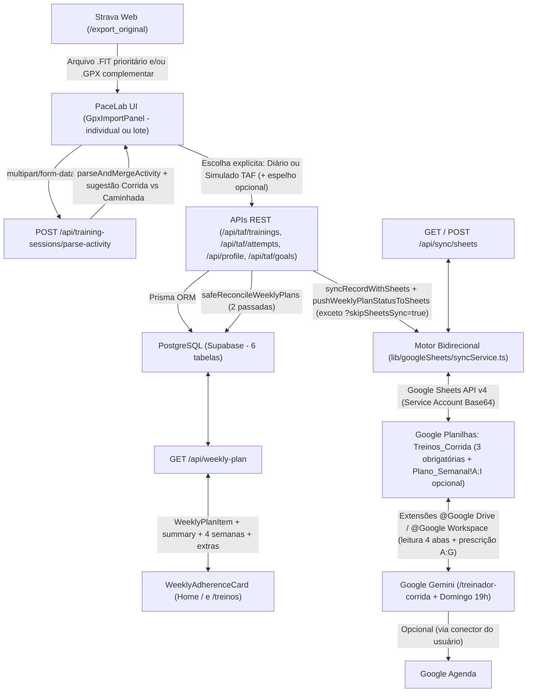

# Arquitetura do Ecossistema PaceLab: Strava + PaceLab + Google Planilhas + Gemini

Este documento é a **referência canônica de arquitetura e integração** entre os quatro pilares do ecossistema PaceLab: captura de telemetria no **Strava**, processamento e persistência no **PaceLab** (`Next.js` + `PostgreSQL/Prisma`), ponte bidirecional no **Google Planilhas (`Treinos_Corrida`)** e inteligência aplicada via **Google Gemini** (treinador interativo e rotina semanal autônoma).

> [!NOTE]
> Este documento consolida a arquitetura viva da branch `main` pós-Plano 15, mantendo fidelidade estrita aos contratos do schema Prisma, endpoints REST e regras reais de sincronização com a planilha de 4 abas (`Log_Treinos`, `Simulados_TAF`, `Perfil_e_Metas` e `Plano_Semanal`).

---

## 1. Status Atual em Produção (`main`)

| Bloco | Status no Repositório (`main`) | Referência |
|---|---|---|
| Exportação/Parser `.FIT` prioritário + `.GPX` complementar + Lote (até 50 arquivos) | **Em Produção** | [`01_leitura_fit_gpx_e_divergencias_strava.md`](./01_leitura_fit_gpx_e_divergencias_strava.md) |
| Banco PostgreSQL (Supabase + Prisma) com **6 modelos** (`TrainingSession`, `TafAttempt`, `TafGoal`, `UserProfile`, `WeightRecord`, **`WeeklyPlanItem`**) | **Em Produção** | [`03_modelo_de_dados_e_apis.md`](./03_modelo_de_dados_e_apis.md) / [`prisma/schema.prisma`](../../prisma/schema.prisma) |
| Sync bidirecional Google Sheets API v4 em **3 abas obrigatórias** (`Log_Treinos`, `Simulados_TAF`, `Perfil_e_Metas`) | **Em Produção** | [`lib/googleSheets/syncService.ts`](../../lib/googleSheets/syncService.ts) |
| **4ª aba opcional `Plano_Semanal!A:I`**, modelo `WeeklyPlanItem`, reconciliação local em 2 passadas (`Planejado` / `Concluído` / `Parcial` / `Perdido`), write-back seletivo `H:I`, `GET /api/weekly-plan`, `GET /api/taf/trainings/[id]` e `WeeklyAdherenceCard` | **Em Produção (Plano 15)** | [`15_plan_sincronizacao_plano_semanal_e_aderencia.md`](../plans/executed/15_plan_sincronizacao_plano_semanal_e_aderencia.md) |
| Skill `/treinador-corrida` e Tarefa Agendada no Gemini (ciclo fechado lendo aderência + prescrição para `Plano_Semanal`) | **Em Uso (Configuração Externa no Gemini)** | [Seção 6 deste documento](#6-pilar-4--google-gemini-treinador-pessoal-interativo--tarefa-agendada) |

---

## 2. Visão Geral da Arquitetura (Fluxo Ponta a Ponta)



---

## 3. Pilar 1 — Strava (Telemetria Bruta `.FIT` e `.GPX`)

### 3.1. Como exportar corretamente do Strava
O aplicativo mobile do Strava não expõe o arquivo original. A extração deve ser feita pelo **Strava Web**:
1. Acesse a atividade desejada (`https://www.strava.com/activities/<ID>`).
2. Abra o menu **`...` → Exportar Original** (atalho direto: `/export_original` ao final da URL).
3. Se o navegador baixar `.fit.gz`, descompacte antes do envio (ex.: `gzip -d treino.fit.gz`).
4. Atividades gravadas por relógios esportivos (Garmin, Coros, Polar, Amazfit etc.) costumam gerar `.FIT` binário; gravações feitas diretamente pelo app do celular costumam gerar `.GPX`. O botão padrão **"Exportar GPX"** do Strava também serve como fonte complementar ou alternativa.

### 3.2. Papel de cada formato no parser (`parseAndMergeActivity`)
O parser unificado em [`lib/activityParser/parseAndMergeActivity.ts`](../../lib/activityParser/parseAndMergeActivity.ts) suporta envio isolado (`.FIT` ou `.GPX`) ou pareado (`.FIT + .GPX` da mesma atividade):

- **`.FIT` (Fonte Prioritária de Telemetria):**
  - Extrai distância em metros/km pelo odômetro do dispositivo, tempo real em movimento vs. tempo decorrido (`elapsedSeconds`), pace médio, velocidade média, FC média/máxima, cadência (normalizada para `spm`), elevação acumulada (`totalAscent`), parciais (`splits`) e voltas (`laps`), temperatura média (`avgTemperatureC`), indicação indoor/esteira sem GPS (`isIndoor`), melhor janela TAF contínua (`tafWindow`) e hash `SHA-256` determinístico (`externalId`) para deduplicação.
  - Caso o `.FIT` não possua título interno, o PaceLab extrai um título legível a partir do nome do arquivo via `extractActivityTitleFromFilename` ([`lib/activityParser/filenameTitle.ts`](../../lib/activityParser/filenameTitle.ts)).
- **`.GPX` (Fonte Complementar ou Alternativa):**
  - Quando enviado junto ao `.FIT`, o sistema valida a proximidade dos horários iniciais (tolerância máxima de 5 minutos, emitindo alerta `MISMATCHED_ACTIVITY_FILES` se exceder) e complementa automaticamente apenas os campos que faltarem no `.FIT`:
    1. **Nome da atividade** (`<trk><name>` → aviso `NAME_MERGED_FROM_GPX`);
    2. **Ganho de elevação total** (`elevationGainM`, quando vier nulo ou `0` no `.FIT` → aviso `ELEVATION_MERGED_FROM_GPX`) e **desnível por split** (`elevationDiffM`);
    3. **Modalidade de origem** (`sourceActivityKind`), se o `.FIT` vier como `"unknown"`;
    4. **Janela TAF (`tafWindow`)** como fallback, caso o `.FIT` não tenha conseguido calculá-la.
  - Se houver divergência entre a modalidade do `.FIT` e a do `.GPX`, mantém-se a prioridade do `.FIT` com aviso `ACTIVITY_TYPE_MISMATCH`.

### 3.3. Classificação Corrida vs. Caminhada e Destino Explícito
- **Sugestão inteligente de modalidade** ([`lib/activityParser/activitySuggestion.ts`](../../lib/activityParser/activitySuggestion.ts)): a API `POST /api/training-sessions/parse-activity` retorna `sourceActivityKind` (`"run" | "walk" | "unknown"`), `suggestedActivityType` e `allowedActivityTypes`, combinando tags esportivas do arquivo, palavras-chave no nome/arquivo (`caminhada`, `walk`, `corrida`, `longao` etc.) e faixas de velocidade/cadência via `resolveActivityTypeSuggestions` e `resolveDefaultActivityTypeFromPreview`.
- **Escolha explícita de destino na UI** ([`components/treinos/GpxImportPanel.tsx`](../../components/treinos/GpxImportPanel.tsx)):
  - **Não** existe envio automático para `Simulados_TAF` só porque um treino durou 12 minutos ou mais.
  - Na importação individual ou em lote, **o usuário define o destino** (`Diário de Treinos` ou `Simulado TAF`). Ao importar como `Simulado TAF`, há uma opção de **espelhamento** para registrar também a sessão correspondente no `Diário de Treinos` (cujo salvamento no Diário participa automaticamente da reconciliação do `Plano_Semanal`).
  - O parser sempre calcula e exibe a prévia da janela `tafWindow` (melhor janela contínua de 12 min ou duração configurada no edital) para facilitar esse lançamento quando o treino for realmente um simulado.
- **Importação em Lote (Plano 14):** suporta múltiplos arquivos até o limite de **50 arquivos** (máximo **4 MB por arquivo**), agrupa pares `.FIT + .GPX` (com opção de separar em 2 treinos), detecta duplicados pelo `externalId` (no banco e dentro do próprio lote) e salva cada item com `?skipSheetsSync=true`, disparando **uma única sincronização consolidada** com o Google Sheets ao final do lote (incluindo atualização de `Plano_Semanal!H:I`).

> Para aprofundamento em tolerâncias vs. tela do Strava, cálculo de *moving time*, deduplicação e ferramentas de CLI (`npm run fit:inspect`, `npm run gpx:inspect`), consulte [`01_leitura_fit_gpx_e_divergencias_strava.md`](./01_leitura_fit_gpx_e_divergencias_strava.md).

---

## 4. Pilar 2 — PaceLab (Aplicação Web Full-Stack & Banco PostgreSQL)

### 4.1. Stack Verificada (`package.json`)
- **Framework:** Next.js `14.2.35` (App Router) + React `18` + TypeScript `^5`
- **Persistência e ORM:** PostgreSQL (Supabase) via Prisma ORM (`@prisma/client@^6.19.3`)
- **Validação e API Docs:** Zod (`^4.6.6`) e OpenAPI/Swagger em `/docs` (`/api/docs/spec`)
- **Gráficos e Parsing:** Recharts (`^2.12.7`), `@garmin/fitsdk` (`^21.221.0`), `fast-xml-parser` (`^5.12.1`)
- **Integração Google:** `@googleapis/sheets` (`^14.0.0`) e `google-auth-library` (`^10.9.1`)

### 4.2. Enums Oficiais do Banco (`prisma/schema.prisma`)

Qualquer integração (API, Sheets ou IA) deve respeitar os enums exatos definidos em [`prisma/schema.prisma`](../../prisma/schema.prisma):

- **`ActivityType` (`activity_type`, 6 valores exatos):**
  - `rodagem_leve`
  - `corrida_continua`
  - `tempo_run`
  - `corrida_intervalada`
  - `longao`
  - `caminhada`
  > **Atenção:** `"teste_taf"` e `"simulado_taf"` **não** pertencem ao enum `ActivityType`. No `pull` de `Log_Treinos` e `Plano_Semanal`, ambos são aceitos como *aliases* em `ACTIVITY_ALIAS_MAP` ([`lib/math/weeklyAdherence.ts`](../../lib/math/weeklyAdherence.ts)) e normalizados para `tempo_run`, mas o PaceLab sempre persiste e exporta `tempo_run`.
- **`ActivitySource` (`activity_source`, 4 valores):** `manual`, `gpx_upload`, `fit_upload`, `sheets`.
- **`LocationType` (`location_type`, 5 valores):** `pista_400m`, `rua_plana`, `parque_praca`, `esteira`, `outro`.

### 4.3. Modelos Persistidos e Motores Científicos
- **6 tabelas ativas no PostgreSQL** (detalhadas na íntegra em [`03_modelo_de_dados_e_apis.md`](./03_modelo_de_dados_e_apis.md)):
  1. `TrainingSession` (`training_sessions`): diário de treinos com telemetria, RPE, `splits`, gasto calórico e vínculo reverso opcional `weeklyPlanItem`.
  2. `TafAttempt` (`taf_attempts`): simulados cronometrados com parciais de 400 m em `laps` (`Json`).
  3. `TafGoal` (`taf_goals`): meta oficial do edital (corrida e provas complementares de barra fixa, flexão e abdominal — estas últimas mantidas apenas no banco/UI).
  4. `UserProfile` (`user_profiles`): dados biométricos do atleta.
  5. `WeightRecord` (`weight_records`): histórico temporal de pesagens.
  6. `WeeklyPlanItem` (`weekly_plan_items`): itens prescritos da 4ª aba `Plano_Semanal` com vínculo `1:1` opcional (`matchedSessionId @unique`, `onDelete: SetNull`) para `TrainingSession`. *(Plano 15)*
- **Cálculo de gasto calórico ([`lib/math/calories.ts`](../../lib/math/calories.ts)):** utiliza o **Compêndio de Atividades Físicas de 2024** com interpolação linear contínua por velocidade (`COMPENDIUM_WALKING_NODES` e `COMPENDIUM_RUNNING_NODES`), calculando `totalCalories = (MET * 3.5 * pesoKg * duracaoMin) / 200` e `activeCalories` com `MET - 1` (também segmentado em intervalados via `calcIntervalCalories`).
- **VO2 Máx no TAF ([`lib/math/cooper.ts`](../../lib/math/cooper.ts)):** fórmula clássica de Cooper `VO2 Máx = (distância_em_metros - 504.9) / 44.73`, com matriz de classificação por idade e sexo biológico.

---

## 5. Pilar 3 — Google Planilhas (`"Treinos_Corrida"`) — Contrato Técnico e Sync

### 5.1. Autenticação e Variáveis de Ambiente
Configuradas em [`lib/env.ts`](../../lib/env.ts) e consumidas por [`lib/googleSheets/client.ts`](../../lib/googleSheets/client.ts):

```env
GOOGLE_SHEETS_SPREADSHEET_ID="<SEU_SPREADSHEET_ID>"
GOOGLE_CREDENTIALS_BASE64="<JSON_DA_SERVICE_ACCOUNT_EM_BASE64>"
```

**Regras e resiliência do conector:**
- Nunca versione IDs reais da sua planilha pessoal nem credenciais JSON/Base64 em arquivos versionados.
- `GOOGLE_SHEETS_SPREADSHEET_ID` aceita tanto o **ID puro** quanto a **URL completa** `/spreadsheets/d/<ID>/` (extraído via regex no servidor).
- `GOOGLE_CREDENTIALS_BASE64` deve conter o JSON de uma **Conta de Serviço (Service Account)** do Google Cloud codificado em Base64 em linha única. O parser normaliza espaços e `\n` escapados na `private_key`.
- A planilha `"Treinos_Corrida"` no Google Drive deve estar explicitamente compartilhada como **Editor** com o `client_email` dessa Service Account.
- Escopo OAuth utilizado: `https://www.googleapis.com/auth/spreadsheets`.
- O cliente mantém cache em memória por assinatura (`spreadsheetId::client_email::private_key`) e aplica retry exponencial curto (`withSheetsRetry`, padrão `maxRetries = 2`, `baseDelayMs = 250`) apenas para erros transitórios HTTP `429` e `503`.

### 5.2. Estrutura Exata das 4 Abas (`3` Obrigatórias + `1` Opcional)

Definida em `SHEET_TABS`, `SHEET_RANGES` e `SHEET_HEADERS` em [`lib/googleSheets/mapper.ts`](../../lib/googleSheets/mapper.ts). O motor verifica e cria automaticamente abas/cabeçalhos faltantes das 3 abas obrigatórias via `ensureSpreadsheetSchema`; já a 4ª aba `Plano_Semanal` é **opcional** (se ausente ou vazia, `pullWeeklyPlanFromSheets` retorna `sheetMissingOrEmpty: true` sem lançar erro).

#### Aba 1 (Obrigatória): `Log_Treinos` (`Log_Treinos!A:O` — 15 colunas)

| Coluna | Cabeçalho Exato (`SHEET_HEADERS.LOG_TREINOS`) | Formato Exportado (Push) | Regras de Leitura / Validação (Pull) |
|---|---|---|---|
| **A** | `ID` | UUID do registro em `TrainingSession` | Vazio = cria novo registro (`source: "sheets"`) e preenche o UUID de volta na planilha (*writeback*). |
| **B** | `Data` | `YYYY-MM-DD` (fuso `America/Fortaleza`) | Aceita `YYYY-MM-DD` ou `DD/MM/YYYY` (parseado para meio-dia UTC). |
| **C** | `Origem` | `manual`, `gpx_upload`, `fit_upload`, `sheets` | Fallback `"sheets"` se inválido na leitura. |
| **D** | `Tipo` | Um dos 6 valores de `ActivityType` | Aceita aliases em `ACTIVITY_ALIAS_MAP` (ex.: `"rodagem leve"`, `"teste taf"` → `tempo_run`); fallback `"corrida_continua"` com warning. |
| **E** | `Distância (km)` | Número com 2 casas decimais (`toFixed(2)`) | Aceita vírgula (`pt-BR`) ou ponto (`en-US`). Limite `0.05` a `100` km (armazenado com até 3 casas no banco). |
| **F** | `Tempo Mov.` | `HH:MM:SS` | Aceita `HH:MM:SS`, `MM:SS` ou segundos puros positivos (`parseSheetDurationSeconds`). Limite `30` s a `86400` s (24h). |
| **G** | `Pace Médio (min/km)` | Apóstrofo + `MM:SS` (ex.: `'05:30`) | Recalculado no pull a partir de Distância + Tempo Mov. |
| **H** | `FC Média` | Inteiro bpm ou `""` | Inteiro entre `30` e `250`. |
| **I** | `FC Máx` | Inteiro bpm ou `""` | Inteiro entre `30` e `250` (se `< FC Média`, ajusta para `FC Média` com warning). |
| **J** | `Elevação (m)` | Inteiro (`Math.round`) ou `""` | Número entre `0` e `10000`. |
| **K** | `Cadência` | Inteiro spm ou `""` | Inteiro entre `30` e `300`. |
| **L** | `RPE (1-10)` | Inteiro `1..10` ou `""` | Inteiro entre `1` e `10`. |
| **M** | `Peso (kg)` | Número kg ou `""` | Número entre `30` e `250` kg (2 casas decimais). |
| **N** | `Tênis` | Texto sanitizado (máx. 100 chars) | Remove prefixo anti-fórmula `'` quando importado de volta. |
| **O** | `Observações` | Texto sanitizado (máx. 1000 chars) | Sanitização anti-Formula Injection aplicada no envio ao Sheets. |

#### Aba 2 (Obrigatória): `Simulados_TAF` (`Simulados_TAF!A:J` — 10 colunas)

| Coluna | Cabeçalho Exato (`SHEET_HEADERS.SIMULADOS_TAF`) | Formato Exportado (Push) | Regras de Leitura / Validação (Pull) |
|---|---|---|---|
| **A** | `ID` | UUID do registro em `TafAttempt` | Vazio = cria novo `TafAttempt` e escreve o UUID de volta na coluna A. |
| **B** | `Data` | `YYYY-MM-DD` (fuso `America/Fortaleza`) | Aceita `YYYY-MM-DD` ou `DD/MM/YYYY`. |
| **C** | `Local` | `pista_400m`, `rua_plana`, `parque_praca`, `esteira`, `outro` (ou `""`) | Normaliza aliases comuns (`"pista"`, `"rua"`, `"parque"`, `"esteira"`) via `LOCATION_ALIAS_MAP`. |
| **D** | `Tempo Alvo (s)` | Inteiro em segundos (ex.: `720`) | Aceita segundos puros positivos, `HH:MM:SS` ou `MM:SS`; limite `30` a `7200` s (fallback `720` s se vazio/fora). |
| **E** | `Tempo Real (s)` | Inteiro em segundos | Obrigatório (`parseSheetDurationSeconds`: segundos puros positivos, `HH:MM:SS` ou `MM:SS`) entre `30` e `7200` s. |
| **F** | `Distância (m)` | Inteiro em metros | Obrigatório entre `100` e `10000` m. |
| **G** | `Pace (min/km)` | Apóstrofo + `MM:SS` | Recalculado no pull a partir de distância/tempo. |
| **H** | `Vel. (km/h)` | Número com 2 casas (`toFixed(2)`) | Recalculada no pull. |
| **I** | `Status Meta` | Texto informativo: `Meta Segurança Atingida`, `Aprovado (Mínimo)` ou `Abaixo do Mínimo` | Apenas informativo (derivado de `TafGoal`, não altera o banco no pull). |
| **J** | `Observações` | Texto sanitizado (máx. 1000 chars) | Importado de volta removendo proteção de apóstrofo se presente. |

#### Aba 3 (Obrigatória): `Perfil_e_Metas` (`Perfil_e_Metas!A2:I2` — Linha única, 9 colunas)

Espelha um snapshot consolidado do perfil e da meta de corrida para leitura instantânea pela IA (fluxo **PostgreSQL → Sheets**; metas complementares de barra, flexão e abdominal permanecem apenas no PostgreSQL):

- **A:** `Nome` (máx. 100 chars)
- **B:** `Idade` (calculada de `UserProfile.birthDate`)
- **C:** `Altura (cm)`
- **D:** `Peso Atual (kg)` (`resolveCurrentWeightKg` compara o `WeightRecord` mais recente com `UserProfile.updatedAt`, exportado com 2 casas decimais)
- **E:** `Edital Alvo` (padrão `"Edital Padrão"`, máx. 120 chars)
- **F:** `Distância Mínima (m)` (padrão `2400`)
- **G:** `Distância Alvo (m)` (padrão `2600` no mapper / `2300` no fallback inicial da API quando não há registro salvo)
- **H:** `Tempo Prova (min)` (padrão `12`)
- **I:** `Data Prova` (`YYYY-MM-DD` preservado via `formatCalendarDateForSheet`)

#### Aba 4 (Opcional, Ativa): `Plano_Semanal` (`Plano_Semanal!A:I` — 9 colunas)

Aba introduzida pelo **Plano 15** para fechar o ciclo entre a prescrição (IA/planilha) e o executado (`Log_Treinos`):

| Coluna | Cabeçalho Exato (`SHEET_HEADERS.PLANO_SEMANAL`) | Direção | Regras de Leitura, Normalização e Escrita |
|---|---|---|---|
| **A** | `ID` | Sheets → DB | Identificador externo único da prescrição (`planExternalId`, padrão sugerido `PLAN-YYYY-MM-DD-N`). Obrigatório (exceto linhas de descanso ignoradas antes). IDs duplicados na planilha geram warning e a cópia subsequente é ignorada. |
| **B** | `Data` | Sheets → DB | Data prevista (`plannedDate`). Aceita `YYYY-MM-DD` ou `DD/MM/YYYY` via `parseSheetDate` (meio-dia UTC). Obrigatória. |
| **C** | `Dia da Semana` | Sheets → DB | Texto livre (até 30 chars); se vazio, é preenchido automaticamente em português (`Segunda`..`Domingo`) via `getFortalezaWeekdayLabel(plannedDate)`. |
| **D** | `Tipo` | Sheets → DB | Prescrição da atividade. Se for palavra-chave de descanso (`descanso`, `rest`, `off`, `folga`, `repouso`, `day_off`, `dia_de_descanso`, `dia_livre`), a linha retorna `kind: "rest"`, é descartada sem warnings e **não** entra como `"Perdido"`. Demais valores tentam normalização em `normalizePlanActivityType`; se vazio assume `"corrida_continua"` com warning; se desconhecido preserva o texto com warning. |
| **E** | `Distância Alvo (km)` | Sheets → DB | Aceita formato pt-BR (vírgula) e en-US (ponto), arredondado para 3 casas. Células vazias, zero (`0`), placeholders neutros (`-`, `--`, `—`, `n/a`, `na`, `tempo`) e valores inválidos/negativos são tratados como treino por tempo (`null`). |
| **F** | `Pace Alvo (min/km)` | Sheets → DB | Normalizado por `parseWeeklyPlanTargetPace`: remove apóstrofo inicial e sufixos (`/km`, `min/km`), corrige serial `:00` e preserva faixas como `"5:45-6:00"` ou `"5:45–6:00"`. |
| **G** | `Descrição / Observação` | Sheets → DB | Texto sanitizado (máx. 500 chars). |
| **H** | `Status` | DB → Sheets (`H:I`) | Valores canônicos: `"Planejado"`, `"Concluído"`, `"Parcial"`, `"Perdido"`. Atualizado exclusivamente pelo write-back do PaceLab. |
| **I** | `ID Treino Realizado` | DB → Sheets (`H:I`) | UUID da `TrainingSession` conciliada (`matchedSessionId`) ou vazio (`""`). |

### 5.3. Motor Bidirecional, Endpoints, Proteções e Reconciliação Semanal

- **Endpoints ([`app/api/sync/sheets/route.ts`](../../app/api/sync/sheets/route.ts)):**
  - `GET /api/sync/sheets`: consulta leve local sem consumir quota da Google API; retorna `{ configured, error?, pendingTrainingsCount, pendingAttemptsCount, totalPendingCount }`.
  - `POST /api/sync/sheets`: aceita `{ direction?: "bidirectional" | "push" | "pull", forceFullResync?: boolean }` e retorna `SheetsSyncReport` com contadores de treinos, simulados, `profileSynced`, `weeklyPlan` (`imported`, `updated`, `removed`, `matched`, `missed`, `pushed`, `sheetMissingOrEmpty`), `warnings`, `durationMs` e `syncedAt`. Mapeia falhas upstream para HTTP `429`, `502` e `503`.
- **Auto-Sync Síncrono em Mutações ([`lib/api/sheetsSync.ts`](../../lib/api/sheetsSync.ts)):**
  - Criação, edição ou exclusão de treinos, simulados, metas, perfil e pesagens executam `await` de `safeReconcileWeeklyPlans` (quando aplicável), `syncRecordWithSheets` / `safeAutoSync` e `pushWeeklyPlanStatusToSheets` **antes** de responder ao cliente.
  - Pode ser contornado por requisição com `?skipSheetsSync=true` (`shouldSkipSheetsSync`) em importações em lote e restauração de backup JSON, executando a reconciliação local normalmente e deixando a chamada ao Google Sheets consolidada para o final.
- **Proteções Críticas no `pull` (`syncService.ts` + `mapper.ts`):**
  1. **`isProtectedTelemetrySource` (`fit_upload` / `gpx_upload`):** quando um registro veio de `.FIT`/`.GPX`, edições na planilha só podem atualizar campos editoriais/subjetivos (`activityType`, `perceivedEffort`, `bodyWeightKg`, `shoeName`, `notes` em treinos; `locationType`, `notes` em simulados). Campos de sensor são preservados intactos.
  2. **`shouldProtectDirtyLocalRecord` (`DIRTY_TOLERANCE_MS = 2000`):** registros editados localmente ainda pendentes de push (`updatedAt - syncedToSheetsAt > 2000 ms`) não são sobrescritos por um `pull`.
  3. **Anti-Ressurreição:** linhas em `Log_Treinos` ou `Simulados_TAF` com UUID na coluna `A` que não existem mais no PostgreSQL são ignoradas com warning em vez de recriarem registros já excluídos.
  4. **Anti-Formula Injection (`sanitizeSheetText`):** textos iniciando com `=`, `+`, `-`, `@`, `\t` ou `\r` recebem apóstrofo protetor `'` na escrita para a planilha.
- **Regras Puras da Reconciliação de `Plano_Semanal` ([`lib/math/weeklyAdherence.ts`](../../lib/math/weeklyAdherence.ts) & [`lib/googleSheets/syncService.ts`](../../lib/googleSheets/syncService.ts)):**
  1. **Importação e limpeza segura de planos regenerados (`pullWeeklyPlanFromSheets`):** importa novas prescrições (`A:G`) com status inicial `"Planejado"`, atualiza apenas itens com divergência na prescrição (`hasWeeklyPlanPrescriptionDivergence`) e remove planos que sumiram da planilha **somente quando não possuem `matchedSessionId` nem status `"Concluído"` ou `"Parcial"`** (removendo `"Planejado"` órfãos ou `"Perdido"` dentro de uma semana recém-reimportada).
  2. **Revalidação pós-`PUT` / `DELETE` (`reconcileWeeklyPlansWithSessions` + `evaluateLinkedSessionValidity`):** executa 100% localmente no PostgreSQL com transação atômica (duas fases de escrita para evitar colisão no índice único `matched_session_id` e retry para `P2002`/`P2025`). Quando uma sessão editada via `PUT` (`editedSessionId`) passa a dividir a mesma data de Fortaleza com outro plano livre, libera temporariamente o vínculo em memória para recomparar competitivamente na Passada 1. Quando o vínculo deixa de atender às regras ou a sessão é excluída (`onDelete: SetNull`), o plano reverte para `"Planejado"` ou `"Perdido"` antes de rodar nova reconciliação.
  3. **Algoritmo de Reconciliação em 2 Passadas (`computeWeeklyReconciliation`):**
     - **Compatibilidade biomecânica:** agrupa os 5 tipos de corrida na família `"run"` e `caminhada` na família `"walk"` (`arePlanActivitiesCompatible`), priorizando match exato de modalidade (`isExactPlanActivityMatch`) e menor `|session.distanceKm - targetDistanceKm|`.
     - **Corte mínimo e critério de status (`evaluateWeeklyMatch`):**
       - Se `targetDistanceKm` for ausente ou `<= 0` (treino prescrito por tempo) → `"Concluído"`;
       - `ratio = sessionDistanceKm / targetDistanceKm`:
         - `ratio >= 0.85` → `"Concluído"`;
         - `0.40 <= ratio < 0.85` → `"Parcial"`;
         - `ratio < 0.40` → inelegível (`null`, evita vínculo falso com aquecimentos curtos).
     - **Passada 1:** somente mesmo dia civil em `America/Fortaleza` (`dayDiff === 0`).
     - **Passada 2:** tolerância `|dayDiff| === 1` (`±1 dia`), **bloqueada** sempre que o dia da sessão já possui qualquer plano ativo registrado (`occupiedPlanDateKeys`).
     - **Planos não pareados:** recebem `"Perdido"` estritamente quando `plannedDate < ontem` em Fortaleza (`computeUnmatchedPlanStatus`), ou permanecem `"Planejado"` para ontem, hoje e futuro.
  4. **Write-back Seletivo (`pushWeeklyPlanStatusToSheets`) e Orquestração (`syncWithGoogleSheets`):**
     - Atualiza via `spreadsheets.values.batchUpdate` **somente as colunas `H:I`** das linhas cujo `(status, matchedSessionId)` no banco divergir do snapshot atual na planilha (`valueInputOption: "USER_ENTERED"` em lotes de até `200`).
     - Chamada automática nas 3 direções de `syncWithGoogleSheets`:
       - `"pull"`: `pullChangesFromSheets` → `pullWeeklyPlanFromSheets` → `reconcileWeeklyPlansWithSessions` → `pushWeeklyPlanStatusToSheets`;
       - `"push"`: `syncHistoricalDataToSheets` → `reconcileWeeklyPlansWithSessions` → `pushWeeklyPlanStatusToSheets`;
       - `"bidirectional"`: `pullChangesFromSheets` → `pullWeeklyPlanFromSheets` → `reconcileWeeklyPlansWithSessions` → `syncHistoricalDataToSheets` → `pushWeeklyPlanStatusToSheets`.

---

## 6. Pilar 4 — Google Gemini (Treinador Pessoal Interativo + Tarefa Agendada)

Com a aba `Plano_Semanal` em produção, o Gemini opera em **ciclo fechado** com o PaceLab através da planilha `"Treinos_Corrida"`:

1. **Treinador Pessoal Interativo (`/treinador-corrida`):** consultas sob demanda para analisar treinos específicos, explicar sensações/RPE, recalibrar pace para calor ou vento, ajustar treinos da semana já listados em `Plano_Semanal`, controlar rodízio de tênis e simular estratégia de prova do TAF.
2. **Análise Autônoma Semanal (Tarefa Agendada — ex.: Domingo às 19h):** lê as 4 abas (`Perfil_e_Metas`, `Log_Treinos`, `Simulados_TAF` e `Plano_Semanal`) para comparar **o que foi prescrito vs. o que foi `Concluído` / `Parcial` / `Perdido`**, checar progressão de volume (~10–15%), RPE, cadência e desgaste de tênis, gerando o diagnóstico da semana e as linhas estruturadas da semana seguinte prontas para `Plano_Semanal!A:G`.

### 6.1. Pré-requisitos de Configuração no Gemini
1. Ativar a extensão/conector **`Google Workspace`** (`@Google Drive` / Google Planilhas) nas configurações da conta Gemini com acesso à planilha `"Treinos_Corrida"`.
2. (Opcional) Ativar **`@Google Calendar`**, caso queira criar lembretes de treino na agenda durante os chats ou na rotina dominical.
3. **Permissão e escrita em `Plano_Semanal`:** se o conector da sua conta Gemini operar apenas em **leitura**, gere a tabela semanal no formato exato de `Plano_Semanal!A:I` na resposta para colar na planilha; caso utilize escrita/automação autorizada pelo usuário, preencha **somente as colunas `A:G`** (com `H = "Planejado"` e `I` vazio) e **nunca altere linhas de semanas passadas já marcadas como `Concluído` ou `Parcial`**.

### 6.2. Template Placeholder-Safe de Instruções (Pós-Plano 15)

Substitua os marcadores `[PREENCHER ...]` apenas dentro da interface do Gemini — nunca salve dados pessoais ou IDs privados no código do repositório:

```markdown
Você é meu Treinador Pessoal de Corrida e Preparação Física para o TAF (Teste de Aptidão Física).
Seu papel é atuar como coach técnico e preventivo de lesões, analisando meus dados reais na planilha do Google Drive chamada "Treinos_Corrida".

## CONTEXTO DO ATLETA (Personalizar no Gemini)
- Planilha fonte: "Treinos_Corrida" (Google Drive) — ID: [PREENCHER_SEU_SPREADSHEET_ID_OPCIONAL]
- Objetivo principal: [PREENCHER_EX: TAF 2.400m em 12 min — concurso / prova alvo]
- Histórico de cuidados físicos / lesões: [PREENCHER_EX: monitoramento de canelite e tornozelo; progressão conservadora]
- Calçado(s) principal(is): [PREENCHER_EX: Nome do tênis e limite de km para alerta de troca]

## CONTRATO DAS 4 ABAS DA PLANILHA "Treinos_Corrida"
1. **Aba `Perfil_e_Metas` (linha 2):** contém `Nome`, `Idade`, `Altura (cm)`, `Peso Atual (kg)`, `Edital Alvo`, `Distância Mínima (m)`, `Distância Alvo (m)`, `Tempo Prova (min)` e `Data Prova`.
2. **Aba `Log_Treinos`:** contém os treinos executados (`ID`, `Data`, `Origem`, `Tipo`, `Distância (km)`, `Tempo Mov.`, `Pace Médio (min/km)`, `FC Média`, `FC Máx`, `Elevação (m)`, `Cadência`, `RPE (1-10)`, `Peso (kg)`, `Tênis`, `Observações`).
   - Valores válidos de `Tipo` no PaceLab:
     `rodagem_leve` | `corrida_continua` | `tempo_run` | `corrida_intervalada` | `longao` | `caminhada`
   - Nota: simulados espelhados no Diário aparecem tipicamente como `tempo_run`.
3. **Aba `Simulados_TAF`:** contém as tentativas cronometradas (`ID`, `Data`, `Local`, `Tempo Alvo (s)`, `Tempo Real (s)`, `Distância (m)`, `Pace (min/km)`, `Vel. (km/h)`, `Status Meta`, `Observações`).
   - Valores válidos de `Local`: `pista_400m` | `rua_plana` | `parque_praca` | `esteira` | `outro`.
4. **Aba `Plano_Semanal` (`A:I`):** conecta prescrição e execução (`ID`, `Data`, `Dia da Semana`, `Tipo`, `Distância Alvo (km)`, `Pace Alvo (min/km)`, `Descrição / Observação`, `Status`, `ID Treino Realizado`).
   - Use IDs únicos no padrão `PLAN-YYYY-MM-DD-N` (ex.: `PLAN-2026-11-16-1`).
   - Para dias livres, use `Tipo = Descanso` (sem metas obrigatórias).
   - Para treinos por tempo sem distância fixa, deixe `Distância Alvo (km)` como `-`.
   - Deixe `Status` como `Planejado` e `ID Treino Realizado` vazio para o PaceLab preencher automaticamente após a conciliação.

## REGRAS DE ANÁLISE E SEGURANÇA
- Nunca altere linhas em `Log_Treinos`, `Simulados_TAF`, `Perfil_e_Metas` ou linhas antigas de `Plano_Semanal` cujo `Status` já seja `Concluído` ou `Parcial`.
- Avalie primeiro a aderência real da semana atual em `Plano_Semanal` (`Concluído`, `Parcial`, `Perdido`) e cruze com treinos extras em `Log_Treinos`.
- Calcule o volume semanal (segunda a domingo) e verifique saltos > 10–15% frente à semana anterior.
- Cruze `Pace Médio (min/km)`, `FC Média`, `Cadência` e `RPE (1-10)` buscando fadiga ou sobrecarga mecânica.
- Some a quilometragem acumulada por `Tênis` para alertar desgaste.

## FORMATO DA ROTINA SEMANAL (Domingo às 19h ou quando solicitado)
1. Resumo da semana (volume realizado vs. prescrito, taxa de aderência em `Plano_Semanal`, RPE médio, km do tênis).
2. Análise fisiológica, biomecânica e evolução frente à meta em `Simulados_TAF`.
3. Prescrição da próxima semana estruturada como tabela pronta para `Plano_Semanal!A:I` (`ID`, `Data`, `Dia da Semana`, `Tipo`, `Distância Alvo (km)`, `Pace Alvo (min/km)`, `Descrição / Observação`, `Status = Planejado`, `ID Treino Realizado = ""`).
```

---

## 7. Referências no Repositório

- Parser e divergências Strava: [`01_leitura_fit_gpx_e_divergencias_strava.md`](./01_leitura_fit_gpx_e_divergencias_strava.md)
- Schema de dados, fuso horário e APIs REST: [`03_modelo_de_dados_e_apis.md`](./03_modelo_de_dados_e_apis.md) / [`prisma/schema.prisma`](../../prisma/schema.prisma)
- Reconciliação semanal e aderência: [`lib/math/weeklyAdherence.ts`](../../lib/math/weeklyAdherence.ts)
- Cliente, ambiente e mapeamento Google Sheets: [`lib/env.ts`](../../lib/env.ts), [`lib/googleSheets/client.ts`](../../lib/googleSheets/client.ts), [`lib/googleSheets/mapper.ts`](../../lib/googleSheets/mapper.ts), [`lib/googleSheets/syncService.ts`](../../lib/googleSheets/syncService.ts)
- Rotas de API e UI associadas: [`app/api/sync/sheets/route.ts`](../../app/api/sync/sheets/route.ts), [`app/api/weekly-plan/route.ts`](../../app/api/weekly-plan/route.ts), [`app/api/training-sessions/parse-activity/route.ts`](../../app/api/training-sessions/parse-activity/route.ts), [`components/dashboard/WeeklyAdherenceCard.tsx`](../../components/dashboard/WeeklyAdherenceCard.tsx)
- Plano histórico do incremento semanal: [`15_plan_sincronizacao_plano_semanal_e_aderencia.md`](../plans/executed/15_plan_sincronizacao_plano_semanal_e_aderencia.md)
