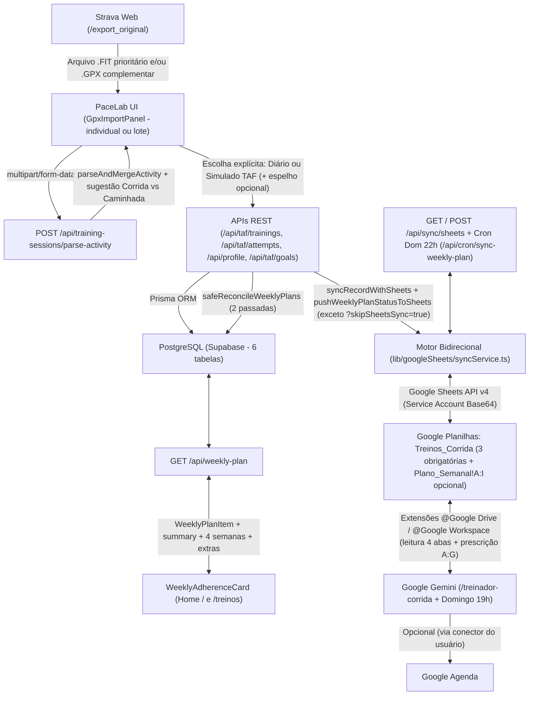

# Arquitetura do Ecossistema PaceLab: Strava + PaceLab + Google Planilhas + Gemini

Este documento é a **referência canônica de arquitetura e integração** entre os quatro pilares do ecossistema PaceLab: captura de telemetria no **Strava**, processamento e persistência no **PaceLab** (`Next.js` + `PostgreSQL/Prisma`), ponte bidirecional no **Google Planilhas (`Treinos_Corrida`)** e inteligência aplicada via **Google Gemini** (treinador interativo e rotina semanal autônoma).

> [!NOTE]
> Este documento consolida a arquitetura viva da branch `main` pós-Plano 18, mantendo fidelidade estrita aos contratos do schema Prisma, endpoints REST (incluindo Vercel Cron semanal), regras reais de sincronização com a planilha de 4 abas (`Log_Treinos`, `Simulados_TAF`, `Perfil_e_Metas` e `Plano_Semanal`) e os 5 status de reconciliação (`Planejado`, `Concluído`, `Adaptado`, `Parcial`, `Perdido`).

---

## 1. Status Atual em Produção (`main`)

| Bloco | Status no Repositório (`main`) | Referência |
|---|---|---|
| Exportação/Parser `.FIT` prioritário + `.GPX` complementar + Lote (até 50 arquivos) | **Em Produção** | [`01_leitura_fit_gpx_e_divergencias_strava.md`](./01_leitura_fit_gpx_e_divergencias_strava.md) |
| Banco PostgreSQL (Supabase + Prisma) com **6 modelos** (`TrainingSession`, `TafAttempt`, `TafGoal`, `UserProfile`, `WeightRecord`, **`WeeklyPlanItem`**) | **Em Produção** | [`03_modelo_de_dados_e_apis.md`](./03_modelo_de_dados_e_apis.md) / [`prisma/schema.prisma`](../../prisma/schema.prisma) |
| Sync bidirecional Google Sheets API v4 em **3 abas obrigatórias** (`Log_Treinos`, `Simulados_TAF`, `Perfil_e_Metas`) | **Em Produção** | [`lib/googleSheets/syncService.ts`](../../lib/googleSheets/syncService.ts) |
| **4ª aba opcional `Plano_Semanal!A:I`**, modelo `WeeklyPlanItem`, parser tolerante + auto-ID col `A`, descoberta resiliente da aba, reconciliação local em 2 passadas com **5 status** (`Planejado` / `Concluído` / `Adaptado` / `Parcial` / `Perdido`), write-back imediato `H:I`, Cron Dominical 22h (`GET /api/cron/sync-weekly-plan`), `GET /api/weekly-plan` e `WeeklyAdherenceCard` | **Em Produção (Planos 15 & 18)** | [`18_plan_correcao_plano_semanal_status_adaptado_e_sync_sheets.md`](../plans/executed/18_plan_correcao_plano_semanal_status_adaptado_e_sync_sheets.md) |
| Skill `/treinador-corrida` e Tarefa Agendada no Gemini (ciclo fechado lendo aderência + prescrição para `Plano_Semanal`) | **Em Uso (Configuração Externa no Gemini)** | [Seção 6 deste documento](#6-pilar-4--google-gemini-treinador-pessoal-interativo--tarefa-agendada) |

---

## 2. Visão Geral da Arquitetura (Fluxo Ponta a Ponta)



---

## 3. Pilar 1 — Strava (Telemetria Bruta `.FIT` e `.GPX`)

### 3.1. Como exportar corretamente do Strava
O aplicativo mobile do Strava não expõe o arquivo original. A extração deve ser feita pelo **Strava Web**:
1. Acesse a atividade desejada (`https://www.strava.com/activities/<ID>`).
2. Abra o menu **`...` → Exportar Original** (atalho direto: `/export_original` ao final da URL).
3. Se o navegador baixar `.fit.gz`, descompacte antes do envio (ex.: `gzip -d treino.fit.gz`).
4. Atividades gravadas por relógios esportivos (Garmin, Coros, Polar, Amazfit etc.) costumam gerar `.FIT` binário; gravações feitas diretamente pelo app do celular costumam gerar `.GPX`. O botão padrão **"Exportar GPX"** do Strava também serve como fonte complementar ou alternativa.

### 3.2. Papel de cada formato no parser (`parseAndMergeActivity`)
O parser unificado em [`lib/activityParser/parseAndMergeActivity.ts`](../../lib/activityParser/parseAndMergeActivity.ts) suporta envio isolado (`.FIT` ou `.GPX`) ou pareado (`.FIT + .GPX` da mesma atividade):

- **`.FIT` (Fonte Prioritária de Telemetria):**
  - Extrai distância em metros/km pelo odômetro do dispositivo, tempo real em movimento vs. tempo decorrido (`elapsedSeconds`), pace médio, velocidade média, FC média/máxima, cadência (normalizada para `spm`), elevação acumulada (`totalAscent`), parciais (`splits`) e voltas (`laps`), temperatura média (`avgTemperatureC`), indicação indoor/esteira sem GPS (`isIndoor`), melhor janela TAF contínua (`tafWindow`) e hash `SHA-256` determinístico (`externalId`) para deduplicação.
  - Caso o `.FIT` não possua título interno, o PaceLab extrai um título legível a partir do nome do arquivo via `extractActivityTitleFromFilename` ([`lib/activityParser/filenameTitle.ts`](../../lib/activityParser/filenameTitle.ts)).
- **`.GPX` (Fonte Complementar ou Alternativa):**
  - Quando enviado junto ao `.FIT`, o sistema valida a proximidade dos horários iniciais (tolerância máxima de 5 minutos, emitindo alerta `MISMATCHED_ACTIVITY_FILES` se exceder) e complementa automaticamente apenas os campos que faltarem no `.FIT`:
    1. **Nome da atividade** (`<trk><name>` → aviso `NAME_MERGED_FROM_GPX`);
    2. **Ganho de elevação total** (`elevationGainM`, quando vier nulo ou `0` no `.FIT` → aviso `ELEVATION_MERGED_FROM_GPX`) e **desnível por split** (`elevationDiffM`);
    3. **Modalidade de origem** (`sourceActivityKind`), se o `.FIT` vier como `"unknown"`;
    4. **Janela TAF (`tafWindow`)** como fallback, caso o `.FIT` não tenha conseguido calculá-la.
  - Se houver divergência entre a modalidade do `.FIT` e a do `.GPX`, mantém-se a prioridade do `.FIT` com aviso `ACTIVITY_TYPE_MISMATCH`.

### 3.3. Classificação Corrida vs. Caminhada e Destino Explícito
- **Sugestão inteligente de modalidade** ([`lib/activityParser/activitySuggestion.ts`](../../lib/activityParser/activitySuggestion.ts)): a API `POST /api/training-sessions/parse-activity` retorna `sourceActivityKind` (`"run" | "walk" | "unknown"`), `suggestedActivityType` e `allowedActivityTypes`, combinando tags esportivas do arquivo, palavras-chave no nome/arquivo (`caminhada`, `walk`, `corrida`, `longao` etc.) e faixas de velocidade/cadência via `resolveActivityTypeSuggestions` e `resolveDefaultActivityTypeFromPreview`.
- **Escolha explícita de destino na UI** ([`components/treinos/GpxImportPanel.tsx`](../../components/treinos/GpxImportPanel.tsx)):
  - **Não** existe envio automático para `Simulados_TAF` só porque um treino durou 12 minutos ou mais.
  - Na importação individual ou em lote, **o usuário define o destino** (`Diário de Treinos` ou `Simulado TAF`). Ao importar como `Simulado TAF`, há uma opção de **espelhamento** para registrar também a sessão correspondente no `Diário de Treinos` (cujo salvamento no Diário participa automaticamente da reconciliação do `Plano_Semanal`).
  - O parser sempre calcula e exibe a prévia da janela `tafWindow` (melhor janela contínua de 12 min ou duração configurada no edital) para facilitar esse lançamento quando o treino for realmente um simulado.
- **Importação em Lote (Plano 14):** suporta múltiplos arquivos até o limite de **50 arquivos** (máximo **4 MB por arquivo**), agrupa pares `.FIT + .GPX` (com opção de separar em 2 treinos), detecta duplicados pelo `externalId` (no banco e dentro do próprio lote) e salva cada item com `?skipSheetsSync=true`, disparando **uma única sincronização consolidada** com o Google Sheets ao final do lote (incluindo atualização de `Plano_Semanal!H:I`).

> Para aprofundamento em tolerâncias vs. tela do Strava, cálculo de *moving time*, deduplicação e ferramentas de CLI (`npm run fit:inspect`, `npm run gpx:inspect`), consulte [`01_leitura_fit_gpx_e_divergencias_strava.md`](./01_leitura_fit_gpx_e_divergencias_strava.md).

---

## 4. Pilar 2 — PaceLab (Aplicação Web Full-Stack & Banco PostgreSQL)

### 4.1. Stack Verificada (`package.json`)
- **Framework:** Next.js `14.2.35` (App Router) + React `18` + TypeScript `^5`
- **Persistência e ORM:** PostgreSQL (Supabase) via Prisma ORM (`@prisma/client@^6.19.3`)
- **Validação e API Docs:** Zod (`^4.6.6`) e OpenAPI/Swagger em `/docs` (`/api/docs/spec`)
- **Gráficos e Parsing:** Recharts (`^2.12.7`), `@garmin/fitsdk` (`^21.221.0`), `fast-xml-parser` (`^5.12.1`)
- **Integração Google:** `@googleapis/sheets` (`^14.0.0`) e `google-auth-library` (`^10.9.1`)

### 4.2. Enums Oficiais do Banco (`prisma/schema.prisma`)

Qualquer integração (API, Sheets ou IA) deve respeitar os enums exatos definidos em [`prisma/schema.prisma`](../../prisma/schema.prisma):

- **`ActivityType` (`activity_type`, 6 valores exatos):**
  - `rodagem_leve`
  - `corrida_continua`
  - `tempo_run`
  - `corrida_intervalada`
  - `longao`
  - `caminhada`
  > **Atenção:** `"teste_taf"` e `"simulado_taf"` **não** pertencem ao enum `ActivityType`. No `pull` de `Log_Treinos` e `Plano_Semanal`, ambos são aceitos como *aliases* em `ACTIVITY_ALIAS_MAP` ([`lib/math/weeklyAdherence.ts`](../../lib/math/weeklyAdherence.ts)) e normalizados para `tempo_run`, mas o PaceLab sempre persiste e exporta `tempo_run`.
- **`ActivitySource` (`activity_source`, 4 valores):** `manual`, `gpx_upload`, `fit_upload`, `sheets`.
- **`LocationType` (`location_type`, 5 valores):** `pista_400m`, `rua_plana`, `parque_praca`, `esteira`, `outro`.

### 4.3. Modelos Persistidos e Motores Científicos
- **6 tabelas ativas no PostgreSQL** (detalhadas na íntegra em [`03_modelo_de_dados_e_apis.md`](./03_modelo_de_dados_e_apis.md)):
  1. `TrainingSession` (`training_sessions`): diário de treinos com telemetria, RPE, `splits`, gasto calórico e vínculo reverso opcional `weeklyPlanItem`.
  2. `TafAttempt` (`taf_attempts`): simulados cronometrados com parciais de 400 m em `laps` (`Json`).
  3. `TafGoal` (`taf_goals`): meta oficial do edital (corrida e provas complementares de barra fixa, flexão e abdominal — estas últimas mantidas apenas no banco/UI).
  4. `UserProfile` (`user_profiles`): dados biométricos do atleta.
  5. `WeightRecord` (`weight_records`): histórico temporal de pesagens.
  6. `WeeklyPlanItem` (`weekly_plan_items`): itens prescritos da 4ª aba `Plano_Semanal` com vínculo `1:1` opcional (`matchedSessionId @unique`, `onDelete: SetNull`) para `TrainingSession`. *(Plano 15)*
- **Cálculo de gasto calórico ([`lib/math/calories.ts`](../../lib/math/calories.ts)):** utiliza o **Compêndio de Atividades Físicas de 2024** com interpolação linear contínua por velocidade (`COMPENDIUM_WALKING_NODES` e `COMPENDIUM_RUNNING_NODES`), calculando `totalCalories = (MET * 3.5 * pesoKg * duracaoMin) / 200` e `activeCalories` com `MET - 1` (também segmentado em intervalados via `calcIntervalCalories`).
- **VO2 Máx no TAF ([`lib/math/cooper.ts`](../../lib/math/cooper.ts)):** fórmula clássica de Cooper `VO2 Máx = (distância_em_metros - 504.9) / 44.73`, com matriz de classificação por idade e sexo biológico.

---

## 5. Pilar 3 — Google Planilhas (`"Treinos_Corrida"`) — Contrato Técnico e Sync

### 5.1. Autenticação e Variáveis de Ambiente
Configuradas em [`lib/env.ts`](../../lib/env.ts) e consumidas por [`lib/googleSheets/client.ts`](../../lib/googleSheets/client.ts):

```env
GOOGLE_SHEETS_SPREADSHEET_ID="<SEU_SPREADSHEET_ID>"
GOOGLE_CREDENTIALS_BASE64="<JSON_DA_SERVICE_ACCOUNT_EM_BASE64>"
```

**Regras e resiliência do conector:**
- Nunca versione IDs reais da sua planilha pessoal nem credenciais JSON/Base64 em arquivos versionados.
- `GOOGLE_SHEETS_SPREADSHEET_ID` aceita tanto o **ID puro** quanto a **URL completa** `/spreadsheets/d/<ID>/` (extraído via regex no servidor).
- `GOOGLE_CREDENTIALS_BASE64` deve conter o JSON de uma **Conta de Serviço (Service Account)** do Google Cloud codificado em Base64 em linha única. O parser normaliza espaços e `\n` escapados na `private_key`.
- A planilha `"Treinos_Corrida"` no Google Drive deve estar explicitamente compartilhada como **Editor** com o `client_email` dessa Service Account.
- Escopo OAuth utilizado: `https://www.googleapis.com/auth/spreadsheets`.
- O cliente mantém cache em memória por assinatura (`spreadsheetId::client_email::private_key`) e aplica retry exponencial curto (`withSheetsRetry`, padrão `maxRetries = 2`, `baseDelayMs = 250`) apenas para erros transitórios HTTP `429` e `503`.

### 5.2. Estrutura Exata das 4 Abas (`3` Obrigatórias + `1` Opcional)

Definida em `SHEET_TABS`, `SHEET_RANGES` e `SHEET_HEADERS` em [`lib/googleSheets/mapper.ts`](../../lib/googleSheets/mapper.ts). O motor verifica e cria automaticamente abas/cabeçalhos faltantes das 3 abas obrigatórias via `ensureSpreadsheetSchema`; já a 4ª aba `Plano_Semanal` é **opcional** (se ausente ou vazia, `pullWeeklyPlanFromSheets` retorna `sheetMissingOrEmpty: true` sem lançar erro).

#### Aba 1 (Obrigatória): `Log_Treinos` (`Log_Treinos!A:O` — 15 colunas)

| Coluna | Cabeçalho Exato (`SHEET_HEADERS.LOG_TREINOS`) | Formato Exportado (Push) | Regras de Leitura / Validação (Pull) |
|---|---|---|---|
| **A** | `ID` | UUID do registro em `TrainingSession` | Vazio = cria novo registro (`source: "sheets"`) e preenche o UUID de volta na planilha (*writeback*). |
| **B** | `Data` | `YYYY-MM-DD` (fuso `America/Fortaleza`) | Aceita `YYYY-MM-DD`, `YYYY/MM/DD`, `DD/MM/YYYY`, `DD-MM-YYYY`, `DD/MM/YY`, `DD-MM-YY`, `DD/MM` (ano mais próximo) e timestamps ISO via `parseSheetDate` (ancorado ao meio-dia UTC). |
| **C** | `Origem` | `manual`, `gpx_upload`, `fit_upload`, `sheets` | Fallback `"sheets"` se inválido na leitura. |
| **D** | `Tipo` | Um dos 6 valores de `ActivityType` | Aceita aliases em `ACTIVITY_ALIAS_MAP` (ex.: `"rodagem leve"`, `"teste taf"` → `tempo_run`); fallback `"corrida_continua"` com warning. |
| **E** | `Distância (km)` | Número com 2 casas decimais (`toFixed(2)`) | Aceita vírgula (`pt-BR`) ou ponto (`en-US`). Limite `0.05` a `100` km (armazenado com até 3 casas no banco). |
| **F** | `Tempo Mov.` | `HH:MM:SS` | Aceita `HH:MM:SS`, `MM:SS` ou segundos puros positivos (`parseSheetDurationSeconds`). Limite `30` s a `86400` s (24h). |
| **G** | `Pace Médio (min/km)` | Apóstrofo + `MM:SS` (ex.: `'05:30`) | Recalculado no pull a partir de Distância + Tempo Mov. |
| **H** | `FC Média` | Inteiro bpm ou `""` | Inteiro entre `30` e `250`. |
| **I** | `FC Máx` | Inteiro bpm ou `""` | Inteiro entre `30` e `250` (se `< FC Média`, ajusta para `FC Média` com warning). |
| **J** | `Elevação (m)` | Inteiro (`Math.round`) ou `""` | Número entre `0` e `10000`. |
| **K** | `Cadência` | Inteiro spm ou `""` | Inteiro entre `30` e `300`. |
| **L** | `RPE (1-10)` | Inteiro `1..10` ou `""` | Inteiro entre `1` e `10`. |
| **M** | `Peso (kg)` | Número kg ou `""` | Número entre `30` e `250` kg (2 casas decimais). |
| **N** | `Tênis` | Texto sanitizado (máx. 100 chars) | Remove prefixo anti-fórmula `'` quando importado de volta. |
| **O** | `Observações` | Texto sanitizado (máx. 1000 chars) | Sanitização anti-Formula Injection aplicada no envio ao Sheets. |

#### Aba 2 (Obrigatória): `Simulados_TAF` (`Simulados_TAF!A:J` — 10 colunas)

| Coluna | Cabeçalho Exato (`SHEET_HEADERS.SIMULADOS_TAF`) | Formato Exportado (Push) | Regras de Leitura / Validação (Pull) |
|---|---|---|---|
| **A** | `ID` | UUID do registro em `TafAttempt` | Vazio = cria novo `TafAttempt` e escreve o UUID de volta na coluna A. |
| **B** | `Data` | `YYYY-MM-DD` (fuso `America/Fortaleza`) | Aceita `YYYY-MM-DD`, `YYYY/MM/DD`, `DD/MM/YYYY`, `DD-MM-YYYY`, `DD/MM/YY`, `DD-MM-YY`, `DD/MM` e timestamps ISO via `parseSheetDate`. |
| **C** | `Local` | `pista_400m`, `rua_plana`, `parque_praca`, `esteira`, `outro` (ou `""`) | Normaliza aliases comuns (`"pista"`, `"rua"`, `"parque"`, `"esteira"`) via `LOCATION_ALIAS_MAP`. |
| **D** | `Tempo Alvo (s)` | Inteiro em segundos (ex.: `720`) | Aceita segundos puros positivos, `HH:MM:SS` ou `MM:SS`; limite `30` a `7200` s (fallback `720` s se vazio/fora). |
| **E** | `Tempo Real (s)` | Inteiro em segundos | Obrigatório (`parseSheetDurationSeconds`: segundos puros positivos, `HH:MM:SS` ou `MM:SS`) entre `30` e `7200` s. |
| **F** | `Distância (m)` | Inteiro em metros | Obrigatório entre `100` e `10000` m. |
| **G** | `Pace (min/km)` | Apóstrofo + `MM:SS` | Recalculado no pull a partir de distância/tempo. |
| **H** | `Vel. (km/h)` | Número com 2 casas (`toFixed(2)`) | Recalculada no pull. |
| **I** | `Status Meta` | Texto informativo: `Meta Segurança Atingida`, `Aprovado (Mínimo)` ou `Abaixo do Mínimo` | Apenas informativo (derivado de `TafGoal`, não altera o banco no pull). |
| **J** | `Observações` | Texto sanitizado (máx. 1000 chars) | Importado de volta removendo proteção de apóstrofo se presente. |

#### Aba 3 (Obrigatória): `Perfil_e_Metas` (`Perfil_e_Metas!A2:I2` — Linha única, 9 colunas)

Espelha um snapshot consolidado do perfil e da meta de corrida para leitura instantânea pela IA (fluxo **PostgreSQL → Sheets**; metas complementares de barra, flexão e abdominal permanecem apenas no PostgreSQL):

- **A:** `Nome` (máx. 100 chars)
- **B:** `Idade` (calculada de `UserProfile.birthDate`)
- **C:** `Altura (cm)`
- **D:** `Peso Atual (kg)` (`resolveCurrentWeightKg` compara o `WeightRecord` mais recente com `UserProfile.updatedAt`, exportado com 2 casas decimais)
- **E:** `Edital Alvo` (padrão `"Edital Padrão"`, máx. 120 chars)
- **F:** `Distância Mínima (m)` (padrão `2400`)
- **G:** `Distância Alvo (m)` (padrão `2600` no mapper / `2300` no fallback inicial da API quando não há registro salvo)
- **H:** `Tempo Prova (min)` (padrão `12`)
- **I:** `Data Prova` (`YYYY-MM-DD` preservado via `formatCalendarDateForSheet`)

#### Aba 4 (Opcional, Ativa): `Plano_Semanal` (`Plano_Semanal!A1:I` — 9 colunas)

Aba introduzida pelo **Plano 15** e aprimorada no **Plano 18** com parser tolerante, descoberta resiliente do nome da aba (`Plano_Semanal` / `Plano Semanal` / `plano_semanal`), detecção automática de linha 1 (cabeçalho vs. dado), auto-ID na coluna `A` e 5 status de reconciliação:

| Coluna | Cabeçalho Exato (`SHEET_HEADERS.PLANO_SEMANAL`) | Direção | Regras de Leitura, Normalização e Escrita |
|---|---|---|---|
| **A** | `ID` | Sheets ↔ DB | Identificador externo único da prescrição (`planExternalId`, padrão `PLAN-YYYY-MM-DD-N`). Apóstrofo inicial é normalizado; se vier em branco, o PaceLab gera ID determinístico `PLAN-YYYY-MM-DD-N` (sem colisão) e grava de volta na coluna `A` (`batchUpdate` `RAW` não bloqueante). IDs duplicados na planilha geram warning e a cópia subsequente é ignorada. |
| **B** | `Data` | Sheets → DB | Data prevista (`plannedDate`). Aceita `YYYY-MM-DD`, `YYYY/MM/DD`, `DD/MM/YYYY`, `DD-MM-YYYY`, `DD/MM/YY`, `DD-MM-YY`, `DD/MM` (ano civil atual de Fortaleza) e timestamps ISO via `parseSheetDate` (ancorado ao meio-dia UTC). Obrigatória. |
| **C** | `Dia da Semana` | Sheets → DB | Texto livre (até 30 chars); se vazio, é preenchido automaticamente em português (`Segunda`..`Domingo`) via `getFortalezaWeekdayLabel(plannedDate)`. |
| **D** | `Tipo` | Sheets → DB | Prescrição da atividade. Se for palavra-chave de descanso (`descanso`, `rest`, `off`, `folga`, `repouso`, `day_off`, `dia_de_descanso`, `dia_livre`), a linha retorna `kind: "rest"`, é descartada sem warnings e **não** entra como `"Perdido"`. Demais valores tentam normalização em `normalizePlanActivityType`; se vazio assume `"corrida_continua"` com warning; se desconhecido preserva o texto com warning. |
| **E** | `Distância Alvo (km)` | Sheets → DB | Aceita formato pt-BR (vírgula) e en-US (ponto), arredondado para 3 casas. Células vazias, zero (`0`), placeholders neutros (`-`, `--`, `—`, `n/a`, `na`, `tempo`) e valores inválidos/negativos são tratados como treino por tempo (`null`). |
| **F** | `Pace Alvo (min/km)` | Sheets → DB | Normalizado por `parseWeeklyPlanTargetPace`: remove apóstrofo inicial, prefixos (`~`, `aprox.`, `entre`, `abaixo de`, `acima de`, `ritmo alvo`), sufixos (`/km`, `min/km`), notação com aspas (`5'45"-6'00"`), pace embutido (`Z2 (5:50-6:10/km)`), corrige serial `:00` e preserva faixas como `"5:45-6:00"`. |
| **G** | `Descrição / Observação` | Sheets → DB | Texto sanitizado (máx. 500 chars). |
| **H** | `Status` | DB → Sheets (`H:I`) | 5 valores canônicos (`WEEKLY_PLAN_STATUSES`): `"Planejado"`, `"Concluído"`, `"Adaptado"`, `"Parcial"`, `"Perdido"`. Atualizado exclusivamente pelo write-back do PaceLab. |
| **I** | `ID Treino Realizado` | DB → Sheets (`H:I`) | UUID da `TrainingSession` conciliada (`matchedSessionId`) ou vazio (`""`). |

### 5.3. Motor Bidirecional, Endpoints, Proteções e Reconciliação Semanal

- **Endpoints ([`app/api/sync/sheets/route.ts`](../../app/api/sync/sheets/route.ts) e [`app/api/cron/sync-weekly-plan/route.ts`](../../app/api/cron/sync-weekly-plan/route.ts)):**
  - `GET /api/sync/sheets`: consulta leve local sem consumir quota da Google API; retorna `{ configured, error?, pendingTrainingsCount, pendingAttemptsCount, totalPendingCount }`.
  - `POST /api/sync/sheets`: aceita `{ direction?: "bidirectional" | "push" | "pull", forceFullResync?: boolean }` e retorna `SheetsSyncReport` com contadores de treinos, simulados, `profileSynced`, `weeklyPlan` (`imported`, `updated`, `removed`, `matched`, `adapted?`, `missed`, `pushed`, `sheetMissingOrEmpty`), `warnings`, `durationMs` e `syncedAt`. Mapeia falhas upstream para HTTP `429`, `502` e `503`.
  - `GET /api/cron/sync-weekly-plan` (**Vercel Cron `0 1 * * 1` UTC = Domingo 22:00 `America/Fortaleza`** em [`vercel.json`](../../vercel.json)): exige `Authorization: Bearer <CRON_SECRET>` (comparação em tempo constante via hash SHA-256 + `crypto.timingSafeEqual`; `401` com `WWW-Authenticate: Bearer` se inválido, `503` se `CRON_SECRET` ou Sheets não configurados) e executa `syncWithGoogleSheets({ direction: "bidirectional", forceFullResync: false })` para puxar o plano novo de domingo do Gemini, fechar pendências elegíveis (`plannedDate < ontem`, preservando tolerância `D+1` para treinos de sábado/domingo) e gravar `H:I`.
- **Auto-Sync Síncrono em Mutações ([`lib/api/sheetsSync.ts`](../../lib/api/sheetsSync.ts)):**
  - Criação, edição ou exclusão de treinos, simulados, metas, perfil e pesagens executam `await` de `syncRecordWithSheets` / `safeAutoSync` **antes** de responder ao cliente. Especificamente nas mutações de **treinos** (`POST`/`PUT`/`DELETE /api/taf/trainings`), também são executados `ensureWeeklyPlanLoadedForSession` (em `POST`/`PUT`, puxando `Plano_Semanal` sob demanda quando o banco ainda não tem itens na semana da sessão), `safeReconcileWeeklyPlans` e `pushWeeklyPlanStatusToSheets` — garantindo atualização imediata de `H:I` assim que o treino é salvo.
  - Pode ser contornado por requisição com `?skipSheetsSync=true` (`shouldSkipSheetsSync`) em importações em lote e restauração de backup JSON, executando a reconciliação local normalmente e deixando a chamada ao Google Sheets consolidada para o final.
- **Proteções Críticas no `pull` (`syncService.ts` + `mapper.ts`):**
  1. **`isProtectedTelemetrySource` (`fit_upload` / `gpx_upload`):** quando um registro veio de `.FIT`/`.GPX`, edições na planilha só podem atualizar campos editoriais/subjetivos (`activityType`, `perceivedEffort`, `bodyWeightKg`, `shoeName`, `notes` em treinos; `locationType`, `notes` em simulados). Campos de sensor são preservados intactos.
  2. **`shouldProtectDirtyLocalRecord` (`DIRTY_TOLERANCE_MS = 2000`):** registros editados localmente ainda pendentes de push (`updatedAt - syncedToSheetsAt > 2000 ms`) não são sobrescritos por um `pull`.
  3. **Anti-Ressurreição:** linhas em `Log_Treinos` ou `Simulados_TAF` com UUID na coluna `A` que não existem mais no PostgreSQL são ignoradas com warning em vez de recriarem registros já excluídos.
  4. **Anti-Formula Injection (`sanitizeSheetText`):** textos iniciando com `=`, `+`, `-`, `@`, `\t` ou `\r` recebem apóstrofo protetor `'` na escrita para a planilha.
- **Regras Puras da Reconciliação de `Plano_Semanal` ([`lib/math/weeklyAdherence.ts`](../../lib/math/weeklyAdherence.ts) & [`lib/googleSheets/syncService.ts`](../../lib/googleSheets/syncService.ts)):**
  1. **Importação e limpeza segura de planos regenerados (`pullWeeklyPlanFromSheets`):** lê `A1:I` com resolução tolerante do título da aba e detecção de cabeçalho, importa novas prescrições (`A:G`) com status inicial `"Planejado"`, atualiza prescrições divergentes (`hasWeeklyPlanPrescriptionDivergence`, reavaliando vínculos existentes no `reconcile` seguinte) e remove planos que sumiram da planilha **somente quando não possuem `matchedSessionId` nem status realizado (`isRealizedWeeklyPlanStatus`: `"Concluído"`, `"Adaptado"` ou `"Parcial"`)**.
  2. **Revalidação pós-`PUT` / `DELETE` (`reconcileWeeklyPlansWithSessions` + `evaluateLinkedSessionValidity`):** seleciona `paceSeconds` e `paceFormatted` da sessão, executa 100% localmente no PostgreSQL com transação atômica em duas fases e retry para `P2002`/`P2025`. Quando o vínculo deixa de atender às regras ou a sessão é excluída (`onDelete: SetNull`), o plano reverte para `"Planejado"` ou `"Perdido"` antes de rodar nova reconciliação.
  3. **Algoritmo de Reconciliação em 2 Passadas e 5º Status `"Adaptado"` (`computeWeeklyReconciliation` + `evaluateWeeklyMatchDetailed`):**
     - **Compatibilidade e choque de intensidade (`classifyActivityIntensityMismatch`):** agrupa os 5 tipos de corrida na família `"run"` e `caminhada` na família `"walk"`. Classifica incompatibilidade quando alterna entre **Alta intensidade** (`corrida_intervalada`, `tempo_run`) e **Baixa intensidade** (`rodagem_leve`, `caminhada`), ou quando há troca `run ↔ walk`.
     - **Precedência e critério dos 5 status (`evaluateWeeklyMatchDetailed`):**
       - `session.distanceKm <= 0` ou (`targetDistanceKm > 0` e `ratio < 0.40`) → inelegível (`null`, evita vínculo falso com aquecimentos curtos);
       - `targetDistanceKm > 0` e `0.40 <= ratio < 0.85` → **`"Parcial"`** (peso `0.50`, precedência sobre `"Adaptado"` para não inflar nota de treino pela metade);
       - Volume base atingido (`ratio >= 0.85` ou treino por tempo sem `targetDistanceKm`): avalia desvios:
         - `volume_above`: `ratio > 1.25` (*"Volume acima do planejado"*);
         - `pace_faster` / `pace_slower`: faixa alvo extraída por `parseTargetPaceRangeSeconds` vs. `session.paceSeconds` (ou `durationSeconds / distanceKm`) com tolerância inclusiva **`±15 s/km`** (*"Ritmo mais forte que o alvo"* / *"Ritmo mais lento que o alvo"*);
         - `type_changed`: choque de intensidade/família (*"Tipo alterado"*).
         Se houver `>= 1` desvio → **`"Adaptado"`** (peso `0.75`); caso contrário → **`"Concluído"`** (peso `1.00`).
     - **Passada 1:** mesmo dia civil em `America/Fortaleza` (`dayDiff === 0`); aceita fallback `run ↔ walk` com prioridade menor que mesma família (`isSameFamily`) e classificação `"Adaptado"`.
     - **Passada 2:** tolerância `|dayDiff| === 1` (`±1 dia`), exigindo mesma família (`run`/`walk`) e **bloqueada** sempre que o dia da sessão já possui qualquer plano ativo registrado (`occupiedPlanDateKeys`).
     - **Planos não pareados:** recebem `"Perdido"` estritamente quando `plannedDate < ontem` em Fortaleza (`computeUnmatchedPlanStatus`), ou permanecem `"Planejado"` para ontem, hoje e futuro.
     - **Virada Dominical (`isSundayPostRolloverFortaleza` & `getDefaultDisplayWeekStartFortaleza`):** no domingo `>= 22:00` (`America/Fortaleza`), se existir planejamento para a **próxima semana imediata** (`hasImmediateNextPlannedWeek`), `GET /api/weekly-plan` e `WeeklyAdherenceCard` antecipam automaticamente o foco para a nova semana mantendo a semana encerrada acessível em 1 clique.
  4. **Write-back Seletivo (`pushWeeklyPlanStatusToSheets`) e Orquestração (`syncWithGoogleSheets`):**
     - Normaliza IDs com remoção de apóstrofo inicial (e recomputa `PLAN-YYYY-MM-DD-N` deterministicamente em fallback caso a coluna `A` esteja vazia) e atualiza via `spreadsheets.values.batchUpdate` (`valueInputOption: "RAW"`) **somente as colunas `H:I`** no título resolvido da aba (`formatSheetRange`) das linhas cujo `(status, matchedSessionId)` no banco divergir do snapshot atual na planilha.
     - Chamada automática nas 3 direções de `syncWithGoogleSheets`:
       - `"pull"`: `pullChangesFromSheets` → `pullWeeklyPlanFromSheets` → `reconcileWeeklyPlansWithSessions` → `pushWeeklyPlanStatusToSheets`;
       - `"push"`: `syncHistoricalDataToSheets` → *(bootstrap `pullWeeklyPlanFromSheets` se `weekly_plan_items` estiver vazia)* → `reconcileWeeklyPlansWithSessions` → `pushWeeklyPlanStatusToSheets`;
       - `"bidirectional"`: `pullChangesFromSheets` → `pullWeeklyPlanFromSheets` → `reconcileWeeklyPlansWithSessions` → `syncHistoricalDataToSheets` → `pushWeeklyPlanStatusToSheets`.

---

## 6. Pilar 4 — Google Gemini (Treinador Pessoal Interativo + Tarefa Agendada)

Com a aba `Plano_Semanal` em produção, o Gemini opera em **ciclo fechado** com o PaceLab através da planilha `"Treinos_Corrida"`:

1. **Treinador Pessoal Interativo (`/treinador-corrida`):** consultas sob demanda para analisar treinos específicos, explicar sensações/RPE, recalibrar pace para calor ou vento, ajustar treinos da semana já listados em `Plano_Semanal`, controlar rodízio de tênis e simular estratégia de prova do TAF.
2. **Análise Autônoma Semanal (Tarefa Agendada — ex.: Domingo às 19h + Sync Automático às 22h):** lê as 4 abas (`Perfil_e_Metas`, `Log_Treinos`, `Simulados_TAF` e `Plano_Semanal`) para comparar **o que foi prescrito vs. o que foi `Concluído` / `Adaptado` / `Parcial` / `Perdido`**, checar progressão de volume (~10–15%), RPE, cadência e desgaste de tênis, gerando o diagnóstico da semana e as linhas estruturadas da semana seguinte prontas para `Plano_Semanal!A:G`. Todo domingo às **22:00 (`America/Fortaleza`)**, o Vercel Cron (`GET /api/cron/sync-weekly-plan`) sincroniza automaticamente a planilha com o PaceLab.

### 6.1. Pré-requisitos de Configuração no Gemini
1. Ativar a extensão/conector **`Google Workspace`** (`@Google Drive` / Google Planilhas) nas configurações da conta Gemini com acesso à planilha `"Treinos_Corrida"`.
2. (Opcional) Ativar **`@Google Calendar`**, caso queira criar lembretes de treino na agenda durante os chats ou na rotina dominical.
3. **Permissão e escrita em `Plano_Semanal`:** se o conector da sua conta Gemini operar apenas em **leitura**, gere a tabela semanal no formato exato de `Plano_Semanal!A:I` na resposta para colar na planilha; caso utilize escrita/automação autorizada pelo usuário, preencha **somente as colunas `A:G`** (com `H = "Planejado"` e `I` vazio) e **nunca altere linhas de semanas passadas já marcadas como `Concluído`, `Adaptado` ou `Parcial`**.

### 6.2. Template Placeholder-Safe de Instruções (Pós-Plano 18)

Substitua os marcadores `[PREENCHER ...]` apenas dentro da interface do Gemini — nunca salve dados pessoais ou IDs privados no código do repositório:

```markdown
Você é meu treinador especialista em corrida de rua, fisiologia do exercício, preparação para Teste de Aptidão Física (TAF) e prevenção de lesões.

QUANDO USAR ESTA HABILIDADE:
Sempre que eu enviar dados de corrida, prints do Strava, arquivos FIT/GPX, pedir análise de pace/volume, avaliar simulados de 12 minutos ou solicitar planejamento de treinos.

MEU PERFIL, HISTÓRICO E OBJETIVO:
- Objetivo principal: [PREENCHER_EX: Prova do TAF de 12 minutos — mínimo de 2,4 km (pace 5:00 min/km) e meta de segurança de 2,6 km (pace 4:37 min/km)].
- Disponibilidade e horário padrão: [PREENCHER_EX: 3x na semana (seg, qua, sex) às 06:00 (fuso America/Fortaleza), com opção de 4º treino no sábado quando a carga permitir].
- Histórico e prevenção de lesões: [PREENCHER_EX: histórico de cuidados articulares/musculares e restrições médicas para priorizar progressão conservadora e prevenção de recidiva].
- Tênis principal (e limite de troca): [PREENCHER_EX: Tênis Principal A — alerta aos 500 km, troca aos 600 km].

FONTE DE DADOS E ESCRITA (GOOGLE DRIVE — PLANILHA "Treinos_Corrida"):
Sempre que eu pedir histórico, diagnóstico, fechamento semanal ou montagem de treinos, consulte via @Google Drive as 4 abas da planilha "Treinos_Corrida":
1. Aba "Perfil_e_Metas": Leia a Linha 2 para obter meu peso atual, metas atualizadas e a Data da Prova (calcule quantas semanas faltam para ajustar o ciclo de treino: Base, Construção, Específico TAF ou Polimento). Se estiver vazia, use os dados do meu perfil acima.
2. Aba "Log_Treinos" (Colunas A a O): Analise ID, Data, Origem (fit_upload, gpx_upload, manual, sheets), Tipo, Distância (km), Tempo Mov., Pace Médio, FC Média, FC Máx, Elevação (m), Cadência, RPE (1-10), Peso (kg), Tênis e Observações.
3. Aba "Simulados_TAF" (Colunas A a J): Consulte para avaliar especificamente minha evolução nos testes de 12 minutos (Tempo Real, Distância, Pace, Vel., Status Meta e Observações).
4. Aba "Plano_Semanal" (Colunas A a I):
  - Leitura e Auditoria dos 5 Status: Verifique os treinos planejados da semana anterior e seus respectivos Status conciliados pelo PaceLab ("Concluído", "Adaptado", "Parcial", "Perdido" ou "Planejado") antes de montar o próximo ciclo:
    * "Concluído" (100%): distância entre 85% e 125% do alvo (ou treino por tempo), pace dentro da faixa alvo (±15 s/km) e tipo/intensidade compatível.
    * "Adaptado" (75%): volume base atingido (≥ 85% do alvo ou treino por tempo), mas com alteração de estímulo — volume > 125% do alvo, pace > 15 s/km mais rápido ou mais lento que a faixa alvo, ou troca incompatível de intensidade/família (ex.: alta intensidade ↔ rodagem leve/caminhada).
    * "Parcial" (50%): distância entre 40% e 84% do alvo (precedência sobre "Adaptado" para não inflar nota de treino incompleto).
    * "Perdido" (0%): nenhum treino válido (≥ 40% do alvo) realizado dentro do prazo (±1 dia).
  - Interpretação obrigatória do status "Adaptado": Sempre que houver treino marcado como "Adaptado", cruze a linha de "Plano_Semanal" com o treino executado em "Log_Treinos" (via Coluna I - ID Treino Realizado) para identificar se houve:
    * (a) Excesso de ritmo ou volume em dia que deveria ser leve -> alerte sobre risco de sobrecarga em canela/tornozelo e reduza a intensidade/carga da sessão seguinte;
    * (b) Redução consciente de intensidade ou volume por fadiga -> valide a autorregulação e redistribua o estímulo de qualidade na semana seguinte sem salto brusco de carga.
  - Escrita na aba "Plano_Semanal": Sempre que prescrever uma nova semana de treinos em conversa ativa (ou após aprovação de rotina agendada), registre cada sessão como uma nova linha preenchendo (sem jamais alterar linhas já marcadas como "Concluído", "Adaptado" ou "Parcial"):
    * Coluna A (ID): "PLAN-YYYY-MM-DD-N" (ex.: PLAN-2026-11-16-1)
    * Coluna B (Data): YYYY-MM-DD
    * Coluna C (Dia da Semana): Segunda, Quarta, Sexta ou Sábado
    * Coluna D (Tipo): usar exatamente um dos 6 slugs oficiais: rodagem_leve, corrida_continua, tempo_run, corrida_intervalada, longao, caminhada (ou "Descanso" nos dias livres; simulados TAF usam tempo_run)
    * Coluna E (Distância Alvo (km)): valor numérico (ex.: 5.0)
    * Coluna F (Pace Alvo (min/km)): prefixado com apóstrofo simples (ex.: '5:45-6:00)
    * Coluna G (Descrição / Observação): Aquecimento + Bloco principal + Desaquecimento
    * Coluna H (Status): "Planejado"
    * Coluna I (ID Treino Realizado): deixar em branco (preenchido automaticamente pelo PaceLab)

AGENDAMENTO AUTOMÁTICO NO @Google Calendar:
1. Consulte primeiro o @Google Calendar na semana alvo (segunda a domingo, fuso America/Fortaleza) para verificar conflitos e não duplicar eventos já existentes.
2. Em conversa ativa (ao montar ou após aprovação), crie um evento para cada treino prescrito no horário padrão das 06:00 às 07:00 (America/Fortaleza), salvo se eu informar outro horário na conversa:
  - Título do evento: "[Corrida] <Tipo legível> — <Distância Alvo> km" (ex.: "[Corrida] Rodagem Leve — 5 km").
  - Descrição do evento: Inclua Objetivo fisiológico, Aquecimento, Bloco Principal, Pace Alvo e Desaquecimento.
3. Nota para Ações Agendadas (execução automática em segundo plano): Como rotinas agendadas rodam em modo somente leitura, não tente gravar na planilha nem criar eventos durante a execução em segundo plano — entregue o diagnóstico, a tabela de treinos e os dados exatos prontos para gravação/agendamento assim que eu responder "Aprovado".

REGRAS DE ANÁLISE DE TREINO E BIOMECÂNICA:
1. Diagnóstico objetivo: Avalie controle de pace (splits/laps se enviados), relação pace x FC (deriva cardíaca) e esforço percebido (RPE), considerando também treinos indoor na esteira quando não houver GPS.
2. Contexto de terreno e técnica:
  - Considere o ganho de Elevação (m) ao julgar variações de pace e estresse em panturrilha/tornozelo.
  - Monitore a Cadência: se a média ficar abaixo de 162-165 spm, alerte sobre o risco de passada alongada (overstriding) sobrecarregar canela e tornozelo.
3. Controle de carga e retorno pós-pausa:
  - Compare o volume semanal com a média das últimas 4 semanas e alerte se o salto ultrapassar 10% a 15%.
  - Após pausas de 1 a 2+ semanas, segure sessões de tiros máximos nas primeiras 2 semanas de retomada (priorize rodagens aeróbicas controladas com RPE <= 6).
4. Desgaste de equipamento: Some a distância acumulada por tênis na aba "Log_Treinos" e avise se [PREENCHER_NOME_TENIS_PRINCIPAL] passar de 500 km (recomendando troca aos 600 km).

REGRAS PARA MONTAGEM DE TREINOS:
1. Exiba sempre no chat a tabela Markdown: `Dia | Tipo | Distância / Tempo | Pace Alvo | Objetivo Fisiológico`.
2. Respeite a polarização de intensidade: ~80% do volume semanal em zona aeróbica confortável e no máximo 1 a 2 sessões de qualidade (tiros, tempo run ou simulado) na semana.
3. Tom e estilo: Direto, técnico e prático, sempre usando unidades métricas (km, min/km). Sem introduções genéricas ou elogios vazios. Se faltar algum dado crítico (como dor articular pós-treino ou qualidade do sono), faça no máximo 2 perguntas objetivas no final.

## FORMATO DA ROTINA SEMANAL (Domingo às 19h ou quando solicitado)
1. Resumo da semana (volume realizado vs. prescrito, taxa de aderência em `Plano_Semanal`, RPE médio, km do tênis).
2. Análise fisiológica, biomecânica e evolução frente à meta em `Simulados_TAF`.
3. Prescrição da próxima semana estruturada como tabela pronta para `Plano_Semanal!A:I` (`ID`, `Data`, `Dia da Semana`, `Tipo`, `Distância Alvo (km)`, `Pace Alvo (min/km)`, `Descrição / Observação`, `Status = Planejado`, `ID Treino Realizado = ""`).
```

---

## 7. Referências no Repositório

- Parser e divergências Strava: [`01_leitura_fit_gpx_e_divergencias_strava.md`](./01_leitura_fit_gpx_e_divergencias_strava.md)
- Schema de dados, fuso horário e APIs REST: [`03_modelo_de_dados_e_apis.md`](./03_modelo_de_dados_e_apis.md) / [`prisma/schema.prisma`](../../prisma/schema.prisma)
- Reconciliação semanal e aderência: [`lib/math/weeklyAdherence.ts`](../../lib/math/weeklyAdherence.ts)
- Cliente, ambiente e mapeamento Google Sheets: [`lib/env.ts`](../../lib/env.ts), [`lib/googleSheets/client.ts`](../../lib/googleSheets/client.ts), [`lib/googleSheets/mapper.ts`](../../lib/googleSheets/mapper.ts), [`lib/googleSheets/syncService.ts`](../../lib/googleSheets/syncService.ts)
- Rotas de API e UI associadas: [`app/api/sync/sheets/route.ts`](../../app/api/sync/sheets/route.ts), [`app/api/cron/sync-weekly-plan/route.ts`](../../app/api/cron/sync-weekly-plan/route.ts), [`app/api/weekly-plan/route.ts`](../../app/api/weekly-plan/route.ts), [`app/api/training-sessions/parse-activity/route.ts`](../../app/api/training-sessions/parse-activity/route.ts), [`components/dashboard/WeeklyAdherenceCard.tsx`](../../components/dashboard/WeeklyAdherenceCard.tsx)
- Planos históricos do incremento semanal: [`15_plan_sincronizacao_plano_semanal_e_aderencia.md`](../plans/executed/15_plan_sincronizacao_plano_semanal_e_aderencia.md) e [`18_plan_correcao_plano_semanal_status_adaptado_e_sync_sheets.md`](../plans/executed/18_plan_correcao_plano_semanal_status_adaptado_e_sync_sheets.md)
