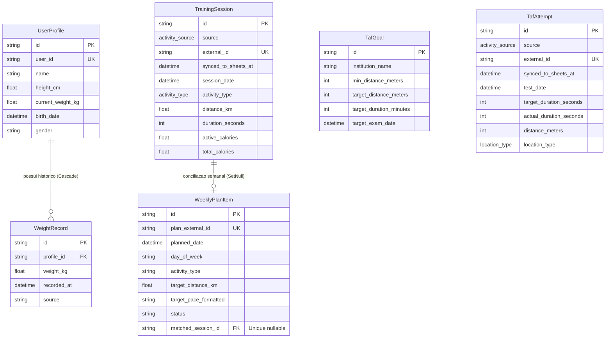

# Modelo de Dados, Persistência Híbrida e Contratos de API

> **Documentação Técnica de Arquitetura — PaceLab**  
> Referência canônica pós-Plano 15 cobrindo persistência no navegador, schema relacional PostgreSQL/Prisma, regras de fuso horário (`America/Fortaleza`), envelopes REST e catálogo OpenAPI (`/docs`).

---

## 1. Arquitetura de Persistência Híbrida

O PaceLab combina **armazenamento local no navegador** (para privacidade instantânea nas calculadoras e fluidez de cache) com **PostgreSQL gerenciado (Supabase) via Prisma ORM** como fonte única de verdade para o Diário de Treinos, Simulados TAF, Perfil/Biometria e Plano Semanal.

| Camada | Chaves / Estruturas Reais | Módulos Responsáveis | Finalidade e Ciclo de Vida |
|---|---|---|---|
| **`localStorage`** | `pacelab_history_v1` | [`lib/storage/localStorage.ts`](../../lib/storage/localStorage.ts) (`HistoryStorageAdapter`) | Histórico local das calculadoras (`/calculadora`, `/taf`, `/metas`, `/intervalado`) gerenciado e exportável em CSV/JSON na página `/historico`. Permanece entre sessões do navegador. |
| **`localStorage`** | `pacelab_weight_prompt_dismissed_until` | [`lib/services/profileService.ts`](../../lib/services/profileService.ts) | Marca timestamp até quando o lembrete semanal de pesagem (`WeeklyWeightModal`) foi adiado pelo usuário. |
| **`localStorage`** | `theme` (padrão `next-themes`) | [`components/providers/ThemeProvider.tsx`](../../components/providers/ThemeProvider.tsx) | Preferência visual de tema (`light` / `dark` / `system`). |
| **`sessionStorage`** | `pacelab_draft_calc`, `pacelab_draft_interval` | [`app/calculadora/page.tsx`](../../app/calculadora/page.tsx), [`app/intervalado/page.tsx`](../../app/intervalado/page.tsx) | Rascunhos temporários de inputs para evitar perda acidental de formulário ao navegar dentro da mesma aba. Limpos ao limpar formulário/reset. |
| **`sessionStorage`** | `pacelab_cache_trainings`, `pacelab_cache_weekly_plan`, `pacelab_cache_taf_goal`, `pacelab_cache_taf_attempts`, `pacelab_cache_taf_trainings`, `pacelab_cache_profile`, `pacelab_cache_weights` | [`lib/sheetsSyncUi.ts`](../../lib/sheetsSyncUi.ts), [`lib/services/profileService.ts`](../../lib/services/profileService.ts), [`components/dashboard/WeeklyAdherenceCard.tsx`](../../components/dashboard/WeeklyAdherenceCard.tsx), [`app/treinos/page.tsx`](../../app/treinos/page.tsx), [`app/meu-taf/page.tsx`](../../app/meu-taf/page.tsx) | Caches otimistas de leitura (*stale-while-revalidate* simples em memória de aba) para renderização imediata antes da revalidação via API. |
| **PostgreSQL (Supabase)** | 6 tabelas + 3 enums (`prisma/schema.prisma`) | [`prisma/schema.prisma`](../../prisma/schema.prisma), [`lib/prisma.ts`](../../lib/prisma.ts) | Persistência transacional definitiva de treinos, simulados, editais, biometria/pesagens e itens do plano semanal reconciliados com o Google Sheets. |

### Invalidação Coordenada entre Páginas

Mutações executadas em `/treinos`, `/meu-taf` (incluindo restauração de backup JSON) ou sincronizações no Google Sheets invalidam automaticamente os caches de `sessionStorage` compartilhados através de `CROSS_PAGE_SHEETS_CACHE_KEYS` e `clearCrossPageSheetsCaches` ([`lib/sheetsSyncUi.ts`](../../lib/sheetsSyncUi.ts)):

- `trainings` → `pacelab_cache_trainings`
- `tafAttempts` → `pacelab_cache_taf_attempts`
- `tafTrainings` → `pacelab_cache_taf_trainings`
- `tafGoal` → `pacelab_cache_taf_goal`
- `weeklyPlan` → `pacelab_cache_weekly_plan`

Quando um treino é criado, editado, excluído ou importado em `/meu-taf` ou via restauração de backup em `GoalAndBackupSettings.tsx`, `pacelab_cache_weekly_plan` também é limpo para que o widget `WeeklyAdherenceCard` (presente na Home `/` e em `/treinos`) recarregue o snapshot reconciliado do servidor sem exibir estado obsoleto.

---

## 2. Modelo Relacional PostgreSQL & Prisma

O schema em [`prisma/schema.prisma`](../../prisma/schema.prisma) utiliza PostgreSQL (`DATABASE_URL` com pool e `DIRECT_URL` para migrations) e contém **6 modelos** e **3 enums**.



### 2.1. Catálogo das 6 Tabelas

| Modelo Prisma | Tabela SQL (`@@map`) | Descrição Funcional | Chaves Únicas, FKs e Índices |
|---|---|---|---|
| `TafGoal` | `taf_goals` | Meta do concurso/edital: corrida (`minDistanceMeters` default `2400`, `targetDistanceMeters` default `2600` no schema — API retorna `2300` em fallback inicial sem registro em banco —, `targetDurationMinutes` default `12`, `targetExamDate`) e provas complementares (`pullup_*` dinâmica/isometria, `pushup_*`, `abs_*`). | `id` (UUID PK) |
| `TafAttempt` | `taf_attempts` | Tentativas cronometradas de simulado TAF (12 min ou duração customizada), parciais de 400 m em `laps` (`Json`), velocidade/pace, local, FC média/máx, tênis e rastreabilidade Sheets/arquivo. | `id` (UUID PK), `externalId @unique`, índices `[userId, testDate(Desc)]` e `[userId, targetDurationSeconds]` |
| `TrainingSession` | `training_sessions` | Sessões do Diário de Treinos com distância em km, `durationSeconds` (tempo em movimento), `elapsedSeconds`, velocidade, pace, FC, elevação, cadência, `perceivedEffort` (RPE 1–10), `bodyWeightKg`, `splits` (`Json`), métricas calóricas (Compêndio 2024) e vínculo reverso opcional `weeklyPlanItem`. | `id` (UUID PK), `externalId @unique`, índices `[userId, sessionDate(Desc)]` e `[userId, activityType]` |
| `UserProfile` | `user_profiles` | Dados biométricos do atleta mono-usuário (`name`, `heightCm`, `currentWeightKg`, `birthDate`, `gender`). | `id` (UUID PK), `userId @unique` |
| `WeightRecord` | `weight_records` | Série histórica de pesagens vinculada a `UserProfile`, usada para atualizar `currentWeightKg` e contextualizar o gasto calórico no diário. | `id` (UUID PK), FK `profileId -> user_profiles.id` (`onDelete: Cascade`), índice `[profileId, recordedAt(Desc)]` |
| `WeeklyPlanItem` | `weekly_plan_items` | Prescrições importadas da 4ª aba `Plano_Semanal` (`Google Sheets` / Gemini) com reconciliação local `1:1` opcional para `TrainingSession`. | `id` (UUID PK), `planExternalId @unique`, FK `matchedSessionId @unique -> training_sessions.id` (`onDelete: SetNull`), índice `[plannedDate]` |

> **Comportamento de `onDelete: SetNull` em `WeeklyPlanItem`:** excluir uma `TrainingSession` que estava vinculada a um treino planejado **não exclui** a linha do plano semanal; o PostgreSQL define `matched_session_id = NULL` e o hook pós-exclusão (`safeReconcileWeeklyPlans`) recalcula o status para `"Planejado"` ou `"Perdido"` (e permite novo pareamento automático caso exista outra sessão elegível).

### 2.2. Enums Oficiais (`prisma/schema.prisma`)

- **`ActivityType` (`activity_type`, 6 valores):**
  - `rodagem_leve`
  - `corrida_continua`
  - `tempo_run`
  - `corrida_intervalada`
  - `longao`
  - `caminhada`
- **`ActivitySource` (`activity_source`, 4 valores):**
  - `manual`
  - `gpx_upload`
  - `fit_upload`
  - `sheets`
- **`LocationType` (`location_type`, 5 valores):**
  - `pista_400m`
  - `rua_plana`
  - `parque_praca`
  - `esteira`
  - `outro`

### 2.3. Histórico Consolidado de Migrations (`prisma/migrations/`)

| # | Pasta da Migration | Mudanças Aplicadas no Schema |
|---|---|---|
| 1 | `20261012022658_init` | Criação dos enums `activity_type` (3 valores iniciais) e `location_type`, além das tabelas `taf_goals`, `taf_attempts` e `training_sessions` com índices iniciais. |
| 2 | `20261012150000_add_profile_weight_and_calories` | Adição dos campos calóricos em `training_sessions` (`active_calories`, `total_calories`, `met_value`, `calorie_method`, `calorie_source`, `calorie_metadata`) e criação de `user_profiles` e `weight_records`. |
| 3 | `20261013150000_expand_taf_goals_multimodal` | Expansão de `taf_goals` com `institution_name`, `min_distance_meters` e metas complementares (`pullup_*`, `pushup_*`, `abs_*`). |
| 4 | `20261013210000_add_pullup_duration_seconds` | Adição de `pullup_duration_seconds` em `taf_goals` para cronometragem da barra fixa. |
| 5 | `20261113233500_add_gpx_import_fields` | Criação de `activity_source` (`manual`, `gpx_upload`), expansão de `activity_type` (+`rodagem_leve`, `tempo_run`, `longao`), índices únicos `external_id` e campos de telemetria (`elapsed_seconds`, `avg_heart_rate`, `max_heart_rate`, `elevation_gain_m`, `avg_cadence`, `shoe_name`, `synced_to_sheets_at`). |
| 6 | `20261114020000_add_fit_upload_activity_source` | Adição de `'fit_upload'` ao enum nativo `activity_source`. |
| 7 | `20261114151320_add_sheets_sync_fields` | Adição de `'sheets'` ao enum `activity_source` e de `synced_to_sheets_at` em `taf_attempts`. |
| 8 | `20261115191047_add_weekly_plan_items` | Criação da tabela `weekly_plan_items`, índices únicos `plan_external_id` e `matched_session_id`, índice `planned_date` e FK `matched_session_id` (`ON DELETE SET NULL`) com `training_sessions`. *(Plano 15)* |

---

## 3. Contrato de Datas e Fuso Horário (`America/Fortaleza`)

Servidores serverless em produção (Vercel) executam por padrão em **UTC (`Z`)**, enquanto o atleta registra e planeja treinos no horário de Brasília/Fortaleza (**`America/Fortaleza`, UTC-3 sem horário de verão**). Sem normalização explícita, um treino feito às **21:30 BRT** (`00:30Z` do dia seguinte) ou uma string `"YYYY-MM-DD"` interpretada como meia-noite UTC (`00:00:00Z` → `21:00` da véspera em UTC-3) causariam deslocamento de **±1 dia** entre o app, a planilha e os agrupamentos semanais.

O PaceLab resolve isso por meio de quatro regras padronizadas:

1. **Chave Civil Canônica em Fortaleza (`toFortalezaDateKey` e `formatDateFortaleza`):**
   - Definida em [`lib/math/weeklyAdherence.ts`](../../lib/math/weeklyAdherence.ts) (`toFortalezaDateKey`) e reexposta em [`lib/googleSheets/mapper.ts`](../../lib/googleSheets/mapper.ts) (`formatDateFortaleza`).
   - Strings civis puras `"YYYY-MM-DD"` têm o calendário validado diretamente (ex.: rejeita `"2026-02-30"`) e são preservadas sem deslocamento de timezone.
   - Objetos `Date` ou timestamps ISO completos com hora (`...T23:40:00-03:00` ou `...Z`) são convertidos usando `Intl.DateTimeFormat("en-CA", { timeZone: "America/Fortaleza" })` para o dia civil exato em Fortaleza (`YYYY-MM-DD`).
2. **Semana Segunda a Domingo (`getFortalezaWeekBounds` & `shiftFortalezaDays`):**
   - Toda semana no módulo `Plano_Semanal` e em `GET /api/weekly-plan` é delimitada de **Segunda-feira (`weekStart`)** a **Domingo (`weekEnd`)** no calendário de Fortaleza, com aritmética puramente civil em UTC meio-dia para ser independente do fuso do servidor Node.js.
3. **Datas Vindas da Planilha (`parseSheetDate`) e Datas Puras de Perfil (`formatCalendarDateForSheet`):**
   - Ao ler datas civis do Google Sheets (`YYYY-MM-DD` ou `DD/MM/YYYY`), `parseSheetDate` ancora em **meio-dia UTC (`12:00:00.000Z`)**, garantindo que o mesmo dia civil seja preservado tanto em UTC quanto em `UTC-3`.
   - Campos de calendário civil sem hora útil (`UserProfile.birthDate` e `TafGoal.targetExamDate`) usam `formatCalendarDateForSheet`, evitando que valores armazenados como `00:00:00.000Z` recuem 1 dia na exportação para `Perfil_e_Metas`.
4. **Validação Estrita em Zod (`lib/validations/taf.ts`):**
   - `isValidCalendarDateString` valida datas reais de calendário no formato `YYYY-MM-DD` (aplicada em `WeeklyPlanQuerySchema`, `birthDate`, `targetExamDate` e timestamps ISO via `isValidDateInput` / `createDefaultIsoDateSchema`), retornando **HTTP 400** em entradas inválidas antes de atingir `Date.toISOString()` ou queries do Prisma.

---

## 4. Contrato HTTP, Wrapper de Erros e Paginação

### 4.1. Envelope Padrão `ApiResponse<T>` e `withApiHandler`

Todas as rotas de negócio em `app/api/` retornam JSON no formato definido em [`lib/api/response.ts`](../../lib/api/response.ts):

```typescript
export interface ApiResponse<T = unknown> {
  success: boolean;
  data?: T;
  error?: string;
  details?: FormattedZodError[] | Record<string, unknown> | unknown;
  meta?: {
    totalCount?: number;
    nextCursor?: string | null;
    hasMore?: boolean;
    [key: string]: unknown;
  };
  timestamp: string; // ISO-8601
}
```

O wrapper central `withApiHandler` mapeia exceções automaticamente para códigos HTTP consistentes:

| Condição / Exceção Capturada | HTTP Status | Comportamento / Payload de Saída |
|---|---|---|
| Sucesso (`apiSuccess`) | `200` / `201` | `{ success: true, data, meta?, timestamp }`. |
| `ZodError` (`lib/validations/taf.ts`) | `400` | Primeira mensagem legível + array `details` (`[{ path, message }]`). |
| `SyntaxError` (JSON malformado) | `400` | `"Corpo da requisição com formato JSON inválido"`. |
| `AppError` (erro de domínio customizado) | `error.statusCode` | Mensagem e `details` definidos no domínio. |
| `PrismaClientKnownRequestError` `P2025` | `404` | `"Registro não encontrado no banco de dados"`. |
| `PrismaClientKnownRequestError` `P2002` | `409` | Se o alvo único envolver `externalId` / `external_id`, retorna `409 Conflict` com `{ code: "DUPLICATE_EXTERNAL_ID" }`; demais chaves únicas retornam `409` genérico. *(Obs.: em `POST /api/taf/trainings`, apenas o `create`/`update` principal do treino fica no bloco de captura de `P2002`, evitando que falhas secundárias na reconciliação pós-commit gerem falso `409`.)* |
| Arquivo vazio ou inválido no parse `.FIT`/`.GPX` (`apiUnprocessable`) | `422` | Erro semântico de atividade não suportada ou arquivo inválido. |
| Arquivo > `4 MB` (`apiPayloadTooLarge`) | `413` | `"Arquivo excede o limite máximo permitido (4 MB)"`. |
| `PrismaClientInitializationError` | `503` | `"Não foi possível conectar ao banco de dados Supabase"`. |
| Erros upstream Google Sheets (em `/api/sync/sheets`) | `429` / `502` / `503` | `mapSheetsUpstreamError`: `429` (`SHEETS_QUOTA_EXCEEDED`), `502` para `401`/`403` (`SHEETS_PERMISSION_DENIED`), `404` (`SHEETS_NOT_FOUND`) ou outro status HTTP, e `503` para `GoogleSheetsNotConfiguredError` (`SHEETS_NOT_CONFIGURED`) ou indisponibilidade Google (`SHEETS_UNAVAILABLE`). |

### 4.2. Paginação Cursor-Based e Bypass `?skipSheetsSync=true`

- **Paginação (`PaginationQuerySchema` em [`lib/validations/taf.ts`](../../lib/validations/taf.ts)):**
  - Aplicada em `GET /api/taf/trainings` (ordenação `sessionDate DESC`) e `GET /api/taf/attempts` (ordenação `testDate DESC`).
  - Parâmetros: `limit` (`1..100`, padrão `50`), `cursor` (ID do último item retornado), além de filtro opcional `activityType` em `/api/taf/trainings`.
  - A query busca `take: limit + 1` e devolve `meta: { limit, nextCursor, hasMore }`.
- **Auto-Sync Síncrono vs. `?skipSheetsSync=true` ([`lib/api/sheetsSync.ts`](../../lib/api/sheetsSync.ts)):**
  - Em mutações individuais, as rotas aguardam (`await`) a reconciliação local (`safeReconcileWeeklyPlans`) e a sincronização pontual (`syncRecordWithSheets` + `pushWeeklyPlanStatusToSheets`) **antes** de encerrar a resposta HTTP — requisito essencial para que funções serverless não sejam congeladas antes da chamada à Google API.
  - Operações em lote (importação múltipla no `GpxImportPanel.tsx` e restauração de backup JSON em `GoalAndBackupSettings.tsx`) enviam `?skipSheetsSync=true` (`shouldSkipSheetsSync`) em cada item e executam um único `POST /api/sync/sheets` consolidado ao final, prevenindo HTTP `429` no Google Sheets. Mesmo com `?skipSheetsSync=true`, a reconciliação local `safeReconcileWeeklyPlans` no PostgreSQL continua executando normalmente.

---

## 5. Catálogo Oficial de Endpoints REST & OpenAPI (`/docs`)

A documentação interativa Swagger UI está disponível em `/docs` (`app/docs/page.tsx`), alimentada pela especificação OpenAPI 3.0.3 em [`lib/swagger/spec.ts`](../../lib/swagger/spec.ts) e servida como JSON em `GET /api/docs/spec`.

| Rota | Métodos no App Router (`app/api/`) | Documentação Swagger (`/docs`) | Finalidade Principal |
|---|---|---|---|
| `/api/taf/goals` | `GET`, `POST` | `GET`, `POST` | Consulta a meta oficial mais recente (ou fallback padrão em memória) e cria/atualiza edital completo + sync de `Perfil_e_Metas`. |
| `/api/taf/attempts` | `GET`, `POST` | `GET`, `POST` | Lista simulados com paginação por cursor e cria/atualiza simulado TAF (com `externalId`, `onDuplicate` `"error"` \| `"update"`, `?skipSheetsSync=true` e sync com `Simulados_TAF`). |
| `/api/taf/attempts/[id]` | `PUT`, `DELETE` | `GET`, `PUT`, `DELETE` | Atualiza ou exclui um simulado específico e reflete na aba `Simulados_TAF`. *(Nota técnica: o método `GET` por ID consta no contrato OpenAPI `/api/taf/attempts/{id}`, enquanto o Route Handler implementa atualmente `PUT` e `DELETE`.)* |
| `/api/taf/trainings` | `GET`, `POST` | `GET`, `POST` | Lista treinos paginados (com filtro opcional `activityType`) e cria/atualiza treino com reconciliação semanal local (`safeReconcileWeeklyPlans`) + sync de `Log_Treinos` e `Plano_Semanal!H:I`. |
| `/api/taf/trainings/[id]` | `GET`, `PUT`, `DELETE` | `GET`, `PUT`, `DELETE` | Consulta sessão individual *(Plano 15)*, atualiza sessão (reavaliando vínculo semanal com `editedSessionId`) ou remove sessão (revertendo vínculo via `onDelete: SetNull` + `safeReconcileWeeklyPlans`) e sincroniza com Sheets. |
| `/api/training-sessions/parse-activity` | `POST` | `POST` | Processa `multipart/form-data` com 1 `.FIT`, 1 `.GPX` ou par `.FIT + .GPX` (`<= 4 MB`/arq.), mescla sensores, extrai `tafWindow`, sugere modalidade e verifica duplicidade nas tabelas `TrainingSession` e `TafAttempt`. |
| `/api/taf/trainings/gpx-preview` | `POST` | `POST` *(deprecated)* | Alias retrocompatível que reexporta `POST` de `/api/training-sessions/parse-activity`. |
| `/api/profile` | `GET`, `PUT` | `GET`, `PUT` | Consulta ou cria perfil único do atleta e atualiza biometria (gerando `WeightRecord` quando `currentWeightKg` muda) + sync de `Perfil_e_Metas`. |
| `/api/profile/weight` | `GET`, `POST` | `GET`, `POST` | Lista histórico de pesagens em ordem decrescente e registra nova pesagem (atualizando `UserProfile.currentWeightKg` caso seja a mais recente). |
| `/api/profile/weight/[id]` | `DELETE` | `DELETE` | Remove registro de pesagem de forma idempotente e recalcula `UserProfile.currentWeightKg` pela pesagem remanescente mais recente. |
| `/api/sync/sheets` | `GET`, `POST` | `GET`, `POST` | `GET` informa `configured`, contadores de pendências locais (`pendingTrainingsCount`, `pendingAttemptsCount`, `totalPendingCount`) sem consumir quota Google; `POST` dispara `syncWithGoogleSheets` (`direction`: `"bidirectional"` \| `"push"` \| `"pull"`, `forceFullResync`), incluindo a 4ª aba opcional `Plano_Semanal`. |
| `/api/weekly-plan` | `GET` | `GET` | *(Plano 15)* Retorna o snapshot semanal (`WeeklyPlanResponse`) para `?weekStart=YYYY-MM-DD` (ou semana atual em `America/Fortaleza`), itens conciliados, `summary`, `rollingFourWeeksAverage` (até 4 semanas com plano) e `extraSessions` / `extraSummary`. |
| `/api/taf/health` | `GET` | `GET` | Executa `SELECT 1` no PostgreSQL (Prisma), mede latência em ms e reporta `sheetsConfigured` (`200` conectado, `503` desconectado). |
| `/api/docs/spec` | `GET` | — *(Meta)* | Serve o JSON bruto do objeto `swaggerSpec` com cache HTTP (`public, max-age=3600`). |

---

## 6. Referências no Código-Fonte

- Schema relacional e migrations: [`prisma/schema.prisma`](../../prisma/schema.prisma), [`prisma/migrations/`](../../prisma/migrations)
- Validação Zod e envelopes HTTP: [`lib/validations/taf.ts`](../../lib/validations/taf.ts), [`lib/api/response.ts`](../../lib/api/response.ts), [`lib/api/sheetsSync.ts`](../../lib/api/sheetsSync.ts)
- Motor de datas e reconciliação semanal: [`lib/math/weeklyAdherence.ts`](../../lib/math/weeklyAdherence.ts)
- Especificação OpenAPI / Swagger UI: [`lib/swagger/spec.ts`](../../lib/swagger/spec.ts), [`app/api/docs/spec/route.ts`](../../app/api/docs/spec/route.ts)
- Cliente HTTP e cache entre páginas: [`lib/services/tafService.ts`](../../lib/services/tafService.ts), [`lib/services/profileService.ts`](../../lib/services/profileService.ts), [`lib/sheetsSyncUi.ts`](../../lib/sheetsSyncUi.ts)
- Arquitetura complementar: [`01_leitura_fit_gpx_e_divergencias_strava.md`](./01_leitura_fit_gpx_e_divergencias_strava.md), [`02_ecossistema_strava_pacelab_sheets_gemini.md`](./02_ecossistema_strava_pacelab_sheets_gemini.md)
