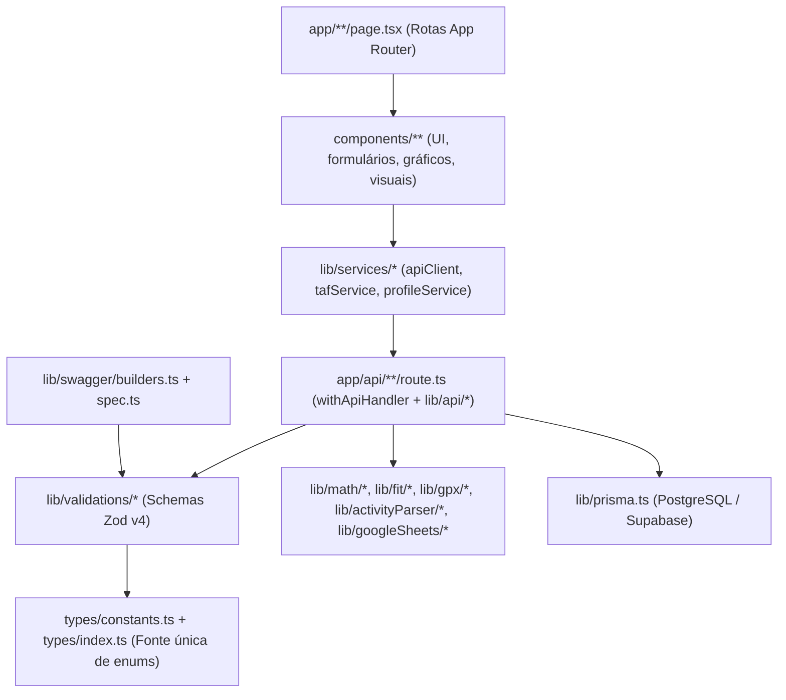

# Padrões de Código, Contratos de API/Swagger e Design System — PaceLab

> **Documentação Técnica de Engenharia — PaceLab**  
> Referência permanente consolidada no Plano 17 para manutenção consistente de código, camadas de domínio, rotas REST, especificação OpenAPI, segurança e interface **Dark Performance Athletics**.

---

## 1. Arquitetura em Camadas e Regra "Zero UI em `lib/`"

O PaceLab separa estritamente regras de negócio/infraestrutura da camada visual React/Tailwind:

### Regras de Organização de Pastas
- **`lib/` (Zero UI):** módulos em `lib/` **não** devem importar `react`, `lucide-react` ou classes utilitárias Tailwind (`bg-*`, `text-*`, `border-*`).
  - Metadados puros de atividades (cores hex, rótulos, ordenação) ficam em [`lib/activity.ts`](../../lib/activity.ts); ícones `lucide-react` e classes Tailwind ficam em [`components/shared/activityVisuals.ts`](../../components/shared/activityVisuals.ts).
  - Cálculos biométricos puros (`calcBmi` em [`lib/services/profileService.ts`](../../lib/services/profileService.ts) e `classifyCooperVo2Max` em [`lib/math/cooper.ts`](../../lib/math/cooper.ts)) retornam apenas categorias/dados; classes Tailwind de cor/badge ficam em [`components/shared/biometricVisuals.ts`](../../components/shared/biometricVisuals.ts).
- **`lib/validations/` (Unificado):** toda validação de entrada mora em `lib/validations/` — contratos REST/domínio em [`lib/validations/taf.ts`](../../lib/validations/taf.ts) e validadores de inputs das calculadoras em [`lib/validations/calculatorInputs.ts`](../../lib/validations/calculatorInputs.ts).
- **`components/` (Por domínio + base compartilhada):**
  - `components/ui/`: primitivos reutilizáveis do Design System (`Badge`, `Button`, `Card`, `CopyButton`, `Input`, `ResultBlock`).
  - `components/shared/`: visuais de domínio e widgets transversais (`activityVisuals.ts`, `biometricVisuals.ts`, `SheetsSyncBadge.tsx`).
  - `components/treinos/`: formulários, cards, lista, importação `.FIT`/`.GPX` (incluindo `batch/*`), parciais e dashboard do Diário (`TrainingForm.tsx`, `TrainingList.tsx`, `TrainingCard.tsx`, `TrainingDetailModal.tsx`, etc.).
  - `components/meu-taf/`: simulados TAF, régua, Cooper VO2, evolução, comparador de períodos e meta/backup.
  - `components/profile/`: configuração de editais/metas (`TafGoalConfigCard.tsx`) e pesagem semanal (`WeeklyWeightModal.tsx`).
  - `components/docs/`: [`SwaggerUIViewer.tsx`](../../components/docs/SwaggerUIViewer.tsx) e [`swagger-theme.css`](../../components/docs/swagger-theme.css).

---

## 2. Fonte Única de Enums e Tipos (`types/` ↔ `lib/validations/`)

Para evitar duplicação de literais e ciclos de importação entre tipos e Zod, todos os arrays `as const` e rótulos canônicos vivem em [`types/constants.ts`](../../types/constants.ts) (módulo puro, sem imports externos) e são reexportados por [`types/index.ts`](../../types/index.ts):

- `ACTIVITY_TYPES` / `ActivityType` / `ACTIVITY_LABELS`
- `ACTIVITY_SOURCES` / `ActivitySource` / `SOURCE_LABELS`
- `LOCATION_TYPES` / `LocationType` / `LOCATION_LABELS`
- `ATHLETE_GENDERS` / `AthleteGender`
- `WEIGHT_SOURCES` / `WeightSource` (`"manual" | "weekly_prompt" | "profile_update"`)
- `PULLUP_TYPES` / `PullupType`
- `DUPLICATE_POLICIES` / `DuplicatePolicy` (`"error" | "update"`)
- `SHEETS_SYNC_DIRECTIONS` / `SheetsSyncDirection` (`"bidirectional" | "push" | "pull"`)
- `WEEKLY_PLAN_STATUSES` / `WeeklyPlanStatus` (`"Planejado" | "Concluído" | "Adaptado" | "Parcial" | "Perdido"`)

Em [`lib/validations/taf.ts`](../../lib/validations/taf.ts):
- Schemas Zod consomem diretamente esses arrays (`z.enum(ACTIVITY_TYPES)`, `z.enum(LOCATION_TYPES)`, etc.).
- Campos compartilhados entre `TafAttempt` e `TrainingSession` são compostos via sub-schemas reutilizáveis (`ExternalTrackingFields`, `HeartRateFields` e `validateHeartRateRefinement`).
- `PathIdSchema` valida o parâmetro `[id]` de todas as rotas dinâmicas (`string.trim().min(1).max(128)`).

---

## 3. Contrato Padrão de APIs (`lib/api/*`) e Cliente HTTP (`lib/services/apiClient.ts`)

### 3.1. Envelopes, Erros e `withApiHandler` ([`lib/api/response.ts`](../../lib/api/response.ts))
Todas as rotas de negócio devem envolver o handler em `withApiHandler` e responder com os helpers padronizados:

- **Sucesso:** `apiSuccess(data, status = 200, meta?)` → `{ success: true, data, meta?, timestamp }`.
- **Exclusão por ID:** `apiDeleted(id)` → `200` com `{ success: true, data: { deletedId: id, deleted: true }, timestamp }`.
- **Erros padronizados:** `apiBadRequest` (`400`), `apiNotFound` (`404`), `apiConflict` (`409`), `apiPayloadTooLarge` (`413`), `apiUnprocessable` (`422`), `apiServiceUnavailable` (`503`) e `AppError(message, statusCode, details?, code?)`.
- **Catálogo `ApiErrorCode`:** o campo `code` é emitido no **topo** do JSON (`{ success: false, error, code, details?, timestamp }`) e preservado em `details.code` quando necessário para retrocompatibilidade. Códigos principais: `BAD_REQUEST`, `VALIDATION_ERROR`, `INVALID_JSON`, `INVALID_PATH_ID`, `NOT_FOUND`, `CONFLICT`, `DUPLICATE_EXTERNAL_ID`, `PAYLOAD_TOO_LARGE`, `UNPROCESSABLE_ENTITY`, `DATABASE_UNAVAILABLE`, `SERVICE_UNAVAILABLE`, `MISSING_FILE`, `TOO_MANY_FILES`, `INVALID_EXTENSION`, `EMPTY_FILE`, `FILE_TOO_LARGE`, `PARSE_ERROR`, `SHEETS_*` e `INTERNAL_ERROR`.

### 3.2. Helpers Reutilizáveis de Rota (`lib/api/*`)
| Módulo | Helpers Principais | Responsabilidade |
|---|---|---|
| [`lib/api/request.ts`](../../lib/api/request.ts) | `parseJsonBody`, `parseOptionalJsonBody`, `parseQueryParams`, `parsePathId`, `hasOwnDefinedField`, `mergeDefinedFields`, `resolveDefinedUpdateFields` | Parsing seguro de JSON/query/path IDs e mapeamento explícito de campos parciais em `PUT` e `onDuplicate: "update"`. |
| [`lib/api/pagination.ts`](../../lib/api/pagination.ts) | `getCursorPaginationPrismaArgs`, `buildCursorPaginatedResponse` | Paginação cursor-based (`take: limit + 1`, `skip: cursor ? 1 : 0`) devolvendo `meta: { limit, nextCursor, hasMore }`. |
| [`lib/api/externalIdConflict.ts`](../../lib/api/externalIdConflict.ts) | `resolveActivityConflictMessage`, `buildDuplicateExternalIdResponse`, `isPrismaUniqueConstraintError` | Resposta `409` uniforme (`DUPLICATE_EXTERNAL_ID` + `existingId` quando conhecido) tanto na checagem prévia quanto em *race condition* `P2002`. |
| [`lib/api/sheetsSync.ts`](../../lib/api/sheetsSync.ts) | `shouldSkipSheetsSync`, `safeReconcileWeeklyPlans`, `syncRecordWithSheets`, `syncTrainingRecordWithPlanAndSheets` | Controle de `?skipSheetsSync=true`, reconciliação semanal não bloqueante e auto-sync síncrono com atualização de `syncedToSheetsAt`. |

### 3.3. Cliente HTTP Unificado ([`lib/services/apiClient.ts`](../../lib/services/apiClient.ts))
Os serviços de frontend ([`lib/services/tafService.ts`](../../lib/services/tafService.ts) e [`lib/services/profileService.ts`](../../lib/services/profileService.ts)) compartilham:
- `unwrapApiResponse<T>(payload)` — desempacota `{ success, data }` preservando valores *falsy* válidos (`false`, `0`, `null`).
- `extractApiErrorInfo(res, fallbackMessage)` / `extractErrorMessage(res, fallbackMessage)` — lê mensagens de `details[]` (Zod), `error` e `code`/`details.code` com fallback seguro para respostas não-JSON.
- `throwIfHttpError(res, fallbackMessage, errorFactory?)` — lança `ApiClientError` (ou `TafApiError` via factory) com `status` e `code`.

---

## 4. Manutenção Automática do Swagger/OpenAPI (`z.toJSONSchema`)

A especificação OpenAPI 3.0.3 em [`lib/swagger/spec.ts`](../../lib/swagger/spec.ts) é construída a partir dos próprios schemas Zod v4 usando [`lib/swagger/builders.ts`](../../lib/swagger/builders.ts), reduzindo divergências manuais entre validação runtime e `/docs`:

- `zodToOpenApiSchema(schema, options?)`: converte qualquer schema Zod via `z.toJSONSchema(..., { target: "openapi-3.0", unrepresentable: "any", io: "input" })`, normalizando uniões `string | Date` para `type: "string", format: "date-time"`, removendo `$schema`/`MAX_SAFE_INT`, tratando `z.unknown().nullable()` e aplicando `omitProperties`, `stripRequired`, `stripDefaults` e `propertyOverrides`.
- `createSuccessEnvelopeSchema` / `createPaginatedListResponseSchema`: geram envelopes padronizados com `meta: { limit, nextCursor, hasMore }`.
- `createErrorResponses`, `createJsonResponse`, `createPathIdParam`, `createSkipSheetsSyncParam`, `createPaginationParams`: geram respostas de erro (`$ref` ou descrição inline) e parâmetros inline alinhados a `PathIdSchema` e `PaginationQuerySchema`.

**Regra ao alterar APIs:** ao adicionar ou alterar rotas em `app/api/`, atualize [`lib/validations/taf.ts`](../../lib/validations/taf.ts) e [`lib/swagger/spec.ts`](../../lib/swagger/spec.ts). A suíte [`__tests__/api/docs.test.ts`](../../__tests__/api/docs.test.ts) valida automaticamente a correspondência entre os arquivos `app/api/**/route.ts` e `swaggerSpec.paths`.

---

## 5. Formatação Temporal (`America/Fortaleza`), Ritmo, Segurança e `@deprecated`

### 5.1. Datas e Tempo
- **Calendário e UI ([`lib/formatting/date.ts`](../../lib/formatting/date.ts)):** toda exibição e aritmética de datas na UI usa obrigatoriamente `FORTALEZA_TIMEZONE = "America/Fortaleza"` (`UTC-3`, sem horário de verão):
  - Exibição: `formatDateFortaleza`, `formatCalendarDateFortaleza`, `formatDateTimeFortaleza`, `formatShortDateFortaleza`.
  - Chaves e janelas: `toFortalezaDateKey`, `toFortalezaCalendarDateKey`, `getTodayFortalezaDateKey`, `shiftFortalezaDateKey`, `getDaysDifferenceFortaleza`, `getAgeFromBirthDateFortaleza`, `getFortalezaWeekInfo`, `getFortalezaMonthKey`.
  - Inputs HTML `datetime-local` e âncora civil: `formatFortalezaDateTimeInput`, `fromFortalezaDateTimeInput`, `toFortalezaNoonIso`.
  - **Regra:** não usar `.toLocaleDateString(...)` / `.toLocaleTimeString(...)` sem `timeZone: "America/Fortaleza"` na camada de UI.
- **Tempo, Pace e Fallback ([`lib/formatting/time.ts`](../../lib/formatting/time.ts) + [`lib/math/pace.ts`](../../lib/math/pace.ts)):** `formatPace`, `parsePace`, `formatTime`, `parseTime`, `formatDecimal` e `resolvePaceMetricsFallback` (fonte única compartilhada por `tafService.ts`, `attempts/route.ts` e `trainings/route.ts`).

### 5.2. Segurança e Higienização
- **Anti-XXE e limites de upload (`.FIT`/`.GPX`):** [`lib/gpx/xml.ts`](../../lib/gpx/xml.ts) bloqueia `<!DOCTYPE` / `<!ENTITY`, `parse-activity` limita cada arquivo a `4 MB` e sanitiza textos (`sanitizeActivityText`).
- **Anti-CSV Formula Injection:** exportações CSV em [`lib/services/tafService.ts`](../../lib/services/tafService.ts) e células textuais em [`lib/googleSheets/mapper.ts`](../../lib/googleSheets/mapper.ts) escapam prefixos perigosos (`=`, `+`, `-`, `@`, `\t`, `\r`).
- **Segredos server-side:** `GOOGLE_CREDENTIALS_BASE64`, `DATABASE_URL` e `DIRECT_URL` nunca são expostos em rotas públicas nem em payloads de erro.

### 5.3. Política `@deprecated`
- Endpoints ou aliases mantidos apenas para retrocompatibilidade devem levar anotação JSDoc `@deprecated` no Route Handler e `deprecated: true` no OpenAPI (exemplo atual: [`app/api/taf/trainings/gpx-preview/route.ts`](../../app/api/taf/trainings/gpx-preview/route.ts), substituído por `/api/training-sessions/parse-activity`).

---

## 6. Design System Oficial: *Dark Performance Athletics*

O PaceLab opera em **tema escuro exclusivo** (sem `next-themes`, `ThemeProvider`, `ThemeToggle` ou `localStorage.theme`), com paleta única configurada em [`tailwind.config.ts`](../../tailwind.config.ts) e [`app/globals.css`](../../app/globals.css).

### 6.1. Tokens Oficiais (`pacelab.*`)
| Token Tailwind | Hex / Valor | Uso Semântico |
|---|---|---|
| `pacelab-navy` | `#0B1020` | Fundo principal da aplicação, canvas de páginas e inputs profundos |
| `pacelab-card` | `#131A2E` | Superfície elevada de cards, painéis, modais e tabelas |
| `pacelab-border` | `#1E2942` | Bordas sutis, divisórias, badges neutras e gridlines de gráficos |
| `pacelab-lime` | `#B7F34A` *(hover `#A3E332`, active `#8FCE20`, subtle `rgba(183,243,74,0.15)`)* | CTA primário, destaque esportivo, métricas de foco, links ativos e aprovação |
| `pacelab-white` | `#FFFFFF` | Títulos, valores numéricos principais e alto contraste |
| `pacelab-muted` | `#8E9BB0` | Textos secundários, legendas, eixos de gráficos e placeholders |

### 6.2. Diretrizes de Componentes e UX
- **Primitivos `components/ui/`:** reutilizar `Card`, `Button`, `Badge` (incluindo variante semântica `"adapted"` em índigo `bg-indigo-950/60 text-indigo-300 border-indigo-700/80`), `Input`, `ResultBlock` e `CopyButton` antes de criar variações duplicadas.
- **Zero prefixos `dark:` residuais e zero `bg-white` estrutural:** todas as classes devem mirar diretamente a paleta escura; o Swagger UI em `/docs` aplica tema escuro nativo em [`components/docs/swagger-theme.css`](../../components/docs/swagger-theme.css) sem depender de `.dark`.
- **Confirmação de ações destrutivas em 2 etapas inline:** é proibido usar `window.confirm` / `confirm()`. Exclusões (treinos, simulados, histórico local e pesagens) devem usar confirmação inline em React em 2 cliques (*Excluir* → *Sim, Excluir* / *Cancelar*), como em [`TafAttemptCard.tsx`](../../components/meu-taf/TafAttemptCard.tsx), [`TrainingCard.tsx`](../../components/treinos/TrainingCard.tsx), [`app/historico/page.tsx`](../../app/historico/page.tsx) e [`app/perfil/page.tsx`](../../app/perfil/page.tsx).

---

## 7. Referências Cruzadas

- Modelo de dados, fuso horário e catálogo REST completo: [`03_modelo_de_dados_e_apis.md`](./03_modelo_de_dados_e_apis.md)
- Arquitetura e padrões da suíte de testes: [`../operations/02_arquitetura_e_padroes_de_testes.md`](../operations/02_arquitetura_e_padroes_de_testes.md)
- Portões de qualidade e deploy: [`../operations/01_testes_deploy_e_troubleshooting.md`](../operations/01_testes_deploy_e_troubleshooting.md)
