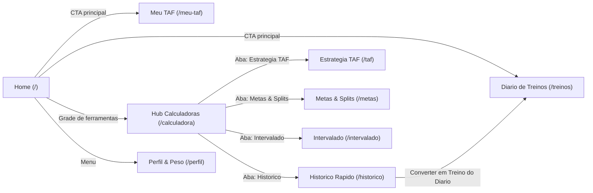

# Calculadoras, Planejadores de Ritmo e Motores Científicos

Este documento descreve os fluxos funcionais da Home (`/`), do Hub central de calculadoras (`/calculadora`), das ferramentas dedicadas de planejamento e histórico (`/taf`, `/metas`, `/intervalado`, `/historico`) e dos dois motores científicos compartilhados por toda a plataforma: o **Compêndio 2024 (METs e calorias)** e o **VO2 Máx pelo Teste de Cooper (12 minutos)**.

> **Escopo e referências cruzadas:** os contratos HTTP, modelos Prisma e console Swagger UI ([`/docs`](../../app/docs/page.tsx)) estão documentados em [Modelo de Dados e APIs](../architecture/03_modelo_de_dados_e_apis.md). O Diário `/treinos` e o painel `/meu-taf` possuem guias próprios em [Treinos e Dashboard Analítico](02_treinos_e_dashboard_analitico.md) e [Meu TAF, Simulados e Perfil](03_meu_taf_simulados_e_perfil.md).

---

## 1. Mapa de Navegação do Produto

O aplicativo App Router organiza-se em 10 páginas: barra superior ([`Navbar.tsx`](../../components/layout/Navbar.tsx)) com 4 acessos principais (`/calculadora`, `/treinos`, `/meu-taf`, `/perfil`), barra móvel ([`BottomNav.tsx`](../../components/layout/BottomNav.tsx)) com 5 itens (incluindo `/`), páginas especializadas de cálculo/histórico e o console Swagger (`/docs`).

---

## 2. Home (`/`)

Implementada em [`app/page.tsx`](../../app/page.tsx), a tela inicial concentra atalhos de ação rápida e um resumo vivo do ciclo de preparação:

1. **Ações de topo e card de destaque:** CTAs diretos para `Meu TAF (12 Min)` (`/meu-taf`), `Diário de Treinos` (`/treinos`) e `Calculadoras` (`/calculadora`), além do banner dedicado `Acessar Meu TAF`.
2. **Calculadora Rápida (`QuickPaceWidget`):** definida em [`QuickPaceWidget.tsx`](../../components/home/QuickPaceWidget.tsx), oferece presets instantâneos (`2.4 km TAF`, `5 km`, `10 km`, `21.1 km`) com cálculo imediato de pace, velocidade em `km/h` e tempo por volta de `400 m`.
3. **Status Ativo do Atleta (`AthleteActiveStatusCard`):** definida em [`AthleteActiveStatusCard.tsx`](../../components/home/AthleteActiveStatusCard.tsx), consulta em paralelo (`Promise.allSettled`) meta (`getGoal()`), simulados (`getAttempts()`), treinos (`getTrainings()`) e perfil (`getProfile()`). Consolida gasto calórico acumulado nos últimos 7 dias (`totalCalories || activeCalories`), melhor marca pessoal, contagem regressiva até o edital e selo de aprovação em relação a `minDistanceMeters ?? 2400`.
4. **Aderência Semanal (`WeeklyAdherenceCard`):** resumo da semana planejada no Google Sheets frente aos treinos executados (detalhado em [Treinos e Dashboard Analítico](02_treinos_e_dashboard_analitico.md)).
5. **Grade de Ferramentas Disponíveis:** links diretos para `/calculadora`, `/taf`, `/metas`, `/intervalado` e `/historico`.

---

## 3. Hub Central `/calculadora`

Implementado em [`app/calculadora/page.tsx`](../../app/calculadora/page.tsx), o Hub unifica cinco abas (`HUB_TABS`) em uma única interface sem recarregamento completo:

| Aba (`HUB_TABS`) | Rótulo na UI | Badge | Implementação exibida |
| :--- | :--- | :--- | :--- |
| `pace` | `Pace & Ritmo` | `Principal` | 4 modos de cálculo + `PaceSpeedTable` |
| `taf` | `Estratégia TAF` | `Concursos` | Componente da rota [`/taf`](../../app/taf/page.tsx) |
| `metas` | `Metas & Splits` | `Provas` | Componente da rota [`/metas`](../../app/metas/page.tsx) |
| `intervalado` | `Intervalado` | `HIIT` | Componente da rota [`/intervalado`](../../app/intervalado/page.tsx) |
| `historico` | `Histórico` | `Local` | Componente da rota [`/historico`](../../app/historico/page.tsx) |

### Modos da Aba `Pace & Ritmo`

Baseada em [`lib/math/pace.ts`](../../lib/math/pace.ts) e persistida em rascunho na sessão (`sessionStorage` na chave `pacelab_draft_calc`), a aba principal disponibiliza 4 modos:

| Modo UI | Código (`CalcMode`) | Função matemática | Entradas -> Saídas |
| :--- | :--- | :--- | :--- |
| `Pace & Velocidade` | `distance-time` | `calcPaceFromDistanceAndTime` | Distância (`km`) + Tempo -> Pace (`min/km`) e velocidade (`km/h`), com atalho de edital (`<dist>k TAF`) |
| `Pace ↔ Vel` | `pace-speed` | `calcSpeedFromPace` / `calcPaceFromSpeed` | Conversão bidirecional, parcial de `400 m` e distância projetada em 12 min |
| `Tempo Estimado` | `time-needed` | `calcTimeForDistance` | Distância + Pace ou Velocidade -> Duração necessária (`MM:SS` / `HH:MM:SS`) |
| `Distância Percorrida` | `distance-covered` | `calcDistanceFromTimeAndSpeed` | Tempo + Velocidade ou Pace -> Distância estimada em `km` e `m` |

No modo `Pace ↔ Vel`, é exibida a [`PaceSpeedTable.tsx`](../../components/calculadora/PaceSpeedTable.tsx) (`3:00` a `8:00 min/km` em passos de `30 s`, mais `5:13` referente a `2.300 m`), destacando as linhas-alvo do TAF (`5:00` / `2.400 m` e `5:13` / `2.300 m`) e preenchendo os inputs ao clicar na linha.

---

## 4. Planejadores Especializados (`/taf`, `/metas`, `/intervalado`) e Histórico (`/historico`)

### 4.1 Estratégia TAF (`/taf`)

Definida em [`app/taf/page.tsx`](../../app/taf/page.tsx) e [`lib/math/taf.ts`](../../lib/math/taf.ts), opera em dois modos voltados a provas de concurso:

- **`Tempo Fixo (ex: 12 min)` (`fixed-time` / `calcTaf`):** recebe duração do teste, meta em metros, intervalo de parcial (padrão `400 m`, volta em pista) e distância atual opcional; calcula ritmo por minuto (`distancePerMinuteKm`), percentual concluído, déficit restante, tabela de passagens e renderiza a régua [`TafApprovalRuler`](../../components/meu-taf/TafApprovalRuler.tsx). Quando há meta oficial salva no perfil, disponibiliza atalhos de 1 clique (`Edital: <min>m`, `Aplicar Mínimo` e `Aplicar Meta`).
- **`Distância Fixa (ex: 2.400 m)` (`fixed-distance` / `calcFixedTargetTaf`):** dado um percurso fixo e um tempo máximo, determina o pace teto e a velocidade mínima de aprovação.

### 4.2 Metas & Planilha de Splits (`/metas`)

Definida em [`app/metas/page.tsx`](../../app/metas/page.tsx) e [`lib/math/goals.ts`](../../lib/math/goals.ts), calcula o ritmo de prova por **Pace Alvo** (`calcGoalFromPace`) ou **Tempo Alvo Total** (`calcGoalFromTime`), com botão de atalho `Edital TAF` vinculado à meta configurada e seleção de estratégia em `generateGoalSplits`:

| Estratégia (`PacingStrategy`) | Nome na UI | Regra matemática em `generateGoalSplits` |
| :--- | :--- | :--- |
| `even` | `Constante` | Distribuição uniforme do pace médio em todas as parciais |
| `negative` | `Split Negativo` | Primeira metade mais lenta (`1.025 × pace`) e segunda metade mais rápida (`0.975 × pace`), preservando o tempo total exato |
| `progressive` | `Progressivo` | Interpolação linear de `1.035` até `0.965` normalizada por `scale`, com o último split absorvendo o resíduo fracionário |

### 4.3 Treino Intervalado (`/intervalado`)

Definida em [`app/intervalado/page.tsx`](../../app/intervalado/page.tsx) e [`lib/math/intervals.ts`](../../lib/math/intervals.ts):

- **Estrutura da sessão (`calcIntervalSession`):** combina `aquecimento`, `N` repetições de `tiro` (`run`) + `recuperação` (`walk`) e `desaquecimento`, preservando inputs na sessão (`pacelab_draft_interval` em `sessionStorage`).
- **Limitadores de parada:** suporta `Sem Limite` (`none`), `Por Distância` (`distance`, com atalhos do edital TAF e `5,0 km`) e `Por Tempo` (`time`, com atalho da duração do TAF e `20 min`). Caso uma etapa ultrapasse o teto, ela é truncada proporcionalmente (`isTruncated: true`, `truncatedStageIndex`) e etapas posteriores são descartadas (`stagesRemovedCount`).
- **Gráfico, Modo Pista e Calorias:** exibe perfil de velocidade em linha do tempo ([`IntervalSpeedProfileChart.tsx`](../../components/intervalado/IntervalSpeedProfileChart.tsx)), gasto calórico segmentado via `calcIntervalCalories` (usando peso do perfil ou padrão `70 kg`) e modal [`Modo Pista (Cartão de Treino)`](../../components/intervalado/TrackWorkoutCardModal.tsx) com marcação por tiro e cópia de resumo.

### 4.4 Histórico Rápido (`/historico`) e Motor de Médias

Definida em [`app/historico/page.tsx`](../../app/historico/page.tsx), mantém cálculos salvos em `localStorage` (`historyStorage`) com filtros por categoria (`Todas`, `Corridas`, `TAF`, `Metas`), cálculo prévio em tempo real durante o registro manual, exportação em CSV/JSON e o botão **`Converter em Treino do Diário`**, que transforma uma entrada do histórico em `TrainingSession` já enriquecida com estimativa calórica do Compêndio 2024 e a envia ao backend via `tafService.saveTraining`.

Adicionalmente, o módulo [`lib/math/averages.ts`](../../lib/math/averages.ts) provê funções testadas para média simples (`calcAveragePaces`), média ponderada por distância (`calcWeightedAveragePaces`) e projeções de tempo nas distâncias padrão `PROJECTION_DISTANCES` (`1km`, `1.6km`, `2km`, `2.3km`, `3km`, `5km`, `10km`).

---

## 5. Motor Científico 1: Gasto Calórico (Compêndio 2024)

Implementado em [`lib/math/calories.ts`](../../lib/math/calories.ts) com base no *Compendium of Physical Activities 2024* (*Herrmann et al.*), alimenta o Diário de Treinos (manual e GPX/FIT), a conversão do Histórico e o simulador Intervalado.

### Fórmulas Base e Padronização de Persistência

- **Calorias Totais (brutas):** `(MET × 3.5 × weightKg × (durationSeconds / 60)) / 200`
- **Calorias Ativas (acima do basal em repouso):** substitui `MET` por `Math.max(0, MET - 1)` na fórmula acima.
- **Regras de seleção e interpolação (`getMetForSpeedAndActivity` / `interpolateMet`):**
  - Para atividade `repouso` ou velocidade `<= 0.5 km/h`, aplica-se o nó `09040` (`MET = 1.3`).
  - Para `caminhada`, usa-se a tabela de caminhada (`COMPENDIUM_WALKING_NODES`); para corridas (`rodagem_leve`, `corrida_continua`, `tempo_run`, `corrida_intervalada`, `longao`), usa-se a tabela de corrida (`COMPENDIUM_RUNNING_NODES`).
  - Entre dois nós adjacentes, `interpolateMet` interpola linearmente o `MET` proporcional à velocidade e associa o código do nó mais próximo; abaixo do menor nó ou acima do maior, fixa-se o `MET` da extremidade correspondente.
- **Payload unificado (`buildCaloriePayload`):** grava `totalCalories`, `activeCalories`, `metValue`, `calorieMethod = "compendium_2024_met"`, `calorieSource = "auto_calculated"` e `calorieMetadata` (`version = "2024.1"`, `compendiumCode`, `activityDescription`).

### Tabela Oficial de Nós Implementados (`lib/math/calories.ts`)

| Categoria | Código Compêndio | Velocidade (`km/h`) | `MET` |
| :--- | :--- | :--- | :--- |
| Repouso | `09040` | `0.0` (ou `<= 0.5`) | `1.3` |
| Caminhada | `17151` | `3.2` | `2.0` |
| Caminhada | `17170` | `4.0` | `2.8` |
| Caminhada | `17190` | `4.8` | `3.5` |
| Caminhada | `17200` | `5.6` | `4.3` |
| Caminhada | `17220` | `6.4` | `5.0` |
| Caminhada | `17230` | `7.5` | `6.8` |
| Corrida | `12020` | `6.0` | `6.0` |
| Corrida | `12025` | `7.0` | `7.0` |
| Corrida | `12030` | `8.0` | `8.3` |
| Corrida | `12040` | `8.4` | `9.0` |
| Corrida | `12050` | `9.7` | `9.8` |
| Corrida | `12060` | `10.8` | `10.5` |
| Corrida | `12070` | `11.3` | `11.0` |
| Corrida | `12080` | `12.1` | `11.5` |
| Corrida | `12090` | `12.9` | `11.8` |
| Corrida | `12100` | `13.8` | `12.3` |
| Corrida | `12110` | `14.5` | `12.8` |
| Corrida | `12120` | `16.1` | `14.5` |
| Corrida | `12130` | `17.7` | `16.0` |
| Corrida | `12140` | `>= 19.3` | `19.0` |

---

## 6. Motor Científico 2: VO2 Máx pelo Teste de Cooper (12 Minutos)

Implementado em [`lib/math/cooper.ts`](../../lib/math/cooper.ts) e exibido no card [`CooperVo2MaxCard.tsx`](../../components/meu-taf/CooperVo2MaxCard.tsx) em `/meu-taf`:

$$\text{VO}_2\text{ Máx} = \frac{\text{distância em metros} - 504{,}9}{44{,}73} \quad (\text{ml/kg/min})$$

### Pontos de Corte por Sexo Biológico e Faixa Etária (`ml/kg/min`)

| Sexo | Faixa Etária | Muito Fraco | Fraco | Médio | Bom | Muito Bom | Excelente |
| :--- | :--- | :--- | :--- | :--- | :--- | :--- | :--- |
| **Homens** | `20-29` | `< 33.0` | `33.0 - 36.4` | `36.5 - 42.4` | `42.5 - 46.4` | `46.5 - 52.4` | `>= 52.5` |
| **Homens** | `30-39` | `< 31.5` | `31.5 - 35.4` | `35.5 - 40.9` | `41.0 - 44.9` | `45.0 - 49.4` | `>= 49.5` |
| **Homens** | `40-49` | `< 30.2` | `30.2 - 33.5` | `33.6 - 38.9` | `39.0 - 43.7` | `43.8 - 48.0` | `>= 48.1` |
| **Homens** | `50+` | `< 26.1` | `26.1 - 30.9` | `31.0 - 35.7` | `35.8 - 40.9` | `41.0 - 45.3` | `>= 45.4` |
| **Mulheres** | `20-29` | `< 23.6` | `23.6 - 28.9` | `29.0 - 32.9` | `33.0 - 36.9` | `37.0 - 41.0` | `>= 41.1` |
| **Mulheres** | `30-39` | `< 22.8` | `22.8 - 26.9` | `27.0 - 31.4` | `31.5 - 35.6` | `35.7 - 40.0` | `>= 40.1` |
| **Mulheres** | `40-49` | `< 21.0` | `21.0 - 24.4` | `24.5 - 28.9` | `29.0 - 32.8` | `32.9 - 36.9` | `>= 37.0` |
| **Mulheres** | `50+` | `< 20.2` | `20.2 - 22.7` | `22.8 - 26.9` | `27.0 - 31.4` | `31.5 - 35.7` | `>= 35.8` |
