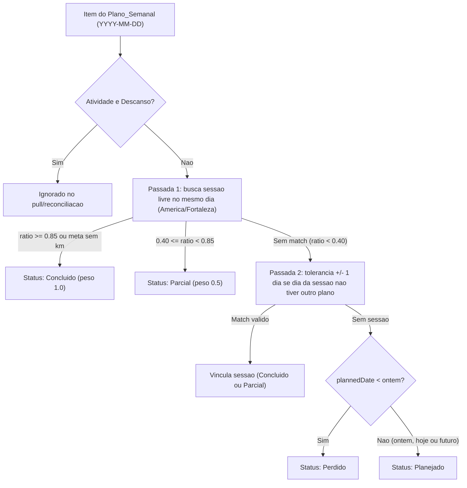

# Diário de Treinos, Aderência Semanal e Dashboard Analítico

Este documento descreve o fluxo de planejamento semanal reconciliado ([`WeeklyAdherenceCard.tsx`](../../components/dashboard/WeeklyAdherenceCard.tsx)), o Diário de Treinos ([`/treinos`](../../app/treinos/page.tsx)), o registro manual e importação de telemetria `.FIT`/`.GPX`, o modal de detalhes com análise de parciais ([`TrainingDetailModal.tsx`](../../components/treinos/TrainingDetailModal.tsx)) e o painel analítico da aba `Evolução & Gráficos` ([`TrainingEvolutionDashboard.tsx`](../../components/treinos/TrainingEvolutionDashboard.tsx)).

> **Referências cruzadas:** a configuração de serviço, credenciais e formato das abas no Google Sheets estão em [Passo a Passo Google Sheets e Gemini](../integrations/02_google_sheets_e_gemini_passo_a_passo.md); o algoritmo de classificação e parsing `.FIT`/`.GPX` do Strava está em [Exportação do Strava e Classificação de Atividades](../integrations/01_strava_exportacao_e_classificacao.md).

---

## 1. Plano Semanal & Aderência (`WeeklyAdherenceCard`)

Renderizado tanto na Home (`/`) quanto na aba `Diário & Registro` de `/treinos`, o componente [`WeeklyAdherenceCard.tsx`](../../components/dashboard/WeeklyAdherenceCard.tsx) compara o plano prescrito na aba `Plano_Semanal` da planilha com as sessões registradas no banco de dados ([`lib/math/weeklyAdherence.ts`](../../lib/math/weeklyAdherence.ts)):

### Regras de Reconciliação e Cálculo

- **Elegibilidade (`evaluateWeeklyMatch`):** sessões com `ratio >= 0.85` da distância planejada (ou planos apenas por tempo sem `targetDistanceKm > 0`) recebem **`Concluído`**; sessões entre `0.40 <= ratio < 0.85` recebem **`Parcial`**; sessões abaixo de `0.40` são ignoradas para não vincular aquecimentos curtos por engano; atividades de descanso (`Descanso`/`Off`/`Rest`/`Folga`) são ignoradas durante o `pull` da planilha e na reconciliação automática.
- **Fórmula de aderência semanal (`calculateWeeklyAdherenceSummary`):**

$$\text{Aderência (\%)} = \min\left(100,\ \text{round}\left(\frac{\text{Concluídos} + 0{,}5 \times \text{Parciais}}{\text{Total Planejado}} \times 100\right)\right)$$

- **Navegação e métricas complementares:** botões `Semana Anterior`, `Semana Atual` (quando fora da semana corrente) e `Próxima` (com `aria-label` `Próxima Semana`), cálculo de média móvel de até 4 semanas (`Média N sem` e delta `+X% / -X% vs. média`), além de cache temporário por semana em `sessionStorage`. Clicar em uma sessão vinculada ou extra abre o [`TrainingDetailModal`](../../components/treinos/TrainingDetailModal.tsx).

---

## 2. Diário de Treinos (`/treinos`)

Implementado em [`app/treinos/page.tsx`](../../app/treinos/page.tsx), apresenta duas abas controladas pelo parâmetro de URL `?tab=`:

- **`Diário & Registro`** (padrão `/treinos`): KPIs resumidos da semana, `WeeklyAdherenceCard`, área de cadastro/importação e lista filtrável de sessões.
- **`Evolução & Gráficos`** (`/treinos?tab=graficos`): abre o `TrainingEvolutionDashboard`.
- **Deep-link direto para inspeção:** acessar `/treinos?trainingId=<id>` carrega o registro via `tafService.getTrainingById`, abre o `TrainingDetailModal` automaticamente e limpa `trainingId` da URL com `window.history.replaceState`.

### Indicadores Rápidos da Aba Diário

| Card KPI | Métrica exibida | Comparativo |
| :--- | :--- | :--- |
| `Volume Semanal` | `km` acumulados nos últimos 7 dias | Diferença em `km` vs. janela de 7 a 14 dias atrás (`vs semana anterior`) |
| `Volume Mensal` | `km` acumulados nos últimos 30 dias | Janela móvel mensal |
| `Calorias Semanais` | Calorias ativas dos últimos 7 dias (`kcal`) | Delta vs. janela de 7 a 14 dias atrás + linha `Hoje` / `Mês` |
| `Pace Médio` | Ritmo médio nos últimos 7 dias (`/km`) | Nesta semana |
| `Esforço (RPE)` | Média nos últimos 7 dias na escala `1-10` | Alerta `Carga intensa (Atenção)` se `>= 8` ou `Carga controlada` |

### Sincronização Google Sheets (`Sincronizar Planilha`)

O botão **`Sincronizar Planilha`** (`handleSyncSheets`) chama `tafService.syncGoogleSheets({ direction: "bidirectional", forceFullResync: false })`, limpa os caches de sessão cross-page (`clearCrossPageSheetsCaches`), recarrega os treinos e exibe toast com o relatório resumido. Cada card na lista exibe o [`SheetsSyncBadge.tsx`](../../components/meu-taf/SheetsSyncBadge.tsx) (`Sheets ✓` em verde com tooltip de data/hora vs. `Pendente Sheets`).

---

## 3. Registro Manual, Importação `.FIT`/`.GPX` e Listagem

### Cadastro Manual (`TrainingForm`)

Definido em [`TrainingForm.tsx`](../../components/meu-taf/TrainingForm.tsx), permite:
- Seleção de data/hora, modalidade (`ACTIVITY_FORM_OPTIONS`), distância com atalhos (`2.3`, `3.0`, `5.0`, `8.0`, `10.0`, `15.0`, `21.1 km`), tempo (`h/min/s`), escala visual **RPE 1 a 10** (`Muito Leve` até `Máximo Absoluto`), peso corporal opcional, notas, parciais manuais e bloco recolhido de telemetria avançada (`shoeName`, FC média/máxima, ganho de elevação, cadência, tempo decorrido).
- **Pré-visualização científica em tempo real:** exibe `Pace Médio`, `Velocidade` e o card `Gasto Calórico Estimado` calculado pelo Compêndio 2024 (`estimateTrainingCalories` + `buildCaloriePayload`).

### Importação em Massa `.FIT` e `.GPX` (`GpxImportPanel`)

Acionada pelo botão **`Importar .FIT / .GPX`**, carrega [`GpxImportPanel.tsx`](../../components/treinos/GpxImportPanel.tsx) e suporta pré-visualização, deduplicação por `externalId` e persistência em lote com concorrência `2` (`persistBatchActivityItems`, enviando via `tafService` para `/api/taf/trainings` ou `/api/taf/attempts` com `skipSheetsSync: true` e disparando um único push consolidado em `POST /api/sync/sheets`). Os detalhes de extração de splits, moving time, classificação automática e fusão de duplicatas ficam concentrados em [Exportação do Strava e Classificação de Atividades](../integrations/01_strava_exportacao_e_classificacao.md).

### Filtros e Ordenação da Lista (`TrainingList`)

Definido em [`TrainingList.tsx`](../../components/meu-taf/TrainingList.tsx), filtra por modalidade, origem (`Qualquer origem`, `Manual`, `Strava FIT`, `Strava GPX`, `Google Sheets`), faixa de RPE (`leve`, `moderado`, `intenso`, `maximo`), período (`preset`, últimas `2`/`4`/`6` sessões ou intervalo personalizado) e busca textual em notas, tênis, modalidade ou `"rpe N"`, expondo ordenação na UI por `Recentes`, `Maior km` e `Mais rápidos` (além de opções internas em `SortOption` para data crescente e RPE).

---

## 4. Modal de Detalhes e Análise de Parciais (`TrainingDetailModal`)

Implementado em [`TrainingDetailModal.tsx`](../../components/treinos/TrainingDetailModal.tsx) com motor em [`lib/math/splitsAnalysis.ts`](../../lib/math/splitsAnalysis.ts):

- **Resumo completo:** exibe métricas principais, gasto calórico ativo/total e MET (`Calorias / MET`), RPE, tênis utilizado, peso corporal no dia, notas e contagem de parciais registradas (fechando com `Escape` ou botão).
- **Estratégia automática (`analyzeSplits`):** divide as parciais comparáveis ao meio e compara o pace ponderado da 2ª metade contra a 1ª (`diff = secondPace - firstPace`):
  - `diff <= -3 s/km` -> **`Split Negativo`**;
  - `diff >= +3 s/km` -> **`Split Positivo`**;
  - `-2 s/km <= diff <= +2 s/km` -> **`Ritmo Uniforme`**.
- **Score de consistência (`consistencyScore`):** calcula um índice `0–100` a partir do coeficiente de variação (`100 - cv * 500`, retornando `100` / *Parcial única* quando há menos de 2 parciais comparáveis) e classifica o índice por faixas (`>= 85`: *Excelente regularidade*, `>= 65`: *Boa consistência*, `>= 40`: *Ritmo variado*, `< 40`: *Alta variação / Intervalado*).
- **Blocos visuais (quando há parciais):**
  1. [`SplitsInsights.tsx`](../../components/treinos/SplitsInsights.tsx) — cards automáticos de estratégia, extremos (km mais rápido/lento), consistência, deriva cardíaca (`cardiacDriftBpm`) e altimetria (`totalElevationGainM`).
  2. [`SplitsPaceChart.tsx`](../../components/treinos/SplitsPaceChart.tsx) — gráfico visual do ritmo por quilômetro.
  3. [`SplitsTable.tsx`](../../components/treinos/SplitsTable.tsx) — tabela completa km a km com delta frente ao pace médio, FC e ganho/perda de elevação.

---

## 5. Dashboard Analítico (`/treinos?tab=graficos`)

Definido em [`TrainingEvolutionDashboard.tsx`](../../components/treinos/TrainingEvolutionDashboard.tsx) com mapa de calor em [`TrainingConsistencyHeatmap.tsx`](../../components/treinos/TrainingConsistencyHeatmap.tsx):

### Filtros Temporais e Mapa de Calor (12 Semanas)

- **Seletor de recorte:** `7 dias`, `30 dias`, `90 dias`, `Ano Atual`, `Tudo`, últimas `2 sessões` / `4 sessões` / `6 sessões`, ou intervalo `Personalizado` (`De:` / `Até:`).
- **Consistência (`TrainingConsistencyHeatmap`):** grade semanal das últimas `12 semanas` em 4 tons conforme volume diário (`0 km`, `< 4 km`, `4 - 7,9 km`, `>= 8 km`), exibindo badges de **`Streak` atual** (ativo ao treinar hoje ou ontem) e **`Recorde`** de dias consecutivos.

### 6 Cards de KPIs Avançados do Período

| Card | Fonte / Cálculo | Unidade |
| :--- | :--- | :--- |
| `Volume Total` | Soma de `distanceKm` e contagem de sessões filtradas | `km` |
| `Tempo Total` | Soma de `durationSeconds` (`Em movimento`) | `X min` ou `Xh Ym` |
| `Gasto Calórico` | Calorias ativas acumuladas (com subtítulo de calorias totais) | `kcal` |
| `Pace Médio` | Ritmo médio ponderado pelo volume rodado | `/km` |
| `Carga Total` | Soma `TRIMP` (`duração em min × RPE`) | `pts` |
| `Maior Sessão` | Maior distância individual do período | `km` |

### 7 Painéis Visuais de Evolução, Carga e Polarização

| # | Título na UI | Tipo de Visualização | O que analisa |
| :--- | :--- | :--- | :--- |
| **1** | `Volume Semanal Acumulado (km)` | `BarChart` (Recharts) | Quilometragem somada por semana de calendário (Seg–Dom) |
| **2** | `Evolução do Pace por Sessão` | `LineChart` (Recharts, eixo Y invertido) | Curva cronológica de `min/km` com filtro próprio por modalidade |
| **3** | `Carga de Treinamento (TRIMP)` | `AreaChart` (Recharts) | Estresse fisiológico semanal acumulado (`minutos × RPE`) |
| **4** | `Pirâmide de Intensidade (RPE)` | Barras proporcionais por zona + guia **Regra 80/20** | Polarização entre volume Leve/Moderado (`RPE 1-6`, ~80%) e Alta Intensidade (`RPE 7-10`, ~20%) |
| **5** | `Volume por Modalidade` | `PieChart` Donut (Recharts) | Distribuição percentual e em `km` entre modalidades |
| **6** | `Gasto Calórico Semanal Acumulado (kcal)` | `BarChart` (Recharts) | Calorias ativas semanais (tooltip mostra calorias totais) |
| **7** | `Calorias por Modalidade` | `PieChart` Donut (Recharts) | Proporção do gasto energético entre corrida contínua, tiros e caminhada |
