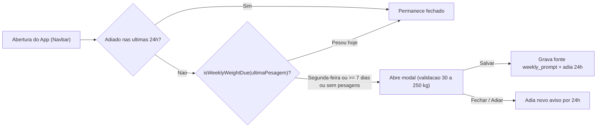

# Meu TAF, Simulados, Comparação de Períodos e Perfil

Este documento detalha o painel principal de preparação física em [`/meu-taf`](../../app/meu-taf/page.tsx) (suas 4 abas: `Testes de 12 Min`, `Gráficos de Evolução`, `Comparar Períodos` e `Meta & Banco`) e o módulo biométrico e de editais em [`/perfil`](../../app/perfil/page.tsx).

> **Referências cruzadas:** a extração da melhor janela contínua de 12 min em arquivos `.FIT`/`.GPX` é detalhada em [Exportação do Strava e Classificação de Atividades](../integrations/01_strava_exportacao_e_classificacao.md); o pareamento com Google Sheets está em [Passo a Passo Google Sheets e Gemini](../integrations/02_google_sheets_e_gemini_passo_a_passo.md); e a fórmula de Cooper VO2 Máx está documentada em [Calculadoras e Motores Científicos](01_calculadoras_e_motores_cientificos.md#6-motor-científico-2-vo2-máx-pelo-teste-de-cooper-12-minutos).

---

## 1. Painel `/meu-taf` e Aba `Testes de 12 Min`

Implementado em [`app/meu-taf/page.tsx`](../../app/meu-taf/page.tsx), organiza toda a jornada do Teste de Aptidão Física em 4 abas:

| # | Aba na UI | Componente / Responsabilidade |
| :--- | :--- | :--- |
| **1** | `Testes de 12 Min` | Régua de aprovação, Cooper VO2 Máx, complementares, importação `.FIT`/`.GPX` e CRUD de simulados |
| **2** | `Gráficos de Evolução` | `EvolutionDashboard` (4 KPIs + Gráficos `A` a `E`) |
| **3** | `Comparar Períodos` | `PeriodComparator` (Período A vs. Período B com atalhos e diagnóstico) |
| **4** | `Meta & Banco` | `GoalAndBackupSettings` (saúde do banco PostgreSQL, Sheets sync/backfill e backup JSON/CSV) |

### Componentes da Aba 1 (`Testes de 12 Min`)

1. **Régua Visual de Aprovação ([`TafApprovalRuler.tsx`](../../components/meu-taf/TafApprovalRuler.tsx)):** compara a melhor/última marca em 12 min contra o corte mínimo (`minDistanceMeters`, padrão `2.400 m`) e a meta de segurança (`targetDistanceMeters`), classificando em três estados:
   - `Abaixo do Edital (Xm restantes)` — distância abaixo do corte mínimo;
   - `Aprovado no Corte (+Xm)` — entre o corte mínimo e a meta de segurança;
   - `Zona de Segurança Garantida!` — igual ou superior à meta de segurança.
2. **VO2 Máx — Teste de Cooper ([`CooperVo2MaxCard.tsx`](../../components/meu-taf/CooperVo2MaxCard.tsx)):** estima o consumo máximo de oxigênio (`ml/kg/min`) para distâncias `> 504,9 m`, recebendo idade e gênero iniciais do `/perfil` (quando carregados antes da montagem do card) e permitindo alternar `Masc`/`Fem` e faixa etária na própria tela.
3. **Exercícios Complementares do TAF ([`TafComplementaryExercisesCard.tsx`](../../components/meu-taf/TafComplementaryExercisesCard.tsx)):** bloco expansível (`Visualizar` / `Recolher`) exibindo mínimo do edital e meta de segurança para **Barra Fixa** (`Isometria (Seg)` ou `Dinâmica` com tempo limite ou `"Tempo livre"`), **Flexão de Braço** e **Abdominal Remador**, além de link direto para ajuste em `/perfil`.
4. **Importação de Simulado e Espelhamento:** o botão `Importar .FIT / .GPX (Strava)` abre o `GpxImportPanel` configurado com `defaultSaveAs="taf_attempt"` para detectar automaticamente a melhor janela contínua de 12 minutos e parciais de `400 m`. No cadastro manual (`TafAttemptForm`), o atleta também pode optar por espelhar o simulado como sessão no Diário (`/treinos`).

---

## 2. Aba `Gráficos de Evolução` (`EvolutionDashboard`)

Definida em [`EvolutionDashboard.tsx`](../../components/meu-taf/EvolutionDashboard.tsx), combina visão consolidada do ciclo TAF com 5 visualizações Recharts:

### 4 KPIs de Topo

- **`Recorde 12 Min`:** melhor distância registrada, com pace e velocidade em `km/h`.
- **`Meta (<alvo> m)`:** barra percentual de progresso até `targetDistanceMeters` (ou déficit restante).
- **`Volume da Semana`:** quilometragem semanal e delta comparativo frente à semana anterior.
- **`Total de Atividades`:** soma de simulados TAF e treinos registrados no Diário.

### 5 Gráficos (`Gráfico A` a `Gráfico E`)

| ID | Título na UI | Tipo Recharts | Escopo |
| :--- | :--- | :--- | :--- |
| **Gráfico A** | `Evolução nos Testes de 12 Minutos` | `AreaChart` | Distância cronológica por simulado com `ReferenceLine` da meta oficial e selo de recorde pessoal |
| **Gráfico B** | `Distância por Sessão de Treino` | `BarChart` | Distância percorrida por sessão registrada no Diário |
| **Gráfico C** | `Evolução do Pace Médio por Treino` | `LineChart` | Trajetória de ritmo (`min/km`) ao longo das sessões com pace válido |
| **Gráfico D** | `Volume Semanal Acumulado (km)` | `BarChart` | Total semanal rodado para controle de sobrecarga e constância |
| **Gráfico E** | `Evolução em Degrau dos Recordes Pessoais (12 Min)` | `LineChart` (degrau) | Comparação entre cada tentativa individual e o teto acumulado de recorde pessoal |

---

## 3. Aba `Comparar Períodos` (`PeriodComparator`)

Definida em [`PeriodComparator.tsx`](../../components/meu-taf/PeriodComparator.tsx) com motor de agregação em [`lib/math/evolution.ts`](../../lib/math/evolution.ts):

- **Atalhos rápidos e datas livres:** `Últimos 14 vs 14 dias`, `Últimos 30 vs 30 dias` (padrão inicial), `Este Mês vs Anterior`, ou escolha livre de data inicial e final para **Período A (Base / Anterior)** e **Período B (Recente)**.
- **Diagnóstico automático:** card `Diagnóstico de Evolução do Período` sintetizando ganhos/quedas de volume e ritmo.
- **6 métricas comparadas lado a lado:**

| # | Card na UI | Variação calculada |
| :--- | :--- | :--- |
| **1** | `Volume Total` | Diferença absoluta (`km`) e percentual (`%`) |
| **2** | `Pace Médio` | Ganho ou perda em `s/km` |
| **3** | `Total de Sessões` | Diferença de frequência entre períodos |
| **4** | `Melhor Simulado TAF` | Diferença de metros no teste de 12 min |
| **5** | `Esforço Médio (RPE)` | Comparação na escala subjetiva `1-10` |
| **6** | `Velocidade Média` | Média comparativa em `km/h` |

---

## 4. Aba `Meta & Banco` (`GoalAndBackupSettings`)

Definida em [`GoalAndBackupSettings.tsx`](../../components/meu-taf/GoalAndBackupSettings.tsx), concentra diagnóstico de persistência e portabilidade de dados:

1. **Banco de Dados e Google Sheets:** exibe status de conexão PostgreSQL (Prisma/Supabase), ação `Sincronizar Agora (Bidirecional)` e ação protegida **`Reenviar Histórico Completo (Full Backfill)`** (exige confirmação no painel antes de reenviar histórico, simulados e perfil à planilha `Treinos_Corrida` por ID sem remover dados do banco). Para configuração de credenciais e arquitetura de abas, veja [Google Sheets e Gemini](../integrations/02_google_sheets_e_gemini_passo_a_passo.md).
2. **Exportações e Backup:**
   - **`Backup Completo (JSON)`:** gera `pacelab-backup-YYYY-MM-DD.json` via `tafService.exportBackupJson(goal, attempts, trainings)`.
   - **`Simulados TAF (CSV)`:** exporta `pacelab-simulados-taf-YYYY-MM-DD.csv` (UTF-8 com BOM `\uFEFF`).
   - **`Diário de Treinos (CSV)`:** exporta `pacelab-treinos-YYYY-MM-DD.csv` (UTF-8 com BOM `\uFEFF`).
3. **Restauração de Backup (`.json`):** botão `Selecionar Arquivo de Backup (.json)` processa `tafService.importBackupJson`, restaurando meta, simulados e treinos e contabilizando eventuais registros duplicados ignorados.

---

## 5. Perfil Biométrico, Editais Presets e Pesagem Semanal (`/perfil`)

Implementado em [`app/perfil/page.tsx`](../../app/perfil/page.tsx), [`TafGoalConfigCard.tsx`](../../components/profile/TafGoalConfigCard.tsx) e [`WeeklyWeightModal.tsx`](../../components/profile/WeeklyWeightModal.tsx), com lógica compartilhada em [`lib/services/profileService.ts`](../../lib/services/profileService.ts).

### Biometria, IMC (OMS) e Gráfico de Peso

- **Cálculo de IMC (`calcBmi`):** calcula $\text{peso} / \text{altura}^2$ (`kg/m²`, arredondado para 1 casa decimal) e classifica segundo a OMS:
  - `< 18.5`: **Abaixo do peso**;
  - `18.5 - 24.9`: **Peso normal**;
  - `25.0 - 29.9`: **Sobrepeso**;
  - `>= 30.0`: **Obesidade**.
- **Evolução Temporal do Peso Corporal:** quando há `>= 2` registros de pesagem, renderiza um `AreaChart` cronológico com variação desde a 1ª pesagem e lista o histórico completo com badges de origem (`Semanal`, `Manual`, `Perfil`).

### Presets Oficiais de Editais (`TafGoalConfigCard`)

O componente [`TafGoalConfigCard.tsx`](../../components/profile/TafGoalConfigCard.tsx) disponibiliza 4 botões de preenchimento rápido (`Presets:`), todos editáveis após aplicação e integrados ao contador de dias da prova (`targetExamDate`):

| Preset | Instituição | Corrida 12 min (Mín / Meta) | Barra Fixa (Dinâmica — Mín / Meta / Tempo) | Flexão (Mín / Meta / Tempo) | Abdominal (Mín / Meta / Tempo) |
| :--- | :--- | :--- | :--- | :--- | :--- |
| **`PM-SP`** | `Polícia Militar SP (PM-SP)` | `2.400 m` / `2.600 m` | `3` / `5` reps / Tempo livre | `20` / `30` reps / `60s` | `30` / `40` reps / `60s` |
| **`PF`** | `Polícia Federal (PF)` | `2.350 m` / `2.500 m` | `2` / `5` reps / Tempo livre | `20` / `30` reps / Tempo livre | `36` / `44` reps / `60s` |
| **`PRF`** | `Polícia Rodoviária Federal (PRF)` | `2.300 m` / `2.500 m` | `3` / `6` reps / Tempo livre | `21` / `30` reps / Tempo livre | `35` / `45` reps / `60s` |
| **`PMPR`** | `Polícia Militar PR (PMPR)` | `2.400 m` / `2.600 m` | `3` / `6` reps / Tempo livre | `20` / `30` reps / Tempo livre | `30` / `40` reps / `60s` |

### Modal Automático de Pesagem Semanal (`WeeklyWeightModal`)

Montado globalmente na barra superior ([`Navbar.tsx`](../../components/layout/Navbar.tsx)), o [`WeeklyWeightModal.tsx`](../../components/profile/WeeklyWeightModal.tsx) acompanha o peso corporal sem exigir lembrança manual:

Quando salvo, o registro atualiza imediatamente o peso atual do perfil (`currentWeightKg`) utilizado como padrão nos cálculos futuros do Compêndio 2024 em `/treinos` e `/intervalado`.
