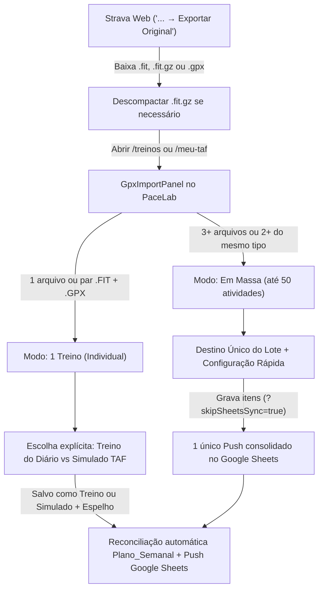

# Guia Prático: Exportação no Strava Web, Importação (.FIT / .GPX) e Classificação no PaceLab

Este guia apresenta o **passo a passo operacional para atletas** exportarem seus treinos no **Strava Web** e importarem arquivos **`.FIT`**, **`.GPX`** ou pares **`.FIT + .GPX`** no PaceLab — seja individualmente ou em massa (até **50 atividades por lote**) — compreendendo como o sistema classifica Corrida vs. Caminhada, evita duplicados e atualiza automaticamente a aderência semanal em `Plano_Semanal`.

> [!NOTE]
> Para consultar tolerâncias de pausa/histerese, motivos técnicos de divergência frente à tela do Strava, constantes do parser e comandos CLI (`npm run fit:inspect`, `npm run gpx:inspect`), consulte [`01_leitura_fit_gpx_e_divergencias_strava.md`](../architecture/01_leitura_fit_gpx_e_divergencias_strava.md).

---

## Visão Geral do Fluxo de Importação

---

## 1. Como Exportar do Strava Web

O aplicativo mobile do Strava **não expõe** o arquivo bruto original do treino. A exportação deve ser feita pelo **Strava Web** (no computador ou ativando *"Versão para computador"* no navegador do celular):

1. Acesse a atividade desejada em `https://www.strava.com/activities/<ID>`.
2. Clique no menu de ações **`...`** (canto esquerdo da barra superior da atividade) e selecione **Exportar Original**.
   - **Atalho direto:** adicione `/export_original` ao final da URL (ex.: `https://www.strava.com/activities/123456789/export_original`).
3. **Se o download vier comprimido como `.fit.gz`:** descompacte antes de enviar ao PaceLab até obter o arquivo `.fit`:
   - **Linux / macOS:** `gzip -d treino.fit.gz` (ou `gunzip treino.fit.gz`)
   - **Windows:** extraia com 7-Zip, WinRAR ou utilitário de descompactação compatível até aparecer o arquivo `.fit`.
4. **Quando o Strava entrega `.FIT` vs. `.GPX`:**
   - **`.FIT` (Fonte Prioritária):** atividades gravadas em relógios esportivos (Garmin, Coros, Polar, Amazfit etc.) e a maioria das gravações diretas pelo app costumam baixar como `.fit` via **Exportar Original**. Ele preserva odômetro, tempo de pausa/movimento real, FC, cadência e voltas reais.
   - **`.GPX` (Fonte Alternativa ou Complementar):** treinos baixados pelo botão padrão **"Exportar GPX"** (ou dispositivos que só exportam XML) vêm em `.gpx`. O Strava injeta altitude corrigida por **DEM** (*Digital Elevation Model*) e o título personalizado (`<trk><name>`) dentro desse arquivo.

> [!TIP]
> **Quando vale enviar `.FIT + .GPX` juntos?**  
> Se o seu `.FIT` veio do celular com elevação zerada/subestimada ou sem o nome que você editou no Strava, baixe **Exportar Original (`.fit`)** **e** **Exportar GPX (`.gpx`)**, salve os dois com o **mesmo nome-base** (ex.: `rodagem_quinta.fit` e `rodagem_quinta.gpx`) e envie o par junto. O PaceLab mantém os sensores soberanos do `.FIT` e completa apenas título e ganho de elevação a partir do `.GPX`.

---

## 2. Onde Abrir o Importador no PaceLab

O mesmo painel inteligente ([`GpxImportPanel.tsx`](../../components/treinos/GpxImportPanel.tsx)) está disponível em duas rotas, mudando apenas o destino pré-selecionado:

| Página | Botão de Abertura | Destino Inicial Pré-Selecionado |
|---|---|---|
| **`/treinos`** (Diário de Treinos) | **`Importar .FIT / .GPX`** | **`Treino do Diário`** |
| **`/meu-taf`** (aba **`Testes de 12 Min`**) | **`Importar .FIT / .GPX (Strava)`** | **`Simulado TAF (Cooper 12 min)`** |

> **Regra de ouro sobre destino:** o PaceLab **nunca** envia um treino automaticamente para `Simulados_TAF` só porque a atividade durou 12 minutos ou mais. Você sempre escolhe o destino explicitamente, e o mesmo arquivo pode existir tanto no Diário quanto no Meu TAF sem bloquear um ao outro.

---

## 3. Passo a Passo: Importação Individual (`1 Treino (Individual)`)

1. Abra o painel e certifique-se de que o seletor superior está em **`1 Treino (Individual)`**.
2. Arraste para a área de upload ou clique em **`Selecionar arquivo(s) .FIT e/ou .GPX`** (`máx. 4 MB` por arquivo):
   - Para envio pareado (`.fit + .gpx` da mesma atividade), após selecionar o 1º arquivo clique em **`Adicionar 2º arquivo complementar ou trocar`**, ou selecione os dois juntos na janela de arquivos.
3. Aguarde a leitura (`POST /api/training-sessions/parse-activity`) e revise os cards exibidos:
   - **Telemetria extraída:** confira distância, tempo em movimento, pace, velocidade, FC média/máx, cadência, elevação e eventuais alertas de mesclagem (`NAME_MERGED_FROM_GPX`, `ELEVATION_MERGED_FROM_GPX`, `MISMATCHED_ACTIVITY_FILES` se os arquivos tiverem início distante > 5 min, ou `ACTIVITY_TYPE_MISMATCH`).
4. Escolha o destino em **`Salvar como:`**:
   - **`Treino do Diário`**: revise a modalidade sugerida, confira/informe seu **Peso Corporal (kg)** (pré-carregado do perfil quando existir) para calcular as calorias pelo **Compêndio de Atividades Físicas de 2024**, ajuste `Tênis`, `RPE (1-10)` e `Observações`, e clique em **`Confirmar e Salvar Treino`**.
   - **`Simulado TAF (Cooper 12 min)`**: confira o quadro **`Melhor Janela Contínua de 12 min (Simulado TAF)`** com as sub-parciais projetadas de 400 m, escolha o `Local` (`pista_400m`, `rua_plana`, `parque_praca`, `esteira` ou `outro`), ajuste tênis/observações e decida se deseja marcar **`Também registrar no Diário de Treinos (Log_Treinos)`** (que grava também uma sessão espelhada como `tempo_run` com ID `trn_` próprio). Por fim, clique em **`Confirmar e Salvar Simulado TAF`**.
5. **Se o arquivo já tiver sido importado antes:** o card exibe o alerta de duplicidade e altera o botão principal para **`Salvar Atualização do Treino`** ou **`Salvar Atualização do Simulado TAF`**, permitindo atualizar os dados sem erro `409 Conflict`.
6. **Se faltar alguma métrica essencial no arquivo:** caso o arquivo não traga data, distância ou duração válidas, o formulário libera campos manuais de preenchimento obrigatório antes de gravar.

---

## 4. Passo a Passo: Importação em Massa (`Em Massa (Vários Arquivos)`)

O modo em lote foi projetado para subir semanas inteiras ou histórico antigo sem estourar limites da Google API nem perder progresso em falhas de rede:

### 4.1. Entrada na Fila e Pareamento Automático
1. Selecione a aba **`Em Massa (Vários Arquivos)`** — ou simplesmente arraste **3 ou mais arquivos** (ou **2+ arquivos da mesma extensão**, como dois `.fit` ou dois `.gpx`) que o painel alterna automaticamente para o modo em lote.
2. **Capacidade:** até **50 atividades** na fila, limite de **4 MB por arquivo**.
3. **Pareamento automático `.FIT + .GPX`:** arquivos com o mesmo nome-base (ex.: `corrida_01.fit` e `corrida_01.gpx`) entram juntos como um único item **`MESCLADO (.FIT + .GPX)`**.
   - Caso sejam treinos diferentes que compartilham o mesmo nome por acidente, clique em **`Separar em 2 treinos`** diretamente no item da fila antes de importar.

### 4.2. Destino Único e Configuração Rápida do Lote
1. Em **`Destino Único do Lote:`**, escolha se toda a fila irá para **`Todos como Treinos do Diário`** ou **`Todos como Simulados TAF (Cooper 12 min)`**.
2. Preencha **`Configuração Rápida do Lote (Aplicar a Todos)`**:
   - **Se destino = Diário:**
     - **`Tipo de Treino do Lote`**: deixe em `Automático por arquivo (sugestão .FIT/.GPX)` para respeitar cada sessão ou force uma modalidade para toda a fila;
     - **`Peso Corporal (kg) — Calorias MET`**: peso aplicado no cálculo metabólico da fila;
     - **`Tênis Padrão (Opcional)`**: preenche automaticamente novos itens (use **`Sobrescrever todos`** para aplicar também nos já editados);
     - **`RPE Padrão do Lote — Esforço 1 a 10 (Opcional)`**: define um esforço padrão (`1..10`) para todos os itens (com opção **`Limpar RPE do lote`**).
   - **Se destino = Simulados TAF:**
     - **`Local do Teste do Lote`**: `Automático (Esteira se indoor, senão Pista 400m)` ou escolha fixa;
     - **`Tênis Padrão (Opcional)`** (com **`Sobrescrever todos`**);
     - **`Também registrar todos no Diário de Treinos (Log_Treinos)`**: espelha cada simulado salvo também no Diário como `tempo_run` de forma isolada por erro (se o espelho falhar ou pular um duplicado já existente no Diário, o Simulado TAF permanece salvo).

### 4.3. Política para Duplicados e Revisão Item a Item
1. Escolha a política global no seletor inferior:
   - **`Pular duplicados (padrão seguro)`**: pula automaticamente arquivos que já existem na tabela de destino (ou arquivos idênticos duplicados na própria fila).
   - **`Atualizar existentes (onDuplicate)`**: atualiza no banco os registros já existentes que possuam o mesmo `externalId`.
2. Se precisar ajustar apenas um treino específico da fila (título, tipo/local individual, notas ou fallback manual caso falte distância/data), clique em **`Detalhes`** na respectiva linha e edite sem sair da fila.

### 4.4. Execução, Retry e Push Consolidado para o Google Sheets
1. Clique em **`Importar Lote (N prontos)`**.
2. O PaceLab grava os itens da fila com concorrência controlada (`concurrency: 2`) usando `?skipSheetsSync=true` em cada requisição, atualizando barra de progresso e status linha a linha.
3. **Resiliência a falhas parciais:** se algum item falhar por oscilação de leitura ou rede, os já salvos ficam preservados; clique em **`Tentar novamente falhos (N)`** (na barra final) ou **`Tentar novamente`** (na linha específica) sem risco de duplicar os anteriores.
4. **Push único no Google Sheets:** ao final do lote, se ao menos 1 registro novo/atualizado foi salvo e o Google Sheets estiver configurado, o PaceLab executa **1 único push consolidado (`direction: "push"`)**, exibindo o card **`Resumo do Lote`** com as contagens (`novo(s)`, `atualizado(s)`, `pulado(s)`, `falha(s)`, espelhos) e a confirmação **`Google Sheets sincronizado em 1 único push consolidado ✓`**.
   - Se a API do Google estiver indisponível no momento, os dados já ficam salvos com segurança no PostgreSQL e você recebe aviso para concluir depois clicando em **`Sincronizar Planilha`**.

---

## 5. Classificação Inteligente (Corrida vs. Caminhada) e Impacto no `Plano_Semanal`

### 5.1. Como o PaceLab Sugere a Modalidade
Durante o parsing em [`activitySuggestion.ts`](../../lib/activityParser/activitySuggestion.ts), o backend analisa três sinais para devolver `suggestedActivityType` e `allowedActivityTypes`:

1. **Tag explícita de caminhada (`walk`):** sugere **`caminhada`** e restringe a lista rápida à família de caminhada.
2. **Tag explícita de corrida (`run`):** sugere **`corrida_continua`** e libera as 5 modalidades de corrida (`rodagem_leve`, `corrida_continua`, `tempo_run`, `corrida_intervalada`, `longao`).
3. **Tag genérica/desconhecida (`unknown`, como alguns treinos `generic`/`training`):** combina palavras-chave presentes no título ou nome do arquivo (ex.: `caminhada`, `walk`, `trilha` vs. `corrida`, `run`, `rodagem`, `tiro`, `longao`, `cooper`), velocidade média e cadência:
   - Velocidades `< 6,8 km/h` tendem a **`caminhada`** (exceto se cadência >= `156 spm` entre `5,8` e `6,8 km/h`);
   - Faixa intermediária `6,8..7,5 km/h` usa a cadência para desempatar (`< 140 spm` → caminhada; `>= 145 spm` → corrida);
   - `>= 7,5 km/h` sugere **`corrida_continua`**;
   - Nesse modo, todas as 6 opções ficam liberadas no seletor caso você queira corrigir manualmente.

### 5.2. Reflexo Direto na Reconciliação Semanal (`Plano_Semanal` e `WeeklyAdherenceCard`)
Após a entrega do Plano 15, toda importação gravada no **Diário de Treinos** (`TrainingSession`) — inclusive quando originada pelo espelhamento opcional de um **Simulado TAF** (`Também registrar no Diário de Treinos (Log_Treinos)`) — dispara automaticamente a reconciliação local com a aba `Plano_Semanal`:

- **Na importação individual:** reconcilia imediatamente no PostgreSQL e atualiza as colunas `H:I` (`Status` e `ID Treino Realizado`) na planilha antes de concluir.
- **Na importação em massa:** mesmo enviando `?skipSheetsSync=true` em cada item individual para economizar quota, a reconciliação local roda em cada salvamento e o push único consolidado ao final envia todas as sessões e atualiza os status da `Plano_Semanal` em lote.
- **Atenção à classificação escolhida:** na reconciliação, `caminhada` só casa com itens prescritos de caminhada, enquanto as 5 modalidades de corrida são compatíveis entre si (priorizando match exato). Escolha corretamente entre `caminhada` e corrida antes de salvar para que a aderência em `WeeklyAdherenceCard` (em `/` e `/treinos`) permaneça exata.

---

## 6. Referências Complementares

- **Guia prático do próximo passo (Google Sheets 4 abas + Google Gemini):** [`02_google_sheets_e_gemini_passo_a_passo.md`](./02_google_sheets_e_gemini_passo_a_passo.md)
- **Detalhes internos do parser `.FIT`/`.GPX` e divergências Strava:** [`01_leitura_fit_gpx_e_divergencias_strava.md`](../architecture/01_leitura_fit_gpx_e_divergencias_strava.md)
- **Regras da reconciliação semanal (`Plano_Semanal`) e contrato das abas:** [`02_ecossistema_strava_pacelab_sheets_gemini.md`](../architecture/02_ecossistema_strava_pacelab_sheets_gemini.md)
- **Schema de dados e rotas REST/OpenAPI:** [`03_modelo_de_dados_e_apis.md`](../architecture/03_modelo_de_dados_e_apis.md)
