# Guia Prático: Google Sheets (`Treinos_Corrida` em 4 Abas) + Google Gemini (Coach e Tarefa Agendada)

Este manual reúne todo o **passo a passo operacional de configuração e uso** para conectar o PaceLab ao **Google Planilhas (`Treinos_Corrida`)** — local e na Vercel — e configurar o **Google Gemini** como Treinador Pessoal interativo (`/treinador-corrida`) e rotina semanal autônoma em ciclo fechado com a aba `Plano_Semanal`.

> [!NOTE]
> Para consultar especificações técnicas completas de validação de colunas, regras matemáticas da reconciliação em 2 passadas (`Passada 1`/`Passada 2`), proteções de `pull` e contratos REST/OpenAPI, consulte [`02_ecossistema_strava_pacelab_sheets_gemini.md`](../architecture/02_ecossistema_strava_pacelab_sheets_gemini.md) e [`03_modelo_de_dados_e_apis.md`](../architecture/03_modelo_de_dados_e_apis.md).

---

## Arquitetura Operacional em Ciclo Fechado

```mermaid
flowchart LR
    GCP["Google Cloud Console ('Sheets API + Service Account JSON')"] -->|"Base64 em linha única"| Env["Variáveis ('.env local ou Vercel Env Vars')"]
    Env -->|"getGoogleSheetsEnvConfig()"| App["PaceLab Server ('@googleapis/sheets')"]
    App <-->|"Sync Automático + Cron Dom 22h + Manual ('/', '/treinos', '/meu-taf')"| Sheets["Planilha Google Drive: Treinos_Corrida ('4 abas')"]
    Sheets <-->|"Extensão '@Google Workspace'"| Gemini["Google Gemini ('/treinador-corrida + Domingo 19h')"]
    Gemini -.->|"Lembretes opcionais"| GCal["Google Calendar"]
```



---

## Parte I — Setup no Google Cloud, Variáveis e Deploy na Vercel

> Se as variáveis do Google Sheets não estiverem preenchidas, o PaceLab continua funcionando normalmente apenas com o banco PostgreSQL (Supabase) e ignora o espelhamento em nuvem sem falhar.

### Passo 1 — Criar Projeto e Ativar a Google Sheets API
1. Acesse o [Google Cloud Console](https://console.cloud.google.com/).
2. Crie um novo projeto (ex.: `pacelab-sheets`) ou selecione um projeto existente.
3. No menu lateral, acesse **APIs e Serviços → Biblioteca**.
4. Pesquise por **`Google Sheets API`** e clique em **Ativar**.

### Passo 2 — Criar uma Conta de Serviço (*Service Account*) e Baixar a Chave `.json`
1. No Google Cloud Console, acesse **IAM e administrador → Contas de serviço**.
2. Clique em **+ Criar conta de serviço**, informe um nome (ex.: `pacelab-sheets-sync`) e conclua a criação (**não** é necessário atribuir papéis IAM no projeto do GCP).
3. Clique na conta de serviço recém-criada, abra a aba **Chaves** e selecione **Adicionar chave → Criar nova chave → JSON**.
4. Salve o arquivo `.json` baixado temporariamente em sua máquina (ex.: `google-key.json`). Ele contém os campos `client_email` e `private_key` exigidos pelo validador [`lib/env.ts`](../../lib/env.ts).

### Passo 3 — Converter o Arquivo `.json` para `GOOGLE_CREDENTIALS_BASE64`
O PaceLab lê a credencial como string **Base64 em linha única** em `GOOGLE_CREDENTIALS_BASE64`, dispensando arquivos no servidor e evitando quebras de `\n` da chave privada em ambiente Serverless (Vercel).

Execute **um** dos comandos abaixo na pasta onde você salvou o arquivo `.json`:

- **Node.js (multiplataforma — recomendado):**
  ```bash
  node -e "const fs = require('fs'); console.log(fs.readFileSync('google-key.json').toString('base64'));"
  ```
- **Linux (GNU coreutils):**
  ```bash
  base64 -w 0 google-key.json
  ```
- **macOS (BSD):**
  ```bash
  base64 -i google-key.json | tr -d '\n'
  ```
- **Windows (PowerShell):**
  ```powershell
  [Convert]::ToBase64String([IO.File]::ReadAllBytes(".\google-key.json"))
  ```

Copie a string gerada **sem quebras de linha e sem aspas adicionais dentro do valor**.

### Passo 4 — Criar a Planilha `"Treinos_Corrida"`, Copiar o ID e Compartilhar
1. Acesse o [Google Sheets](https://sheets.google.com/) e crie uma planilha chamada **`Treinos_Corrida`** (ou abra a sua planilha existente).
2. Copie o **ID da planilha** na barra de endereços do navegador:
   ```text
   https://docs.google.com/spreadsheets/d/ESTE_TRECHO_E_O_ID_DA_PLANILHA/edit
   ```
   *(Nota: `GOOGLE_SHEETS_SPREADSHEET_ID` aceita tanto esse ID puro quanto a URL completa `/spreadsheets/d/<ID>/...`, pois o servidor extrai o ID automaticamente via [`lib/env.ts`](../../lib/env.ts).)*
3. Clique em **Compartilhar** (canto superior direito da planilha).
4. Cole o valor exato de **`client_email`** encontrado dentro do `.json` baixado no Passo 2 (`...@...iam.gserviceaccount.com`).
5. Defina a permissão como **Editor**, **desmarque** *"Notificar pessoas"* e confirme o compartilhamento.

### Passo 5 — Configurar Ambiente Local (`.env`) e Produção (`Vercel`)

#### Ambiente Local (`.env`)
Copie [`.env.example`](../../.env.example) para `.env` e preencha suas credenciais reais apenas localmente:

```env
DATABASE_URL="postgresql://..."
DIRECT_URL="postgresql://..."
GOOGLE_SHEETS_SPREADSHEET_ID="<SEU_SPREADSHEET_ID>"
GOOGLE_CREDENTIALS_BASE64="<SUA_STRING_BASE64_EM_LINHA_UNICA>"
CRON_SECRET="<CHAVE_ALEATORIA_FORTE_PARA_VERCEL_CRON>"
```

Em seguida, valide a conexão do banco e inicie a aplicação:
```bash
npm run db:check
npm run dev
```

#### Produção / Deploy na Vercel (*Environment Variables*)
1. No painel do projeto na **Vercel**, acesse **Settings → Environment Variables**.
2. Adicione/confirme as variáveis de banco (`DATABASE_URL`, `DIRECT_URL`), as variáveis da planilha e o segredo do Cron semanal:
   - **`GOOGLE_SHEETS_SPREADSHEET_ID`**
   - **`GOOGLE_CREDENTIALS_BASE64`**
   - **`CRON_SECRET`** *(obrigatória para autenticar o Vercel Cron automático de domingo às 22h BRT em `GET /api/cron/sync-weekly-plan` via `Authorization: Bearer <CRON_SECRET>`)*
3. Marque os ambientes desejados (**Production**, **Preview** e **Development**), salve e execute um **Redeploy** para carregar as variáveis em runtime.
4. Após o deploy, confirme em **`/meu-taf` → aba `Meta & Banco`** se o indicador exibe **`Configurada`** (ou consulte `GET /api/taf/health` para checar `"sheetsConfigured": true`).

### Passo 6 — Cuidados Obrigatórios de Segurança
- **Exclua o arquivo `.json` original** de sua pasta Downloads/trabalho após salvar o Base64 (ou mova-o para um cofre de senhas fora do projeto).
- **Nunca faça commit** de arquivos `.env`, `.json` de conta de serviço ou IDs pessoais em documentos/repositórios Git.
- A autenticação via `@googleapis/sheets` e `google-auth-library` executa exclusivamente no servidor (*Node.js runtime*), nunca no bundle enviado ao navegador.

---

## Parte II — Operando as 4 Abas na Planilha e Botões no PaceLab

### 1. Primeira Sincronização (3 Abas Obrigatórias)
Na primeira sincronização (`Sincronizar Planilha` ou `Sincronizar Agora (Bidirecional)`), o PaceLab cria e formata automaticamente as 3 abas obrigatórias caso ainda não existam na planilha:
- **`Log_Treinos`** (`A:O`) — Diário de Treinos
- **`Simulados_TAF`** (`A:J`) — Simulados cronometrados
- **`Perfil_e_Metas`** (`A2:I2`) — Snapshot em linha única com biometria e meta de corrida

Você **não** precisa digitar esses cabeçalhos manualmente.

### 2. Como Criar e Preencher a 4ª Aba Opcional `Plano_Semanal!A:I` (Pós-Planos 15 & 18)
A aba **`Plano_Semanal`** permite que você (ou seu Treinador Gemini) prescreva a semana na planilha e receba automaticamente no PaceLab — e de volta na própria planilha — o status de aderência real (**5 status:** `Planejado`, `Concluído`, `Adaptado`, `Parcial` ou `Perdido`).

- **Se a aba não existir ainda:** a sincronização das outras 3 abas continua funcionando normalmente sem nenhum erro.
- **Para ativar a aba:** crie uma aba chamada **`Plano_Semanal`** (variações como `Plano Semanal` ou `plano_semanal` também são descobertas automaticamente) e insira na **linha 1 (`A1:I1`)** os cabeçalhos abaixo:

| A | B | C | D | E | F | G | H | I |
|---|---|---|---|---|---|---|---|---|
| `ID` | `Data` | `Dia da Semana` | `Tipo` | `Distância Alvo (km)` | `Pace Alvo (min/km)` | `Descrição / Observação` | `Status` | `ID Treino Realizado` |

**Exemplo prático de linhas preenchidas para importação:**

| `ID` | `Data` | `Dia da Semana` | `Tipo` | `Distância Alvo (km)` | `Pace Alvo (min/km)` | `Descrição / Observação` | `Status` | `ID Treino Realizado` |
|---|---|---|---|---|---|---|---|---|
| `PLAN-2026-11-16-1` | `2026-11-16` | `Segunda` | `rodagem_leve` | `5,0` | `'5:50–6:10` | `Rodagem aeróbica controlada` | `Planejado` | |
| `PLAN-2026-11-17-1` | `2026-11-17` | `Terça` | `Descanso` | | | `Dia livre / mobilidade` | | |
| `PLAN-2026-11-18-1` | `2026-11-18` | `Quarta` | `corrida_intervalada` | `-` | `'4:25-4:35` | `6x400m na pista (treino por tempo)` | `Planejado` | |

**Boas práticas ao preencher `Plano_Semanal`:**
- **Padrão de IDs (e Auto-ID na Coluna `A`):** prefira `PLAN-YYYY-MM-DD-N` (ex.: `PLAN-2026-11-18-1`). Caso a coluna `A` seja deixada em branco ao colar uma tabela nova, o PaceLab gera automaticamente um ID determinístico `PLAN-YYYY-MM-DD-N` e grava de volta na coluna `A` para manter a sincronização idempotente. IDs duplicados na planilha geram aviso e a linha repetida é ignorada.
- **Formatos aceitos de Data e Pace:** a coluna `B` aceita `YYYY-MM-DD`, `DD/MM/YYYY`, `DD/MM/YY`, `DD-MM-YYYY`, `DD/MM` (ano atual de Fortaleza) e timestamps ISO; a coluna `F` aceita `5:45-6:00`, `'5:45–6:00`, `5:45 a 6:00/km`, `5'45"-6'00"`, `~5:30/km` ou `Z2 (5:50-6:10/km)`.
- **Dias livres:** preencha a coluna `D` (`Tipo`) com **`Descanso`** (ou `Rest`, `Off`, `Folga`, `Repouso`). Linhas de descanso são ignoradas de forma limpa e **nunca** entram como `"Perdido"`.
- **Treinos por tempo sem meta de distância:** deixe a coluna `E` (`Distância Alvo (km)`) vazia ou preencha com **`-`** (ou `tempo` / `N/A`). Qualquer sessão compatível vinculada contará como `"Concluído"` (ou `"Adaptado"` se houver desvio de pace `±15 s/km` ou choque de intensidade).
- **Colunas proibidas de edição manual em `Plano_Semanal`:** deixe **`H` (`Status`)** como `Planejado` e **`I` (`ID Treino Realizado`)** vazia ao prescrever — somente o PaceLab atualiza `H:I` via *write-back* imediato ao registrar treinos e na sincronização semanal automática de **domingo às 22h (`America/Fortaleza`)**.

### 3. O Que Pode vs. NÃO Pode Editar Manualmente em `Log_Treinos` e `Simulados_TAF`
- **Coluna `A` (`ID`):** nunca altere IDs já preenchidos. Se você inserir uma linha **nova** diretamente pelo Google Planilhas mantendo `A` em branco, no próximo `pull` o PaceLab cria o treino/simulado no PostgreSQL e grava o UUID gerado de volta na coluna `A`.
- **Registros vindos do Strava/Garmin (`Origem` = `fit_upload` ou `gpx_upload`):**
  - **Protegidos (não altere na planilha):** data técnica, distância, tempo em movimento, pace, velocidade, FC média/máxima, elevação e cadência. Edições nessas células não sobrescrevem a telemetria real no banco.
  - **Liberados para edição manual na planilha (sincronizam no `pull`):**
    - Em **`Log_Treinos`**: `Tipo`, `RPE (1-10)`, `Peso (kg)`, `Tênis` e `Observações`.
    - Em **`Simulados_TAF`**: `Local` e `Observações`.

### 4. Como Operar os Botões de Sincronização no PaceLab
- **Auto-Sync automático em cada ação:** salvar, editar ou excluir treinos, simulados, metas, perfil ou pesagens envia automaticamente a atualização correspondente ao Google Sheets (e mutações em treinos também carregam/recalculam/enviam `Plano_Semanal!H:I`).
- **Sync semanal automático (Vercel Cron):** todo **domingo às 22:00 (`America/Fortaleza`)** (`0 1 * * 1` UTC em [`vercel.json`](../../vercel.json)), a Vercel dispara `GET /api/cron/sync-weekly-plan` com `Bearer <CRON_SECRET>`, puxando o plano novo do Gemini e sincronizando `H:I`.
- **Na Home `/` (Card `Plano Semanal & Aderência`):**
  - Clique no botão compacto **`Sincronizar`** no cabeçalho do card sempre que quiser puxar imediatamente edições recém-feitas na planilha sem sair da tela inicial.
- **Em `/treinos`:**
  - Clique no botão **`Sincronizar Planilha`** (topo direito do Diário) para executar uma sincronização bidirecional rápida — ideal logo após você ou o Gemini preencherem a nova semana em `Plano_Semanal`.
  - Cada card de treino exibe seu badge individual (`Sheets ✓` com data/hora em `America/Fortaleza` ou `Pendente Sheets`).
- **Em `/meu-taf` → aba `Meta & Banco`:**
  - Verifique o badge de configuração (**`Configurada`** / **`Não configurada`**) e o quadro **`Status de Pendências de Envio`** (mostrando treinos e simulados aguardando push);
  - Clique em **`Sincronizar Agora (Bidirecional)`** para enviar pendências locais e trazer atualizações de todas as abas;
  - Clique em **`Reenviar Histórico Completo (Full Backfill)`** e confirme em **`Confirmar Reenvio Completo`** quando precisar reenviar todos os registros do banco para a planilha de forma idempotente por ID.

---

## Parte III — Configuração do Google Gemini (Coach Interativo + Domingo 19h)

Com as 4 abas ativas na planilha `"Treinos_Corrida"`, o Google Gemini passa a ler tanto **o que você executou** (`Log_Treinos`, `Simulados_TAF`, `Perfil_e_Metas`) quanto **o que cumpriu vs. faltou** em `Plano_Semanal`.

### Passo 1 — Ativar Conectores na Sua Conta Gemini
1. Acesse as configurações de **Extensões / Aplicativos Conectados** do Google Gemini.
2. Ative **`Google Workspace`** (`@Google Drive` / Google Planilhas) na mesma conta Google onde está hospedada a planilha **`Treinos_Corrida`**.
3. *(Opcional)* Ative também **`Google Calendar`** (`@Google Agenda`), caso queira pedir para o coach agendar lembretes dos treinos prescritos.

### Passo 2 — Configurar o Coach Interativo (`/treinador-corrida`)
1. No Gemini, crie um **Gem** (ou instrução salva/atalho de conversa) nomeado, por exemplo, **`Treinador Corrida`** (`/treinador-corrida`).
2. Cole o **Template de Prompt** da Seção 4 abaixo nas instruções do Gem, substituindo apenas os marcadores `[PREENCHER_...]` pelos seus dados pessoais reais **dentro da interface privada do Gemini** (nunca dentro do repositório).
3. Use sempre que quiser: analisar um treino recém-importado do Strava, ajustar o plano semanal por fadiga/RPE alto, recalibrar pace em dias quentes, acompanhar desgaste de tênis ou planejar estratégia de prova.

### Passo 3 — Configurar a Tarefa Agendada Semanal (Ex.: Domingo às 19h)
1. No recurso de **Ações Agendadas (*Scheduled Actions*)** do Google Gemini (ou rotina semanal equivalente na sua conta), crie um agendamento recorrente semanal — por exemplo, **todo domingo às 19:00**.
2. Vincule ao comando de execução semanal (ex.: *"Execute minha revisão dominical da planilha `Treinos_Corrida`: avalie a aderência desta semana em `Plano_Semanal`, analise `Log_Treinos` e `Simulados_TAF`, e entregue a prescrição da próxima semana no padrão `Plano_Semanal!A:I`"*).
3. **Atenção ao modo de escrita do conector:**
   - **Se a extensão Google Workspace operar somente em leitura:** copie a tabela `Plano_Semanal!A:I` gerada na resposta do domingo e cole a partir da próxima linha livre da aba `Plano_Semanal` na planilha; o Vercel Cron sincroniza automaticamente todo **domingo às 22h (`America/Fortaleza`)** (ou clique em **`Sincronizar`** no card / `/treinos` imediatamente).
   - **Se você utilizar automação/conector com permissão de escrita autorizada:** instrua explicitamente para gravar somente novas linhas em `A:G` (com `H = Planejado` e `I` vazio) e **jamais sobrescrever linhas já marcadas pelo PaceLab como `Concluído`, `Adaptado` ou `Parcial`**.

### 4. Template de Prompt Completo (Placeholder-Safe, Pós-Plano 18)

Copie o bloco abaixo para configurar seu Gem / rotina semanal no Gemini, preenchendo os marcadores `[PREENCHER_...]` apenas lá:

```markdown
Você é meu Treinador Pessoal de Corrida e Preparação Física para o TAF (Teste de Aptidão Física).
Seu papel é atuar como coach técnico, progressivo e preventivo de lesões, analisando meus dados reais na planilha do Google Drive chamada "Treinos_Corrida".

## CONTEXTO DO ATLETA (Preencher apenas no Gemini)
- Planilha fonte no Google Drive: "Treinos_Corrida" (ID opcional: [PREENCHER_SEU_SPREADSHEET_ID_OPCIONAL])
- Objetivo principal / Edital: [PREENCHER_EX: TAF 2.400m em 12 min — PMPR / PF / PRF]
- Histórico de cuidados físicos / restrições: [PREENCHER_EX: controle de canelite e joelho; evitar aumentos bruscos de volume]
- Calçado(s) em rodízio e limite de troca: [PREENCHER_EX: Tênis A (até 600 km), Tênis B (até 500 km)]

## CONTRATO OFICIAL DAS 4 ABAS DA PLANILHA "Treinos_Corrida"
1. **Aba `Perfil_e_Metas` (linha 2):**
   Contém `Nome`, `Idade`, `Altura (cm)`, `Peso Atual (kg)`, `Edital Alvo`, `Distância Mínima (m)`, `Distância Alvo (m)`, `Tempo Prova (min)` e `Data Prova`.
2. **Aba `Log_Treinos`:**
   Contém os treinos realizados (`ID`, `Data`, `Origem`, `Tipo`, `Distância (km)`, `Tempo Mov.`, `Pace Médio (min/km)`, `FC Média`, `FC Máx`, `Elevação (m)`, `Cadência`, `RPE (1-10)`, `Peso (kg)`, `Tênis`, `Observações`).
   - Valores exatos de `Tipo` aceitos no PaceLab (`ActivityType`):
     `rodagem_leve` | `corrida_continua` | `tempo_run` | `corrida_intervalada` | `longao` | `caminhada`
   - Nota: simulados TAF espelhados no diário aparecem como `tempo_run`.
3. **Aba `Simulados_TAF`:**
   Contém os simulados cronometrados (`ID`, `Data`, `Local`, `Tempo Alvo (s)`, `Tempo Real (s)`, `Distância (m)`, `Pace (min/km)`, `Vel. (km/h)`, `Status Meta`, `Observações`).
   - Valores exatos de `Local` aceitos no PaceLab (`LocationType`):
     `pista_400m` | `rua_plana` | `parque_praca` | `esteira` | `outro`
4. **Aba `Plano_Semanal` (`A:I`):**
   Conecta prescrição e execução (`ID`, `Data`, `Dia da Semana`, `Tipo`, `Distância Alvo (km)`, `Pace Alvo (min/km)`, `Descrição / Observação`, `Status`, `ID Treino Realizado`).
   - Gere IDs únicos no formato `PLAN-YYYY-MM-DD-N` (ex.: `PLAN-2026-11-16-1`).
   - Para dias livres, use `Tipo = Descanso` (sem metas obrigatórias e com `Status` vazio).
   - Para treinos prescritos por tempo sem distância alvo fixa, use `-` em `Distância Alvo (km)`.
   - Use apenas os 6 slugs oficiais de `ActivityType` nos dias de treino (ou `Descanso` nos dias livres).
   - Preencha `Status` como `Planejado` e deixe `ID Treino Realizado` em branco para o PaceLab conciliar automaticamente.

## REGRAS ESTRITAS DE ANÁLISE E SEGURANÇA
- **Nunca altere** linhas existentes em `Log_Treinos`, `Simulados_TAF`, `Perfil_e_Metas` nem linhas de semanas passadas em `Plano_Semanal` com `Status` igual a `Concluído`, `Adaptado` ou `Parcial`.
- **Aderência semanal primeiro (5 status):** compare os itens da semana atual em `Plano_Semanal` (`Concluído` = 100%, `Adaptado` = 75%, `Parcial` = 50%, `Perdido` = 0%) e identifique sessões extras feitas em `Log_Treinos`. Para qualquer treino marcado como `Adaptado`, cruze a Coluna I (`ID Treino Realizado`) com `Log_Treinos` para diagnosticar se houve excesso de ritmo (`±15 s/km`), volume acima de `125%` ou troca de tipo/intensidade.
- **Sincronização automática dominical (22h BRT):** ao entregar a prescrição no domingo às 19h para inserção em `Plano_Semanal!A:G`, o PaceLab sincroniza automaticamente às **22:00 (`America/Fortaleza`)** e atualiza a semana exibida no site.
- **Controle de carga (regra dos 10–15%):** some a quilometragem semanal (segunda a domingo) e alerte caso a semana atual ou a prescrição proposta salte mais de 10–15% sobre a semana anterior.
- **Cruzamento fisiológico:** analise tendência de `Pace Médio (min/km)` vs. `FC Média`, `Cadência` e `RPE (1-10)` buscando sinais precoces de fadiga acumulada ou sobrecarga mecânica.
- **Controle de tênis:** some os quilômetros por `Tênis` em `Log_Treinos` e alerte quando algum par se aproximar do limite informado.

## FORMATO OBRIGATÓRIO DA REVISÃO SEMANAL (Domingo às 19h ou sob demanda)
1. **Resumo de Aderência e Volume:** planejado vs. realizado na semana (`Plano_Semanal` + extras), taxa de cumprimento, RPE médio e quilometragem acumulada por tênis.
2. **Diagnóstico Fisiológico e Evolução TAF:** leitura de FC, cadência, regularidade e distância projetada frente a `Simulados_TAF` e `Perfil_e_Metas`.
3. **Prescrição da Próxima Semana (Tabela `Plano_Semanal!A:I`):** entregue uma tabela Markdown pronta (e/ou gravada nas colunas `A:G` caso o conector tenha permissão de escrita) exatamente com as 9 colunas na ordem contratual (`ID`, `Data`, `Dia da Semana`, `Tipo`, `Distância Alvo (km)`, `Pace Alvo (min/km)`, `Descrição / Observação`, `Status`, `ID Treino Realizado`).
```

---

## Troubleshooting Rápido & Próximas Referências

| Sintoma | Causa Comum | Como Resolver |
|---|---|---|
| Status `Não configurada` em `/meu-taf` | `GOOGLE_SHEETS_SPREADSHEET_ID` ou `GOOGLE_CREDENTIALS_BASE64` ausente/inválido | Revise o `.env` (modelo em [`.env.example`](../../.env.example)) ou **Vercel → Environment Variables** e faça **Redeploy**. |
| Erro `403 SHEETS_PERMISSION_DENIED` | Planilha não compartilhada com `client_email` | Abra **Compartilhar** em `Treinos_Corrida` e adicione o `client_email` da Service Account como **Editor**. |
| Erro `429 SHEETS_QUOTA_EXCEEDED` | Excesso de chamadas simultâneas à API do Google | Ao importar vários treinos do Strava, use sempre o modo **Em Massa** (`?skipSheetsSync=true` automático + 1 push ao final). |
| Treinos extras ou modificações em `Plano_Semanal` não aparecem | Ainda não houve sincronização bidirecional após editar a planilha | Clique em **`Sincronizar`** no card da Home `/`, **`Sincronizar Planilha`** em `/treinos` ou **`Sincronizar Agora (Bidirecional)`** em `/meu-taf` (ou aguarde o Cron automático de domingo às 22h BRT). |

- **Passo a passo de exportação no Strava e importação em massa:** [`01_strava_exportacao_e_classificacao.md`](./01_strava_exportacao_e_classificacao.md)
- **Especificação técnica completa dos 4 pilares e colunas:** [`02_ecossistema_strava_pacelab_sheets_gemini.md`](../architecture/02_ecossistema_strava_pacelab_sheets_gemini.md)
- **Modelos Prisma, fuso `America/Fortaleza` e endpoints REST:** [`03_modelo_de_dados_e_apis.md`](../architecture/03_modelo_de_dados_e_apis.md)
