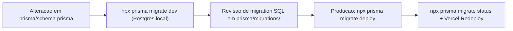

# Testes, Deploy Seguro e Troubleshooting — PaceLab

Este guia reúne os portões de qualidade, ferramentas CLI de validação de telemetria (`.FIT`/`.GPX`), regras seguras de migration e deploy (**Supabase + Vercel**) e o playbook de diagnóstico para incidentes comuns em produção.

> **Referências cruzadas:** a configuração inicial da Service Account e da planilha fica em [Passo a Passo Google Sheets e Gemini](../integrations/02_google_sheets_e_gemini_passo_a_passo.md); o contrato de fuso horário `America/Fortaleza`, códigos de erro de `withApiHandler` e bypass `?skipSheetsSync=true` ficam em [Modelo de Dados e APIs](../architecture/03_modelo_de_dados_e_apis.md); a física de pausas e divergências com o Strava está em [Leitura `.FIT`/`.GPX` e Divergências com o Strava](../architecture/01_leitura_fit_gpx_e_divergencias_strava.md).

---

## 1. Portões de Qualidade (Pipeline Local e CI)

Antes de abrir PR, publicar em `main` ou considerar uma entrega pronta, execute os comandos abaixo a partir da raiz do repositório:

| Etapa | Comando (`package.json` / CLI) | Objetivo e critério de aprovação |
|---|---|---|
| **1. Schema Prisma** | `npx prisma validate` | Garante sintaxe, relações e mapeamentos `@map`/`@@map` válidos em [`prisma/schema.prisma`](../../prisma/schema.prisma). |
| **2. Status de Migrations** | `npx prisma migrate status` | Confirma que todas as migrations de [`prisma/migrations/`](../../prisma/migrations) foram aplicadas sem *drift* no banco conectado. |
| **3. Tipos TypeScript** | `npx tsc --noEmit` | Checagem estrita de tipos sem emitir artefatos. Zero erros permitidos. |
| **4. Análise Estática** | `npm run lint` | Executa ESLint (`next lint`). Zero erros permitidos. |
| **5. Suíte de Testes** | `npm test` | Executa `vitest run` sobre toda a suíte unitária, de componentes, páginas e APIs (`jsdom`). |
| **6. Cobertura V8** | `npm run test:coverage` | Exige limites mínimos definidos em [`vitest.config.ts`](../../vitest.config.ts) (`lines: 90%`, `functions: 90%`). |
| **7. Build de Produção** | `npm run build` | Valida compilação App Router, rotas SSR/dinâmicas e bundle cliente/servidor (`next build`). |

### Regras de Cobertura e Isolamento Offline (`vitest.config.ts`)

Conforme configurado em [`vitest.config.ts`](../../vitest.config.ts) e [`vitest.setup.ts`](../../vitest.setup.ts):
- **Escopo medido pela cobertura:** arquivos em `lib/**/*.ts`, com exclusão explícita de `lib/storage/**` e `lib/prisma.ts`.
- **Metas obrigatórias:** `lines: 90` e `functions: 90` (relatórios `text` e `lcov`).
- **Isolamento de rede nos testes:** tanto o `vitest.config.ts` quanto o `vitest.setup.ts` definem `GOOGLE_SHEETS_SPREADSHEET_ID=""` e `GOOGLE_CREDENTIALS_BASE64=""` como strings vazias, evitando que testes automatizados acionem planilhas reais declaradas em `.env`.

---

## 2. Banco Local e Ferramentas CLI de `.FIT` / `.GPX`

### Diagnóstico de Conexão com PostgreSQL

```bash
npm run db:check
```

O comando `npm run db:check` executa [`scripts/check-db.mjs`](../../scripts/check-db.mjs) com `--env-file=.env`, mascara a senha das URLs, testa `SELECT 1 as connected, NOW() as current_time` e exibe a contagem de `taf_goals`, `taf_attempts` e `training_sessions` (o aviso de `prisma db push` exibido pelo script quando tabelas não existem aplica-se apenas à inicialização manual de um banco novo/vazio não-produtivo). Em caso de ambiente novo ou falha de autenticação, valide:
1. Se caracteres especiais na senha (como `@`) estão escapados em URL (`%40`);
2. Se o projeto Supabase não está pausado;
3. Se `DATABASE_URL` (Transaction Pooler, porta `6543`, ou banco local `5432`) e `DIRECT_URL` (conexão direta na porta `5432`) apontam para o mesmo projeto.

### Suítes Sintéticas, Reais e Inspetores CLI

| Domínio | Comando (`package.json`) | Finalidade |
|---|---|---|
| **`.FIT` Sintético** | `npm run fit:test:synthetic` | Valida as 10 fixtures determinísticas de [`__tests__/fixtures/fit/`](../../__tests__/fixtures/fit/README.md) + teste de mesclagem `.FIT + .GPX`. |
| **`.FIT` Real** | `npm run fit:test:real` | Executa inspeção/validação sobre arquivos colocados em `__tests__/fixtures/fit/strava-real/`. |
| **Inspetor `.FIT`** | `npm run fit:inspect -- arquivo.fit --splits --taf --debug` | Exibe métricas, parciais, janela TAF de 12 min e comparativo opcional com `--strava-dist`, `--strava-time`, etc. |
| **Gerar `.FIT`** | `npm run fit:gen-fixtures` | Regenera as fixtures binárias sintéticas via [`scripts/gen-fit-fixture.mjs`](../../scripts/gen-fit-fixture.mjs). |
| **`.GPX` Sintético** | `npm run gpx:test:synthetic` | Valida as 20 fixtures XML de [`__tests__/fixtures/gpx/`](../../__tests__/fixtures/gpx/README.md) contra gabarito matemático. |
| **`.GPX` Real** | `npm run gpx:test:real` | Avalia arquivos em `__tests__/fixtures/gpx/strava-real/` com tolerâncias de referência. |
| **Inspetor `.GPX`** | `npm run gpx:inspect -- arquivo.gpx --splits --debug` | Mostra `<trkseg>`, descartes de spikes/pausas e cálculo de splits. |
| **Gerar `.GPX`** | `npm run gpx:gen-fixtures` | Regenera as 20 fixtures `.GPX` via [`scripts/gen-gpx-fixture.mjs`](../../scripts/gen-gpx-fixture.mjs). |

---

## 3. Deploy & Migrations Seguras (Supabase + Vercel)



### Regras Obrigatórias de Migration

- **Use sempre `npx prisma migrate deploy` em produção/homologação:** aplica em ordem determinística todas as migrations pendentes registradas em `_prisma_migrations` (`prisma/migrations/`).
- **Proibido rodar `prisma db push` no banco de produção Supabase:** `db push` ignora o histórico versionado de migrations, podendo causar *schema drift*, quebra de enums/índices em migrations futuras ou perda acidental de dados.
- **Instalação e geração do client:** o script `"postinstall": "prisma generate"` em [`package.json`](../../package.json) garante a atualização automática dos tipos `@prisma/client` na Vercel a cada build.

### Checklist de Variáveis de Ambiente ([`.env.example`](../../.env.example))

| Variável | Obrigatória | Onde é usada | Observação |
|---|---|---|---|
| `DATABASE_URL` | **Sim** (módulos persistidos) | Runtime Next.js / Prisma | No Supabase em produção, recomenda-se a URL do Pooler. |
| `DIRECT_URL` | **Sim** (para migrations) | `prisma migrate deploy` / CLI | Conexão direta PostgreSQL (porta `5432`), exigida pelo bloco `datasource db` em [`prisma/schema.prisma`](../../prisma/schema.prisma). |
| `GOOGLE_SHEETS_SPREADSHEET_ID` | Opcional | API Routes Google Sheets (server-side) | ID da planilha `"Treinos_Corrida"`. Sem ela, o app segue normal em Postgres apenas. |
| `GOOGLE_CREDENTIALS_BASE64` | Opcional | API Routes Google Sheets (server-side) | JSON da *Service Account* codificado em Base64 em linha única (nunca salvar `.json` no repositório). |
| `NEXT_PUBLIC_SUPABASE_URL` / `NEXT_PUBLIC_SUPABASE_ANON_KEY` | Opcional | Cliente Supabase (uso futuro/auth) | Definidas no template; autenticação multiusuário ainda é item de roadmap. |

---

## 4. Playbook de Troubleshooting Prático

### 1. Erro HTTP `503` (Banco PostgreSQL ou Google Sheets Não Configurado)

- **Sintoma no Banco:** `GET /api/taf/health` retorna `503` (`DATABASE_URL não configurada` ou falha em `$queryRaw SELECT 1`), ou qualquer endpoint CRUD retorna `503` (`"Não foi possível conectar ao banco de dados Supabase"`, via `PrismaClientInitializationError` em [`lib/api/response.ts`](../../lib/api/response.ts)).
  - **Causa e ação:** `.env` (local) ou *Environment Variables* (Vercel) sem `DATABASE_URL`, senha sem URL-encoding, ou instância Supabase pausada. Verifique com `npm run db:check` (local) e `/api/taf/health` (produção). Note que as calculadoras públicas (`/calculadora`, `/taf`, `/metas`, `/intervalado`, `/historico`) continuam operacionais via `localStorage`/`sessionStorage`.
- **Sintoma no Google Sheets:** `POST /api/sync/sheets` retorna `503` com `code: "SHEETS_NOT_CONFIGURED"` ou `"SHEETS_UNAVAILABLE"`.
  - **Causa e ação:** falta `GOOGLE_SHEETS_SPREADSHEET_ID` ou `GOOGLE_CREDENTIALS_BASE64`, ou indisponibilidade momentânea da API Google. `GET /api/sync/sheets` retornará `configured: false` sem lançar erro, e operações individuais de cadastro/edição no banco continuam salvando normalmente no PostgreSQL (marcando o registro como `Pendente Sheets`). Veja o setup completo em [Passo a Passo Google Sheets e Gemini](../integrations/02_google_sheets_e_gemini_passo_a_passo.md).

### 2. Erros HTTP `429` ou `502` no Google Sheets e Uso de `?skipSheetsSync=true`

Conforme mapeado em [`app/api/sync/sheets/route.ts`](../../app/api/sync/sheets/route.ts):
- **`HTTP 429` (`SHEETS_QUOTA_EXCEEDED`):** cota de requisições por minuto da API Google Sheets atingida. Aguarde ~1 minuto antes de clicar novamente em **Sincronizar Planilha** (`/treinos`) ou **Sincronizar Agora (Bidirecional)** (`/meu-taf`).
- **`HTTP 502` (`SHEETS_PERMISSION_DENIED` / `401` / `403`):** a planilha não foi compartilhada como **Editor** com o `client_email` da Service Account, ou `GOOGLE_CREDENTIALS_BASE64` está malformada/quebrada em múltiplas linhas.
- **`HTTP 502` (`SHEETS_NOT_FOUND` / `404`):** `GOOGLE_SHEETS_SPREADSHEET_ID` incorreto ou aba obrigatória renomeada/removida manualmente.
- **`HTTP 502` (`SHEETS_UPSTREAM_ERROR`):** fallback para outros códigos/falhas não classificados da API do Google Sheets (enquanto indisponibilidade `5xx` retorna `HTTP 503` `SHEETS_UNAVAILABLE` e ausência de credenciais/ID retorna `HTTP 503` `SHEETS_NOT_CONFIGURED`).
- **Prevenção em cargas em lote (`?skipSheetsSync=true`):** na importação em massa (`GpxImportPanel` via `persistBatchActivityItems` em [`lib/activityParser/batchPayloads.ts`](../../lib/activityParser/batchPayloads.ts)) ou restauração de backup (`GoalAndBackupSettings` via `tafService.importBackupJson` em [`lib/services/tafService.ts`](../../lib/services/tafService.ts)), as gravações individuais passam `{ skipSheetsSync: true }` → `?skipSheetsSync=true` ([`lib/api/sheetsSync.ts`](../../lib/api/sheetsSync.ts)), mantendo a reconciliação local no Postgres ativa e disparando apenas **1 chamada consolidada** em `POST /api/sync/sheets` ao término do lote.

### 3. Desvios de Data em Treinos Noturnos (`>= 21h` BRT vs. Vercel UTC)

- **Sintoma clássico:** treino registrado às `21:30` BRT (`00:30Z` do dia seguinte) ou data civil salva como `YYYY-MM-DDT00:00:00.000Z` (`21:00` da véspera em `UTC-3`) aparecendo no dia anterior/posterior ou caindo na semana errada.
- **Como o sistema protege e o que verificar:**
  - Todas as datas de vínculo semanal usam `toFortalezaDateKey` (`America/Fortaleza`, em [`lib/math/weeklyAdherence.ts`](../../lib/math/weeklyAdherence.ts)) e `formatDateFortaleza` / `parseSheetDate` ancorado em meio-dia UTC (`12:00:00.000Z`) em [`lib/googleSheets/mapper.ts`](../../lib/googleSheets/mapper.ts).
  - Se encontrar data errada em edição manual na planilha, confira se a célula está no formato `YYYY-MM-DD` ou `DD/MM/YYYY` válido e dispare uma sincronização bidirecional; detalhes completos em [Contrato de Datas e Fuso Horário](../architecture/03_modelo_de_dados_e_apis.md#3-contrato-de-datas-e-fuso-horário-americafortaleza).

### 4. Diferenças Normais Entre `.FIT`/`.GPX` e a Tela do Strava

- Pequenas diferenças de segundos no tempo em movimento, poucos metros na distância GPS, ganho de elevação suavizado ou calorias (o PaceLab sempre recalcula gasto energético pelo Compêndio 2024 em vez de copiar estimativas proprietárias do relógio) são **esperadas por projeto**.
- Para auditar um arquivo específico antes de suspeitar de bug, rode `npm run fit:inspect` ou `npm run gpx:inspect` com `--splits --debug` e compare com os 6 mecanismos documentados em [Divergências com o Strava](../architecture/01_leitura_fit_gpx_e_divergencias_strava.md#5-por-que-fit-e-gpx-divergem-do-strava).

### 5. Recuperação de Vínculos do `Plano_Semanal` Após Edição, Exclusão ou Falha de Sync

- **Edição (`PUT /api/taf/trainings/[id]`):** executa `safeReconcileWeeklyPlans({ editedSessionId })`, que usa `evaluateLinkedSessionValidity` ([`lib/math/weeklyAdherence.ts`](../../lib/math/weeklyAdherence.ts)) para desvincular sessões que deixaram de cumprir os critérios — janela de `0` ou `±1` dia em `America/Fortaleza` (sem outro item planejado na data da sessão em casos de `±1`), compatibilidade de modalidade e distância `>= 40%` da meta do plano (`evaluateWeeklyMatch`) — e reavaliar planos livres.
- **Exclusão (`DELETE /api/taf/trainings/[id]`):** a FK `matchedSessionId` usa `onDelete: SetNull`, liberando o item no banco; em seguida `safeReconcileWeeklyPlans()` recalcula o status para `"Planejado"` (hoje/ontem/futuro) ou `"Perdido"` (`plannedDate < ontem`).
- **Caso a planilha `Plano_Semanal!H:I` fique defasada** (por falha de rede, erro `429` ou gravação com `?skipSheetsSync=true`): clique em **`Sincronizar Planilha`** em `/treinos` ou **`Sincronizar Agora (Bidirecional)`** em `/meu-taf` (`Meta & Banco`) para reexecutar o `pull` + reconciliação + `pushWeeklyPlanStatusToSheets`.
