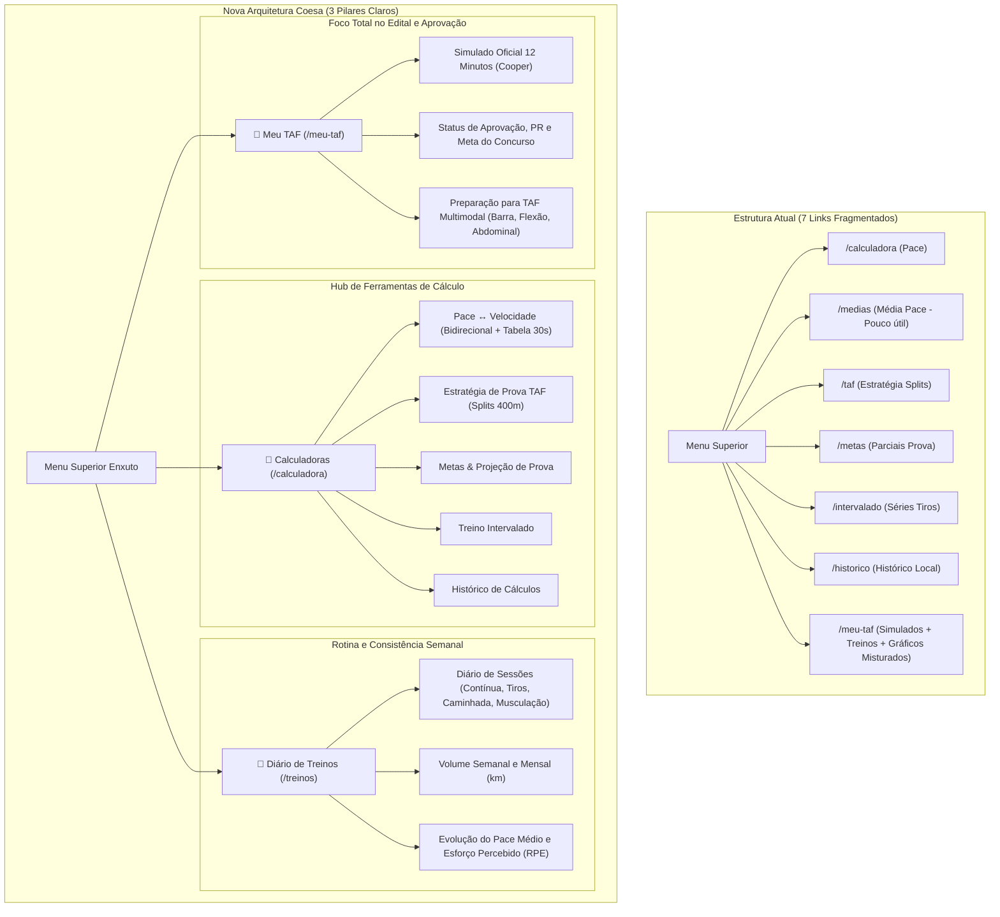

# 📌 Plano de Execução: Reestruturação de UX, Hub de Calculadoras e Desacoplamento do Diário de Treinos

**Projeto:** PaceLab  
**Módulos:** Navegação, Calculadoras, Diário de Treinos (`/treinos`) e Meu TAF (`/meu-taf`)  
**Data:** 11/10/2026  
**Status:** Pendente (Pronto para Execução em Fases)  
**Referência:** [docs/roadmap/01_roadmap_melhorias_futuras.md](../../roadmap/01_roadmap_melhorias_futuras.md)

---

## 1. 🎯 Contexto e Motivação

O PaceLab consolidou sua persistência relacional exclusiva no Supabase e uma API robusta com Zod. Contudo, a experiência do usuário (UX) e a arquitetura de informação apresentam oportunidades essenciais de evolução:

1. **Sobrecarga Cognitiva no Menu:** Atualmente existem **7 a 8 links espalhados no cabeçalho e na barra inferior**, forçando rolagem horizontal no celular e confundindo o usuário.
2. **Funcionalidade de Baixo Valor Prático:** A rota `/medias` ("Médias de Pace") exige digitação manual de múltiplos ritmos, o que não reflete a rotina real dos corredores e gera ruído visual no menu.
3. **Pace ↔ Velocidade Fragmentado:** A conversão entre Pace (min/km) e Velocidade (km/h) está dividida em modos separados, quando corredores precisam de um cálculo bidirecional instantâneo acompanhado de uma **tabela fixa de referência rápida** (de 30 em 30 segundos) para consulta rápida em esteiras e pistas.
4. **Mistura Conceitual no "Meu TAF":** A página `/meu-taf` acumula hoje treinos leves do dia a dia, caminhadas, tiros, simulados oficiais de 12 minutos e comparadores de período. Na ciência desportiva, **Treino Diário/Semanal (Volume e Consistência)** é diferente de **Simulado de TAF (Aferição de Corte e Aprovação)**.
5. **Visão Futura Multimodal do TAF:** Editais de concursos (Guarda Municipal, PF, PRF, PM, PC) cobram não apenas corrida, mas também **Barra Fixa, Flexão de Braço e Abdominal**. O módulo Meu TAF precisa ser limpo agora para estar arquiteturalmente preparado para receber esses exercícios no futuro.

---

## 2. 🏗️ Arquitetura de Informação: Antes vs Depois

---

## 3. 📋 Fases Detalhadas de Implementação

### 🔹 Fase 1: Limpeza da Rota `/medias` e Higienização de Dependências (✅ Concluída)
**Meta:** Eliminar a tela de média de pace sem quebrar os utilitários matemáticos e mantendo os testes 100% verdes.

1. **Remoção de Arquivos de Interface:**
   - Excluída a página `app/medias/page.tsx` e o diretório `app/medias/`.
   - Excluído o arquivo de testes `__tests__/pages/medias.test.tsx`.
2. **Atualização da Navegação:**
   - Removido `/medias` e o ícone `BarChart2` de `components/layout/Navbar.tsx`.
   - Removido `/medias` e o ícone `BarChart2` de `components/layout/BottomNav.tsx`.
   - Removido card de `/medias` na landing page (`app/page.tsx`) e atualizados os testes em `__tests__/pages/home.test.tsx` e `__tests__/components/Navigation.test.tsx`.
3. **Manutenção de Tipos e Funções Matemáticas:**
   - Preservadas as funções de cálculo estatístico em `lib/math/averages.ts` e `__tests__/lib/averages.test.ts`.
4. **Validação:**
   - `npm test`: 33 arquivos / 301 testes aprovados (100%).
   - `npx tsc --noEmit`: 0 erros de TypeScript.
   - `npx eslint .`: 0 erros / 0 warnings.
   - `npm run build`: 11 páginas estáticas e 6 rotas dinâmicas compiladas com sucesso.

---

### 🔹 Fase 2: Calculadora Pace ↔ Velocidade Unificada com Tabela de Referência (30s) (✅ Concluída)
**Meta:** Criar uma experiência de cálculo bidirecional ágil e enriquecida com tabela fixa para esteira e pista.

1. **Conversão Bidirecional Reativa:**
   - Modo `pace-speed` unificado na Calculadora Principal, substituindo a duplicidade dos botões legados.
   - Campos sincronizados em tempo real: ao digitar o Pace (`min:ss` ou minutos inteiros), calcula e atualiza a Velocidade (`km/h`).
   - Ao digitar a Velocidade (`km/h`), calcula e formata o Pace instantaneamente.
   - Resultados detalhados: Pace equivalente, Velocidade, tempo parcial para volta de 400m em pista e projeção para o teste de 12 min do TAF.
2. **Componente de Tabela de Referência Rápida (`PaceSpeedTable`):**
   - Implementado em `components/calculadora/PaceSpeedTable.tsx`.
   - Cobre ritmos de 30 em 30 segundos (de 3:00/km até 8:00/km).
   - Colunas: Pace (min/km), Velocidade (km/h), Volta 400m pista, Zona / Utilidade.
   - Badges especiais de destaque para metas de concurso: 5:00/km (TAF 2.400m) e 5:13/km (TAF 2.300m).
   - Interatividade: clique em qualquer linha preenche instantaneamente os inputs da calculadora e ilumina a linha ativa.
3. **Testes Automatizados:**
   - Criado `__tests__/components/PaceSpeedTable.test.tsx` com 4 testes unitários cobrindo renderização, badges de TAF, seleção e destaque da linha ativa.
   - Atualizado `__tests__/pages/calculadora.test.tsx` cobrindo o fluxo bidirecional, minutos inteiros e clique na tabela.
4. **Validação:**
   - `npm test`: 34 arquivos / 309 testes aprovados (100%).
   - `npx tsc --noEmit`: 0 erros de TypeScript.
   - `npx eslint .`: 0 erros / 0 warnings.
   - `npm run build`: 11 páginas estáticas e 6 rotas dinâmicas compiladas com sucesso.

---

### 🔹 Fase 3: Hub Central de Calculadoras e Redesenho do Header/BottomNav (✅ Concluída)
**Meta:** Enxugar o cabeçalho e a barra mobile de 8 itens para apenas 3 ou 4 pilares estratégicos.

1. **Redesenho do Menu (`Navbar.tsx` e `BottomNav.tsx`):**
   - **Desktop Header:** Enxugado para os 3 pilares estratégicos:
     - `PaceLab` (Home `/`)
     - `Calculadoras` (`/calculadora` - Hub Central)
     - `Diário de Treinos` (`/treinos`)
     - `Meu TAF` (`/meu-taf` com destaque visual)
     - `ThemeToggle`
   - **Mobile BottomNav:** 4 abas perfeitamente distribuídas em grid sem barra de rolagem horizontal:
     - `Início` (`/`), `Calculadoras` (`/calculadora`), `Treinos` (`/treinos`), `Meu TAF` (`/meu-taf`).
2. **Estruturação do Hub de Calculadoras (`app/calculadora/page.tsx`):**
   - Navegação superior em abas do Hub:
     - **Aba 1: Pace & Ritmo:** Conversor bidirecional unificado, modos distância/tempo e Tabela de Referência de 30s.
     - **Aba 2: Estratégia TAF:** Splits de pista de 400m, metas militares/policiais e barra de aptidão.
     - **Aba 3: Metas & Splits:** Projetor de tempos para 5k, 10k, 21k, 42k e parciais km a km.
     - **Aba 4: Intervalado:** Simulador HIIT de tiros, trote regenerativo e velocidade média.
     - **Aba 5: Histórico:** Consultas salvas e exportação CSV/JSON.
   - Sincronização fluida com query param `?tab=...`.
3. **Criação do Esqueleto da Rota `/treinos`:**
   - Criado `app/treinos/page.tsx` com indicadores de consistência (volume semanal/mensal) e cards de transição para a Fase 4.
4. **Validação:**
   - `npm test`: 35 arquivos / 318 testes aprovados (100%).
   - `npx tsc --noEmit`: 0 erros de TypeScript.
   - `npx eslint .`: 0 erros / 0 warnings.
   - `npm run build`: 12 páginas estáticas e 6 rotas dinâmicas compiladas com sucesso.

---

### 🔹 Fase 4: Desacoplamento e Criação do Diário de Treinos (`/treinos`) (✅ Concluída)
**Meta:** Criar uma tela dedicada e especializada para o acompanhamento da rotina semanal de treinos do atleta.

1. **Criação da Rota `app/treinos/page.tsx`:**
   - Página de primeiro nível alimentada pelas rotas já existentes no backend (`GET /api/taf/trainings` e `POST /api/taf/trainings`).
2. **Componentes e Recursos da Tela:**
   - **Formulário de Treino (`TrainingForm`):** Registro de sessões com modalidade (contínua, tiros, caminhada, musculação), distância km, duração, RPE (1 a 10), peso e parciais.
   - **Painel de Indicadores de Consistência:**
     - Volume total da semana atual (km) vs semana anterior.
     - Volume total do mês (km).
     - Pace médio acumulado da semana.
     - Média de esforço percebido (RPE) para prevenção de overtraining.
   - **Lista e Timeline de Treinos (`TrainingList`):** Histórico de treinos com filtros por modalidade, paginação cursor-based, edição e exclusão.
3. **Testes Automatizados & Validação:**
   - Criado `__tests__/pages/treinos.test.tsx` com 5 testes passando (renderização, toggle do formulário, criação, edição e exclusão de treinos).
   - `npm test`: 35 suítes / 320 testes passando (100%).
   - `npx tsc --noEmit`: 0 erros.
   - `npx eslint .`: 0 erros / 0 warnings.
   - `npm run build`: 12 páginas estáticas geradas com sucesso (incluindo `/treinos` com 5.85 kB).

---

### 🔹 Fase 5: Foco Estrito no "Meu TAF" (`/meu-taf`) & Prontidão Multidisciplinar (✅ Concluída)
**Meta:** Focar o Meu TAF 100% no teste de 12 minutos e aprovação, preparando a arquitetura para Barra, Flexão e Abdominal.

1. **Enxugamento do `app/meu-taf/page.tsx`:**
   - Abas de treinos diários desacopladas com sucesso para a rota dedicada `/treinos`.
   - 4 Abas limpas mantidas no Meu TAF:
     - **Aba 1: Testes de 12 Min:** Registro rápido com voltas de 400m e histórico de simulados.
     - **Aba 2: Gráficos de Evolução:** Painel de recorde pessoal e gráficos da meta do edital.
     - **Aba 3: Comparar Períodos:** Comparação entre testes recentes.
     - **Aba 4: Meta & Banco:** Configuração da meta do concurso e exportação/importação de backup.
2. **Preparação Arquitetural para TAF Multimodal (Barra, Flexão, Abdominal):**
   - Seletor multimodal implementado no topo com "Corrida 12 Min (Ativo)" e placeholders profissionais modulares para "Barra Fixa", "Flexão de Braço" e "Abdominal Remador" (com badges "Em breve").
3. **Bateria Geral de Garantia de Qualidade:**
   - `npm test`: 35 arquivos / 321 testes aprovados (100%).
   - `npx tsc --noEmit`: 0 erros de tipagem.
   - `npx eslint .`: 0 erros e 0 warnings.
   - `npm run build`: Compilação de produção validada (12 páginas estáticas geradas com sucesso).

---

## 4. 🎯 Critérios de Aceite (Definition of Done)

- [x] Rota `/medias` excluída com remoção limpa de seus testes e links no menu.
- [x] Calculadora unificada Pace ↔ Velocidade implementada com conversão bidirecional reativa.
- [x] Tabela de referência rápida de 30s em 30s implementada abaixo da calculadora com parciais de 400m.
- [x] Header desktop e BottomNav mobile redesenhados com navegação enxuta (sem scroll horizontal no mobile).
- [x] Nova rota `/treinos` implementada com diário de treinos, volume semanal/mensal e histórico.
- [x] Rota `/meu-taf` focada exclusivamente em simulados de 12 min, PR e índice de aprovação do edital.
- [x] 100% dos testes automatizados aprovados no Vitest (35 suítes / 321 testes).
- [x] Build de produção (`npm run build`) concluído com sucesso.
