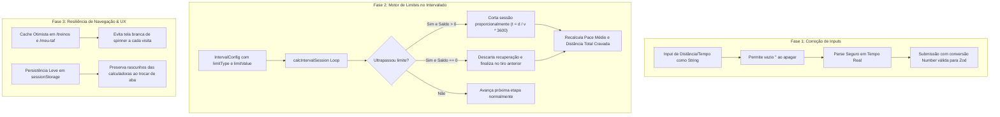

# 📌 Plano de Execução: Resiliência de Navegação, Limites de Treino no Intervalado e Correção de Inputs Numéricos

**Projeto:** PaceLab  
**Módulos:** Diário de Treinos (`/treinos`), Simulador Intervalado (`/intervalado`), Meu TAF (`/meu-taf`) e Hub de Calculadoras (`/calculadora`)  
**Data:** 12/10/2026  
**Status:** Concluído e Validado ✅  
**Referência:** [docs/roadmap/01_roadmap_melhorias_futuras.md](../../roadmap/01_roadmap_melhorias_futuras.md)

---

## 1. 🎯 Diagnóstico e Avaliação de Viabilidade das Sugestões

### 1.1 Sugestão 1: "Páginas recarregando ao sair e entrar no site novamente"
* **Viabilidade:** Faz sentido e possui causa raiz técnica diagnosticada.
* **Diagnóstico da Causa Raiz:**
  1. **Ambiente de Desenvolvimento (`next dev` / Fast Refresh):** Ao trocar de janela ou suspender a aba no navegador, a conexão WebSocket do HMR (`/_next/webpack-hmr`) é interrompida. Ao retornar o foco à aba, o cliente de desenvolvimento do Next.js força um `window.location.reload()` para sincronizar o estado.
  2. **Percepção Visual de Recarregamento (Flicker de Loading):** Em `/treinos` e `/meu-taf`, o estado inicial é `isLoading: true`. A cada acesso ou retorno, a interface é totalmente desmontada e substituída por um spinner centralizado ("Carregando seus treinos..."), gerando um "flash" de carregamento desnecessário mesmo quando os dados já haviam sido lidos recentemente.
  3. **Ausência de Persistência em Calculadoras:** O estado dos inputs das calculadoras existe apenas em memória (`useState`). Ao sair e retornar, todos os valores são reiniciados para os padrões (ex: 5km, 27:30), dando a impressão ao usuário de que a página deu "reset" e perdeu o trabalho.
* **Decisão:** Não alterar código precipitadamente. Na Fase 3, implementar persistência leve de rascunhos (`sessionStorage`) nas calculadoras e cache otimista com SWR/stale-while-revalidate suave em `/treinos` e `/meu-taf`, eliminando spinners agressivos ao revisitar as telas.

---

### 1.2 Sugestão 2: "Limite de Distância ou Tempo no Simulador Intervalado com Corte Inteligente"
* **Viabilidade:** Faz total sentido e agrega grande valor desportivo (especialmente para concurseiros de TAF que buscam fechar exatamente 2,4 km em tiros).
* **Diagnóstico e Regra de Negócio Matemática:**
  1. **Configuração Opcional de Limite:** Permitir definir `limitType: "none" | "distance" | "time"` e o respectivo valor (ex: `2.4 km` ou `12 min`).
  2. **Corte Proporcional da Última Sessão:**
     - Ao simular as etapas sequenciais (aquecimento, tiros de corrida, recuperação, desaquecimento), verificar o acumulado de distância e tempo.
     - Se uma etapa for ultrapassar o limite configurado:
       - **Caso A (Corte Proporcional):** Se a distância/tempo restante for maior que zero, cortar a etapa exatamente na proporção necessária para atingir a meta ($t_{\text{cortado}} = \frac{D_{\text{restante}}}{v} \times 3600$). A etapa recebe a flag `isTruncated: true`.
       - **Caso B (Remoção de Recuperação Excedente):** Se a etapa forte (corrida) anterior já tiver atingido exatamente o limite (ex: 2.400m cravados), a recuperação seguinte tem saldo restante zero e é **completamente descartada**, finalizando o treino na sessão forte anterior.
       - **Caso C (Corte na Sessão Forte):** Se mesmo a sessão de corrida ultrapassar o limite, a própria corrida é cortada para totalizar a meta estrita.
       - **Caso D (Desaquecimento):** Se o limite for atingido durante as séries, o desaquecimento é omitido.
  3. **Métricas Finais:** Recalcular velocidade média e pace médio ponderado com base no treino estritamente ajustado ao limite.

---

### 1.3 Sugestão 3: "Inputs numéricos preenchendo 0 automaticamente e impedindo edição ('017,5km')"
* **Viabilidade:** Faz total sentido; é um bug clássico de inputs numéricos controlados em React.
* **Diagnóstico da Causa Raiz:**
  1. Em `components/meu-taf/TrainingForm.tsx` (linhas 53-56 e 332-401), os estados são numéricos (`useState<number>(5.0)`).
  2. Ao apagar o conteúdo de um input com Backspace, o navegador emite `e.target.value = ""`.
  3. Como `Number("") === 0`, o estado é imediatamente atualizado para `0`.
  4. O componente re-renderiza exibindo `"0"`. Ao tentar apagar esse zero, o evento emite `""`, que converte novamente para `0`, impedindo o campo de ficar limpo.
  5. Ao digitar dígitos à frente ou atrás, valores como `"017.5"` surgem na tela.
  6. Em contrapartida, o campo `bodyWeightKg` foi implementado como `useState<string>("")` e funciona perfeitamente sem esse defeito.
* **Decisão:** Converter os estados locais dos inputs para `string` em `TrainingForm.tsx` e `TafAttemptForm.tsx`, mantendo cálculo reativo com parsing seguro e validação robusta na submissão.

---

## 2. 🏗️ Arquitetura e Modelagem



---

## 3. 📋 Fases Detalhadas de Implementação

### 🔹 Fase 1: Correção dos Inputs Numéricos nos Formulários (✅ Concluída)
**Objetivo:** Garantir que o usuário consiga apagar completamente campos de distância e tempo sem que o `0` seja reinserido compulsoriamente, eliminando artefatos como `"017,5km"`.

- [x] **1.1** Refatorar `components/meu-taf/TrainingForm.tsx`:
  - Migrar estados internos `distanceKm`, `hours`, `minutes`, `seconds` de `number` para `string`:
    - `distanceInput`: string (inicial `"5.0"` ou valor de edição)
    - `hoursInput`: string (inicial `"0"` ou valor de edição)
    - `minutesInput`: string (inicial `"27"` ou valor de edição)
    - `secondsInput`: string (inicial `"30"` ou valor de edição)
  - Ajustar handlers `onChange` para aceitar strings puras (incluindo `""` e substituição de vírgula por ponto).
  - Atualizar os cálculos de live pace e live speed para tratar strings vazias ou `NaN` de forma defensiva sem forçar `"0"` no input.
  - No `onBlur`, aplicar formatação amigável apenas se o campo estiver vazio ou necessitar de sanitização.
  - No `handleSubmit`, converter as strings para `Number()` com validação antes de enviar ao `tafService`.
- [x] **1.2** Verificar e alinhar `components/meu-taf/TafAttemptForm.tsx`:
  - Aplicar o mesmo padrão para `distanceMetersInput`, `minutesInput` e `secondsInput`.
- [x] **1.3** Criar testes unitários em `__tests__/components/TrainingFormInputs.test.tsx`:
  - Simular digitação, apagamento com `userEvent.clear()` ou `backspace`, digitação de "17.5" garantindo ausência do prefixo "0", e envio com valores numéricos corretos.

---

### 🔹 Fase 2: Motor de Limite de Treino no Simulador Intervalado (✅ Concluída)
**Objetivo:** Permitir limitar a sessão intervalada por Distância (ex: 2,4 km) ou por Tempo (ex: 12 min), com corte milimétrico da última etapa ou descarte de recuperação excedente.

- [x] **2.1** Atualizar `types/index.ts`:
  - Adicionar tipos em `IntervalConfig`:
    ```ts
    export type IntervalLimitType = "none" | "distance" | "time";

    export interface IntervalConfig {
      // ... campos existentes
      limitType?: IntervalLimitType;
      maxDistanceKm?: Kilometers;
      maxDurationSeconds?: Seconds;
    }
    ```
  - Adicionar flag em `IntervalStage`:
    ```ts
    export interface IntervalStage {
      // ... campos existentes
      isTruncated?: boolean; // indica se foi cortada para respeitar o limite
    }
    ```
- [x] **2.2** Atualizar função `calcIntervalSession` em `lib/math/intervals.ts`:
  - Implementar lógica de teto durante ou após a iteração das etapas:
    - Se `limitType === "distance"` e `maxDistanceKm > 0`:
      - Interromper a inclusão de novas etapas caso o acumulado alcance o teto.
      - Se uma etapa for extrapolar:
        - Saldo $D_{\text{rest}} = \text{maxDistanceKm} - D_{\text{acumulado}}$.
        - Se $D_{\text{rest}} > 0$: cortar a duração da etapa para $t = \frac{D_{\text{rest}}}{v} \times 3600$ segundos e marcar `isTruncated = true`.
        - Se $D_{\text{rest}} <= 0$: descartar essa etapa (ex: se era recuperação ou desaquecimento e a corrida anterior já atingiu o limite).
    - Se `limitType === "time"` e `maxDurationSeconds > 0`:
      - Aplicar raciocínio análogo para o limite de tempo em segundos.
- [x] **2.3** Atualizar Interface do Usuário em `app/intervalado/page.tsx`:
  - Adicionar card de "Limite de Treino (Opcional)":
    - Opções: "Sem limite" | "Limite de Distância (km)" | "Limite de Tempo (min)".
    - Input de valor com atalho de 2,4 km (TAF) e 12 min (TAF).
  - Exibir badge explicativo no resumo e na tabela de etapas quando houver etapa cortada ou treino finalizado por limite.
- [x] **2.4** Testes Unitários em `__tests__/lib/intervalsLimit.test.ts` e `__tests__/pages/intervalado.test.tsx`:
  - Testar corte exato em 2.4 km quando a recuperação extrapola.
  - Testar remoção de recuperação quando o tiro forte bate exatamente 2.4 km.
  - Testar corte no tiro forte quando o tiro forte ultrapassa o limite.
  - Testar limite por tempo (720s / 12 min).
  - Testar comportamento interativo na interface (botões de atalho, formulário e badges).

---

### 🔹 Fase 3: Resiliência de Navegação, Cache Otimista e Investigação de Recarregamentos (✅ Concluída)
**Objetivo:** Eliminar flashes de loading agressivos, preservar rascunhos de cálculo entre saídas/entradas e documentar o comportamento de HMR.

- [x] **3.1** Cache Otimista em `app/treinos/page.tsx` e `app/meu-taf/page.tsx`:
  - Armazenar última lista carregada em `sessionStorage` ou estado em memória.
  - Se houver dados em cache recente, renderizar a interface imediatamente e efetuar a busca de atualização em segundo plano (padrão Stale-While-Revalidate), eliminando a tela em branco com spinner a cada navegação.
- [x] **3.2** Persistência de Rascunho nas Calculadoras:
  - Adicionar sincronização leve dos inputs de cálculo em `sessionStorage` (ex: `pacelab_draft_calc`, `pacelab_draft_interval`), restaurando os valores caso o usuário saia para outro app e volte à mesma sessão.
- [x] **3.3** Alinhamento de Rotas na Home (`app/page.tsx`):
  - Manter as rotas legadas e novos links da landing page funcionando com navegação instantânea e integração cruzada entre ferramentas.
- [x] **3.4** Documentação Técnica sobre HMR:
  - Registrar no documento de encerramento a explicação técnica para o desenvolvedor sobre a reconexão do WebSocket do Fast Refresh no `next dev`.

---

### 🔹 Fase 4: Testes Automatizados, Homologação e Qualidade (✅ Concluída)
**Objetivo:** Garantir 100% dos testes verdes e zero regressões em todo o projeto.

- [x] **4.1** Executar suíte completa de testes (`npm test`) -> 40/40 suítes verdes, 349 testes aprovados.
- [x] **4.2** Verificar tipagem estrita com TypeScript (`npx tsc --noEmit`) -> 0 erros.
- [x] **4.3** Executar linter (`npx eslint .`) e integridade de formatação -> 0 erros.
- [x] **4.4** Validar build estático (`npm run build`) -> 12 páginas estáticas compiladas com sucesso.

---

## 4. 🎯 Critérios de Aceite

| Requisito | Critério de Aceite |
|---|---|
| **Inputs Numéricos** | Ao limpar o campo de distância ou duração, o campo fica em branco sem preencher `0` automaticamente. Digitar "17.5" resulta em `17.5` sem prefixo `0`. |
| **Limite Intervalado** | Configurar limite de 2,4 km corta a última recuperação no tempo exato restante. Se o tiro forte anterior já atingiu 2,4 km, a recuperação é removida. |
| **Cálculo de Pace Médio** | O pace médio e tempo total da sessão refletem com precisão milimétrica a distância truncada até o limite. |
| **UX de Carregamento** | Ao alternar entre telas ou reabrir o app na mesma sessão, os treinos não desmontam a tela em branco com spinner agressivo caso já existam dados carregados. |
| **Rascunhos Salvos** | Ao preencher o intervalado e alternar abas, os valores configurados permanecem disponíveis sem reset involuntário. |
| **Qualidade de Código** | 100% dos testes unitários e de integração aprovados, build verde e zero erros de ESLint/TypeScript. |
