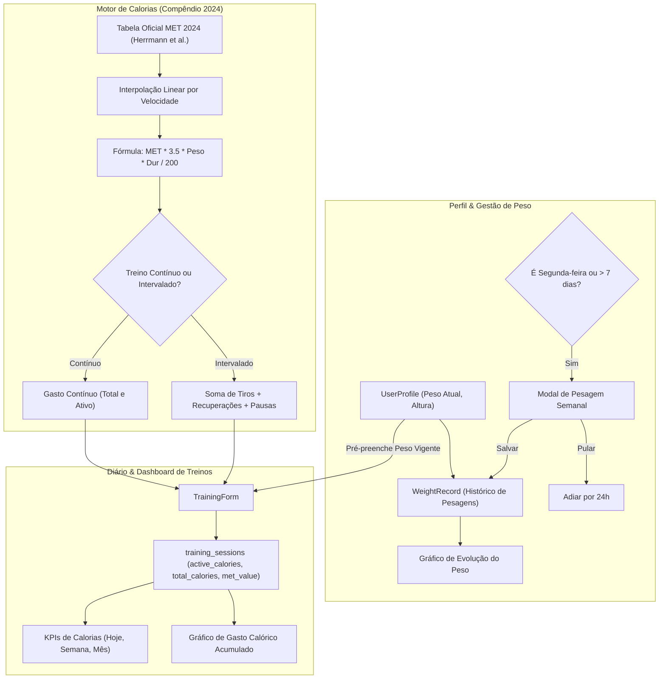

# 📌 Plano de Execução: Sistema de Estimativa Calórica (Compêndio MET 2024), Perfil do Atleta e Pesagem Semanal

**Projeto:** PaceLab  
**Módulos:** Motor Matemático (`lib/math/calories.ts`), Banco de Dados / Prisma (`prisma/schema.prisma`), APIs (`app/api/profile/*`), Diário de Treinos (`/treinos`), Perfil do Atleta (`/perfil`), Simulador Intervalado (`/intervalado`)  
**Data:** 12/10/2026  
**Status:** Concluído e Validado (12/10/2026)  
**Referência:** [docs/roadmap/01_roadmap_melhorias_futuras.md](../../roadmap/01_roadmap_melhorias_futuras.md)

---

## 1. 🎯 Diagnóstico e Especificação Técnica

### 1.1 Objetivo do Negócio e Científico
Implementar um sistema de estimativa de gasto energético para treinos de corrida e caminhada cientificamente fundamentado no **Compêndio de Atividades Físicas de 2024 (2024 Adult Compendium of Physical Activities)**, eliminando fórmulas arbitrárias ou simplistas.  
O sistema calculará com rigor:
1. **Calorias Totais (kcal):** gasto energético bruto durante a atividade.
2. **Calorias Ativas (kcal):** gasto energético líquido atribuível ao exercício físico (descontando o metabolismo de repouso basal durante a duração do treino).

### 1.2 Regras Matemáticas e Equações Metabólicas Oficiais
De acordo com o Compêndio de 2024 e o Colégio Americano de Medicina do Esporte (ACSM):
$$1\text{ MET} = 3,5\text{ mL } \text{O}_2 \cdot \text{kg}^{-1} \cdot \text{min}^{-1} \approx 1\text{ kcal} \cdot \text{kg}^{-1} \cdot \text{h}^{-1}$$

* **Gasto Calórico Total:**
  $$\text{Calorias Totais (kcal)} = \frac{\text{MET} \times 3,5 \times \text{peso (kg)} \times \text{duração (min)}}{200}$$
  *(Equivalente a: $\text{MET} \times \text{peso (kg)} \times \text{duração (horas)}$)*

* **Gasto Calórico Ativo (Adicional ao Repouso):**
  $$\text{Calorias Ativas (kcal)} = \frac{(\text{MET} - 1) \times 3,5 \times \text{peso (kg)} \times \text{duração (min)}}{200}$$

### 1.3 Tabela de Referência Oficial do Compêndio de 2024 (2024 Compendium of Physical Activities)
Os valores de MET não serão inventados ou fixados arbitrariamente. Eles serão indexados conforme os códigos e velocidades documentados:

#### A. Caminhada (Walking - Plano / Geral)
| Código | Descrição da Atividade no Compêndio 2024 | Velocidade (km/h) | Pace Médio (min/km) | MET |
|:---:|:---|:---:|:---:|:---:|
| **17151** | Caminhada lenta em terreno plano (< 3.2 km/h) | < 3,2 | > 18:45 | **2,0** |
| **17170** | Caminhada em ritmo recreativo (3.2 a 4.0 km/h) | 3,2 a 4,0 | 18:45 a 15:00 | **2,8** |
| **17190** | Caminhada moderada (4.0 a 4.8 km/h) | 4,0 a 4,8 | 15:00 a 12:30 | **3,5** |
| **17200** | Caminhada rápida / ritmo firme (4.8 a 5.6 km/h) | 4,8 a 5,6 | 12:30 a 10:43 | **4,3** |
| **17220** | Caminhada muito rápida / vigorosa (5.6 a 6.4 km/h) | 5,6 a 6,4 | 10:43 a 09:23 | **5,0** |
| **17230** | Marcha esportiva / caminhada atlética (6.4 a 8.0 km/h) | 6,4 a 8,0 | 09:23 a 07:30 | **6,8** |

#### B. Corrida (Running - Plano / Pista / Rua)
| Código | Descrição da Atividade no Compêndio 2024 | Velocidade (km/h) | Pace Médio (min/km) | MET |
|:---:|:---|:---:|:---:|:---:|
| **12020** | Jogging geral / trote leve contínuo (< 8.0 km/h) | < 8,0 | > 07:30 | **7,0** |
| **12030** | Corrida a 8.0 km/h (5.0 mph) | 8,0 | 07:30 | **8,3** |
| **12040** | Corrida a 8.4 km/h (5.2 mph) | 8,4 | 07:09 | **9,0** |
| **12050** | Corrida a 9.7 km/h (6.0 mph) | 9,7 | 06:11 | **9,8** |
| **12060** | Corrida a 10.8 km/h (6.7 mph) | 10,8 | 05:33 | **10,5** |
| **12070** | Corrida a 11.3 km/h (7.0 mph) | 11,3 | 05:19 | **11,0** |
| **12080** | Corrida a 12.1 km/h (7.5 mph) | 12,1 | 04:58 | **11,5** |
| **12090** | Corrida a 12.9 km/h (8.0 mph) | 12,9 | 04:39 | **11,8** |
| **12100** | Corrida a 13.8 km/h (8.6 mph) | 13,8 | 04:21 | **12,3** |
| **12110** | Corrida a 14.5 km/h (9.0 mph) | 14,5 | 04:08 | **12,8** |
| **12120** | Corrida a 16.1 km/h (10.0 mph) | 16,1 | 03:44 | **14,5** |
| **12130** | Corrida a 17.7 km/h (11.0 mph) | 17,7 | 03:23 | **16,0** |
| **12140** | Corrida a ≥ 19.3 km/h (≥ 12.0 mph) | ≥ 19,3 | ≤ 03:07 | **19,0** |

#### C. Recuperação / Intervalos
| Código | Descrição | Condição | MET |
|:---:|:---|:---:|:---:|
| **09040** | Repouso em pé / descanso estático entre tiros | Sem deslocamento | **1,3** |
| **17170** | Trote leve ou caminhada de recuperação | Recuperação ativa | Conforme velocidade da caminhada (2,8 a 4,3) |

* **Interpolação Linear Contínua:** Para evitar degraus abruptos entre faixas de velocidade (ex: entre 10.8 km/h e 11.3 km/h), o sistema implementará interpolação linear contínua ancorada nos nós oficiais da tabela.

### 1.4 Cálculo Segmentado para Treinos Intervalados
Quando a sessão for do tipo `corrida_intervalada` e possuir parciais (`splits`) ou for gerada pelo simulador:
- Cada tiro forte terá seu gasto calculado com base na sua duração e velocidade específica.
- Cada recuperação (caminhada ou trote) terá seu gasto calculado pela velocidade da recuperação.
- Períodos de pausa estática utilizam MET 1.3.
- $\text{Calorias da Sessão} = \sum \text{Calorias dos Tiros} + \sum \text{Calorias das Recuperações} + \text{Aquecimento} + \text{Desaquecimento}$.
- Caso só haja dados agregados (sem parciais), o sistema aplica a média ponderada com indicação explícita `accuracy: "estimated_aggregate"`.

### 1.5 Módulo de Perfil e Notificação de Pesagem Semanal (Segunda-feira)
1. **Perfil do Atleta (`/perfil`):**
   - Dados obrigatórios para os cálculos metabólicos: **Peso Atual (kg)** e **Altura (cm)**.
   - Dados opcionais: Nome, Data de Nascimento e Sexo Biológico (para cálculo futuro de Taxa Metabólica Basal por Harris-Benedict ou Mifflin-St Jeor).
   - Cálculo automático do IMC ($\text{peso} / \text{altura}^2$) com classificação da OMS.
2. **Rotina de Pesagem Semanal (Segunda-feira):**
   - Ao carregar a aplicação, se for segunda-feira (`getDay() === 1`) OU se a última pesagem registrada tiver mais de 7 dias:
     - Um modal/banner discreto convida o atleta: *"Hoje é dia de pesagem semanal! Deseja registrar seu peso atual?"*.
     - Opções: **Atualizar Peso** ou **Pular / Lembrar mais tarde**.
     - Se o usuário pular, o banner é silenciado por 24 horas, permitindo atualização manual no `/perfil` a qualquer momento.
3. **Histórico de Peso e Gráfico de Evolução:**
   - Cada pesagem é salva na tabela `weight_records` (data, peso e origem).
   - Um gráfico de evolução temporal exibe a flutuação do peso do atleta ao longo das semanas.
4. **Formulário de Treinos Desacoplado:**
   - No `TrainingForm`, o campo `bodyWeightKg` passa a ser automaticamente pré-preenchido com o peso vigente do perfil.
   - O campo continua editável caso o atleta tenha se pesado na balança da academia especificamente antes ou após aquele treino.
   - Treinos passados mantêm o peso registrado na data daquele treino, garantindo que o histórico calórico seja imutável e auditável.

---

## 2. 🏗️ Arquitetura e Modelagem

---

## 3. 📋 Fases Detalhadas de Implementação

### 🔹 Fase 1: Motor Matemático de MET e Gasto Calórico (`lib/math/calories.ts`) (✅ Concluída)
**Objetivo:** Criar o módulo puro e testável com as tabelas oficiais do Compêndio de 2024 e as funções de estimativa calórica.

- [x] **1.1** Criar `lib/math/calories.ts` contendo:
  - Constantes com a tabela oficial de nós de velocidade do Compêndio 2024 para corrida (cód. 12020 a 12140), caminhada (cód. 17151 a 17230) e repouso (cód. 09040).
  - Função `getMetForSpeedAndActivity(activityType: ActivityType, speedKmh: number): { met: number; code: string; description: string }` com interpolação linear precisa entre os limites conhecidos.
  - Função `calcCalories({ weightKg, durationSeconds, met }): { totalCalories: number; activeCalories: number }`.
  - Função `calcIntervalCalories(session: IntervalSession, weightKg: number)` calculando tiros, recuperações e desaquecimento segmento a segmento.
  - Tipos e metadados de auditoria: `CalorieResult` (`totalCalories`, `activeCalories`, `metValue`, `method: "compendium_2024_met"`, `version: "2024.1"`).
- [x] **1.2** Criar testes unitários exaustivos em `__tests__/lib/calories.test.ts`:
  - Testar corrida lenta, moderada, rápida e tiros vigorosos.
  - Testar caminhadas em diferentes velocidades.
  - Testar que `activeCalories < totalCalories` em todos os cenários.
  - Testar cálculo segmentado de intervalado vs cálculo contínuo.
  - Testar casos de borda (duração zero, peso zero, velocidades extremas).
- [x] **1.3 [Portão de Qualidade Fase 1]**:
  - Rodar suíte completa de testes (`npm test`), tipagem (`npx tsc --noEmit`) e linter (`npx eslint .`).
  - Corrigir qualquer erro ou falha antes de avançar para a Fase 2 -> 41 suítes e 360 testes 100% aprovados, 0 erros de TypeScript e ESLint.

---

### 🔹 Fase 2: Modelagem Prisma, Banco de Dados e APIs de Perfil & Pesagens (✅ Concluída)
**Objetivo:** Expandir o schema relacional no PostgreSQL via Prisma para suportar o perfil do atleta, histórico de pesagens e armazenamento de calorias nos treinos, com mocks completos para testes.

- [x] **2.1** Atualizar `prisma/schema.prisma`:
  - Adicionar modelo `UserProfile` (id, userId, name, heightCm, currentWeightKg, birthDate, gender, timestamps).
  - Adicionar modelo `WeightRecord` (id, profileId, weightKg, recordedAt, notes, source, createdAt).
  - Expandir modelo `TrainingSession` com campos opcionais: `activeCalories`, `totalCalories`, `metValue`, `calorieMethod`, `calorieSource`, `calorieMetadata`.
- [x] **2.2** Gerar migration SQL (`prisma migrate dev` ou script SQL retrocompatível) e sincronizar cliente Prisma (`npx prisma generate`). Sincronizado via `npx prisma db push` no Supabase com 0 perda de dados.
- [x] **2.3** Atualizar validações Zod em `lib/validations/taf.ts`:
  - Schemas `UserProfileInputSchema`, `UpdateUserProfileSchema` e `CreateWeightRecordSchema`.
  - Atualizar `CreateTrainingSessionSchema` e `UpdateTrainingSessionSchema` com os novos campos opcionais de calorias.
- [x] **2.4** Criar endpoints de API REST em `app/api/profile/`:
  - `GET /api/profile` & `PUT /api/profile` (buscar e salvar dados do perfil com auto-registro no histórico se houver alteração de peso).
  - `GET /api/profile/weight` & `POST /api/profile/weight` (listar e registrar pesagens com atualização do peso vigente no perfil).
  - `DELETE /api/profile/weight/[id]` (remover registro com recálculo automático do peso vigente).
- [x] **2.5** Atualizar helper de testes `test/helpers/mockTafApi.ts`:
  - Incluir suporte nativo às rotas `/api/profile` e `/api/profile/weight` no mockFetch, garantindo que todos os testes existentes continuem 100% verdes sem efeitos colaterais.
- [x] **2.6** Criar testes de API em `__tests__/api/profile-routes.test.ts` (10 testes cobrindo todos os fluxos de sucesso, borda e validação).
- [x] **2.7 [Portão de Qualidade Fase 2]**:
  - Rodar suíte completa de testes (`npm test`), tipagem (`npx tsc --noEmit`) e linter (`npx eslint .`).
  - Corrigir qualquer erro ou falha antes de avançar para a Fase 3 -> 42 suítes e 370 testes 100% aprovados, 0 erros de TypeScript e ESLint.

---

### 🔹 Fase 3: Módulo de Perfil do Atleta e Sistema de Pesagem Semanal (Segunda-feira) (✅ Concluída)
**Objetivo:** Permitir ao usuário preencher peso e altura, acompanhar o histórico de pesagens e ser lembrado na segunda-feira sem atritos.

- [x] **3.1** Criar camada de serviço em `lib/services/profileService.ts`:
  - `getProfile()`, `saveProfile()`, `getWeightHistory()`, `addWeightRecord()`, `deleteWeightRecord()`.
  - Funções de cálculo de IMC segundo a OMS (`calcBmi`), verificação de pesagem semanal devida (`isWeeklyWeightDue`), e controle de adiamento de 24h (`dismissWeightPrompt`).
  - Suporte a cache em `sessionStorage` para carregamento instantâneo e modo offline gracioso.
- [x] **3.2** Criar componente de Pesagem Semanal `components/profile/WeeklyWeightModal.tsx`:
  - Disparado se for segunda-feira (`getDay() === 1`) ou se a última pesagem tiver $\ge 7$ dias.
  - Permite digitar o peso em kg com validação rápida ($30$ a $250\text{ kg}$).
  - Opções: "Confirmar Peso" e "Pular por 24h".
  - Salva preferência no `localStorage`/`sessionStorage` para não insistir repetidamente no mesmo dia.
- [x] **3.3** Criar página de Perfil do Atleta em `app/perfil/page.tsx`:
  - Card de Dados Biométricos: Peso Atual (kg), Altura (cm), Idade e IMC calculado automaticamente com barra colorida de status da OMS.
  - Card de Nova Pesagem Avulsa.
  - Card com **Gráfico de Evolução do Peso Corporal** (Recharts) com gradiente e cálculo de $\Delta\text{ peso}$.
  - Tabela histórica de pesagens com badges por origem e opção de exclusão.
- [x] **3.4** Atualizar `Navbar.tsx` e `BottomNav.tsx` para incluir o atalho "Perfil & Peso" com ícone dedicado (`Scale`), e acoplar o `WeeklyWeightModal` de forma global.
- [x] **3.5** Criar testes de UI em `__tests__/pages/perfil.test.tsx` e `__tests__/components/WeeklyWeightModal.test.tsx`, além de testes da camada de serviço em `__tests__/services/profileService.test.ts`.
- [x] **3.6 [Portão de Qualidade Fase 3]**:
  - Rodar suíte completa de testes (`npm test`), tipagem (`npx tsc --noEmit`) e linter (`npx eslint .`).
  - Corrigir qualquer erro ou falha antes de avançar para a Fase 4 -> 45 suítes e 393 testes 100% aprovados, 0 erros de TypeScript e ESLint.

---

### 🔹 Fase 4: Integração de Calorias no Diário de Treinos e Formulários (✅ Concluída)
**Objetivo:** Integrar os cálculos de calorias ativas e totais em todas as sessões de corrida e caminhada com total retrocompatibilidade com treinos legados.

- [x] **4.1** Atualizar `components/meu-taf/TrainingForm.tsx`:
  - Carregar o peso atual do perfil do atleta para pré-preencher o campo `bodyWeightKg` (permitindo edição avulsa se desejado).
  - Se o usuário não tiver perfil, permite digitar o peso normalmente sem bloqueio.
  - Exibir previsão em tempo real de **Calorias Ativas Estimadas** e **Calorias Totais** ao preencher distância, tempo e modalidade.
  - Salvar no payload `activeCalories`, `totalCalories` e `metValue`.
- [x] **4.2** Atualizar `components/meu-taf/TrainingCard.tsx`:
  - Exibir badge com as **Calorias Ativas** (ex: `🔥 420 kcal ativas`).
  - Tooltip/popover informativo com detalhamento: `Calorias Totais: 512 kcal • MET: 10.5 • Compêndio 2024`.
  - Tratamento defensivo gracioso para treinos antigos sem calorias gravadas (renderização normal sem quebras).
- [x] **4.3** Atualizar o simulador intervalado em `app/intervalado/page.tsx`:
  - Exibir estimativa de gasto calórico segmentado por séries e total da sessão no card de resultados.
- [x] **4.4** Criar testes automatizados em `__tests__/components/TrainingFormCalories.test.tsx`.
- [x] **4.5 [Portão de Qualidade Fase 4]**:
  - Rodar suíte completa de testes (`npm test`), tipagem (`npx tsc --noEmit`) e linter (`npx eslint .`).
  - Corrigir qualquer erro ou falha antes de avançar para a Fase 5.

---

### 🔹 Fase 5: Dashboard Analítico de Calorias Semanal e Mensal (✅ Concluída)
**Objetivo:** Permitir ao usuário acompanhar o volume calórico gasto nos treinos na semana, no mês e no dia atual.

- [x] **5.1** Atualizar os KPIs no topo de `app/treinos/page.tsx`:
  - Adicionar KPI de **Gasto Calórico Semanal** (kcal ativas nos últimos 7 dias vs semana anterior).
  - Exibir totalizador de calorias gastas no dia de hoje e no mês.
- [x] **5.2** Atualizar `components/treinos/TrainingEvolutionDashboard.tsx`:
  - Adicionar gráfico de **Gasto Calórico Semanal Acumulado (kcal)** em barras verticais.
  - Adicionar resumo de calorias por modalidade (Corrida Contínua vs Intervalado vs Caminhada).
- [x] **5.3** Criar testes de integração em `__tests__/components/TrainingEvolutionDashboardCalories.test.tsx`.
- [x] **5.4 [Portão de Qualidade Fase 5]**:
  - Rodar suíte completa de testes (`npm test`), tipagem (`npx tsc --noEmit`) e linter (`npx eslint .`).
  - Corrigir qualquer erro ou falha antes de avançar para a Fase 6.

---

### 🔹 Fase 6: Homologação Completa, Testes e Qualidade (✅ Concluída)
**Objetivo:** Assegurar 100% de testes verdes, zero erros de compilação e retrocompatibilidade com treinos legados já cadastrados.

- [x] **6.1** Executar suíte completa de testes (`npm test`) -> 47 arquivos e 406 testes 100% aprovados.
- [x] **6.2** Verificar tipagem estrita com TypeScript (`npx tsc --noEmit`) -> 0 erros de compilação.
- [x] **6.3** Executar linter (`npx eslint .`) -> 0 erros e 0 warnings.
- [x] **6.4** Validar compilação de produção (`npm run build`) -> todas as 13 páginas estáticas e rotas geradas com sucesso.
- [x] **6.5** Atualizar o roadmap oficial em `docs/roadmap/01_roadmap_melhorias_futuras.md`.

---

## 4. 🎯 Critérios de Aceite

| Requisito | Critério de Aceite |
|---|---|
| **Precisão Científica** | Fórmulas baseadas estritamente no Compêndio de Atividades Físicas de 2024 com METs catalogados por velocidade. |
| **Distinção de Calorias** | O sistema diferencia claramente Calorias Totais e Calorias Ativas, priorizando Calorias Ativas no diário. |
| **Treinos Intervalados** | Intervalados calculam tiros, recuperações e pausas com seus respectivos METs específicos e somam a sessão. |
| **Imutabilidade Histórica** | Treinos antigos mantêm as calorias calculadas com base no peso da data da corrida; alterar o peso atual não recalcula treinos antigos retroativamente. |
| **Perfil Obrigatório/Opcional** | Peso e altura são obrigatórios no perfil para habilitar o cálculo calórico preciso; demais dados são opcionais. |
| **Pesagem da Segunda-feira** | Prompt automático em segundas-feiras (ou se $\ge 7$ dias) com opção amigável de atualizar ou pular. |
| **Evolução do Peso** | Gráfico de evolução temporal do peso corporal no perfil do atleta. |
| **Formulário Ágil** | No registro de treino, o peso já inicia preenchido com o peso vigente do perfil, sem necessidade de digitação repetitiva. |
| **Qualidade & Estabilidade** | 100% dos testes unitários e de integração verdes, zero erros de TypeScript e build limpo. |
