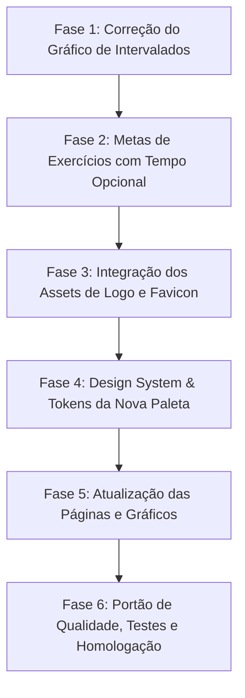

# 📌 Plano de Execução: Correção do Gráfico de Intervalados, Metas com Tempo Opcional, Assets de Marca e Nova Paleta PaceLab

**Projeto:** PaceLab  
**Módulos:** Gráfico de Intervalados (`/intervalado`), Metas Multimodais com Tempo Flexível (`/perfil`, Prisma, Zod, `/meu-taf`), Assets de Marca (Logo & Favicon em `public/`) e Novo Design System Global Oficial  
**Data:** 18/10/2026  
**Status:** Concluído / Validado em Homologação  
**Referência:** [docs/roadmap/01_roadmap_melhorias_futuras.md](../../roadmap/01_roadmap_melhorias_futuras.md)

---

## 1. 🎯 Diagnóstico e Especificação Técnica

### 1.1 Gráfico de "Perfil de Velocidade da Sessão" em `/intervalado`
* **Diagnóstico do Problema:**
  1. **Coordenadas Duplicadas:** O componente `IntervalSpeedProfileChart.tsx` gerava dois pontos consecutivos com o mesmo tempo (`timeMinute`) na transição entre etapas (ponto final da etapa anterior e ponto inicial da etapa seguinte). Em gráficos de linha/área do Recharts, isso causa conflitos de interpolação, saltos visuais e oscilação no tooltip.
  2. **Conflito de Tipo de Curva:** O gráfico utilizava `points.push` duplicado manualmente junto com a propriedade `type="stepAfter"`, aplicando um degrau sobre o degrau existente.
  3. **Inconsistência Visual:** A legenda indicava "Tiros Rápidos" em âmbar e "Recuperação / Aquec." em azul, mas o gráfico renderizava uma única `Area` roxa (`#8b5cf6`), que não refletia a alternância de cores da legenda nem a nova identidade do app.
* **Solução Proposta:**
  - Reformular a estrutura de dados para o modelo em degraus limpo: ou série de blocos temporais distintos com `BarChart` segmentado por etapa/duração, ou `AreaChart` contínuo sem coordenadas duplicadas no mesmo timestamp.
  - Aplicar as novas cores oficiais do PaceLab: Tiros em **Verde-Lima Elétrico (`#B7F34A`)** e Recuperação/Aquecimento em **Cinza-Azulado (`#8E9BB0`)** com fundo **Azul-Marinho (`#0B1020`)**.
  - Garantir que o tooltip exiba com clareza o tipo da etapa, o pace e a velocidade em km/h.

---

### 1.2 Metas de Exercícios no Perfil: Tempo Máximo de Execução Opcional
* **Diagnóstico do Problema:**
  - Editais de concursos possuem regras distintas:
    - Alguns exigem repetições em tempo fixado (ex: "fazer o máximo de flexões em 60 segundos" ou "máximo de abdominais em 1 minuto").
    - Outros não estipulam limite de tempo (ex: "executar repetições sem interrupção até a exaustão, sem limite de tempo").
    - Na barra fixa dinâmica, alguns editais aplicam limite de 60s e outros tempo livre.
  - O sistema hoje não possui campos ou controles visuais para alternar entre "Com tempo limite (segundos)" e "Sem limite de tempo (livre)".
* **Solução Proposta:**
  1. **Banco de Dados & Schema Prisma (`TafGoal`):**
     - Garantir as colunas `pullupDurationSeconds Int?`, `pushupDurationSeconds Int?` e `absDurationSeconds Int?` (onde `null` significa "Sem limite de tempo / Livre").
  2. **Validação Zod (`lib/validations/taf.ts`):**
     - Aceitar `durationSeconds` opcional ou nulo para cada exercício.
  3. **Interface em `TafGoalConfigCard.tsx` (`/perfil`):**
     - Para Barra (dinâmica), Flexão e Abdominal, adicionar toggle/checkbox:
       - `[x] Possui tempo máximo de execução` -> exibe input de tempo em segundos (ex: 60s) com presets rápidos (30s, 60s, 90s).
       - Desmarcado -> exibe badge sutil *"Sem limite de tempo (livre)"* e salva como `null`.
  4. **Exibição Contextual em `/meu-taf`:**
     - O card `TafComplementaryExercisesCard.tsx` exibirá:
       - Exemplo com tempo: *"30 reps em até 60s"*;
       - Exemplo sem tempo: *"30 reps (tempo livre)"*.

---

### 1.3 Onde Salvar as Imagens (Logo e Favicon)
* **Diretório Canônico do Next.js:**
  - Os arquivos devem ser salvos na pasta **`public/`** na raiz do projeto (`/home/kauan/Área de trabalho/PaceLab/public/`):
    1. **Favicon:** `public/favicon.ico` (ou `app/favicon.ico` ou `public/icon.png`).
    2. **Logotipo:** `public/logo.png` (ou `public/images/logo.png` ou `public/logo.svg`).
* **Adaptação no Código:**
  - Atualizar `components/layout/Navbar.tsx` e `components/layout/Footer.tsx` para exibir a tag `<Image />` da nova logo quando presente, mantendo fallback tipográfico moderno.
  - Atualizar os metadados em `app/layout.tsx` referenciando os ícones oficiais.

---

### 1.4 Nova Paleta de Cores Oficial do PaceLab
A nova identidade visual adota uma estética de alta tecnologia esportiva (*Dark Performance Athletics*):

| Cor | Hex | Função no Sistema |
|---|---|---|
| **Azul-Marinho Profundo** | `#0B1020` | Fundo principal da aplicação (`bg-background` e canvas de tela cheia). |
| **Card / Superfície Elevada** | `#131A2E` | Fundo dos cards, tabelas e modais, criando elevação suave sobre `#0B1020`. |
| **Bordas Sutis** | `#1E2942` | Linhas de divisão, bordas de cards e divisores. |
| **Verde-Lima Elétrico** | `#B7F34A` | Destaque principal (*Pace*), botões primários de ação, badges de aprovação, acentos de foco e tiros rápidos. |
| **Verde-Lima Hover** | `#A3E332` | Estado hover/ativo dos botões e links principais. |
| **Branco Puro** | `#FFFFFF` | Títulos (`h1`, `h2`), métricas em destaque, valores numéricos e textos de máximo contraste. |
| **Cinza-Azulado** | `#8E9BB0` | Textos secundários, legendas, hints, placeholders e labels informativos. |

---

## 2. 📋 Plano de Fases Passo a Passo

---

### 🔹 Fase 1: Correção e Aprimoramento do Gráfico de Perfil de Velocidade em `/intervalado`
**Objetivo:** Eliminar dados duplicados de timestamps, alinhar cores com as novas diretrizes e garantir representação fiel da alternância de tiros e recuperações.

- [x] **1.1** Inspecionar e refatorar `components/intervalado/IntervalSpeedProfileChart.tsx`:
  - Corrigir a geração de dados da linha do tempo: manter sequência temporal estrita sem coordenadas sobrepostas no mesmo instante.
  - Aplicar as cores oficiais: Tiros em **Verde-Lima (`#B7F34A`)** e Recuperações em **Cinza-Azulado (`#8E9BB0`)**.
  - Alinhar a legenda superior com as cores reais do gráfico.
- [x] **1.2** Aprimorar o tooltip flutuante exibindo nome da etapa, tempo acumulado, pace formatado e velocidade.
- [x] **1.3** Criar/atualizar testes unitários do gráfico em `__tests__/components/IntervalSpeedProfileChart.test.tsx` garantindo renderização e ausência de NaNs/coordenadas inválidas.
- [x] **1.4 [Portão de Qualidade Fase 1]**: Testes do componente e da página `/intervalado` 100% verdes.

---

### 🔹 Fase 2: Metas de Exercícios no Perfil (Tempo Máximo Opcional / Livre)
**Objetivo:** Permitir que o candidato configure o tempo de execução para flexão, barra e abdominal, ou selecione a opção "Sem limite de tempo (livre)".

- [x] **2.1** Atualizar `prisma/schema.prisma` garantindo suporte a:
  - `pullupDurationSeconds Int?` (tempo máximo para barra dinâmica)
  - `pushupDurationSeconds Int?` (tempo máximo para flexão)
  - `absDurationSeconds Int?` (tempo máximo para abdominal)
  - Criar migração SQL compatível.
- [x] **2.2** Atualizar tipos em `types/index.ts` e schemas Zod em `lib/validations/taf.ts`:
  - Permitir `durationSeconds?: number | null`.
- [x] **2.3** Atualizar `components/profile/TafGoalConfigCard.tsx`:
  - Adicionar controle de alternância para cada exercício complementar:
    - Checkbox ou botão toggle: *"Definir tempo máximo de execução"*
    - Se marcado: campo de tempo em segundos com atalhos (ex: 60s, 90s).
    - Se desmarcado: exibe *"Tempo livre / Sem limite"* e envia `null`.
- [x] **2.4** Atualizar a exibição no card de acompanhamento `components/meu-taf/TafComplementaryExercisesCard.tsx`:
  - Exibir *"X reps em Ys"* quando houver tempo, ou *"X reps (tempo livre)"* quando for livre.
- [x] **2.5** Atualizar rotas de API (`/api/taf/goals`) e testes em `__tests__/components/TafGoalConfig.test.tsx` e `__tests__/api/taf-routes.test.ts`.
- [x] **2.6 [Portão de Qualidade Fase 2]**: `npm test` para as suítes de perfil e metas 100% aprovado.

---

### 🔹 Fase 3: Integração dos Assets de Marca (Logo & Favicon)
**Objetivo:** Criar a estrutura para receber os arquivos de imagem do usuário e conectá-los ao layout.

- [x] **3.1** Criar a pasta `public/` na raiz do projeto (caso não exista) e subpastas de assets (`public/images/`).
- [x] **3.2** Configurar `app/layout.tsx` para carregar o favicon oficial de `public/favicon.ico` / `app/favicon.ico`.
- [x] **3.3** Atualizar `components/layout/Navbar.tsx` e `components/layout/Footer.tsx`:
  - Integrar exibição da logo via `BrandLogo.tsx` com fallback elegante para SVG/tipografia quando a imagem estiver sendo adicionada.
- [x] **3.4** Fornecer instruções diretas e claras ao usuário de onde colar os arquivos de imagem no sistema de arquivos.
- [x] **3.5 [Portão de Qualidade Fase 3]**: Testes de layout e navegação 100% verdes.

---

### 🔹 Fase 4: Design System & Tokens da Nova Paleta PaceLab
**Objetivo:** Configurar os tokens CSS e Tailwind com as novas cores oficiais (#0B1020, #B7F34A, #FFFFFF, #8E9BB0).

- [x] **4.1** Atualizar `tailwind.config.ts`:
  - Cadastrar paleta semântica:
    - `pacelab-navy`: `#0B1020`
    - `pacelab-card`: `#131A2E`
    - `pacelab-border`: `#1E2942`
    - `pacelab-lime`: `#B7F34A`
    - `pacelab-muted`: `#8E9BB0`
    - `pacelab-white`: `#FFFFFF`
- [x] **4.2** Atualizar `app/globals.css`:
  - Redefinir variáveis CSS de `:root` e `.dark` para alinhar com o novo padrão escuro oficial.
- [x] **4.3** Atualizar os componentes fundamentais de UI:
  - `components/ui/Button.tsx`: Botão primário em Verde-Lima (`#B7F34A`) com texto escuro (`#0B1020`), hover responsivo e anel de foco.
  - `components/ui/Badge.tsx`: Badges nas cores da paleta oficial (lime para destaques/aprovação, navy/muted para neutros).
  - `components/ui/Card.tsx`: Superfície `#131A2E` com borda `#1E2942`.
  - `components/ui/Input.tsx`: Fundo escuro com foco iluminado em Verde-Lima.
- [x] **4.4 [Portão de Qualidade Fase 4]**: Testes dos componentes de UI (`Button`, `Badge`, `Card`, `Input`) 100% verdes.

---

### 🔹 Fase 5: Atualização das Páginas e Gráficos Recharts na Nova Paleta
**Objetivo:** Aplicar a nova identidade visual em todas as páginas públicas e privadas.

- [x] **5.1** Atualizar `components/layout/Navbar.tsx` e `components/layout/BottomNav.tsx`:
  - Barra de navegação com fundo `#0B1020`/90 glassmorphism, indicador ativo em Verde-Lima e borda suave `#1E2942`.
- [x] **5.2** Atualizar a Landing Page (`app/page.tsx`):
  - Hero com títulos em `#FFFFFF`, subtítulos em `#8E9BB0`, destaques e botões em `#B7F34A`.
  - Quick Pace Widget e Card do Atleta com o novo visual.
- [x] **5.3** Atualizar Calculadoras (`/calculadora`, `/taf`, `/metas`, `/intervalado`):
  - Substituição de azuis legados pelos novos tons oficiais de Verde-Lima e Navy.
- [x] **5.4** Atualizar Meu TAF e Diário (`/meu-taf`, `/treinos`, `/perfil`, `/historico`):
  - Gráficos Recharts (linhas, barras e donuts) com paleta harmonizada.
- [x] **5.5 [Portão de Qualidade Fase 5]**: Todas as páginas compilando e sem conflitos visuais.

---

### 🔹 Fase 6: Homologação Final, Qualidade, Build e Atualização de Roadmap
**Objetivo:** Certificar 100% de testes verdes, compilação de produção limpa e documentação atualizada.

- [x] **6.1** Executar suíte completa de testes (`npm test`) -> 100% aprovados (467/467 testes verdes em 57 arquivos).
- [x] **6.2** Verificar tipagem estrita com TypeScript (`npx tsc --noEmit`) -> 0 erros.
- [x] **6.3** Executar linter (`npx eslint .`) -> 0 erros e 0 warnings.
- [x] **6.4** Validar compilação de produção (`npm run build`) -> 15/15 rotas estáticas/dinâmicas geradas com sucesso.
- [x] **6.5** Atualizar roadmap oficial em `docs/roadmap/01_roadmap_melhorias_futuras.md`.
- [x] **6.6** Mover plano para `docs/plans/executed/` e sugerir commit semântico.
