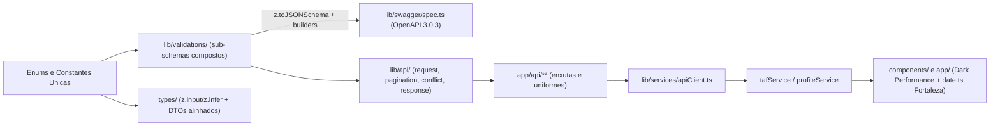

# Plano 17 — Padronização de Código, APIs/Swagger, Utilitários Compartilhados, Design System e Testes

> **Status:** ✅ Concluído e Arquivado (Fases 0–6 executadas — sucessor do [Plano 16](./16_plan_organizacao_e_consolidacao_documentacao.md))  
> **Objetivo Geral:** Eliminar duplicações estruturais, bugs de contrato e desvios de padrão no PaceLab por meio de utilitários reutilizáveis — **contrato uniforme de erros e helpers de API (`lib/api/`)**, **OpenAPI gerado a partir de Zod via `z.toJSONSchema` (`lib/swagger/`)**, **fonte única de tipos/enums (`types/` ↔ `lib/validations/`)**, **cliente HTTP único (`lib/services/apiClient.ts`)**, **tema *Dark Performance* exclusivo**, **datas `America/Fortaleza` na UI**, **remoção de `window.confirm`** e **cobertura individual `>= 90%` em `lib/`** — sempre preservando **100%** dos fluxos e testes existentes antes de publicar a documentação definitiva de engenharia.  
> **Fora de Escopo:** Pipeline de CI no GitHub Actions (`.github/workflows/ci.yml`), mantido no **Eixo E** de [`docs/roadmap/01_roadmap_melhorias_futuras.md`](../../roadmap/01_roadmap_melhorias_futuras.md) para um plano posterior.

---

## 1. Diagnóstico Técnico Baseado em Auditoria Direta

Auditoria completa sobre `31` arquivos em `app/`, `47` em `components/`, `49` em `lib/`, `types/`, `5` em `scripts/` e `92` arquivos `.test.ts/.tsx`:

| Área Auditada | Padrão Pretendido / Referência | Bugs, Duplicações e Desvios Encontrados no Código Real | Solução no Plano 17 |
|---|---|---|---|
| **1. Swagger/OpenAPI (`1.764` linhas) vs. Rotas e Zod** | Fonte única derivada de Zod (`zod@4.6.6` possui `z.toJSONSchema` nativo — validado em `20/20` schemas de [`taf.ts`](../../../lib/validations/taf.ts)). | [`lib/swagger/spec.ts`](../../../lib/swagger/spec.ts) duplica schemas manualmente e já contém **4 bugs reais de contrato**: (a) `ProfileInput`/`ProfileResponse` (`L1507-1539`) listam `weightKg`, `biologicalSex`, `activityLevel`, `calculatedBmi`, enquanto [`UserProfileInputSchema`](../../../lib/validations/taf.ts) e [`app/api/profile/route.ts`](../../../app/api/profile/route.ts) usam `name`, `heightCm`, `currentWeightKg`, `birthDate`, `gender`; (b) `TafAttemptsListResponse` (`L1318`) e `TrainingsListResponse` (`L1496`) declaram `pagination: { nextCursor, hasMore }`, mas a API retorna **`meta: { limit, nextCursor, hasMore }`** via `apiSuccess`; (c) `GET /api/taf/attempts/{id}` consta no Swagger (`L205`) e em [`docs.test.ts`](../../../__tests__/api/docs.test.ts), porém [`app/api/taf/attempts/[id]/route.ts`](../../app/api/taf/attempts/%5Bid%5D/route.ts) só exporta `PUT`/`DELETE` (retorna `405` no Next.js); (d) `DeleteSuccessResponse` (`L1020-1034`) declara `{ id, deleted }` enquanto os `3` endpoints `DELETE` retornam `{ success: true, deletedId }` (`TafGoalResponse` e `WeightRecordResponse` também omitem campos). | Criar `lib/swagger/builders.ts` com `zodToOpenApiSchema`, factories de envelope/respostas/parâmetros, corrigir os 4 desvios e implementar `GET /api/taf/attempts/[id]`. |
| **2. Boilerplate & Saídas de Erro em `app/api/`** | [`withApiHandler`](../../../lib/api/response.ts) + helpers uniformes sem copiar lógica entre rotas. | (a) `attempts/route.ts` (`177L`), `trainings/route.ts` (`259L`) e rotas `[id]` repetem **paginação cursor-based**, **4 cópias idênticas de `hasRawField`**, **3 cópias de `resolveFallbackPaceMetrics`** (também em [`tafService.ts`](../../../lib/services/tafService.ts)) e **lógica de conflito `externalId` / `P2002`** (onde `findUnique` prévio não envia `code: "DUPLICATE_EXTERNAL_ID"` enquanto o `catch P2002` envia!); (b) [`lib/api/response.ts`](../../../lib/api/response.ts) `L156` imprime `"Este arquivo .GPX já foi importado"` hardcoded mesmo em conflitos `.FIT`; `AppError` tem `0` usos; `parse-activity/route.ts` tem duas mensagens distintas para `MISSING_FILE`; (c) Os 3 `DELETE` retornam `apiSuccess({ success: true, deletedId })` (aninhando `data.success`), nenhuma rota `[id]` valida `params.id` com schema, e `weight/[id]` retorna `200` para ID ausente enquanto `attempts/[id]`/`trainings/[id]` retornam `404` (`P2025`). | Criar `lib/api/request.ts`, `lib/api/pagination.ts`, `lib/api/externalIdConflict.ts`, adicionar `code?: ApiErrorCode` no topo de `ApiResponse` (preservando `details.code` e `deletedId`), criar `apiDeleted(id)` e `apiNotFound`, e extrair `resolvePaceMetricsFallback` em `lib/math/pace.ts`. |
| **3. Duplicação de Tipos, Enums, Validações & Services** | Fonte única de verdade sem drift entre Prisma, Zod, `types/` e services. | (a) `ACTIVITY_TYPES` e `ACTIVITY_SOURCES` de [`types/index.ts`](../../../types/index.ts) são copiados em [`lib/validations/taf.ts`](../../../lib/validations/taf.ts) (`LocationType` nem tem array `as const`); (b) **Bug em [`types/index.ts`](../../../types/index.ts) (`L392`):** `WeightRecord.source` lista `"training_sync"` (fantasma) em vez de `"manual" \| "weekly_prompt" \| "profile_update"`; (c) Dentro de `taf.ts` (`652` linhas), campos de telemetria e tracking repetem-se entre `TafAttempt` e `TrainingSession`; (d) [`tafService.ts`](../../../lib/services/tafService.ts) e [`profileService.ts`](../../../lib/services/profileService.ts) duplicam `unwrapApiResponse` e `extractErrorMessage` (com `profileService` desatualizado sem leitura de `code`). | Centralizar arrays de enums em fonte única compartilhada por `types/` e Zod; derivar DTOs de entrada via `z.input`/`z.infer`; compor sub-schemas base em `taf.ts`; extrair `lib/services/apiClient.ts`. |
| **4. Tema & Design System** | **Dark Performance Athletics** do [Plano 10](./10_plan_correcoes_ux_metas_tempo_novo_design_system.md) (`#0B1020`, `#131A2E`, `#1E2942`, `#B7F34A`, `#FFFFFF`, `#8E9BB0`). | `ThemeProvider.tsx`, `ThemeToggle.tsx` na [`Navbar.tsx`](../../../components/layout/Navbar.tsx) e [`Button`](../../../components/ui/Button.tsx)/[`Card`](../../../components/ui/Card.tsx)/[`Input`](../../../components/ui/Input.tsx)/[`Badge`](../../../components/ui/Badge.tsx) mantêm classes light (`bg-white`/`dark:*`), enquanto **43 de 58** arquivos UI + [`ResultBlock.tsx`](../../../components/ui/ResultBlock.tsx) + `SheetsSyncBadge.tsx` usam fundo escuro sem `dark:`. Apenas `12/57` arquivos UI usam `components/ui/`, e [`lib/activity.ts`](../../../lib/activity.ts) mistura `lucide-react` e classes Tailwind em `lib/`. | Oficializar **Dark Performance exclusivo**, remover `ThemeToggle`/`next-themes`/classes light, tornar `swagger-theme.css` dark nativo e separar JSX/Tailwind de `lib/activity.ts`. |
| **5. Datas UI, Confirmações & Pastas** | `America/Fortaleza` na UI ([`WeeklyAdherenceCard.tsx`](../../../components/dashboard/WeeklyAdherenceCard.tsx)), confirmações inline em React e `lib/validations/` no plural. | **11 chamadas** diretas de `.toLocaleDateString("pt-BR", ...)` sem `timeZone: "America/Fortaleza"` em `10` arquivos UI; `3` `window.confirm`/`confirm` bloqueantes em [`app/historico/page.tsx`](../../../app/historico/page.tsx) e [`app/perfil/page.tsx`](../../../app/perfil/page.tsx); pastas duplicadas `lib/validation/` vs `lib/validations/`; pasta vazia `hooks/`; componentes `Training*` e `SheetsSyncBadge` dentro de `components/meu-taf/`; [`scripts/check-db.mjs`](../../../scripts/check-db.mjs) imprime `taf_trainings`; [`.env.example`](../../../.env.example) cita `ver README.md`; `Caminhada_leve.fit` *untracked* na raiz. | Criar `lib/formatting/date.ts` (`America/Fortaleza`), trocar `window.confirm` por confirmação React inline/modal, unificar `lib/validations/`, reorganizar pastas e limpar resíduos. |
| **6. Suíte de Testes & Cobertura** | Mocks compartilhados, setup único e `>= 90%` em todos os arquivos `lib/`. | `test/helpers/mockTafApi.ts` fica fora de `__tests__/` e só atende `10` suites (`5` ainda usam `vi.stubGlobal("fetch", ...)` manual; [`SplitsVisualization.test.tsx`](../../../__tests__/components/SplitsVisualization.test.tsx) duplica mock de `ResizeObserver`); [`vitest.config.ts`](../../../vitest.config.ts) exclui `lib/supabase/**` (inexistente); [`lib/math/cooper.ts`](../../../lib/math/cooper.ts) tem `77.61%` e [`lib/services/profileService.ts`](../../../lib/services/profileService.ts) `83.83%`; `8` componentes sem teste unitário dedicado. | Mover helper para `__tests__/helpers/`, consolidar mocks/setup, elevar `cooper.ts`, `profileService.ts` e novos utilitários para `>= 90%` e testar componentes descobertos. |

---

## 2. Arquitetura de Utilitários & Contratos Pós-Plano 17

### Mapa Detalhado dos Utilitários Reutilizáveis (Zero Duplicação)
1. **Camada API (`lib/api/`):**
   - [`lib/api/response.ts`](../../../lib/api/response.ts): `ApiErrorCode` tipado, `code?: ApiErrorCode` no topo de `ApiResponse` (mantendo `details.code`), helpers `apiBadRequest`, `apiNotFound`, `apiConflict`, `apiPayloadTooLarge`, `apiUnprocessable`, `apiServiceUnavailable`, `apiDeleted(id)` (`{ deletedId: id, deleted: true }`), e `withApiHandler` atualizado sem `".GPX"` hardcoded em `P2002`;
   - `lib/api/request.ts`: `parseJsonBody(request, schema)`, `parseQueryParams(request, schema)`, `parsePathId(params)` (`PathIdSchema`), `hasOwnDefinedField(rawBody, key)`, e `resolveDefinedUpdateFields(rawBody, validated, mapping)` (eliminando as 4 cópias de `hasRawField` e `searchParams` boilerplate);
   - `lib/api/pagination.ts`: `getCursorPaginationPrismaArgs(limit, cursor)` + `buildCursorPaginatedResponse(items, limit)` (`apiSuccess(paginatedItems, 200, { limit, nextCursor, hasMore })`);
   - `lib/api/externalIdConflict.ts`: `resolveActivityConflictLabel(source, externalId)` (`.FIT`, `.GPX`, `do Google Sheets` ou `externo`) + helper único que garante `{ code: "DUPLICATE_EXTERNAL_ID", existingId }` idêntico tanto na checagem prévia `findUnique` quanto na race condition `P2002`.
2. **Camada Swagger / OpenAPI (`lib/swagger/`):**
   - `lib/swagger/builders.ts`:
     - `zodToOpenApiSchema(schema, overrides?)` baseado em **`z.toJSONSchema(schema, { target: "openapi-3.0", unrepresentable: "any", io: "input" })`** (remove `$schema`, simplifica `anyOf` de datas `union([string, date])` para `{ type: "string", format: "date-time" }` e preserva descrições/exemplos);
     - `createSuccessEnvelopeSchema(dataSchemaOrRef, metaProps?)` & `createPaginatedListResponseSchema(itemSchemaRef)` (usando **`meta: { limit, nextCursor, hasMore }`** real em vez de `pagination`);
     - `createJsonResponse(schemaRef, description)` & `createErrorResponses(statuses)` eliminando centenas de linhas de boilerplate nos `paths`;
     - Factories de parâmetros (`createPathIdParam()`, `createPaginationParams()`, `createSkipSheetsSyncParam()`) retornando objetos **inline** (preservando `p.name === "skipSheetsSync"` exigido por [`docs.test.ts`](../../../__tests__/api/docs.test.ts#L127-L138)).
3. **Camada de Domínio, Tipos & Transporte Cliente:**
   - Fonte única de enums (`ACTIVITY_TYPES`, `ACTIVITY_SOURCES`, `LOCATION_TYPES`, `GENDERS`, `WEIGHT_SOURCES`, `PULL_UP_TYPES`, `DUPLICATE_POLICIES`, `SYNC_DIRECTIONS`) compartilhada entre `types/` e `lib/validations/`;
   - `resolvePaceMetricsFallback` centralizado em [`lib/math/pace.ts`](../../../lib/math/pace.ts) (usando `formatPace` de [`lib/formatting/time.ts`](../../../lib/formatting/time.ts)) substituindo as 3 cópias em `tafService.ts`, `attempts/route.ts` e `trainings/route.ts`;
   - `lib/services/apiClient.ts` centralizando `unwrapApiResponse`, `extractApiErrorInfo`, `extractErrorMessage` e classe de erro padronizada entre `tafService.ts` e `profileService.ts`;
   - `lib/formatting/date.ts` centralizando formatação `pt-BR` sempre em `timeZone: "America/Fortaleza"`.

---

## 3. Fases Estratégicas de Execução

### Fase 0 — Baseline, Higiene do Repositório e Limpeza Inicial (`[PQT0]`)
**Objetivo:** Registrar baseline verde e limpar resíduos triviais sem alterar contratos.

- **Ações:**
  1. Executar baseline: `npx prisma validate`, `npx tsc --noEmit`, `npm run lint`, `npm run test:coverage`, `npm run build`.
  2. **Arquivo `Caminhada_leve.fit` na raiz:** validar via `npm run fit:inspect -- Caminhada_leve.fit` com o usuário se deve mover para `__tests__/fixtures/fit/strava-real/` ou ser descartado, deixando a raiz limpa.
  3. **Pasta vazia `hooks/`:** remover `hooks/` se permanecer sem arquivos após as refatorações (ou apenas mantê-la se algum hook compartilhado genuíno surgir).
  4. **Configs/scripts:** remover `'lib/supabase/**'` inexistente em [`vitest.config.ts`](../../../vitest.config.ts); corrigir o rótulo legado `taf_trainings` → `training_sessions` em [`scripts/check-db.mjs`](../../../scripts/check-db.mjs); atualizar comentário em [`.env.example`](../../../.env.example) (`ver README.md` → `ver docs/integrations/02_google_sheets_e_gemini_passo_a_passo.md`).
- **Critério de conclusão (`[PQT0]`):** Baseline verde e resíduos de raiz/configs limpos.

---

### Fase 1 — Padronização Visual: Tema Dark Performance Exclusivo & Design System (`[PQT1]`)
**Objetivo:** Eliminar a mistura quebrada Light/Dark unificando 100% da UI sob a paleta *Dark Performance Athletics*.

- **Ações:**
  1. **Remover `ThemeToggle` / `next-themes` com segurança:**
     - Remover `<ThemeToggle />` de [`Navbar.tsx`](../../../components/layout/Navbar.tsx) e excluir `ThemeToggle.tsx` + `ThemeToggle.test.tsx`;
     - Remover `ThemeProvider.tsx` de [`app/layout.tsx`](../../../app/layout.tsx) e remover `"next-themes"` de [`package.json`](../../../package.json) (atualizando `package-lock.json`);
     - Fixar `<html lang="pt-BR" className="dark">` e `body` com `bg-[#0B1020] text-[#FFFFFF]` em `app/layout.tsx`.
  2. **Consolidar CSS global & `/docs`:**
     - Simplificar [`app/globals.css`](../../../app/globals.css) deixando `:root` diretamente com a paleta escura (`#0b1020`, `#ffffff`, `#131a2e`, `#1e2942`, `#b7f34a`, `#8e9bb0`) sem bloco `.dark` paralelo;
     - Tornar [`components/docs/swagger-theme.css`](../../../components/docs/swagger-theme.css) nativamente escuro em `.swagger-custom-theme .swagger-ui` (sem depender de `.dark`).
  3. **Limpar classes *Light* residuais nos primitivos `components/ui/` e páginas:**
     - Atualizar [`Button.tsx`](../../../components/ui/Button.tsx), [`Card.tsx`](../../../components/ui/Card.tsx), [`Input.tsx`](../../../components/ui/Input.tsx), [`Badge.tsx`](../../../components/ui/Badge.tsx), [`Navbar.tsx`](../../../components/layout/Navbar.tsx) e páginas (`/`, `/calculadora`, `/taf`, `/metas`, `/historico`, `/treinos`) removendo `bg-white`, `bg-slate-50`, `text-slate-900` e prefixos `dark:` supérfluos;
     - Adotar primitivos de `components/ui/` onde haja repetição simples, preservando `role`, `aria-label` e `data-testid` usados nos testes.
  4. **Validar testes impactados:** atualizar `__tests__/components/Navigation.test.tsx` e conferir `Button.test.tsx`, `Card.test.tsx`, `Input.test.tsx`, `Badge.test.tsx`.
- **Critério de conclusão (`[PQT1]`):** Zero referências a `ThemeToggle`/`next-themes`/`localStorage.theme`, zero classes *light* residuais na UI e testes verdes.

---

### Fase 2 — Padronização de APIs REST, Saídas de Erro, Tipos Únicos, Services e Swagger (`[PQT2]`)
**Objetivo:** Centralizar regras de validação, erro, paginação, conflito, cliente HTTP e geração OpenAPI eliminando duplicação de código sem quebrar consumidores ou testes existentes.

- **Ações:**
  1. **Enums & Constantes Únicas (`types/` ↔ `lib/validations/`) + Correção `types/index.ts`:**
     - Centralizar `ACTIVITY_TYPES`, `ACTIVITY_SOURCES`, `LOCATION_TYPES`, `GENDERS`, `WEIGHT_SOURCES`, `PULL_UP_TYPES`, `DUPLICATE_POLICIES` e `SYNC_DIRECTIONS` em um único módulo sem ciclos (ex.: `types/constants.ts` reexportado por [`types/index.ts`](../../../types/index.ts));
     - Corrigir `WeightRecord.source` em [`types/index.ts`](../../../types/index.ts) (`L392`: remover `"training_sync"` fantasma e adotar `WeightSource` `"manual" | "weekly_prompt" | "profile_update"`);
     - Fazer [`lib/validations/taf.ts`](../../../lib/validations/taf.ts) consumir esses arrays (`z.enum(ACTIVITY_TYPES)`, `z.enum(LOCATION_TYPES)`, etc.) e compor sub-schemas compartilhados (`ExternalTrackingFields`, `HeartRateFields` + `validateHeartRateRefinement`) eliminando repetição entre `TafAttempt` e `TrainingSession`;
     - Derivar tipos de entrada/query via `z.input` / `z.infer` sem quebrar interfaces públicas já importadas pelos componentes/testes.
  2. **Utilitários de API, Saídas de Erro Padronizadas & Endpoints Simétricos (`lib/api/` + `app/api/`):**
     - Expandir [`lib/api/response.ts`](../../../lib/api/response.ts): catálogo `ApiErrorCode`, campo `code?: ApiErrorCode` no envelope `ApiResponse` (mantendo `details.code` para retrocompatibilidade), `apiBadRequest`, `apiNotFound`, `apiServiceUnavailable`, `apiDeleted(id)` (`{ deletedId: id, deleted: true }`), uso consistente de `AppError`, e mensagem `P2002` neutra (sem `".GPX"` hardcoded);
     - Criar `lib/api/request.ts` (`parseJsonBody`, `parseQueryParams`, `parsePathId`, `hasOwnDefinedField`, helper de campos opcionais em `PUT`), `lib/api/pagination.ts` (cursor pagination reutilizável) e `lib/api/externalIdConflict.ts` (mesma resposta `409` `{ code: "DUPLICATE_EXTERNAL_ID", existingId }` na checagem prévia e em `P2002`);
     - Extrair `resolvePaceMetricsFallback` para [`lib/math/pace.ts`](../../../lib/math/pace.ts) (usando `formatPace` de [`lib/formatting/time.ts`](../../../lib/formatting/time.ts)) removendo as `3` cópias duplicadas (`tafService.ts`, `attempts/route.ts`, `trainings/route.ts`);
     - Refatorar `app/api/taf/attempts/**`, `app/api/taf/trainings/**` e `app/api/profile/**` para consumir esses helpers; implementar **`GET /api/taf/attempts/[id]`** (`404` se não existir); validar `params.id` com `PathIdSchema` nas `3` rotas `[id]`; uniformizar `DELETE` com `apiDeleted(id)` e `404` consistente para ID ausente em [`profile/weight/[id]/route.ts`](../../app/api/profile/weight/%5Bid%5D/route.ts); unificar mensagem `MISSING_FILE` em [`parse-activity/route.ts`](../../../app/api/training-sessions/parse-activity/route.ts) e marcar [`gpx-preview/route.ts`](../../../app/api/taf/trainings/gpx-preview/route.ts) como `@deprecated`.
  3. **Motor Swagger Modular via `z.toJSONSchema` (`lib/swagger/builders.ts` + `lib/swagger/spec.ts`):**
     - Criar `lib/swagger/builders.ts` (`zodToOpenApiSchema`, `createSuccessEnvelopeSchema`, `createPaginatedListResponseSchema`, `createErrorResponses`, `createPathIdParam`, `createPaginationParams`, `createSkipSheetsSyncParam`);
     - Refatorar [`lib/swagger/spec.ts`](../../../lib/swagger/spec.ts) derivando schemas de entrada e parâmetros de consulta diretamente de [`lib/validations/taf.ts`](../../../lib/validations/taf.ts);
     - Corrigir os `4` bugs reais de contrato no `/docs`: alinhar `ProfileInput`/`ProfileResponse` a `UserProfile`, trocar `pagination` por **`meta: { limit, nextCursor, hasMore }`** em `TafAttemptsListResponse` e `TrainingsListResponse`, alinhar `DeleteSuccessResponse` a `{ deletedId, deleted }`, completar `TafGoalResponse` / `WeightRecordResponse` / `TafAttemptResponse`, e marcar `/api/taf/trainings/gpx-preview` com `deprecated: true`;
     - Preservar todos os nomes em `components.schemas` e parâmetros inline `skipSheetsSync` validados por [`docs.test.ts`](../../../__tests__/api/docs.test.ts), adicionando testes em `docs.test.ts` que verificam coerência entre paths reais em `app/api/` e `swaggerSpec.paths`.
  4. **Extrair Cliente HTTP Compartilhado dos Services (`lib/services/apiClient.ts`):**
     - Mover `unwrapApiResponse`, `extractApiErrorInfo`, `extractErrorMessage` e erro estruturado para `lib/services/apiClient.ts`, consumido por [`tafService.ts`](../../../lib/services/tafService.ts) e [`profileService.ts`](../../../lib/services/profileService.ts).
- **Critério de conclusão (`[PQT2]`):** Zero enum duplicado, `lib/api/*` compartilhados eliminando boilerplate de rotas, Swagger sincronizado com Zod sem bugs de payload/`pagination`/`405`, `apiClient.ts` unificado e todas as suites de API/Swagger/services verdes.

---

### Fase 3 — Padronização de UI/Domínio: Datas `America/Fortaleza`, Confirmações e Pastas (`[PQT3]`)
**Objetivo:** Alinhar helpers temporais na UI, UX de exclusões e separação entre domínio puro e componentes React.

- **Ações:**
  1. **Datas Canônicas na UI (`lib/formatting/date.ts`):** criar helpers `formatDateFortaleza`, `formatDateTimeFortaleza` e `formatShortDateFortaleza` sempre com `timeZone: "America/Fortaleza"`, substituir todas as `11` chamadas `.toLocaleDateString(...)` em UI e cobrir fronteiras noturnas UTC em `__tests__/lib/dateFormatting.test.ts`.
  2. **Remoção dos `window.confirm` bloqueantes:** substituir os `3` `confirm`/`window.confirm` em [`app/historico/page.tsx`](../../../app/historico/page.tsx) e [`app/perfil/page.tsx`](../../../app/perfil/page.tsx) pelo padrão de confirmação em 2 etapas inline (mesmo padrão de `TafAttemptCard`/`TrainingCard`), atualizando `historico.test.tsx` e `perfil.test.tsx`.
  3. **Desacoplar UI de [`lib/activity.ts`](../../../lib/activity.ts) & Unificar `lib/validations/`:** manter dados puros em `lib/activity.ts`, mover `lucide-react` + `badgeClass`/`borderClass` para `components/shared/activityVisuals.ts`, e consolidar `lib/validation/inputs.ts` em `lib/validations/calculatorInputs.ts` removendo `lib/validation/`.
  4. **Reorganização física de componentes compartilhados:** mover `TrainingForm.tsx`, `TrainingList.tsx`, `TrainingCard.tsx` e `SheetsSyncBadge.tsx` de `components/meu-taf/` para `components/treinos/` (e `components/shared/` para `SheetsSyncBadge.tsx`), atualizando todos os imports e `vi.mock(...)`.
- **Critério de conclusão (`[PQT3]`):** Zero `window.confirm`, zero `.toLocaleDateString` sem `America/Fortaleza` na UI, `lib/` sem React/Tailwind e pastas organizadas sem erros TS/testes.

---

### Fase 4 — Consolidação de Mocks & Fechamento de Lacunas de Testes (`[PQT4]`)
**Objetivo:** Padronizar helpers de teste e atingir `>= 90%` individualmente em `lib/**/*.ts`.

- **Ações:**
  1. **Consolidar `mockTafApi.ts` e [`vitest.setup.ts`](../../../vitest.setup.ts):** mover `test/helpers/mockTafApi.ts` para `__tests__/helpers/mockTafApi.ts`, remover a pasta raiz `test/`, ajustar `include` em [`vitest.config.ts`](../../../vitest.config.ts) para `['**/__tests__/**/*.{test,spec}.{ts,tsx}']`, consolidar stubs manuais redundantes de `fetch` onde aplicável e remover mock duplicado de `ResizeObserver` em [`SplitsVisualization.test.tsx`](../../../__tests__/components/SplitsVisualization.test.tsx).
  2. **Cobertura `>= 90%` em todos os arquivos individuais de `lib/**/*.ts`:** expandir `__tests__/lib/cooper.test.ts` ([`cooper.ts`](../../../lib/math/cooper.ts) hoje `77.61%`), [`__tests__/services/profileService.test.ts`](../../../__tests__/services/profileService.test.ts) ([`profileService.ts`](../../../lib/services/profileService.ts) hoje `83.83%`), e cobrir integralmente os novos módulos (`lib/api/*`, `lib/swagger/builders.ts`, `lib/services/apiClient.ts`, `lib/formatting/date.ts`).
  3. **Novos testes de componentes e rotas:** adicionar testes unitários dedicados para [`PeriodComparator.tsx`](../../../components/meu-taf/PeriodComparator.tsx), [`TafAttemptList.tsx`](../../../components/meu-taf/TafAttemptList.tsx), [`SwaggerUIViewer.tsx`](../../../components/docs/SwaggerUIViewer.tsx) e [`Footer.tsx`](../../../components/layout/Footer.tsx), além de cobertura para `GET /api/taf/attempts/[id]`, validação `PathIdSchema` e `404` em `DELETE /api/profile/weight/[id]`.
- **Critério de conclusão (`[PQT4]`):** `npm run test:coverage` verde com **todos** os arquivos individuais de `lib/**/*.ts` `>= 90%` e `0` pasta `test/` paralela.

---

### Fase 5 — Documentação de Engenharia (`docs/`) & Sincronização `Doc-as-Code` (`[PQT5]`)
**Objetivo:** Publicar guias permanentes de padrões de código, API/Swagger, Design System e testes alinhados 1:1 ao código pós-Fases 1–4.

- **Entregável 5.1 — Criar `docs/architecture/04_padroes_de_codigo_e_design_system.md`:**
  - Arquitetura em camadas e regra "zero UI em `lib/`";
  - Guia do contrato padrão de API (`withApiHandler`, `ApiErrorCode`, helpers `lib/api/*`, `apiClient.ts`) e manutenção automática do Swagger via `z.toJSONSchema` + `lib/swagger/builders.ts`;
  - Fonte única de enums/tipos (`types/` ↔ `lib/validations/`), helpers de formatação (`time.ts` + `date.ts` em `America/Fortaleza`), segurança (XSS/XXE/CSV) e política `@deprecated`;
  - Design System **Dark Performance Athletics** oficial, tokens `pacelab.*`, uso de `components/ui/` e confirmações React em 2 etapas.
- **Entregável 5.2 — Criar `docs/operations/02_arquitetura_e_padroes_de_testes.md`:**
  - Estrutura da suíte (`__tests__/lib`, `api`, `components`, `pages`, `services`, `qa`, `fixtures`, `helpers`), `vitest.config.ts` / `vitest.setup.ts`, uso padrão de `mockTafApi.ts`, mocks de Prisma/Sheets, fixtures `.FIT`/`.GPX` e metas de cobertura.
- **Entregável 5.3 — Atualizações `Doc-as-Code`:** sincronizar [`docs/architecture/03_modelo_de_dados_e_apis.md`](../../architecture/03_modelo_de_dados_e_apis.md) (remover `theme`, documentar `code` top-level, `meta` de paginação, `GET /api/taf/attempts/[id]`, `DELETE` padronizado e `@deprecated` de `gpx-preview`), [`docs/roadmap/01_roadmap_melhorias_futuras.md`](../../roadmap/01_roadmap_melhorias_futuras.md) (remover `theme` de 1.1 e registrar **Eixo B.12 — Plano 17**), [`docs/README.md`](../../README.md) e [`README.md`](../../../README.md).
- **Critério de conclusão (`[PQT5]`):** Documentação de engenharia publicada e 100% coerente com código/Swagger.

---

### Fase 6 — Auditoria Final, Portões Completos e Arquivamento (`[PQT6]`)
**Objetivo:** Comprovar integridade total e arquivar o Plano 17.

- **Ações:**
  1. Rodar `npx prisma validate`, `npx tsc --noEmit`, `npm run lint`, `npm run fit:test:synthetic`, `npm run gpx:test:synthetic`, `npm run test:coverage` e `npm run build`.
  2. Validar via auditoria automatizada: `0` referências a `ThemeToggle`/`next-themes`/`localStorage.theme`, `0` `window.confirm`, `0` `.toLocaleDateString` sem `America/Fortaleza` na UI, `100%` dos endpoints `app/api/` e campos reais alinhados a `/api/docs/spec`, `0` links/âncoras quebradas e `0` vazamentos de `.env`.
  3. Atualizar status para `✅ Concluído e Arquivado (Fases 0–6)`, ajustar links relativos e mover para `docs/plans/executed/17_plan_padronizacao_codigo_testes_e_design_system.md` (atualizando [`docs/README.md`](../../README.md) e [`docs/roadmap/01_roadmap_melhorias_futuras.md`](../../roadmap/01_roadmap_melhorias_futuras.md) em seguida).
- **Critério de conclusão (`[PQT6]`):** Todos os portões verdes, zero regressões e Plano 17 arquivado.

---

## 4. Riscos Técnicos & Mitigações

| Risco | Impacto | Mitigação |
|---|---|---|
| **R1 — Quebra de retrocompatibilidade em APIs / `/api/docs/spec`** | Alterar `DELETE`, `ApiResponse` ou Swagger via `z.toJSONSchema` quebrar `taf-routes.test.ts`, `profile-routes.test.ts` ou `docs.test.ts`. | Preservar `deletedId` em `DELETE`, manter `details.code` junto de `code` no topo, manter nomes de `components.schemas` e retornar `parameters` inline em `lib/swagger/builders.ts` (preservando `p.name === "skipSheetsSync"` em `docs.test.ts`). |
| **R2 — Ciclos de importação ao unificar `types/` ↔ `lib/validations/`** | `types/` importar de `lib/validations/` enquanto `lib/validations/` importa de `types/` gerar dependência circular. | Isolar constantes literais (`ACTIVITY_TYPES`, `LOCATION_TYPES`, etc.) em `types/constants.ts` puro (zero imports externos), consumido por `types/index.ts` e `lib/validations/taf.ts`. |
| **R3 — Quebra de `vi.mock(...)` ao mover arquivos** | Mover `Training*`, `lib/validation/inputs.ts`, `lib/activity.ts` ou `mockTafApi.ts` quebrar strings de `vi.mock(...)` em testes. | Mapear 100% das referências via `grep -rn` antes de mover, atualizar todos os call sites/mocks em bloco e executar `tsc` + `vitest` após cada bloco. |
| **R4 — Regressão visual em `/docs` ou fuso em testes** | Remover `next-themes`/`.dark` afetar `/docs`, ou `America/Fortaleza` alterar datas em asserções dependentes de timezone do runner. | Migrar seletores de [`swagger-theme.css`](../../../components/docs/swagger-theme.css) para fora de `.dark`, varrer `bg-white`/`dark:` na Fase 1 e testar `dateFormatting.test.ts` com `TZ=UTC` e `TZ=America/Fortaleza`. |
| **R5 — Cobertura abaixo de `90%` em novos utilitários `lib/`** | Novos arquivos (`lib/api/*`, `lib/swagger/builders.ts`, `lib/services/apiClient.ts`, `lib/formatting/date.ts`) reduzirem cobertura V8. | Escrever testes unitários dedicados para cada novo módulo na mesma fase e conferir cobertura individual no `npm run test:coverage`. |
