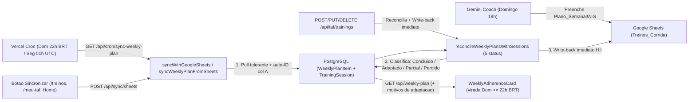

# Plano 18 — Correção da Sincronização do `Plano_Semanal`, Status `"Adaptado"`, Write-Back Imediato e Virada Dominical (22h)

> **Status:** ✅ Concluído e Arquivado (Fases 0–6) — sucessor do [Plano 17](./17_plan_padronizacao_codigo_testes_e_design_system.md)  
> **Objetivo Geral:** Corrigir integralmente os bugs de leitura e escrita bidirecional da aba **`Plano_Semanal`** (Google Sheets ↔ PostgreSQL ↔ Site), garantir atualização imediata de status na planilha assim que um treino é identificado como realizado, introduzir o **5º status `"Adaptado"`** (adaptado fielmente à arquitetura real do PaceLab, com detecção de desvio de volume, faixa de pace e intensidade/tipo + peso `0.75` na aderência + indicador visual do motivo), e automatizar a virada/sincronização semanal todo **domingo às 22h (`America/Fortaleza`)**.  
> **Escopo de Dados:** Zero migration destrutiva — a coluna `WeeklyPlanItem.status` em [`prisma/schema.prisma`](../../../prisma/schema.prisma) já é `String`, suportando `"Adaptado"` nativamente sem `ALTER TYPE`, e os motivos de adaptação são derivados deterministicamente de `(plan, matchedSession)` pela camada pura de domínio.

---

## 1. Diagnóstico Técnico Baseado em Auditoria Direta do Código

Auditoria linha a linha sobre [`lib/googleSheets/mapper.ts`](../../../lib/googleSheets/mapper.ts), [`lib/googleSheets/syncService.ts`](../../../lib/googleSheets/syncService.ts), [`lib/math/weeklyAdherence.ts`](../../../lib/math/weeklyAdherence.ts), [`app/api/weekly-plan/route.ts`](../../../app/api/weekly-plan/route.ts), [`app/api/taf/trainings/route.ts`](../../../app/api/taf/trainings/route.ts), [`lib/sheetsSyncUi.ts`](../../../lib/sheetsSyncUi.ts) e [`components/dashboard/WeeklyAdherenceCard.tsx`](../../../components/dashboard/WeeklyAdherenceCard.tsx) revelou **8 causas reais** que explicam por que os planejamentos não aparecem corretamente no site e por que os status não são gravados de volta na planilha:

| # | Sintoma / Falha Reportada | Causa Raiz Encontrada no Código Real | Solução no Plano 18 |
|---|---|---|---|
| **1** | **Planejamentos não entram no site após sincronizar** *(linhas descartadas silenciosamente)* | Em [`mapper.ts`](../../../lib/googleSheets/mapper.ts) (`L1046-L1060`): (a) **coluna `A` (`ID`) vazia descarta a linha inteira** (`ID ausente`), diferentemente de `Log_Treinos` e `Simulados_TAF` que auto-geram ID e gravam de volta na coluna `A`; (b) `parseSheetDate` (`L487-L517`) aceita apenas `YYYY-MM-DD` e `DD/MM/YYYY` (rejeita `DD/MM/YY`, `DD/MM`, `DD-MM-YYYY`, timestamps ISO com hora e datas formatadas pelo Sheets/Gemini); (c) `parseWeeklyPlanTargetPace` (`L656-L690`) retorna `null` para formatos comuns do Gemini como `"5:45 - 6:00/km"`, `"~5:40/km"`, `"5'45\"-6'00\""` ou `"Z2 (5:50-6:10)"`. | Tornar o parser de `Plano_Semanal` tolerante a formatos reais de data/pace/distância, gerar ID determinístico (`PLAN-YYYY-MM-DD-N`) quando a coluna `A` vier vazia (com *write-back* na coluna `A` do Sheets) e normalizar `normalizeIdCell` removendo apóstrofos iniciais (`'PLAN-...`). |
| **2** | **Aba `Plano_Semanal` ignorada como "ausente" ou dados na linha 1 perdidos** | Em [`syncService.ts`](../../../lib/googleSheets/syncService.ts) (`L1505-L1530`, `L429-L435`): `readWeeklyPlanSheetRows` consulta o range fixo `Plano_Semanal!A2:I` (case-sensitive). Se o título da aba tiver variação de caixa/espaço (ex.: `plano_semanal` ou `Plano Semanal`), a API Google retorna `400 Unable to parse range` e `isMissingTabError` mascara silenciosamente como `sheetMissingOrEmpty: true` (toast diz *"Planilha já estava atualizada"*). Além disso, se a linha 1 já tiver dados sem cabeçalho, `A2:I` pula o 1º treino da semana. | Resolver dinamicamente o título real da aba via metadados (`spreadsheets.get` com busca normalizada sem acento/caixa/espaço/underscore), ler `A1:I` detectando automaticamente se a linha 1 é cabeçalho ou dado (e auto-escrevendo cabeçalho se ausente), e diferenciar claramente *"aba não encontrada"* de *"aba vazia"* no relatório de sync. |
| **3** | **Status (`H`) e ID Realizado (`I`) não são gravados na planilha** | Múltiplos pontos de falha em [`syncService.ts`](../../../lib/googleSheets/syncService.ts): (a) `normalizeCellString` (`L162`) não remove apóstrofo inicial enquanto `planExternalId` pode divergir por formatação, fazendo `snapshots.get(plan.planExternalId)` falhar no `pushWeeklyPlanStatusToSheets` (`L2060`); (b) se um treino é criado/importado antes de o plano da semana ter sido puxado para o Postgres, `safeReconcileWeeklyPlans()` não encontra o plano no banco e `pushWeeklyPlanStatusToSheets()` não escreve nada em `H:I`; (c) falhas pontuais em `safeAutoSync(() => pushWeeklyPlanStatusToSheets())` são engolidas silenciosamente sem marcar pendência em `getSheetsSyncStatus()`; (d) `POST /api/taf/attempts` (quando não espelhado) não aciona reconciliação/push. | Normalizar IDs com `stripLeadingApostrophe` em leitura e snapshot; ao registrar/editar/excluir treino (`POST`/`PUT`/`DELETE`), rodar `pullWeeklyPlanFromSheets` sob demanda quando não houver itens da semana atual no banco (best-effort) antes de reconciliar + `pushWeeklyPlanStatusToSheets`; reportar `pendingWeeklyPlanUpdatesCount` em `getSheetsSyncStatus()` e garantir `valueInputOption: "USER_ENTERED"` com `H:I` limpo (`RAW` para strings de status/ID). |
| **4** | **Status fica desatualizado quando vira o dia ou após sync em outra tela** | `GET /api/weekly-plan` ([`route.ts`](../../../app/api/weekly-plan/route.ts)) apenas lê `weekly_plan_items` do banco sem reavaliar prazos (`Planejado` → `Perdido`) nem sessões ainda não conciliadas. Além disso, `WeeklyAdherenceCard.tsx` (`L337`) congela `currentWeekStart = useMemo(..., [])` na montagem e não oferece botão direto de sincronizar na Home (`/`). | Executar reconciliação local idempotente (`safeReconcileWeeklyPlans()`) quando houver sessões desvinculadas na janela ou mudança de data de referência (com *write-back* `pushWeeklyPlanStatusToSheets` em caso de alteração real), adicionar botão discreto *"Sincronizar Planilha"* no `WeeklyAdherenceCard` e atualizar `currentWeekStart` ao focar a aba ou cruzar a virada dominical. |
| **5** | **UI esconde erros/avisos do sync e exibe `activityType` cru** | (a) Em [`WeeklyAdherenceCard.tsx`](../../../components/dashboard/WeeklyAdherenceCard.tsx) (`L261`), o cabeçalho de cada dia renderiza `{item.activityType}` cru (`rodagem_leve`, `corrida_intervalada`) em vez de `getActivityLabel(item.activityType)`; (b) Em [`lib/sheetsSyncUi.ts`](../../../lib/sheetsSyncUi.ts) (`L101-L119`), `formatSheetsSyncReportSummary` só exibe `(N aviso(s))`, escondendo os motivos reais de `report.warnings` (ex.: qual linha da `Plano_Semanal` teve data/ID inválido). | Corrigir a exibição do nome da atividade com `getActivityLabel(item.activityType)` em `PlanDayRow` e exibir resumo acionável dos avisos de `Plano_Semanal` no toast/banner (com os primeiros avisos detalhados para diagnóstico imediato). |
| **6** | **Reconciliação sem pace e sem 5º status `"Adaptado"`** | Em [`syncService.ts`](../../../lib/googleSheets/syncService.ts) (`L1842-L1874`), `runReconcileWeeklyPlansOnce` **não seleciona `paceSeconds`** da `TrainingSession` nem passa `targetPaceFormatted` do `WeeklyPlanItem`. Em [`weeklyAdherence.ts`](../../../lib/math/weeklyAdherence.ts), `evaluateWeeklyMatch` (`L351-L376`) só avalia `ratio >= 0.85` / `>= 0.40` (aceitando volume excessivo `> 125%`, ritmo muito fora do alvo ou troca de intervalado por rodagem leve como `"Concluído"` 100%). | Implementar o motor completo do **5º status `"Adaptado"`** em `lib/math/weeklyAdherence.ts` (faixa de pace `±15s/km`, volume `> 125%`, choque de intensidade/família + motivos estruturados), selecionar `paceSeconds` em `syncService.ts` e aplicar peso `0.75` na fórmula de aderência. |
| **7** | **Checks hardcoded de status espalhados (`Concluído` / `Parcial`)** | `weeklyAdherence.ts` (`L573-L574`) e `syncService.ts` (`L1744`, `L1884`) verificam manualmente `status === "Concluído" || status === "Parcial"`. Sem unificação, linhas `"Adaptado"` seriam apagadas no `pull` ou resetadas indevidamente. | Criar helper único `isRealizedWeeklyPlanStatus(status)` (`"Concluído" | "Adaptado" | "Parcial"`) em `lib/math/weeklyAdherence.ts` e substituir todos os checks duplicados. |
| **8** | **Falta de automação semanal (Domingo 22h `America/Fortaleza`)** | Não há `vercel.json` nem rota de Cron para sincronizar automaticamente o novo plano após a revisão dominical do Gemini (19h), nem regra de virada da semana exibida no domingo à noite (`>= 22h` BRT). | Criar `vercel.json` com Vercel Cron (`"0 1 * * 1"` UTC = **Domingo 22:00 `America/Fortaleza`**), rota protegida `GET /api/cron/sync-weekly-plan` autenticada via `CRON_SECRET`, e lógica inteligente na virada dominical (`>= 22h` BRT): se já existir plano para a próxima semana, abrir automaticamente com foco na nova semana (com acesso de 1 clique à semana encerrada em *"Semana Anterior"*). |

---

## 2. Adaptação da Proposta do 5º Status `"Adaptado"` à Realidade do PaceLab

A proposta externa trazia nomes fictícios (`googleSheetsSyncService.ts`, `teste_taf`). Abaixo está o mapeamento exato para os módulos e contratos reais do PaceLab:

| Conceito da Proposta | Módulo / Contrato Real no PaceLab | Decisão de Engenharia |
|---|---|---|
| `googleSheetsSyncService.ts` | [`lib/math/weeklyAdherence.ts`](../../../lib/math/weeklyAdherence.ts) (regras puras) + [`lib/googleSheets/syncService.ts`](../../../lib/googleSheets/syncService.ts) (Prisma + Google API) | Toda lógica de parse de faixa de pace, classificação `"Adaptado"`, motivos e cálculo de aderência fica pura e isolada em `lib/math/weeklyAdherence.ts`, mantendo `syncService.ts` enxuto e cobertura `>= 90%`. |
| `WEEKLY_PLAN_STATUSES` | [`types/constants.ts`](../../../types/constants.ts) (fonte única reexportada por `types/index.ts`, `lib/googleSheets/types.ts` e `lib/swagger/spec.ts`) | Expandir para `["Planejado", "Concluído", "Adaptado", "Parcial", "Perdido"] as const` — atualiza automaticamente TypeScript, Zod e OpenAPI `/docs`. |
| Tipos de alta vs. baixa intensidade (`teste_taf` não existe no enum) | `ACTIVITY_TYPES` reais (`6` valores): `rodagem_leve`, `corrida_continua`, `tempo_run`, `corrida_intervalada`, `longao`, `caminhada` | **Alta intensidade:** `corrida_intervalada`, `tempo_run` *(simulados TAF e aliases `teste_taf`/`simulado_taf` já normalizam para `tempo_run` em `ACTIVITY_ALIAS_MAP`)*.<br>**Baixa intensidade / leve:** `rodagem_leve`, `caminhada`.<br>**Moderada / volume:** `corrida_continua`, `longao`.<br>Incompatibilidade de tipo aciona `"Adaptado"` quando: (1) alterna entre **Alta** (`corrida_intervalada`, `tempo_run`) e **Baixa** (`rodagem_leve`, `caminhada`), OU (2) no mesmo dia (`dayDiff === 0`), troca família `run ↔ walk` (ex.: planejou `rodagem_leve`, executou `caminhada` com distância elegível). Na Passada 2 (`±1 dia`), continua exigindo mesma família (`run`/`walk`) para evitar falsos cruzamentos. |
| Extração da faixa de pace (`targetPaceFormatted`) | `parseTargetPaceRangeSeconds(raw)` novo em `lib/math/weeklyAdherence.ts` + normalização tolerante em `parseWeeklyPlanTargetPace` (`mapper.ts`) | Converte `'5:45-6:00`, `5:45–6:00`, `5:45 a 6:00`, `5'45"-6'00"`, `5:13`, `05:13:00` → `{ minPaceSeconds, maxPaceSeconds }` (normalizando ordem crescente `min <= max`). Usa `session.paceSeconds` (ou fallback `Math.round(durationSeconds / distanceKm)` quando ausente/inválido). Tolerância estrita de **`±15 s/km`**: mais rápido que `min - 15` ou mais lento que `max + 15` aciona `"Adaptado"`. |
| Precedência de classificação (`evaluateWeeklyMatch`) | `evaluateWeeklyMatch(plan, session)` retornando `{ status, reasons }` | 1. Se `session.distanceKm <= 0` ou (`targetDistanceKm > 0` e `ratio < 0.40`) → `null` (inelegível).<br>2. Se `targetDistanceKm > 0` e `0.40 <= ratio < 0.85` → **`"Parcial"`** (`0.50`, pois não atingiu o volume mínimo da sessão — evitando a distorção de premiar um treino pela metade com nota maior `0.75` de `"Adaptado"`).<br>3. Quando atingiu o volume base (`ratio >= 0.85` ou treino por tempo sem `targetDistanceKm`), avalia os 3 desvios:<br>   - `volume_above`: `targetDistanceKm > 0` e `ratio > 1.25` → *"Volume acima do planejado"*;<br>   - `pace_faster`: faixa alvo válida e `sessionPaceSeconds < minPaceSeconds - 15` → *"Ritmo mais forte que o alvo"*;<br>   - `pace_slower`: faixa alvo válida e `sessionPaceSeconds > maxPaceSeconds + 15` → *"Ritmo mais lento que o alvo"*;<br>   - `type_changed`: conflito de intensidade/família → *"Tipo alterado"*.<br>   Se houver `>= 1` desvio → **`"Adaptado"`** (`0.75`). Caso contrário → **`"Concluído"`** (`1.00`). |
| Fórmula de aderência semanal | `calculateWeeklyAdherenceSummary` e `calculateRollingFourWeeksAdherence` em `lib/math/weeklyAdherence.ts` | `Math.min(100, Math.round(((completed * 1.0 + adapted * 0.75 + partial * 0.5) / totalPlanned) * 100))`, adicionando `adapted: number` em `WeeklyAdherenceSummary`, `RollingWeekAdherenceItem`, DTOs e Swagger. |
| Motivo do desvio na UI | `adaptationReasons?: string[]` e `adaptationReason?: string | null` em `WeeklyPlanItemDto` ([`types/index.ts`](../../../types/index.ts)) | Calculado deterministicamente em `GET /api/weekly-plan` a partir de `(item, item.matchedSession)` usando `evaluateWeeklyMatch` — **zero coluna extra redundante no banco** e sempre sincronizado com a sessão real. |
| Visual da badge `"Adaptado"` | [`components/ui/Badge.tsx`](../../../components/ui/Badge.tsx) + [`WeeklyAdherenceCard.tsx`](../../../components/dashboard/WeeklyAdherenceCard.tsx) | Nova variante `variant="adapted"` (índigo/roxo escuro: `bg-indigo-950/60 text-indigo-300 border-indigo-700/80`) no Design System *Dark Performance*, exibição do contador `adaptado(s)` no resumo e tag discreta com o motivo (ex.: *"Ritmo mais forte que o alvo"*, *"Volume acima do planejado"* ou *"Tipo alterado"*). |

### Arquitetura do Fluxo Corrigido (Sync + Reconciliação + Cron Domingo 22h)



---

## 3. Fases Estratégicas de Execução

### Fase 0 — Baseline e Diagnóstico Reproduzível (`[PQ18-0]`)
**Objetivo:** Garantir baseline limpa pós-Plano 17 e mapear todos os casos de borda reais da aba `Plano_Semanal` em testes.

- **Ações:**
  1. Confirmar baseline verde (`npx prisma validate`, `npx tsc --noEmit`, `npm run lint`, `npm test`).
  2. Documentar nos testes de regressão os formatos reais problemáticos de `Plano_Semanal` (linha sem ID na coluna `A`, data `DD/MM/YY` e `DD/MM`, apóstrofo em ID/data/pace, aba com variação de caixa/espaço, linha 1 sem cabeçalho, faixas de pace com espaços/unidades/tilde).
- **Critério de conclusão (`[PQ18-0]`):** Baseline 100% verde e casos de reprodução especificados.

---

### Fase 1 — Correção da Leitura, Auto-ID e Write-Back `Plano_Semanal!H:I` (`[PQ18-1]`)
**Objetivo:** Eliminar 100% das perdas silenciosas de linhas do `Plano_Semanal` e garantir que `Status` (`H`) e `ID Treino Realizado` (`I`) sejam gravados com confiabilidade na planilha.

- **Ações:**
  1. **Parser tolerante em [`lib/googleSheets/mapper.ts`](../../../lib/googleSheets/mapper.ts):**
     - Atualizar `normalizeIdCell` para aplicar `stripLeadingApostrophe` e trim consistente.
     - Expandir `parseSheetDate` para aceitar, além de `YYYY-MM-DD` e `DD/MM/YYYY`: `DD/MM/YY` (assumindo século `2000+YY`), `DD-MM-YYYY`, `YYYY/MM/DD`, ISO com timestamp (`YYYY-MM-DDTHH:mm...` / `YYYY-MM-DD HH:mm...`), e `DD/MM` (usando o ano de referência em `America/Fortaleza`).
     - Expandir `parseWeeklyPlanTargetPace` para extrair faixas ou paces únicos em textos como `'5:45 - 6:00/km`, `5:45 a 6:00 min/km`, `5'45"-6'00"`, `~5:30/km`, `05:45:00 - 06:00:00` e rótulos com pace embutido (ex.: `Z2 (5:50-6:10)`).
     - Permitir que `parseWeeklyPlanRowFromSheet` aceite linhas **sem ID na coluna `A`**, sinalizando `needsGeneratedId: true` e gerando ID determinístico `PLAN-YYYY-MM-DD-N` (índice sequencial por data, pulando IDs já presentes na planilha) para gravar de volta na coluna `A` durante o `pull` — mesmo se o write-back da col `A` falhar por 429/rede, a execução seguinte recalcula o mesmo ID sem duplicar registros no PostgreSQL.
  2. **Descoberta resiliente da aba e cabeçalho em [`lib/googleSheets/syncService.ts`](../../../lib/googleSheets/syncService.ts):**
     - Resolver o nome real da aba `Plano_Semanal` via `spreadsheets.get` comparando chave normalizada (`plano_semanal` / `plano semanal` / `planosemanal`), preservando o título exato retornado pela planilha ao montar ranges (`'Nome Real'!A1:I`).
     - Ler `A1:I` (em vez de `A2:I`) e detectar se a linha 1 é cabeçalho (`ID` / `Data` / `Dia`) ou já é dado de treino — evitando descartar o 1º treino quando não há cabeçalho, e preenchendo cabeçalho quando a aba existe mas está vazia.
     - Em `pullWeeklyPlanFromSheets`: gravar de volta na coluna `A` qualquer ID auto-gerado (em lote via `batchUpdate`), para manter a planilha sincronizada por ID nas próximas execuções.
  3. **Garantia de write-back `H:I` e visibilidade de pendências:**
     - Normalizar `normalizeCellString` com `stripLeadingApostrophe` em `collectWeeklyPlanSheetSnapshots` e `pullWeeklyPlanFromSheets` para nunca falhar o match `snapshots.get(plan.planExternalId)`.
     - Garantir que `pushWeeklyPlanStatusToSheets` use o título resolvido da aba e escreva `H{row}:I{row}` com `valueInputOption: "RAW"` (evitando reinterpretação pelo Sheets de status/UUIDs).
     - Em `syncWithGoogleSheets` (`direction: "push"`): se `weeklyPlanItem` estiver vazio no banco mas a aba `Plano_Semanal` existir na planilha, puxar antes de reconciliar e enviar `H:I`.
     - Em `POST`/`PUT` de treinos (`syncTrainingRecordWithPlanAndSheets` em [`lib/api/sheetsSync.ts`](../../../lib/api/sheetsSync.ts)): se não houver nenhum `WeeklyPlanItem` na semana do treino salvo e o Sheets estiver configurado, executar um `pullWeeklyPlanFromSheets` rápido (best-effort) antes de `safeReconcileWeeklyPlans` + `pushWeeklyPlanStatusToSheets` — garantindo que o status na planilha seja preenchido imediatamente assim que o treino for realizado/importado!
     - Em `POST /api/taf/attempts`: quando um simulado TAF for salvo diretamente (sem espelho no diário) ou via espelho, manter coerência com o `Plano_Semanal` (documentando claramente que simulados conciliam via sessão espelhada `tempo_run` e avaliando aviso/hook seguro).
- **Critério de conclusão (`[PQ18-1]`):** Linhas com formatos variados de data/pace/ID sem coluna `A` são importadas corretamente e seus status `H:I` + IDs `A` são gravados de volta na planilha com 100% de idempotência.

---

### Fase 2 — Motor do 5º Status `"Adaptado"` e Nova Fórmula de Aderência (`[PQ18-2]`)
**Objetivo:** Implementar toda a lógica científica do status `"Adaptado"`, motivos de desvio e atualização da fórmula de aderência (`1.0 / 0.75 / 0.50`) de ponta a ponta (tipos, motor puro, banco/reconciliação, API e Swagger).

- **Ações:**
  1. **Fonte única de tipos e contratos ([`types/constants.ts`](../../../types/constants.ts), [`types/index.ts`](../../../types/index.ts)):**
     - Adicionar `"Adaptado"` em `WEEKLY_PLAN_STATUSES`.
     - Adicionar `adapted: number` em `WeeklyAdherenceSummary` e `RollingWeekAdherenceItem`.
     - Adicionar `adaptationReason?: string | null` e `adaptationReasons?: string[]` em `WeeklyPlanItemDto`.
     - Adicionar `adapted?: number` opcional em `WeeklyPlanSyncStats` (retrocompatível).
  2. **Motor puro em [`lib/math/weeklyAdherence.ts`](../../../lib/math/weeklyAdherence.ts):**
     - Atualizar `normalizeWeeklyPlanStatus` para reconhecer `"adaptado"`, `"adaptada"`, `"adapted"` → `"Adaptado"`.
     - Criar helper único `isRealizedWeeklyPlanStatus(status)` (`"Concluído" | "Adaptado" | "Parcial"`) e aplicá-lo em `computeWeeklyReconciliation`, `pullWeeklyPlanFromSheets` e `runReconcileWeeklyPlansOnce`.
     - Criar `parseTargetPaceRangeSeconds(raw?: string | null): { minPaceSeconds: number; maxPaceSeconds: number } | null`.
     - Criar `classifyActivityIntensityMismatch(planType: string, sessionType: string): boolean` (alta intensidade `corrida_intervalada` / `tempo_run` vs. baixa intensidade `rodagem_leve` / `caminhada`, além de troca `run ↔ walk`).
     - Evoluir `evaluateWeeklyMatch` (mantendo assinatura retrocompatível ou sobrecarga limpa + função detalhada `evaluateWeeklyMatchDetailed`) com:
       - corte `ratio < 0.40` → inelegível (`null`);
       - volume incompleto `0.40 <= ratio < 0.85` → `"Parcial"` (`0.50`, sem inflar nota para `0.75`);
       - com volume base cumprido (`ratio >= 0.85` ou sem meta de distância):
         - desvio `ratio > 1.25` → `"Adaptado"` (*"Volume acima do planejado"*);
         - desvio de pace `±15 s/km` contra faixa alvo → `"Adaptado"` (*"Ritmo mais forte que o alvo"* / *"Ritmo mais lento que o alvo"*);
         - incompatibilidade de intensidade/tipo → `"Adaptado"` (*"Tipo alterado"*);
         - sem desvios → `"Concluído"` (`1.00`).
     - Permitir na **Passada 1 (`dayDiff === 0`)** que uma sessão de família diferente (`run ↔ walk`) concorra com prioridade menor que matches exatos/mesma família (classificada como `"Adaptado"` / *"Tipo alterado"*), mantendo na Passada 2 (`±1 dia`) exigência de mesma família.
     - Atualizar `evaluateLinkedSessionValidity` para considerar `targetPaceFormatted` e `session.paceSeconds` e retornar `"Concluído" | "Adaptado" | "Parcial" | null`.
     - Atualizar `calculateWeeklyAdherenceSummary` e `calculateRollingFourWeeksAdherence` para:
       `Math.min(100, Math.round(((completed * 1.0 + adapted * 0.75 + partial * 0.5) / totalPlanned) * 100))`.
  3. **Reconciliação & API ([`lib/googleSheets/syncService.ts`](../../../lib/googleSheets/syncService.ts), [`app/api/weekly-plan/route.ts`](../../../app/api/weekly-plan/route.ts), [`lib/swagger/spec.ts`](../../../lib/swagger/spec.ts)):**
     - Incluir `paceSeconds` e `paceFormatted` no `select` de `prisma.trainingSession.findMany` em `runReconcileWeeklyPlansOnce` e passar `targetPaceFormatted` de `allPlans` para `workingPlans`.
     - Revalidar itens já vinculados quando a prescrição mudar no `pullWeeklyPlanFromSheets` (ex.: se o coach alterou o `targetPaceFormatted` ou `targetDistanceKm`, o status reavalia entre `Concluído` / `Adaptado` / `Parcial` e atualiza `H:I` no Sheets!).
     - Em `GET /api/weekly-plan`: calcular e retornar `adaptationReasons` / `adaptationReason` em cada `WeeklyPlanItemDto` (quando `status === "Adaptado"` e `matchedSession` existir) e `summary.adapted`.
     - Atualizar `lib/swagger/spec.ts` com `adapted` em `WeeklyPlanResponse.summary` e `rollingFourWeeksAverage.weeks[]`, mais `adaptationReason` / `adaptationReasons` em `items[]` (o enum de `status` já deriva de `WEEKLY_PLAN_STATUSES`).
- **Critério de conclusão (`[PQ18-2]`):** Todos os 5 status funcionam de ponta a ponta no motor puro, reconciliação Prisma, write-back `H:I`, API `/api/weekly-plan` e Swagger `/docs`.

---

### Fase 3 — Virada Semanal Dominical (22h `America/Fortaleza`) & Sincronização Automática (`[PQ18-3]`)
**Objetivo:** Garantir que toda semana vire e sincronize automaticamente todo domingo à noite às 22h (`America/Fortaleza`), e que mudanças de dia/treinos nunca deixem o card ou a planilha obsoletos.

- **Ações:**
  1. **Helper temporal de virada semanal em [`lib/math/weeklyAdherence.ts`](../../../lib/math/weeklyAdherence.ts):**
     - Criar `isSundayPostRolloverFortaleza(referenceDate?: Date, cutoffHour = 22): boolean` usando `Intl.DateTimeFormat` em `timeZone: "America/Fortaleza"` (retorna `true` aos domingos com hora `>= 22:00`).
     - Criar `getDefaultDisplayWeekStartFortaleza(referenceDate?: Date, hasNextPlannedWeek?: boolean): string`: retorna a semana atual (`Segunda..Domingo`) por padrão, e **quando for domingo `>= 22:00` em Fortaleza E existir planejamento para a próxima semana**, retorna a segunda-feira seguinte (mantendo a semana encerrada acessível em 1 clique via *"Semana Anterior"*).
  2. **Reconciliação automática sob demanda em `GET /api/weekly-plan`:**
     - Antes de montar a resposta, rodar reconciliação local leve (`safeReconcileWeeklyPlans()`) somente quando houver itens `Planejado` com `plannedDate < ontem` ou sessões recentes sem vínculo; caso `reconcile.updatedCount > 0` **e** `isGoogleSheetsConfigured()` seja `true`, disparar `safeAutoSync(() => pushWeeklyPlanStatusToSheets())` para manter `Plano_Semanal!H:I` atualizado automaticamente sem desperdiçar quota em leituras ociosas!
     - Retornar no payload de `GET /api/weekly-plan` o campo booleano `isSundayRolloverWindow` (e se não foi passado `?weekStart=...` e `isSundayRolloverWindow && hasNextPlannedWeek`, entregar a nova semana como padrão, ou permitir que o `WeeklyAdherenceCard` navegue de forma determinística).
  3. **Vercel Cron Job Dominical (`22:00 America/Fortaleza` = `01:00 UTC` de segunda-feira):**
     - Criar `vercel.json` configurando:
       ```json
       {
         "crons": [
           {
             "path": "/api/cron/sync-weekly-plan",
             "schedule": "0 1 * * 1"
           }
         ]
       }
       ```
     - Criar `app/api/cron/sync-weekly-plan/route.ts`:
       - Valida `Authorization: Bearer ${process.env.CRON_SECRET}` (retorna `401` se `CRON_SECRET` estiver configurado e não bater; falha segura `503` se `CRON_SECRET` não estiver definido em produção).
       - Executa `syncWithGoogleSheets({ direction: "bidirectional", forceFullResync: false })` (ou `syncWeeklyPlanFromSheets` + reconciliação completa) para puxar o plano novo de domingo do Gemini, fechar os status da semana encerrada (`Concluído`/`Adaptado`/`Parcial`/`Perdido`) e gravar `H:I` na planilha.
       - Documentar `CRON_SECRET` em [`.env.example`](../../../.env.example) e registrar a rota em `lib/swagger/spec.ts` (se aplicável aos testes de `docs.test.ts`!).
- **Critério de conclusão (`[PQ18-3]`):** Cron dominical configurado e testado com autenticação `CRON_SECRET`, `GET /api/weekly-plan` reconcilia automaticamente e a virada de domingo `>= 22h` em Fortaleza funciona sem afetar datas civis de Segunda a Domingo.

---

### Fase 4 — UI/UX: Badge `"Adaptado"`, Motivo do Desvio, Correção Visual e Avisos do Sync (`[PQ18-4]`)
**Objetivo:** Deixar o `WeeklyAdherenceCard` claro, informativo, alinhado ao Design System *Dark Performance* e transparente sobre avisos da planilha.

- **Ações:**
  1. **Nova variante no Design System ([`components/ui/Badge.tsx`](../../../components/ui/Badge.tsx)):**
     - Adicionar variante `"adapted"` (`bg-indigo-950/60 text-indigo-300 border-indigo-700/80`) preservando todas as variantes existentes.
  2. **Atualização de [`components/dashboard/WeeklyAdherenceCard.tsx`](../../../components/dashboard/WeeklyAdherenceCard.tsx):**
     - Adicionar `Adaptado: { label: "Adaptado", variant: "adapted" }` em `STATUS_META`.
     - **Corrigir bug visual (`L261`):** substituir `{item.activityType}` por `{getActivityLabel(item.activityType)}`.
     - Quando `item.status === "Adaptado"` e `item.adaptationReason` existir, exibir um indicador discreto (ícone + texto índigo/roxo) com o motivo do desvio (*"Ritmo mais forte que o alvo"*, *"Ritmo mais lento que o alvo"*, *"Volume acima do planejado"* ou *"Tipo alterado"* — podendo listar múltiplos motivos separados por `·`).
     - Atualizar o texto de resumo de aderência para incluir `{summary.adapted} adaptado(s)` quando `summary.adapted > 0`.
     - Adicionar botão discreto de **"Sincronizar"** (ou callback opcional `onSyncSheets`) no header do card para permitir atualizar diretamente da Home (`/`) ou de `/treinos`, limpando `CROSS_PAGE_SHEETS_CACHE_KEYS` e exibindo feedback claro inclusive de avisos de linhas ignoradas.
     - Recalcular `currentWeekStart` dinamicamente quando a aba voltar ao foco (`visibilitychange` / `focus`), eliminando congelamento de semana na virada de domingo para segunda.
  3. **Feedback acionável de `warnings` em [`lib/sheetsSyncUi.ts`](../../../lib/sheetsSyncUi.ts) e [`app/treinos/page.tsx`](../../../app/treinos/page.tsx):**
     - Atualizar `formatWeeklyPlanActivityDetail` para incluir `adaptados` quando houver e incluir até 2 mensagens resumidas de `report.warnings` (priorizando avisos de `Plano_Semanal`) quando existirem linhas rejeitadas, para que o usuário veja imediatamente o motivo (ex.: *"Linha 4 (Plano_Semanal): Data inválida"*).
- **Critério de conclusão (`[PQ18-4]`):** Badge roxa/índigo `"Adaptado"` com motivo visível, nomes de modalidades humanizados, botão de sync acessível e avisos da planilha visíveis no feedback da UI.

---

### Fase 5 — Testes Unitários, de API, de Componentes e Multi-Timezone (`[PQ18-5]`)
**Objetivo:** Cobrir 100% das correções e do novo status `"Adaptado"` mantendo cobertura individual `>= 90%` em todos os arquivos `lib/**/*.ts`.

- **Ações:**
  1. **Testes do motor (`__tests__/lib/math/weeklyAdherence.test.ts`):**
     - `parseTargetPaceRangeSeconds` (faixas com `-`, `–`, `a`, `até`, apóstrofo, `:00`, valor único, invertido, inválido).
     - `evaluateWeeklyMatch` / `"Adaptado"`: volume `> 1.25` (ex.: `1.26`), pace `< min - 15s`, pace `> max + 15s`, pace exatamente nos limites `±15s` (deve permanecer `Concluído`!), conflito alta intensidade vs. baixa intensidade (`corrida_intervalada` ↔ `rodagem_leve`, `tempo_run` ↔ `caminhada`), troca `run ↔ walk` no mesmo dia (`dayDiff === 0`), múltiplos motivos simultâneos.
     - Nova fórmula de aderência (`1.0 / 0.75 / 0.50`) + `calculateRollingFourWeeksAdherence` com semanas contendo itens `"Adaptado"`.
     - `isSundayPostRolloverFortaleza` em `TZ=UTC`, `TZ=America/Fortaleza` e `TZ=Asia/Tokyo` (domingo 21:59 vs domingo 22:00 vs segunda 00:05).
  2. **Testes do mapper & sync (`__tests__/lib/googleSheets/mapper.test.ts`, `syncService.test.ts`):**
     - Linhas de `Plano_Semanal` sem ID na col `A` (geração automática + write-back `A`), datas `DD/MM/YY`, `DD/MM`, `DD-MM-YYYY`, ISO com hora, paces com texto/tilde/apóstrofo.
     - Aba com variação de caixa/espaço (`plano_semanal`), linha 1 sem cabeçalho.
     - Write-back `H:I` com status `"Adaptado"`, proteção de `"Adaptado"` contra deleção no `pull`, revalidação quando a prescrição muda no Sheets e pull sob demanda ao salvar treino quando o banco ainda não tinha o plano da semana.
  3. **Testes de APIs (`__tests__/api/weekly-plan-route.test.ts`, `sync-sheets-route.test.ts`, `sheets-sync-hooks.test.ts`, novo `cron-sync-weekly-plan-route.test.ts`, `docs.test.ts`):**
     - Retorno de `status: "Adaptado"`, `adaptationReason`, `adaptationReasons` e `summary.adapted` em `GET /api/weekly-plan`.
     - Autenticação `CRON_SECRET` (`401` sem header, `503` sem env, `200` autorizado) em `GET /api/cron/sync-weekly-plan`.
     - Coerência OpenAPI em `docs.test.ts` (100% das rotas em `app/api/` incluindo a rota de cron).
  4. **Testes de UI (`__tests__/components/WeeklyAdherenceCard.test.tsx`, `Badge.test.tsx`, `SheetsSyncUi.test.tsx`):**
     - Renderização da badge `"Adaptado"` (variante `adapted`), exibição do motivo do desvio, contagem no resumo, rótulo humanizado (`Rodagem Leve` em vez de `rodagem_leve`), virada visual no domingo `>= 22h` BRT quando `hasNextPlannedWeek === true` e exibição de warnings no toast de sync.
- **Critério de conclusão (`[PQ18-5]`):** `npm run test:coverage` verde com **100% dos arquivos individuais em `lib/**/*.ts` >= 90%** e testes temporais verdes em `TZ=UTC`, `TZ=America/Fortaleza` e `TZ=Asia/Tokyo`.

---

### Fase 6 — Documentação `Doc-as-Code`, Portões Completos e Arquivamento (`[PQ18-6]`)
**Objetivo:** Sincronizar documentação viva e template do Gemini Coach, validar todos os portões e arquivar o Plano 18.

- **Ações:**
  1. Atualizar toda a documentação viva impactada (`10` arquivos):
     - [`docs/architecture/02_ecossistema_strava_pacelab_sheets_gemini.md`](../../architecture/02_ecossistema_strava_pacelab_sheets_gemini.md) (5 status incluindo `"Adaptado"`, regra `±15s/km` / `>125%` / intensidade, precedência `Parcial` vs. `Adaptado`, auto-ID col `A`, descoberta tolerante da aba e Cron Domingo 22h);
     - [`docs/architecture/03_modelo_de_dados_e_apis.md`](../../architecture/03_modelo_de_dados_e_apis.md) (nova rota `GET /api/cron/sync-weekly-plan`, `adapted` e `adaptationReason`/`adaptationReasons` em `GET /api/weekly-plan`, `isSundayRolloverWindow` e 5 valores em `WEEKLY_PLAN_STATUSES`);
     - [`docs/architecture/04_padroes_de_codigo_e_design_system.md`](../../architecture/04_padroes_de_codigo_e_design_system.md) (nova variante `"adapted"` em `components/ui/Badge.tsx` e atualização da lista de 5 valores em `WEEKLY_PLAN_STATUSES`);
     - [`docs/features/02_treinos_e_dashboard_analitico.md`](../../features/02_treinos_e_dashboard_analitico.md) (badge `"Adaptado"`, indicador de motivo do desvio, fórmula `1.0 / 0.75 / 0.50`, correção de rótulos humanizados, botão rápido de sync no card e virada dominical 22h);
     - [`docs/integrations/02_google_sheets_e_gemini_passo_a_passo.md`](../../integrations/02_google_sheets_e_gemini_passo_a_passo.md) (auto-ID em `Plano_Semanal!A`, prompt do Gemini atualizado para reconhecer/proteger `"Adaptado"` e mencionar sync automático às 22h de domingo);
     - [`docs/operations/01_testes_deploy_e_troubleshooting.md`](../../operations/01_testes_deploy_e_troubleshooting.md) (variável `CRON_SECRET`, configuração Vercel Cron `0 1 * * 1` e troubleshooting de avisos/parser de `Plano_Semanal`);
     - [`docs/operations/02_arquitetura_e_padroes_de_testes.md`](../../operations/02_arquitetura_e_padroes_de_testes.md) (nova suíte `cron-sync-weekly-plan-route.test.ts` e suporte a `adapted` em `mockTafApi.ts`);
     - [`docs/roadmap/01_roadmap_melhorias_futuras.md`](../../roadmap/01_roadmap_melhorias_futuras.md) (registrar **Eixo B.13 — Plano 18**);
     - [`docs/README.md`](../../README.md) e [`README.md`](../../../README.md) (resumo do ecossistema pós-Plano 18 com 5 status e Cron dominical 22h).
  2. Rodar portões completos: `npx prisma validate`, `npx tsc --noEmit`, `npm run lint`, `npm run fit:test:synthetic`, `npm run gpx:test:synthetic`, `npm run test:coverage` e `npm run build`.
  3. Atualizar status para `✅ Concluído e Arquivado (Fases 0–6)`, ajustar links relativos e mover para `docs/plans/executed/18_plan_correcao_plano_semanal_status_adaptado_e_sync_sheets.md`.
- **Critério de conclusão (`[PQ18-6]`):** Todos os portões verdes, docs 100% sincronizados e Plano 18 arquivado.

---

## 4. Riscos Técnicos & Mitigações

| Risco | Impacto | Mitigação |
|---|---|---|
| **R1 — Falso positivo de `"Adaptado"` em treinos sem pace alvo ou com pace mal formatado** | Treinos corretos marcados como `"Adaptado"` injustamente, derrubando a aderência de `100%` para `75%`. | Só aplicar comparação de pace quando `parseTargetPaceRangeSeconds(plan.targetPaceFormatted)` retornar uma faixa válida **e** `session.paceSeconds > 0`; tolerância inclusiva de `±15 s/km` (`< min - 15` ou `> max + 15`). |
| **R2 — Escrita em `Plano_Semanal!A` (auto-ID) ou `H:I` atingir cota `429` da Google API** | Mutações em lote ou `GET /api/weekly-plan` dispararem muitas chamadas ao Google Sheets. | Agrupar updates em 1 única chamada `batchUpdate` por ciclo; respeitar `?skipSheetsSync=true` em importações em massa e backups; em `GET /api/weekly-plan`, só chamar `pushWeeklyPlanStatusToSheets()` quando `reconcile.updatedCount > 0`. |
| **R3 — Limites do plano Vercel Hobby para Cron Jobs** | Expressões cron muito frequentes falharem no deploy da Vercel Hobby. | Usar expressão semanal **`0 1 * * 1`** (1x por semana = **Domingo 22:00 `America/Fortaleza`**, 100% compatível com o plano Hobby da Vercel) e manter o botão manual + reconciliação imediata ao salvar treinos como garantias complementares. |
| **R4 — Quebra de testes existentes em `WeeklyAdherenceCard.test.tsx` ou `weeklyAdherence.test.ts`** | Alterar `WeeklyAdherenceSummary` (novo campo `adapted`) ou exibição de `activityType` quebrar fixtures antigas. | Tornar `adapted` padrão `0` em helpers/mocks (`mockTafApi.ts`), atualizar testes de forma retrocompatível e manter `getActivityLabel` caindo para o texto original caso venha rótulo livre já humanizado (ex.: `"Rodagem Leve"`). |
| **R5 — Virada de domingo `>= 22h` confundir o usuário quando a próxima semana ainda não foi planejada** | Exibir tela vazia às 22h de domingo escondendo a semana que acabou de encerrar. | A virada automática às `22h` de domingo **só** muda a exibição padrão para a próxima semana quando `hasNextPlannedWeek === true`; caso contrário, permanece mostrando a semana encerrada normalmente. |
